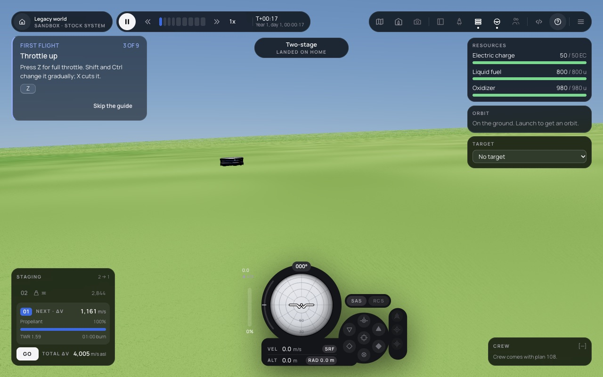
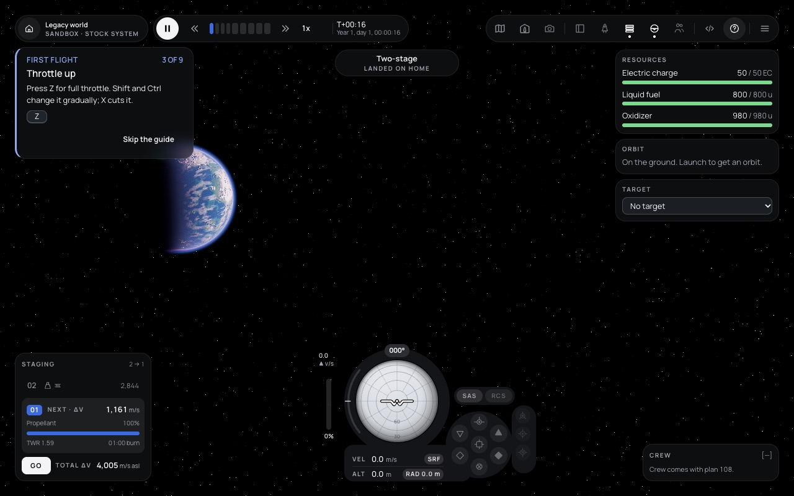
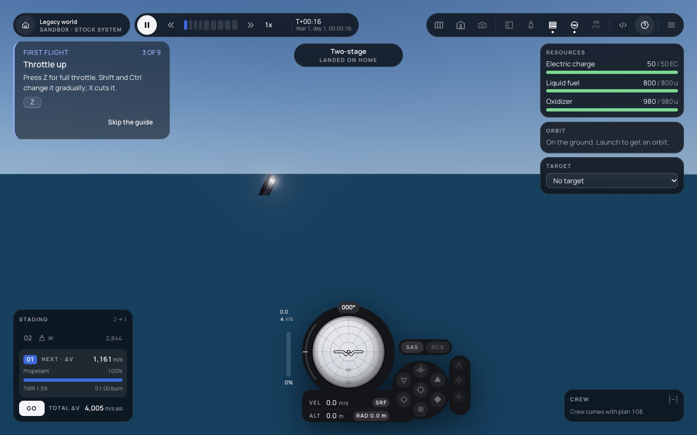
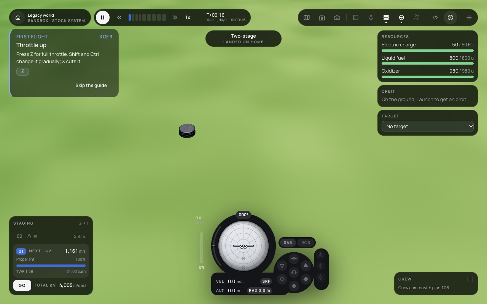
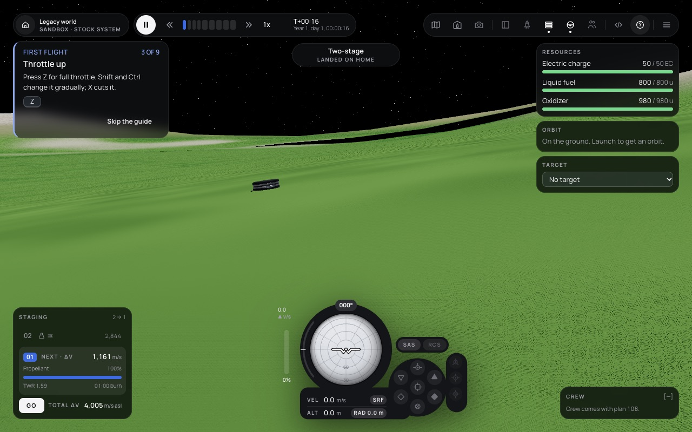

# 071 — Atmosphere, sea and variety on a second hills planet

**Plan:** plans/071-atmosphere-and-sea-on-a-second-planet.md · **Session:** Agent 1 (Lead, Apple M5, 2026-10-18), three-agent team mode · **ADRs:** [0121](../decisions/0121-second-hills-planet-terrain-spec-air-sea-shadows.md) (new), [0090](../decisions/0090-hills-on-a-second-body-in-the-ground-pass.md), [0027](../decisions/0027-environment-rendering-pipeline.md) · **Research:** none

**Status when written: done, merged as `cp/f5-071-second-planet`.**

## What was done

| Where | What |
| --- | --- |
| `packages/core` | `terrain.hills.seed`; `hillsSeedOf` (own seed, else the world's for home, else the world's mixed with the body id); API 0.1.51 |
| `packages/sim/src/bodies.ts` | a hills body's field from `hillsSeedOf` and its site zones |
| `apps/web` | `Catalog.bodyTerrain` (seed and zones of each later hills body) to the renderer |
| `packages/renderer/src/moon.ts` | the hills spec in the biome map, the zone and shift uniforms of both bakes and the CPU twin; the air, sea and shadow chunks |
| `packages/renderer/src/moon-air.ts` (new) | aerial perspective, the sky shell, the sea (Fresnel, glint, patch-local waves) |
| `packages/renderer/src/environment.ts`, `scene.ts`, `atmosphere-model.ts` | the light, fog and exposure over a later body with air; optical depth from surface pressure |
| `packages/renderer/src/terrain-shadow.ts`, `shaders/moon.glsl.ts` | `HILLS_SHADOW_MARCH` (relief 1 500 m, free sine 0.72), the march GLSL as a function of its constants; the hash noise included once |
| tests | `hills-spec.test.ts` (5), `moon-air.test.ts` (3), `hills-ground.test.ts` (the sim's seeded field; shadows on; the bake pins) |

## Found while reading (fixed here)

The three height fields of a later hills body disagreed: the sim built it from the world's terrain seed and the body's site zones, the renderer's CPU twin from the Legacy seed and zone, and the GPU bake with its zone and shift uniforms never set (so no flat zone and the Legacy lattice shift). Journal 059 measured 0 m at the flat zone because its scratch bodies used the Legacy world.

## Numbers (Apple M5, headless Chromium with Metal, 1280 × 800, DPR 1, `high`, a scratch stock mod: `stock.mist` 250 km, 60 kPa, 40 km of air, seed 11; `stock.rock` 420 km, airless, seed 5; not committed)

- GPU bake against the float64 field (600 texels per patch, `Renderer.debug.readMoonPatch`): mist fine 0.0015 / 0.0005 m (worst / mean), mid 0.018 / 0.0007 m; rock fine 0.0028 / 0.0007 m, mid 0.018 / 0.0013 m. Both seeded: the bake now uses the seed and the zones.
- Frame (`renderer.debug.benchmark(30)`, two runs): mist on the ground looking at the horizon 7.1 and 7.3 ms; mist from 600 km, the limb, 5.2 and 5.3 ms; rock on the ground 7.8 and 8.1 ms; the sea 5.9 and 6.0 ms. ADR 0053's `high` budget is 14.4 ms.

## Screenshots

## Decisions and deviations

- **Air through the moon pass**, not a second planet pass (ADR 0121 point 2): aerial perspective in the ground fragment (six view samples) and a sky shell; ADR 0090 had rejected a second planet pass at 9 to 12.5 ms.
- **The default seed** of a later hills body mixes the world's terrain seed with its id: a mod's hills planet without a seed gets new continents (stock has none).
- **Hills shadows** use the craters' march with hills constants on the patches; the ray stays inside the mid patch (5 km), so a mountain farther than that does not shade the camera's ground.
- The first browser run showed two GLSL errors only WebGL could see: the air chunk read the camera before the sea's chunk declared it, and the hash noise was included twice (the atmosphere and the hills ground). The view uniforms come first now, and the hash noise has an include guard (its bytes changed, so the planet pass's bake pins moved; the code is the same).

## Follow-ups

- The image-based light cube (PMREM) still uses the home atmosphere; on a later body with air the reflections are the home sky.
- Clouds on a later body, a base's buildings (out of scope).

## Verification output

See the plan's Log.
