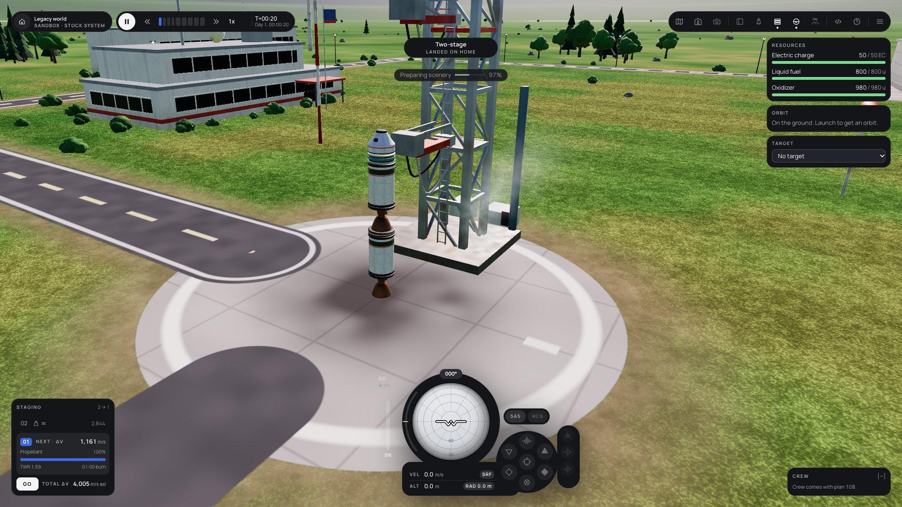
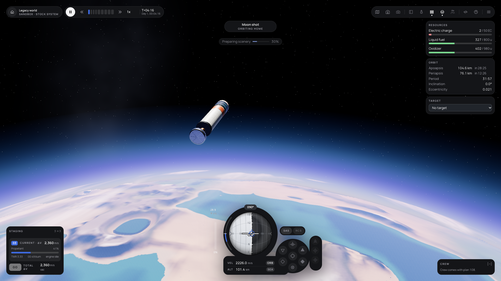
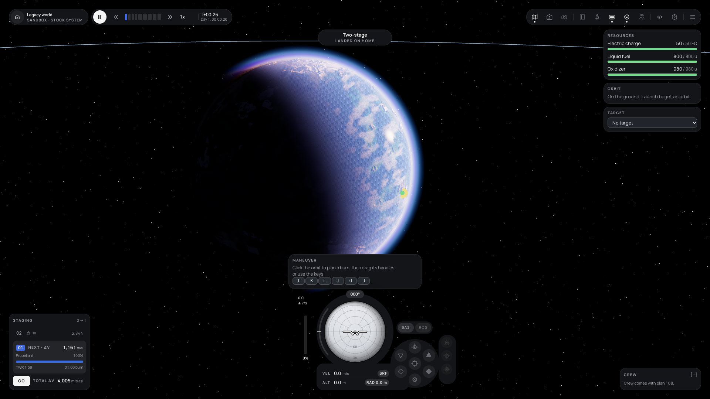
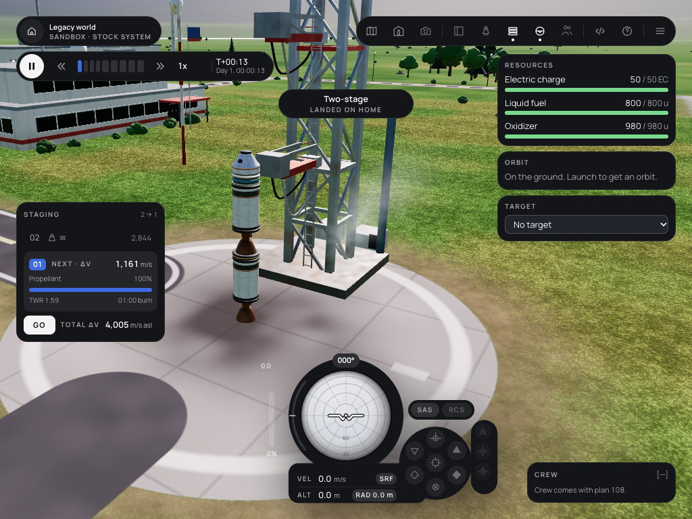

# 088 — UI stage 2: the flight HUD in the refs style

**Plan:** [plans/088-ui-stage-2-flight-hud.md](../plans/088-ui-stage-2-flight-hud.md) · **Session:** Agent 2 (Dev B, MacBook Pro M2 13"), 2026-10-17 · **ADRs:** [0144](../decisions/0144-flight-hud-refs-layout-what-has-no-data-yet.md) (new), [0107](../decisions/0107-ui-adopts-the-refs-visual-language-in-stages.md), [0026](../decisions/0026-design-system-and-hud-architecture.md), [0140](../decisions/0140-refs-tokens-glass-contrast-ui-scale-and-legacy-names.md) · **Research:** none

**Status when written: criteria met except the M5 frame cost and the Firefox run** (Agent 1 and Agent 3; below).

## What was done

| Where | What |
|---|---|
| `lib/hud/InstrumentDeck.svelte` | the navball module: one solid bezel (ball circle, readout pill, pod circle, and a column for our three extra SAS modes), the vertical-speed arc (radius 96, +-40 degrees, log scale to 2 km/s), the heading chip, VEL and ALT with the speed-reference chip and the radar chip, a slim throttle bar; mock geometry in rem times `--k` (ball 176 or 144 px) |
| `lib/hud/navball-draw.ts`, `ui/tokens.css` | monochrome ball (light grey sky, dark grey ground, white horizon, grey ladder), white reticle over a dark outline, the accent for prograde, retrograde and the node, `--danger` for the target pair, light grey for the rest; theme from `--ball-*` tokens |
| `lib/hud/SasButtons.svelte` | the pod: hold in the centre, six modes at the mock's positions, maneuver, target and anti-target in the column beside; SAS pill (aria-label "SAS on/off") and a disabled RCS pill; all `sas-*` test ids and labels kept |
| `lib/hud/WarpControl.svelte`, `WorldCapsule.svelte` | the time capsule (pause, slower, 9 warp segments, faster, `Nx`, MET over the date, catch-up) and the world capsule (home, world name, `MODE · STOCK SYSTEM`) |
| `lib/hud/AppBar.svelte` | the refs toolbar: Map, VAB, Camera; Dock, Vessel, Staging, Nav, Crew; Script, Controls; Menu; flat icons with the 4 px dot; Camera, Dock, Vessel and Crew disabled with the plan that brings them |
| `lib/hud/StageStack.svelte`, `CrewPanel.svelte`, `SituationBar.svelte`, `ui/Toasts.svelte` | staging as the refs (queue, the stage in hand with its delta-v and propellant, GO, total), the crew placeholder, the situation capsule, glass toasts |
| `routes/flight/+page.svelte` | the refs regions with 24 px margins: capsules top left (stacked under 1280 px), toolbar top right (`.tb`), resources, orbit and target below it (`.tr`), staging bottom left (`.bl`), the module with the ball centred (`.bc`), the maneuver editor docked above it, crew bottom right (hidden with the touch controls) |
| `lib/layout/layout-model.ts` | `EDGE` 24 and a 12 px gap above the deck |
| `ui/icons.ts` | home, orbit, hangar, camera, dock, vessel, staging, navball, crew (the mock's paths) |
| numbers | `--font-num` is Manrope with tabular figures (ADR 0140 point 4); code, key caps and hashes moved to `--font-mono` |
| `scripts/capture-hud.ts` | the screenshots below, against a dev server, with `orbit.json` from `release-saves.tool.ts` |

## Side-by-side review against refs `Main` (1920 x 1080)

   

| Region | Refs | This build | Differs because |
|---|---|---|---|
| Navball module | 390 x 262 at (806, 794), ball centred at x 960 | 430 x 262 at (806, 794), ball centre measured at x 960 | a 40 px column for maneuver, target and anti-target (ADR 0144 point 2) |
| Navball | light/dark grey halves, accent prograde | same; target pair in `--danger` | the target pair must stand out from prograde |
| Time | 8 segments, 1 to 10 000x, MET/UT switch | 9 segments to 100 000x, slower and faster buttons, MET over the date | our warp steps; the date replaces the UT switch (081) |
| Toolbar | 3 groups | the 3 groups plus Script and Controls | our panels with no refs slot (ADR 0144 point 5) |
| Staging | named tanks per stage | one propellant bar per stage | the model has no per-tank names |
| Crew | members with suit and signal | `[—]` placeholder | no crew data until 108 |
| Right side | vessel panel | resources, orbit, target cards | the vessel panel is 111 |

**What still looks like a debug view:** the throttle bar and the vertical-speed number at the module's left read as add-ons beside the bezel; the resources meters still use the old green and red tones; the target select is a native `<select>`. Stages 3 to 5 and plans 111 and 112 replace those cards.

## What surprised me

- **The ball, not the module, is centred** in the mock (its centre is 154 px from the module's left); `.bc` is placed by that offset times `--k`, measured at x 960.0 at 1920.
- **The toolbar is 473 px wide**, so it cannot share the 264 px right column; it got its own region, and under 1280 px the time capsule drops below the world capsule so the situation capsule and the toolbar never meet.
- **On tablets staging and the script panel want the same column.** The mobile test caught the Run button under staging at 1180 x 820; staging now steps back (`visibility: hidden`, still measured) while the script panel is open under 1280 px.
- The layout model's 12 px margin made the left column touch the deck by 20 px²; `EDGE` is the refs' 24 and a 12 px gap keeps them apart.
- Some number fields were in IBM Plex Mono through `.num`; switching `--font-num` to Manrope needed the code editor, the script output, key caps and mod hashes moved to `--font-mono` first.

## Decisions made

- [ADR 0144](../decisions/0144-flight-hud-refs-layout-what-has-no-data-yet.md): our extra SAS modes beside the pod, 9 warp segments, placeholders for what has no data, extra cards in the right column until 111/112, the monochrome navball palette, the world capsule's home.

## Open questions / follow-ups

- HUD frame cost on the M5 (criterion 3, Agent 1): measure with the journal 054 method, before and after this plan.
- Firefox e2e (Agent 3, or Agent 1 at the phase gate).
- Plans 108, 111, 112 replace the crew placeholder, take resources, orbit and target into the vessel panel and the dock, and enable the toolbar's disabled buttons.

## Verification output

See the plan's Log.
