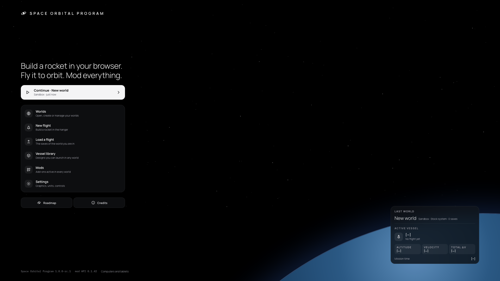
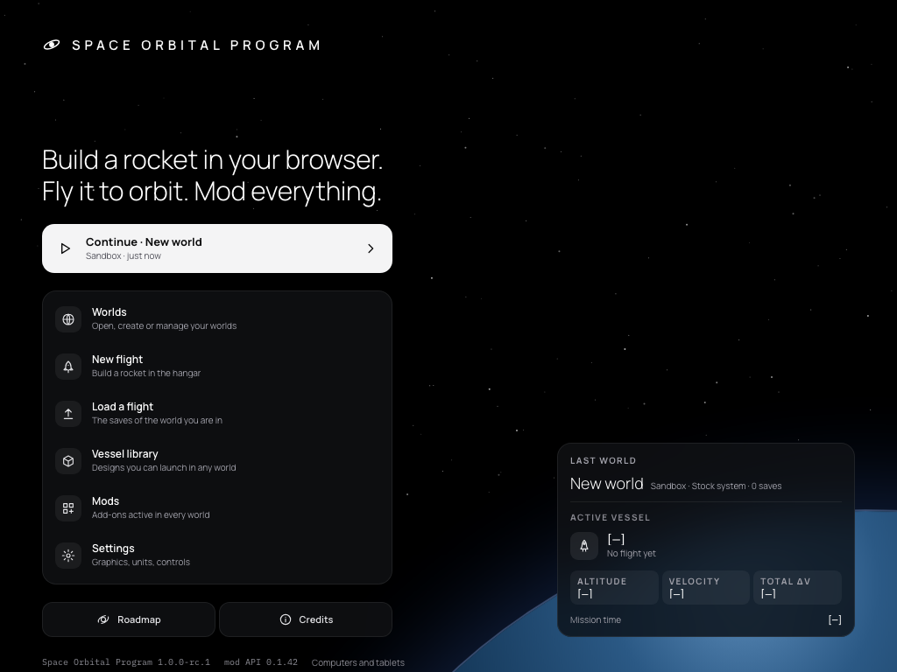
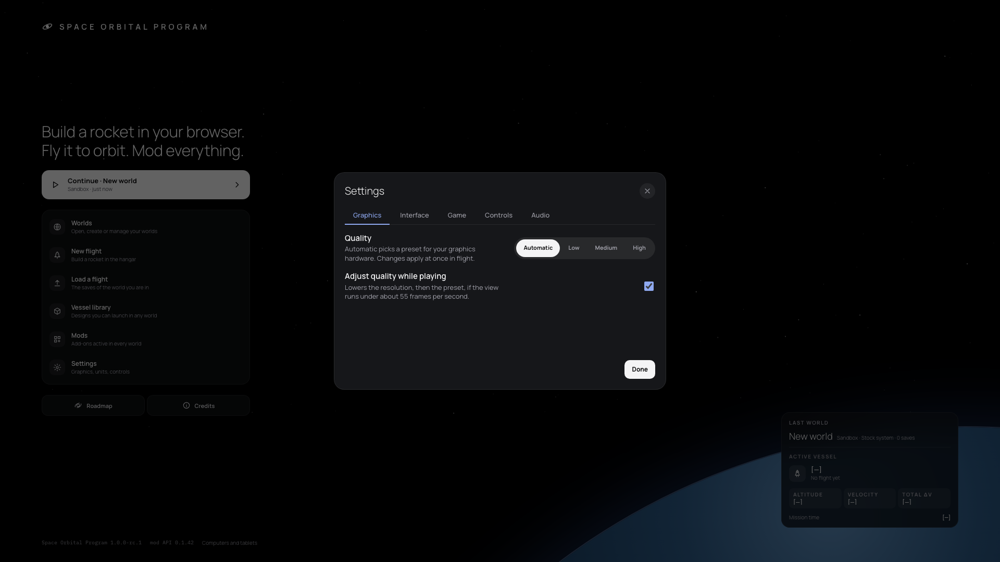
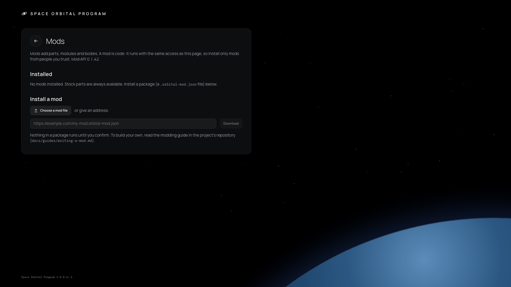
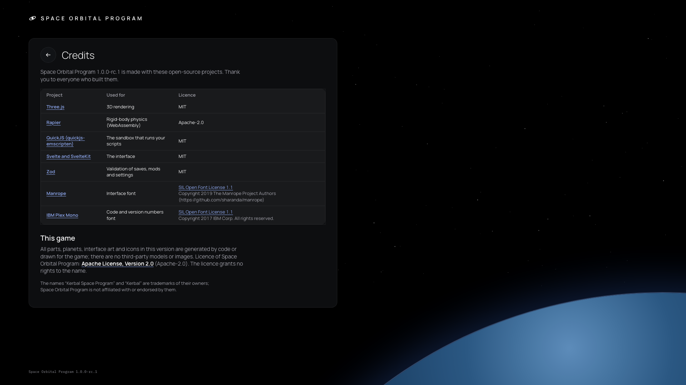
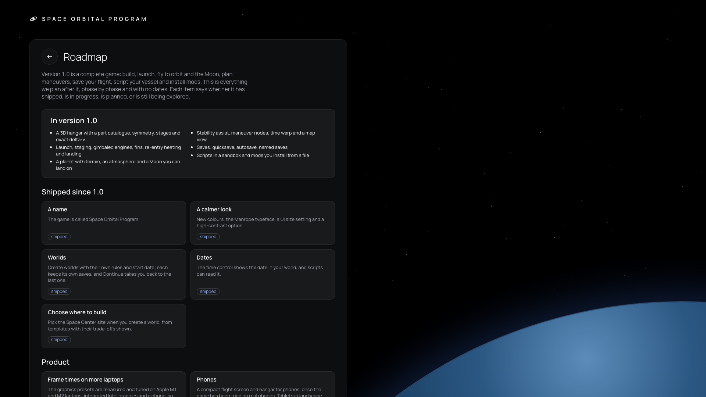

# 089 — UI stage 3: Home, menus, settings and public pages in the refs style

**Plan:** [plans/089-ui-stage-3-menus-and-public-pages.md](../plans/089-ui-stage-3-menus-and-public-pages.md) · **Session:** Agent 2 (Dev B, MacBook Pro M2 13"), 2026-10-18 · **ADRs:** [0107](../decisions/0107-ui-adopts-the-refs-visual-language-in-stages.md), [0140](../decisions/0140-refs-tokens-glass-contrast-ui-scale-and-legacy-names.md) · **Research:** none (refs `Home.dc.html`, `Worlds.dc.html`, `SCREENS.md` §0)

**Status when written: criteria met here except Firefox (not installed on this machine).**

## What was done

| Where | What |
|---|---|
| `ui/SpaceBackdrop.svelte` | the refs space: black, a seeded 160-star field (box-shadows on one dot, no image), the planet limb low on the right |
| `ui/MenuShell.svelte` | the frame of Home and the public pages: wordmark (letter-spaced, 24-grid mark), a 25 rem column, an `aside` slot (bottom right), the version footer; on wide pages the content is one glass sheet |
| `ui/MenuButton.svelte` | three variants: `primary` (light Continue capsule, 56 px, chevron), `row` (a line of the glass menu: icon tile, title, hint, a dot on hover or focus), `compact` (Roadmap, Credits pills) |
| `routes/+page.svelte` | Home: tagline title, Continue · world (mode · save kind and age), the glass menu, Roadmap and Credits, the last-world card; focus returns to Settings when its dialog closes |
| `worlds/LastWorldCard.svelte` | world, mode, system, saves; newest save's vessel, mode, vessel count, altitude and mission time; velocity and Δv `[—]` (no save records them) |
| `ui/Dialog.svelte` | the refs sheet: radius 20, padding 20, light 20 px title, round close button (`Close dialog`) |
| `hud/PauseMenu.svelte` | links styled as the secondary Button |
| `ui/PageHead.svelte`, roadmap, credits, mods | round back button and a light display title; legacy colour aliases replaced by refs tokens |
| `ui/ErrorScreen.svelte`, `ui/LoadingScreen.svelte` | space backdrop and a glass sheet; white progress bar on the track |
| `ui/icons.ts`, `tokens.css` | globe, cube, mods, gear, chevron from the refs; `--selected-muted` |
| tests | `LastWorldCard.test.ts` (2), smoke "keyboard only" (Tab to Settings, Enter, Escape, focus back) |
| `scripts/capture-menus.ts` | the screenshots below |

## Self-review (screenshots)

| | |
|---|---|
|  | Home at 1920 x 1080: matches the refs layout (title at about 250 px, Continue, glass menu of six rows, two pills, card bottom right, footer on one line). |
|  | 1024 x 768: two columns kept (breakpoint at 940 px), everything above the fold. |
|  | Settings in the new sheet; the menu behind is dimmed by the scrim. |
|    | Public pages in one glass sheet with the round back button. |

## What surprised me

- **The menu has more entries than the refs.** The refs list Worlds, Vessel library, Mods, Settings; the game also has New flight, Load a flight and Fly the last vessel, which stay as rows of the same menu (no entry was dropped; the e2e test ids are unchanged).
- **No save records velocity or delta-v**, so the card shows `[—]` for both, as ADR 0107 asks for unknown figures; altitude and mission time come from the save summary.
- **No image backdrop.** The old menu loaded `menu-orbit.jpg`; the refs space is CSS, so the menu draws at once. The file stays in `static/` (social preview pages may link it).
- **Focus after a dialog.** The native dialog returns focus in Chromium; the page also focuses the Settings entry itself so every engine behaves the same.
- **Firefox** is not installed here (only Chromium and WebKit); the three-engine smoke needs Agent 1's run.
