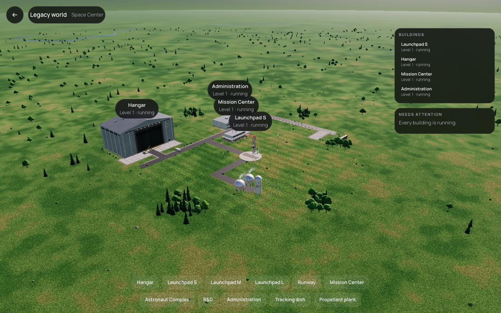
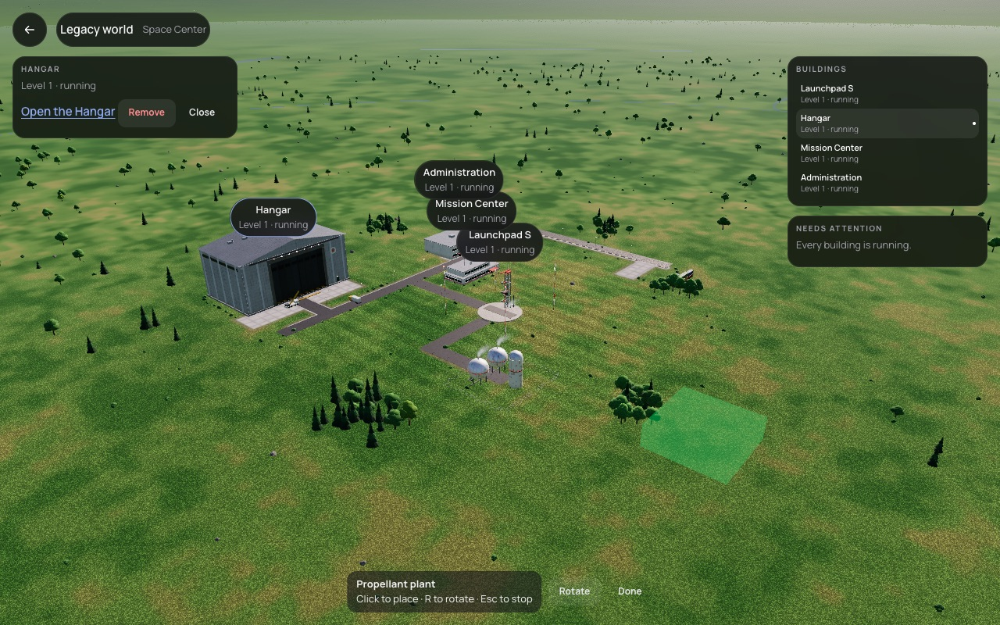
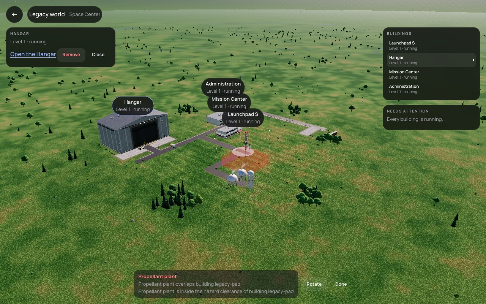

# 091 — Space Center in 3D with free grid placement

**Plan:** plans/091-space-center-3d-and-grid-placement.md · **Session:** Agent 1 (Lead, Apple M5, 2026-10-17), three-agent team mode · **ADRs:** [0117](../decisions/0117-space-center-view-site-mode-picking-and-where-buildings-persist.md) (new), [0097](../decisions/0097-sites-space-center-in-3d-free-grid-bases-and-range-safety.md), [0115](../decisions/0115-building-grid-placement-rules-and-the-legacy-layout.md), [0107](../decisions/0107-ui-adopts-the-refs-visual-language-in-stages.md) · **Research:** none

**Status when written: done, merged as `cp/f2-091-space-center`.**

## What was done

| Where | What |
| --- | --- |
| `packages/renderer/src/site-list.ts` (new) | `SiteBuildingView`, `footprintCentre`, `buildSiteList`: one generator per `visual.generator` (hangar, control, office, launch-pad, runway, dish, tanks, plain block), road cells as slabs, merged per material |
| `packages/renderer/src/site-meshes.ts`, `site-buildings.ts`, `environment.ts` | `LaunchSite` list mode (skips the hard-coded boxes), `setBuildings`, `setGhost`, `pickPlane`, `siteToWorld` |
| `packages/renderer/src/scene.ts`, `renderer.ts` | `setSiteView` (virtual vessel −2 at the site centre, `SITE_RIG_LIMITS` 40 to 2 500 m), `setSiteBuildings`, `setSiteGhost`, `pickSite`, `projectSite` |
| `apps/web/src/lib/space-center/` (new) | `model.ts` (rows, actions, ghost cell, `checkGhost` through core `canPlace`, `confirmPlacement`, rotation, keyboard selection, `spreadLabels`, `steadyLabels`), `SpaceCenterOverlay.svelte`, `space-center-loop.ts` |
| `apps/web/src/routes/space-center/` (new) | the page: plugins on the main thread, build mode (hover ghost, click places, R rotates, Esc stops), remove, `Worlds.setSites` 300 ms after a change |
| `apps/web/src/lib/worlds` | `setSites`, `startInfo` returns the Legacy world's info once it has one; entering a world opens `/space-center` |
| tests | `packages/renderer/test/site-list.test.ts` (4), `model.test.ts` (8), `worlds.test.ts` (+1), `e2e/space-center.e2e.ts` (new), `e2e/worlds.e2e.ts` (enter goes through the Space Center) |
| docs | ADR 0117, `architecture/overview.md` "Space Center", `product/visual-direction.md` |

## Numbers (Apple M5, Browser pane visible, 1000 × 700 CSS px, DPR 2, dev build)

| View | `high` | `medium` |
| --- | --- | --- |
| Space Center, default camera, stock Legacy layout | 18.37 ms | 9.74 ms |
| Flight, on the pad (baseline, same size) | 17.35 ms | — |

The scene at the default camera holds 27 meshes, 23 of them instanced (trees and props); the building group is 8 meshes (one per material bucket) for the four Legacy buildings and their roads. The Space Center costs about the same as the pad view (the planet pass dominates); `high` is over the 16.7 ms budget of ADR 0053 as the flight view is (known issue in STATUS).

## Screenshots and self-review

Against the refs Space Center (`refs/space-orbital-program-ui/docs/SCREENS.md`) and ADR 0025:

- Matches: world capsule top left with the back button, glass pill labels with name and status over each building, Buildings list and Needs attention on the right, detail panel with the one action, build dock bottom centre; one accent colour only on the selected row and the link.
- Deviates: the refs show a status dot and an icon per label; ours has text only. Labels of close buildings stack vertically instead of clustering. The dock wraps to two rows at 1280 px with eleven kinds; the refs have a categorised dock.
- Ghost: green where it fits, red with the reasons where it does not; the reasons are the sim's own messages, but they name the other building by id (`legacy-pad`).
- ADR 0025: the site reads as a place (trees, pad, roads), the buildings are simple procedural blocks; the hangar is the strongest silhouette, the office and control are small at this distance.

## Decisions and deviations

- **Renderer API** is five calls (`setSiteView`, `setSiteBuildings`, `setSiteGhost`, `pickSite`, `projectSite`), not one `setSite` (ADR 0117).
- **Moving** a building is remove then place; drawing roads by hand is left to 096. Roads come from the connection `canPlace` returns.
- **Persistence** is in the world record until a save carries the Space Center (094, 096).
- The flight view keeps its hard-coded site layout until the flight page feeds the list.
- Screenshots are JPEG like the other journal assets (the plan said `.png`).

## What surprised me

- Label positions changed by fractions of a pixel every frame, and Playwright would not click them ("element is not stable"). `steadyLabels` rounds to whole pixels and keeps the old position for moves under 1 px.
- With no vessel, the floating origin and the camera fell back to the planet centre. A virtual vessel at the site centre made the existing pad logic (origin, up, ground clamp) work unchanged.

## Follow-ups

- Show building labels instead of ids in placement reasons (core `canPlace` messages).
- Feed the building list to the flight view so placed buildings appear at launch.
- Label icons and status dots, label clustering, a categorised dock (refs).

## Verification output

See the plan's acceptance criteria; command output follows in the merge report.
