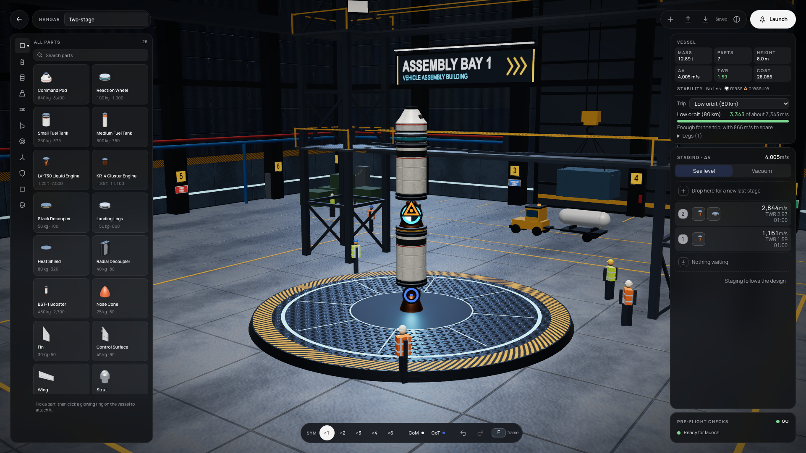
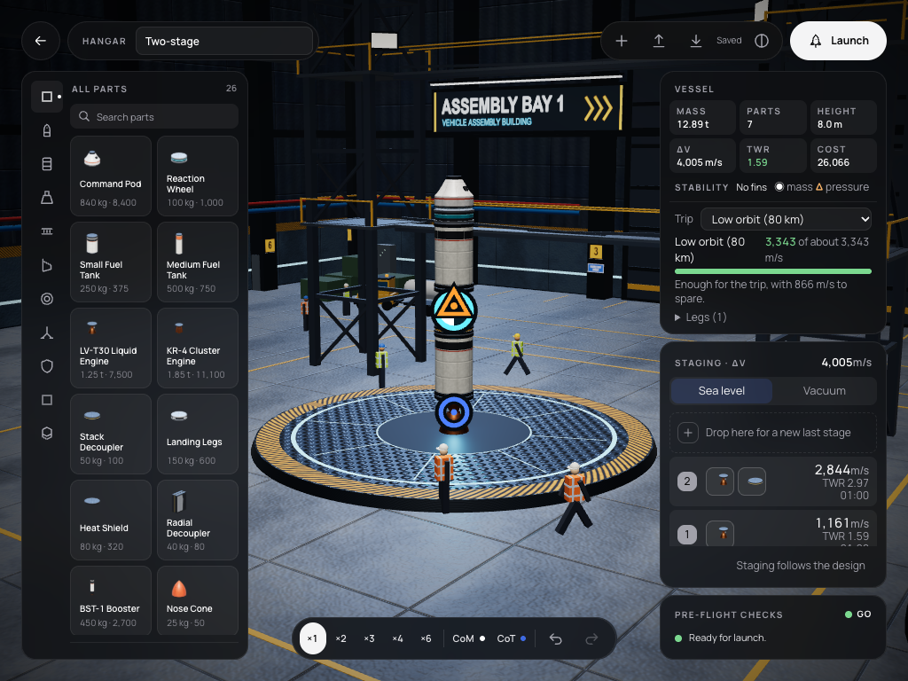

# 093 — UI stage 4: the Hangar in the refs layout

**Plan:** [plans/093-ui-stage-4-hangar.md](../plans/093-ui-stage-4-hangar.md) · **Session:** Agent 2 (Dev B, MacBook Pro M2 13"), 2026-10-18 · **ADRs:** [0148](../decisions/0148-hangar-verdict-levels-tool-pill-and-centre-of-thrust.md) (new), [0107](../decisions/0107-ui-adopts-the-refs-visual-language-in-stages.md), [0146](../decisions/0146-catalogue-categories-are-a-registry.md), [0029](../decisions/0029-vab-editor-state-and-hangar-view.md) · **Research:** none (refs `Hangar.dc.html`, `SCREENS.md` W1)

**Status when written: criteria met here except the frame-time comparison (M5) and Firefox.**

## What was done

| Where | What |
|---|---|
| `editor/checks.ts` | `Check.level` (`no-go`, `caution`) beside `severity`; `verdictOf`; `marginal-twr` (1 ≤ TWR < 1.2, the first stage's engines); `no-control` names the root part |
| `vab/Catalogue.svelte` | one glass panel: a 36 px vertical rail (registry order, a dot on the chosen category, Up/Down keys), capital header with the count, search, two-column cards (mass · cost, `[—]` without a cost), part facts below |
| `vab/TopBar.svelte` | round back, the Hangar capsule with the vessel name, the placing hints in the middle, a file capsule (new, open, save, drawers, contrast) and the Launch pill |
| `vab/StatsStrip.svelte` | the Vessel panel: six tiles (mass, parts, height, Δv, TWR, cost), stability, the trip planner |
| `vab/StageEditor.svelte`, `vab/ChecksList.svelte` | Staging · Δv in the refs panel; Pre-flight with the verdict, a dot per check and the part at fault |
| `vab/ToolPill.svelte` | symmetry ×1 to ×6 (the editor's 1, 2, 3, 4, 6), CoM and CoT toggles, undo, redo, the frame key |
| `vab/controller.svelte.ts`, renderer `stability-markers.ts`, `scene-model.ts` | `cot` marker: the first stage's engines weighted by peak thrust, an accent ring; `showCom`, `showCot` |
| tests | `editor/checks.test.ts` (3), `vab/Catalogue.test.ts` (+1) |
| `scripts/capture-hangar.ts` | the screenshots below |

## Self-review (screenshots)

| | |
|---|---|
|  | 1920 x 1080 with the two-stage example: the refs arrangement (catalogue 340 left, column 300 right, capsules on top, the pill at the bottom); the CoT ring sits at the engine, under the CoM and CoP glyphs. |
|  | 1024 x 768: the pill drops its keys hint and label to fit between the panels; the staging list scrolls inside its panel. |

## What surprised me

- **A verdict is not a severity.** Mapping "no control" to a launch-blocking error would have changed what ADR 0029 allows (a probe without control may still be launched to fall). ADR 0148 keeps severity for blocking and adds a level for the verdict.
- **The refs tools have no editor behind them.** Place, Move, Rotate and Re-root are flows today (arm, pick up), not modes; the pill shows only what works (ADR 0148 point 3).
- **Symmetry ×5 does not exist.** The editor offers 1, 2, 3, 4 and 6 copies; the pill shows those.
- **The 3D hall stays.** The refs draw a flat blueprint grid; the hall, its signs and crew are the game's own and remain (plan scope: "the 3D hall stays").
- **Pane screenshots of WebGL are not reliable** in the app's browser; the Playwright capture with software WebGL was used for the review images.
- **Frame time** (criterion: within 0.2 ms of before on the M5) is for Agent 1: this machine's swap pressure makes a timing here meaningless.
