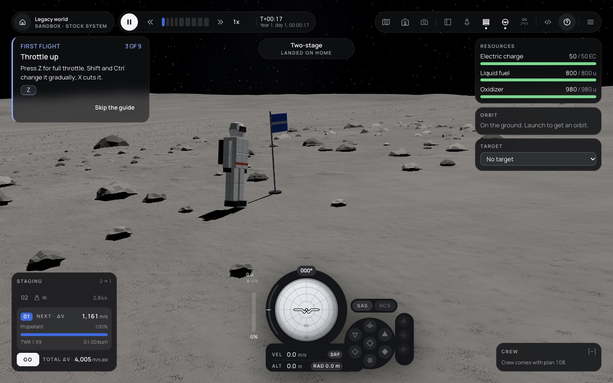

# 109 — EVA: crew as actors outside the vessel

**Plan:** plans/109-eva-crew-outside-the-vessel.md · **Session:** Agent 1 (Lead, Apple M5, 2026-10-18), three-agent team mode · **ADRs:** [0120](../decisions/0120-eva-the-suit-is-a-vessel-commands-walking-jetpack-flag.md) (new), [0100](../decisions/0100-crew-a-full-simulation-every-aspect-a-world-rule.md) · **Research:** none

**Status when written: done, merged as `cp/f3-109-eva`.**

## What was done

| Where | What |
| --- | --- |
| `packages/core` | commands `crew-eva`, `crew-board`, `crew-walk`, `plant-flag`; `ModuleDefinition.keep`; `PartDefinition.walk`; milestone kind `eva`; crew place `eva` (XP 1); API 0.1.49 |
| `packages/sim/src/eva.ts` (new) | step out beside the vessel, board (seat, samples into `VesselState.samples`, the suit removed as recovered), walk (`stepWalking`: upright and the ground speed), plant a flag |
| `packages/sim` | `isKept` (no reaping, surface rails for a flag), `recoverScience` credits the locker, `reachMilestone` |
| `mods/stock/src/eva.ts` (new) | `stock.eva-suit` (85 kg, seat, command, life-support pack, jetpack 50 N at 60 s on 5 kg of `stock.eva-propellant`, reaction wheel, surface sampler, `walk` 1.5 m/s), `stock.flag` (`keep`) |
| `packages/renderer/src/parts/generators/eva.ts` (new) | `suit` (boots, legs, torso, arms, pack, helmet and visor) and `flag` (pole, cloth, foot) |
| `apps/web` | the crew panel's EVA, walk N/E/S/W, stop, plant flag and board; the camera follows the suit; the eva milestone's words |
| tests | `packages/sim/test/eva.test.ts` (4), `crew-card.test.ts` (+1), stock boot and visuals lists |
| tools | `apps/web/scripts/capture-eva.ts` |

## Numbers

- Exit then board: the pod's mass is the same to 1e-9 kg after the round trip (crew has no mass; the suit takes nothing of the pod's).
- On the moon a suit walking north at 1 m/s covers more than 10 m in 12 s, never more than 2 m above the ground and never below it.
- The jetpack in orbit: 5 kg of propellant burnt in about 59 s; the change of velocity relative to the pod beside it is within 1 % of `Isp g0 ln(m0/m1)` (about 31.5 m/s for 95 to 90 kg).
- A planted flag is still there after 60 s; the surface sample taken in the suit is credited when the pod it boarded is recovered.

## Screenshot

The figure is built from boxes and a revolved helmet in the stock palette (white suit, dark pack, orange band); it reads as a person in a suit at a glance and does not copy a KSP kerbal. The flag's cloth is the accent blue.

## Decisions and deviations

- **Walking is a controller, not a force** (ADR 0120 point 3): a force bounded by the ground's friction cancels against the very friction that holds the suit. The first browser run showed the suit falling over as it walked (the velocity was set at the centre of mass, friction acted at the feet); a landed walker now keeps the ground's spin, as a person keeps balance.
- **Walking and the flag are commands**, not module actions: modules cannot spawn vessels or move crew, and the sim owns both.
- **The HUD keeps its vessel**: the camera follows the suit, the staging and readouts stay the launched vessel's. A vessel switcher needs per-vessel designs (ADR 0118 follow-up).
- Seating crew at launch is plan 108; until then a flight has crew only through the dev hook or a save, so the crew panel's EVA button shows only then.

## Follow-ups

- A vessel switcher (focus the suit's readouts), suit radios (121).
- The jetpack has no translation input (RCS); it pushes along the suit's up axis.

## Verification output

See the plan's Log.
