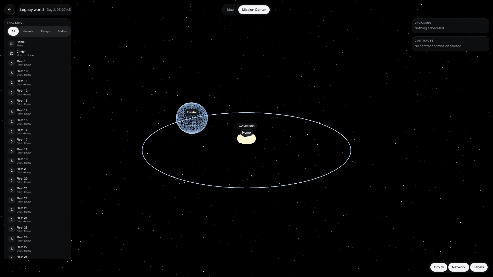
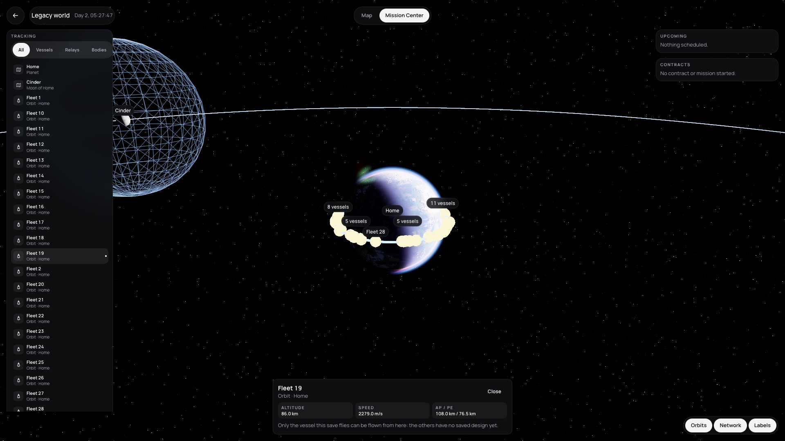
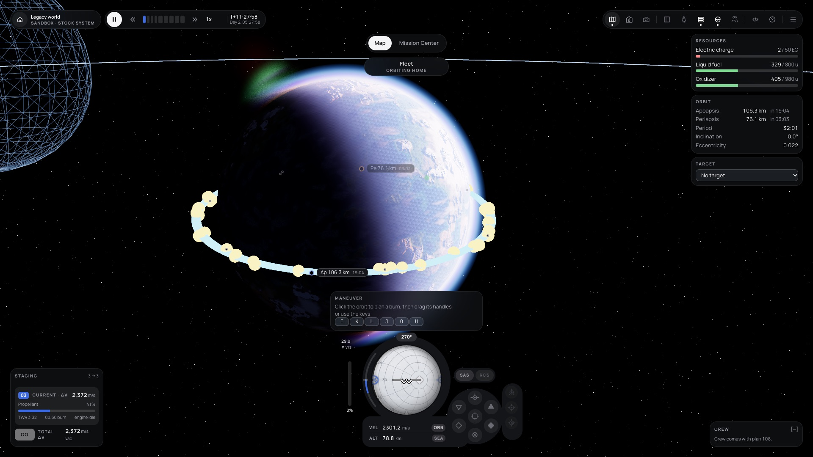

# 113 — Mission Center: one place for the whole system

**Plan:** plans/113-mission-center.md · **Session:** Agent 1 (Lead, Apple M5, 2026-10-18), three-agent team mode · **ADRs:** [0118](../decisions/0118-mission-center-system-scope-own-sim-and-fly.md) (new), [0102](../decisions/0102-vessel-panel-part-actions-dock-panels-and-the-mission-center.md), [0107](../decisions/0107-ui-adopts-the-refs-visual-language-in-stages.md) · **Research:** none

**Status when written: done, merged as `cp/f4-113-mission-center`.**

## What was done

| Where | What |
| --- | --- |
| `packages/renderer/src/scene.ts`, `renderer.ts`, `map.ts` | `setMapScope('vessel' \| 'system')` (root body, start at three times the largest moon apoapsis, far limit fifty), `setMapHighlight(key)`, `setMapLayers({ orbits })`, `VesselMarker.setColor`; test `map-scope.test.ts` |
| `apps/web/src/lib/mission-center/` (new) | `model.ts` (tracking rows and filters, Upcoming from nodes and the next sphere change, `warpToCommand`, the object card, `fly`, `clusterLabels`), `MissionCenterOverlay.svelte`, `mission-center-loop.ts` |
| `apps/web/src/routes/mission-center/` (new) | the page: its sim from `?load=`, the newest save or the start info; labels, links, pick, Fly through `SaveController.autosaveId` |
| `apps/web/src/lib/hud/MapSwitch.svelte` (new), `routes/flight` | the `Map \| Mission Center` switch in the flight's map view |
| `apps/web/src/lib/hud/WorldCapsule.svelte` | home goes to the Space Center (plan 091's scope, missed there) |
| `apps/web/src/lib/space-center/model.ts` | the Mission Center building opens `/mission-center` |
| `packages/sim/test/fleet-save.tool.ts` (new) | 50 headless launches to low orbit, written as a game save |
| tests | `mission-center/model.test.ts` (7), `map-scope.test.ts` (2), `space-center/model.test.ts` (+1), `e2e/mission-center.e2e.ts` (new) |

## Numbers (Apple M5, Browser pane visible, 1920 × 1080 CSS px emulated, DPR 2, `high`, governor off)

`renderer.debug.benchmark(60)`, three runs each, production build (`NODE_ENV=development`, `scripts/serve.ts`):

| View | Vessels | ms per frame |
| --- | --- | --- |
| Mission Center, system scope | 50 | 8.91, 8.97, 9.04 |
| Mission Center, system scope | 2 | 9.21, 9.25, 9.07 |
| Flight map view (the same save, vessel scope) | 50 | 16.66, 17.05, 16.92 |

The budget (map view + 1 ms) holds: the system scope costs about half of the flight's map view, where the planet fills the screen, and 50 vessels cost nothing measurable over two. Whole-page intervals in the Mission Center: 15.3 to 15.4 ms mean, median 16.6 (the pane's display interval).

## Screenshots and self-review

Against refs `Map.dc.html` (Mission Center) and ADR 0025:

- Matches: full-bleed system on black, world capsule top left, the `Map | Mission Center` tablist top centre, Tracking with All / Vessels / Relays / Bodies on the left and the crew roster below it, Upcoming and Contracts on the right, the object card bottom centre with three facts and Fly, the layer pill bottom right.
- Deviates: the refs draw the planet as a large gradient disc; ours is the real planet, a few pixels at the system scope. Selection is a highlighted orbit, a larger marker and the accent label border, not a ring. The refs' agency strip and stats bar are one row of three tiles, shown only with the economy on. The Tracking list is long with 50 vessels (it scrolls), and the crew panel sits below it.
- The fleet: at the system scope 32 of 50 vessels are in front of the planet and share one "32 vessels" label; zooming in splits it into clusters.

## Decisions and deviations

- **Fly flies the save's focus vessel only** (ADR 0118 point 5): the save holds one design, and the flight HUD needs it. The criterion was narrowed when the plan was refined.
- **Upcoming warp time** for a node is the node minus the maneuver panel's 30 s lead (the panel also subtracts half the burn; the Mission Center has no thrust figures).
- **Labels cluster**: three or more vessels within 24 px share one label.
- The world capsule's home went to `/` since 091; it now goes to the Space Center.

## What surprised me

- A body's centre projects as hidden by the body itself, so body labels vanished until the page accepted a hidden point for bodies.
- Fifty launches in a row: every launch after the 35th was lost because the apoapsis grew 2 km each time and the stage ran out of fuel for the circularisation. The tool now cycles 100 to 114 km.

## Follow-ups

- Per-vessel designs in the save, then Fly for any vessel.
- Relays (117), contract deadlines (099) and construction done (096) in Upcoming and Tracking.
- A schematic body disc at the system scope (refs), selection rings.

## Verification output

See the plan's Log for the commands and their results.
