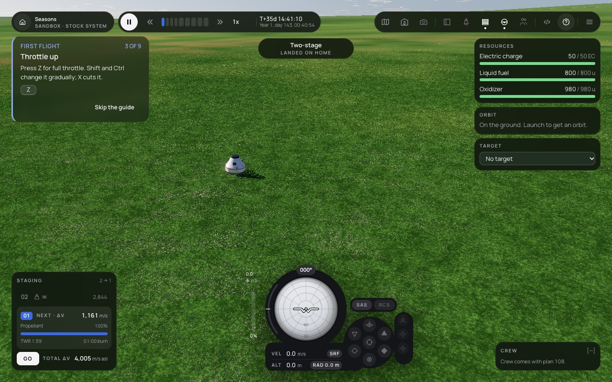
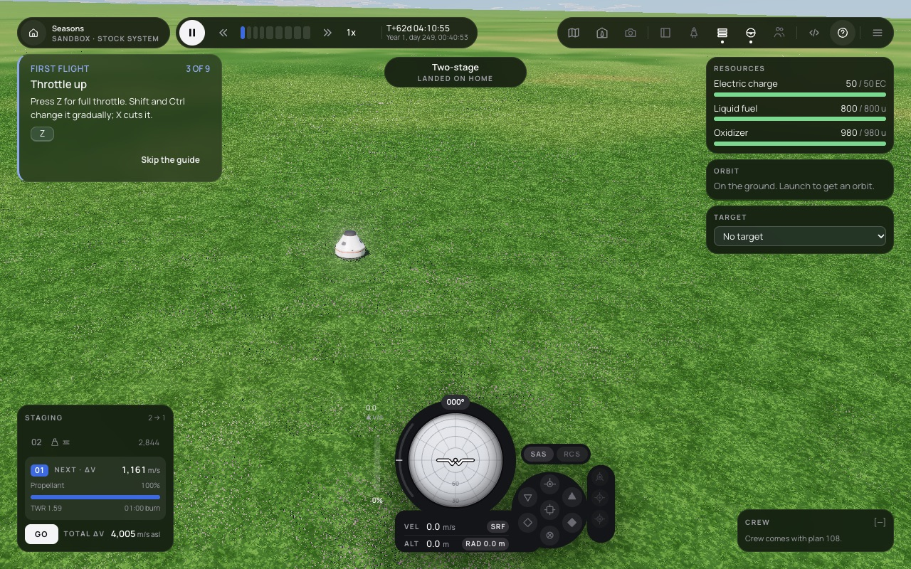
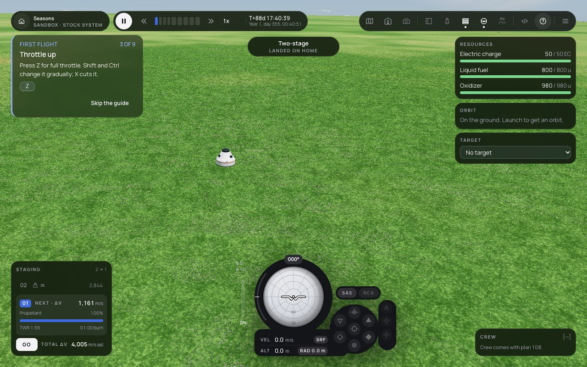

# 122 — The Sun as root, axial tilt and seasons in the stock system

**Plan:** plans/122-sun-root-axial-tilt-seasons.md · **Session:** Agent 1 (Lead, Apple M5, 2026-10-18), three-agent team mode · **ADRs:** [0119](../decisions/0119-sun-at-the-root-home-body-tilt-as-orbit-inclination.md) (new), [0103](../decisions/0103-time-calendar-sun-and-the-real-solar-system.md), [0141](../decisions/0141-calendar-on-the-root-body-epoch-from-j2000-and-a-year-only-with-an-orbit.md) · **Research:** none

**Status when written: done, merged as `cp/f5-122-sun`.**

## What was done

| Where | What |
| --- | --- |
| `mods/stock/src/bodies.ts` | `stock.sun` (star, 1.7565e28 kg, radius 261 600 km, the calendar), the home planet as its child on `HOME_ORBIT` (13.6 Gm, i = 23.44°, node and phase solved so the sun at t = 0 is the old fixed one) |
| `packages/core` | `BodyDefinition.star`; save format 6 (`SimSave.home`, migration 5 to 6 from `bodies[0]`); `seasons.ts` (`positionFromStar`, `subSolarLatitude`); `homeBodyOf` in `sites.ts`; API 0.1.48 |
| `packages/sim` | the home is named (option, save, primary site, root); `Sim.home`; stars get no terrain; `stateInParent` keeps the last state per body |
| `packages/renderer` | `SceneConfig.home` keys the planet pass, environment and site; a star is an emissive sphere; the environment's sun is the star's direction each sync |
| `apps/web` | the worker's catalog carries `home`; the flight loop, HUD, VAB, trip planner, worlds and Mission Center use it (or `homeBodyOf`); the renderer gets the star flag and the home id; Star / Planet / Moon labels |
| tests | `sun-parity.test.ts` (frozen flight), `save-format.test.ts` (frozen v5), `seasons.test.ts`, `sun-body.test.ts`; 30 tests rekeyed from `bodies[0]` and the 21 600 s day |
| tools | `fixtures/make-save-v5.ts`, `fixtures/make-sun-parity.ts`, `apps/web/scripts/capture-seasons.ts` |

## Inventory (step 1)

About 70 places took the first or parentless body as home or the sun as fixed: sim 22 (`core.root` from `bodies[0]`, the resume check, the plain terrain field, test helpers), core 7 (calendar on the root, docs), renderer 14 (`config.bodies[0]` as primary, `i > 0` as moon pass, the fixed `starDirection`), web 20 (`catalog.bodies[0]`, `parent === undefined` as home, the renderer sort), stock 3, save 6. Kepler had none: its patched conics already handle a home that orbits a parent.

## Numbers

- Parity: the moon rocket's ascent (orbit at t = 246.54 s) and its transfer to the moon (capture at t = 28 316 s) match the frozen flight from before the Sun within 1e-6 relative, in position, velocity and time.
- Seasons (core): over one year the sub-solar latitude reaches +23.44° and -23.44° within 0.01°; at t = 0 it is 0.2 rad, the old fixed sun.
- Noon sun elevation at latitude 40° (renderer `sunElevationDeg` beside the orbit's prediction): south solstice 26.559° (26.561), equinox 50.061° (50.059), north solstice 73.441° (73.440); the solstices differ by 46.882° = 2 × 23.441°.
- Year 9 203 393 s; solar day 21 650.8 s (rotation 21 600 s kept); home SOI 84 159 km.
- Frame time on the pad (M5, pane 826 × 930 DPR 2, `high`, `renderer.debug.benchmark(60)`, three runs each): main 23.21, 22.95, 22.98 ms; 122 23.01, 23.31, 23.34 ms (+0.17 ms, noise). Whole-page interval mean 25.9 against 25.8 ms. The sun at load: 29.75° on main, 29.65° here.
- Sim cost: the career bot's 3 600 days take 8.7 s alone against 7.4 s before (the home's orbit is propagated at every comms sample); its wall budget went from 30 to 45 s, because under the parallel full suite it read 30.2 s.

## Screenshots

## Decisions and deviations

- **The tilt is the orbit's inclination** (ADR 0119 point 4), not a tilted pole: a tilted pole would turn the launch site and the moon's equatorial orbit in inertial axes and break the parity criterion.
- **The criterion's "solstice and equinox differ by 2 × tilt"** holds between the two solstices; solstice to equinox is one tilt. The screenshots show all three.
- **The pod at 40°** was placed through the dev hook: the flight launches at (0, 0) until plan 094 launches from the world's site.
- **The day**: the rotation stays 21 600 s, so the calendar's solar day is 21 650.8 s and dates read "Year 1, day N"; constants written against 21 600 s (stock data rates, crew rest) are 0.2 % off until they read the calendar.

## What surprised me

- Many tests read `snapshot.bodies[0]` as home or compared system-frame positions with home at the origin; one "jump" of 185.7 m per step in the SOI test was the home planet's orbital speed (9.3 km/s × 0.02 s), not a frame error.
- A warp-to to a non-integer day boundary (21 650.8 s) can stop within the loop's 1e-6 epsilon before the sim arrives: the career bot now waits for warp 1.

## Follow-ups

- Day-based constants read the calendar (stock data, crew).
- Scripts see Sun-centred `system` positions now: the scripting guide should say so.
- The map's system scope frames the whole Sun system; a home-system scope for the Mission Center.

## Verification output

See the plan's Log.
