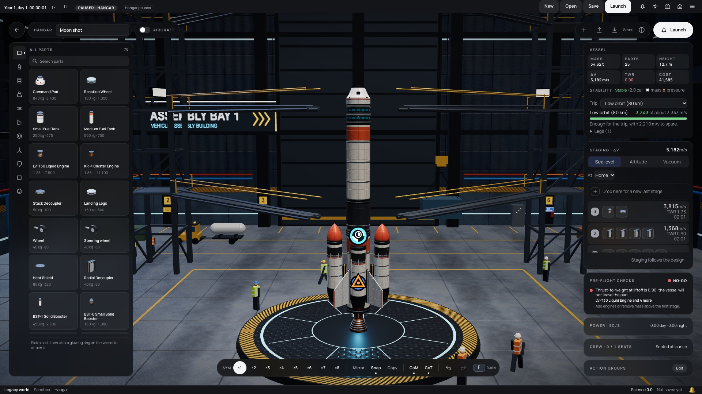
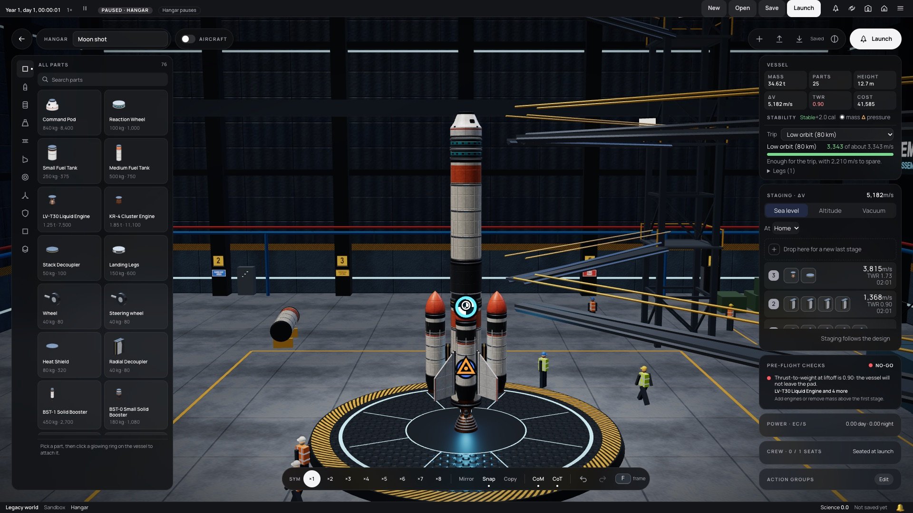
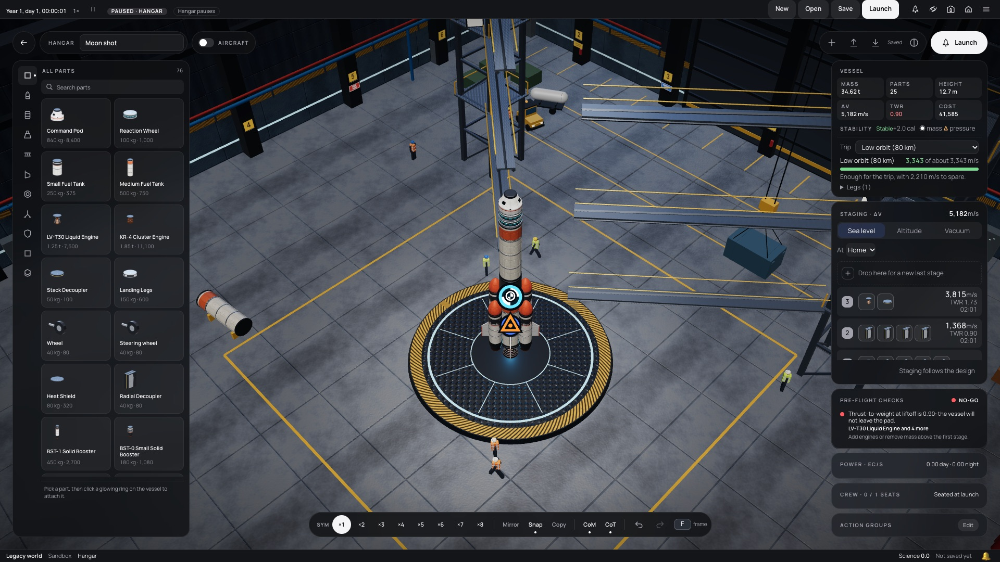
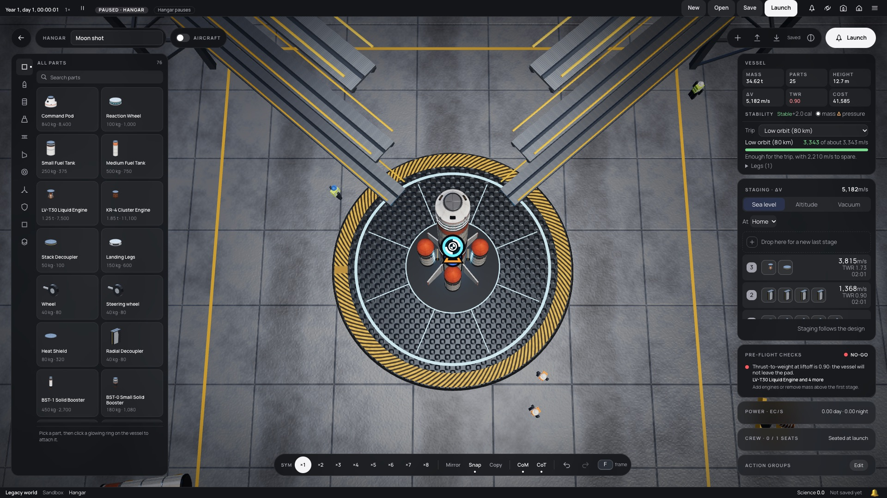

# 220 — Roomier Hangar and high detail in the Hangar

**Plan:** [plans/220-roomier-hangar.md](../plans/220-roomier-hangar.md) · **Session:** Worker A, 2026-10-20 · **ADRs:** none new (0029, 0053 related) · **Research:** Rancangan §8b.8, §8b.10

## What was done

| Where | What |
|---|---|
| `packages/renderer/src/vab/hangar.ts` | `TOWERS` at (−15, −13) and (15, −13); the swing arms are their own group (`arms`), aimed from each deck at the vessel's axis; `Hangar.setVesselRadius(r)` stops them `ARM_CLEARANCE` (1 m) outside the vessel, or at the platform edge plus 0.2 m without one, rebuilt only on a change over 0.1 m; floodlights move with the towers (820 cd, 64 m reach, for the longer throw) |
| `packages/renderer/src/vab/hangar-movers.ts` | tug lane back to z = −18.6 … −21.6 and x = ±16; the pacing worker and the two by the left tower moved off its base; the worker at the platform edge moved out to 7.1 m |
| `packages/renderer/src/vab/orbit-camera.ts` | `VAB_CAMERA_LIMITS`: max distance 70 m, room half 27.5 m, pan box 18 m |
| `packages/renderer/src/presets.ts`, `vab/view.ts` | `hangarDetail` (the high preset's part detail on every preset); the view passes the main group's widest reach to `setVesselRadius` on each scene |
| `apps/web` | `capture-hangar.ts` takes four angles; the Hangar test hook gains `stats()` and `aim()` for captures |
| tests | `hangar.test.ts` (towers, arms with and without a radius, mover paths), `presets.test.ts` (Hangar detail), the crane case in `vab-hangar-life.test.ts` |

## Captures

Moon shot on the platform, 1920×1080, software WebGL (`SHOT_URL=… bun scripts/capture-hangar.ts`):

| Front | Side |
|---|---|
|  |  |
| **45° high** | **Top-down** |
|  |  |

## Triangle counts

- The room: 15 112 triangles before, 15 028 after. The arms are shorter overall: they now point at the stack, where they used to run parallel to x.
- The moon shot in the Hangar: 26 092 triangles in 53 draw calls, 22 parts instanced, now the same on every preset. Before, the low preset used 16 segments a round part where high uses 32.

## What surprised me

- **The old arms never pointed at the vessel.** They ran along x from towers at z = −7, so they came no closer than 7.2 m to the axis. Moved back to z = −13 they would have ended in the air, so they now run along the line to the axis.
- **The debug camera skips the room limits.** A top-down shot from 52 m put the camera above the ceiling and drew the lamp housings as black discs. It now shoots from 28 m.

## Decisions made (link ADRs)

- No ADR: the plan set the numbers. The arm reach uses the main group's bounding box, measured from the platform axis.
