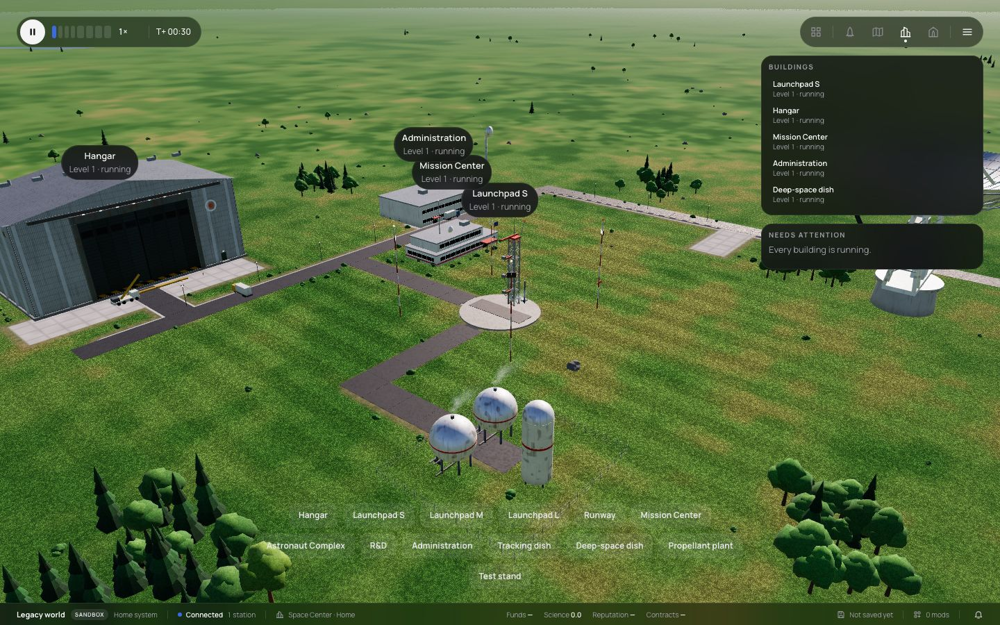
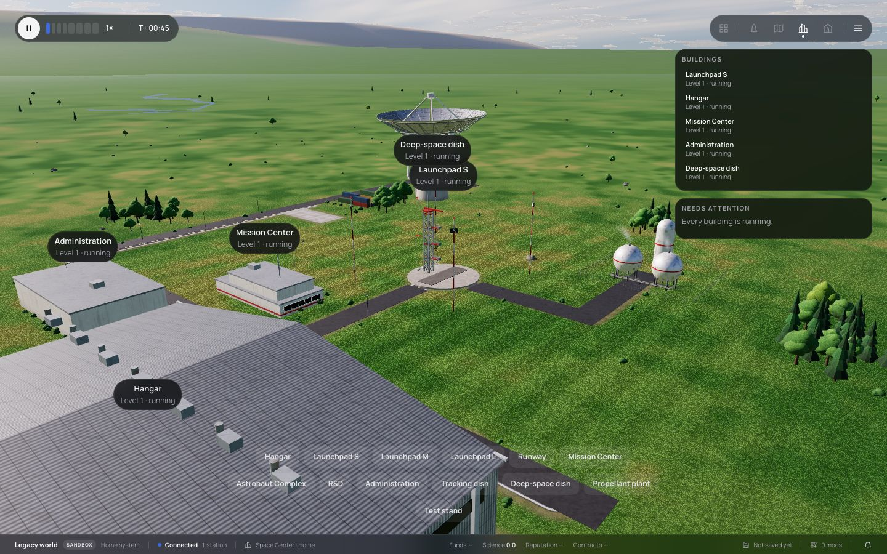
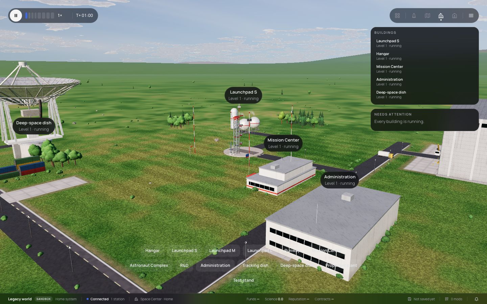
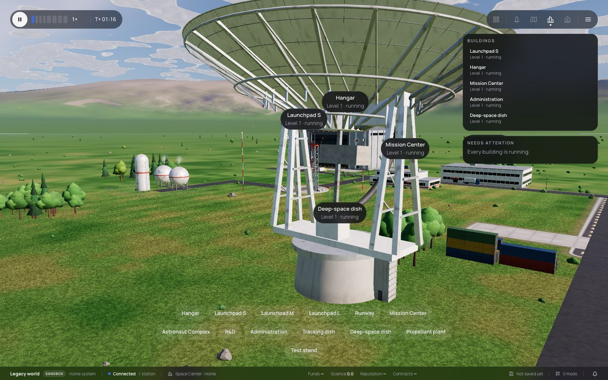

# 234 — Deep-space dish

**Plan:** [plans/234-deep-space-dish.md](../plans/234-deep-space-dish.md) · **Session:** Worker C, 2026-10-20 · **ADRs:** [0228](../decisions/0228-deep-space-dish-model-tracking-station-tiers.md), [0222](../decisions/0222-ui-fidelity-build-menu-branch-centers-deep-space-dish.md), [0185](../decisions/0185-comms-link-budget-bands-rate-ladder-inspector.md) · **Research:** [deep-space-dish.md](../research/deep-space-dish.md)

## What was done

| Where | What |
|---|---|
| `mods/stock` | `stock.deep-space-dish`: 8 × 8 cells, station tiers 4–6 |
| `packages/core` | station ranges and apertures for six tiers; the tracking dish 9, 12, 18 m |
| `packages/renderer` | `site-dish.ts`: the model (near and far), `aimOf`, `trackStep`; the site draws dishes as moving groups and tracks the vessel or the nearest moon; `debug.dishAims()` |
| tests | `site-dish.test.ts` (4: footprint, LOD, slew limits, stow), `packages/sim/test/deep-space-dish.test.ts` (a vessel at the moon's distance gets about 17 dB more and a higher rate), `comms-budget.test.ts` (9 m tier 1), `e2e/deep-space-dish.e2e.ts` |

## Screenshots (Chromium, 1440 × 900, Legacy world, the dish in stow)

`[manual]` The owner judges the realism.

## What surprised me

- **A 70 m reflector does not turn inside an 8 × 8 cell footprint** with its subreflector and counterweight: the model is the 64 m class (the DSN's antennas before their 70 m upgrade); level 2 counts as the 70 m upgrade in the link budget.
- **The site's buildings are merged and static.** The dish is the first moving building: its own nested groups with the site's materials, left out of the merge.
- **The Space Center camera looks at the pad**, so the e2e cannot frame the dish; the fourth quarter turn happens to stand next to it.
- **The tracking dish carried a 70 m aperture** on a 20 m footprint since plan 116. It is 9–18 m now; one link budget test moved by 20 log 0.9.

## Decisions made (link ADRs)

- ADR 0228. In the plan's Log: the reference geometry and the 64 m choice.

## Open questions / follow-ups

- A camera that frames a selected building at the Space Center would help screenshots and players alike.
- The flight's legacy site layout has no list buildings, so the dish moves only at the Space Center.
