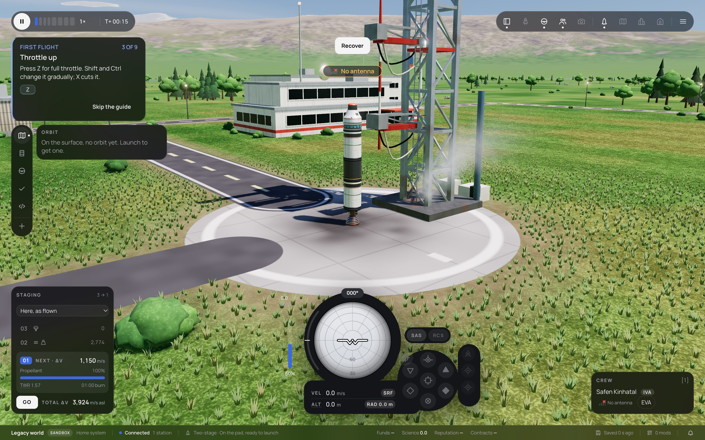
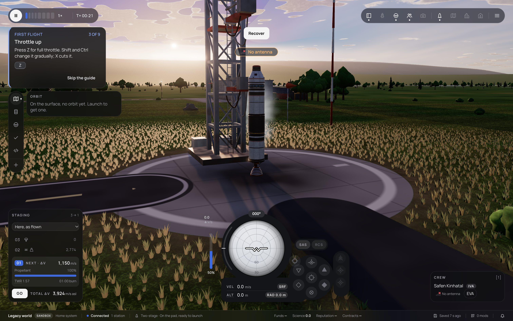
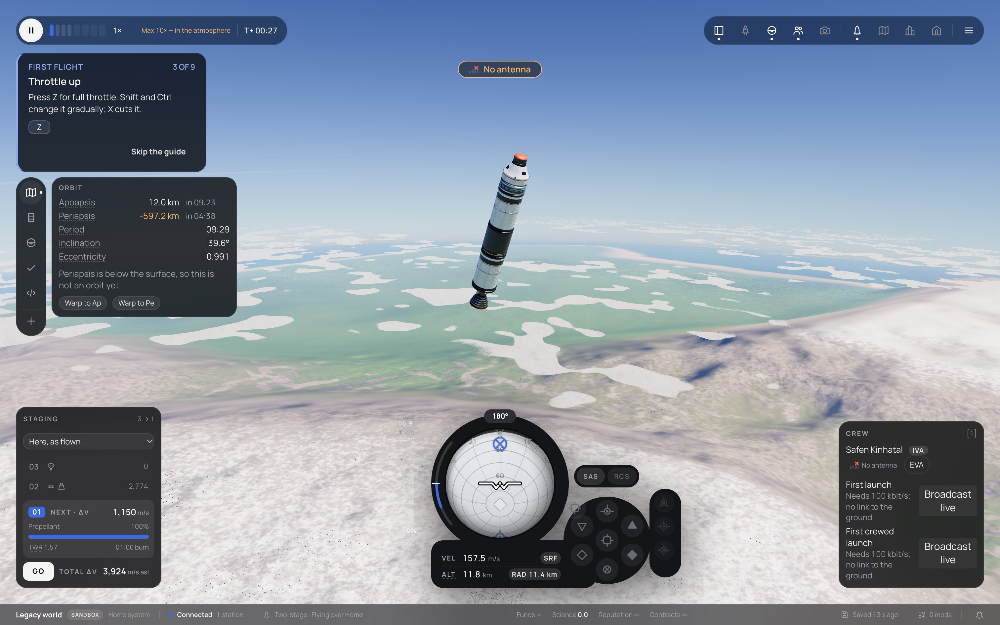
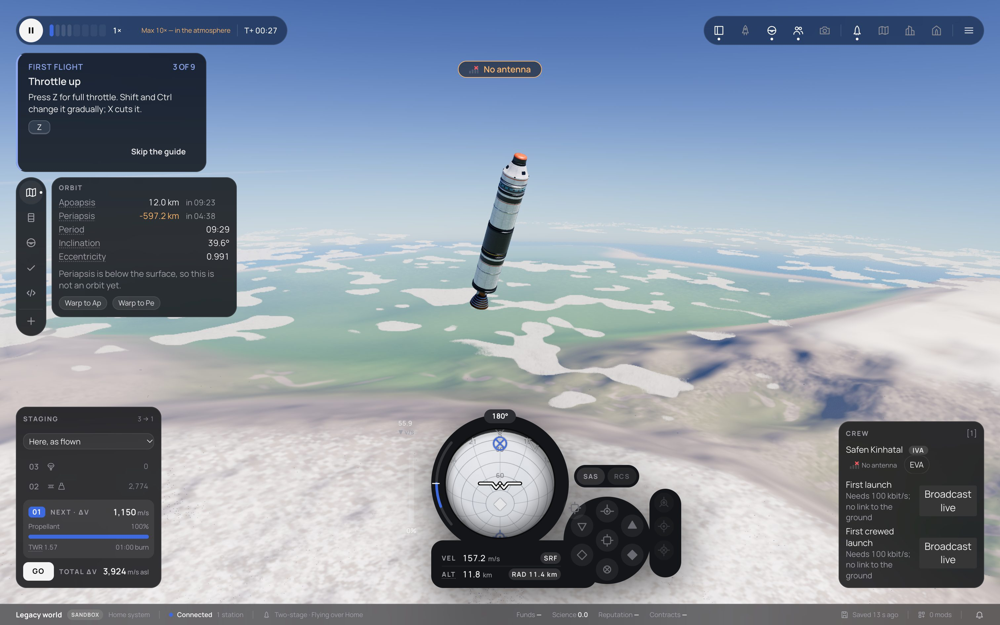
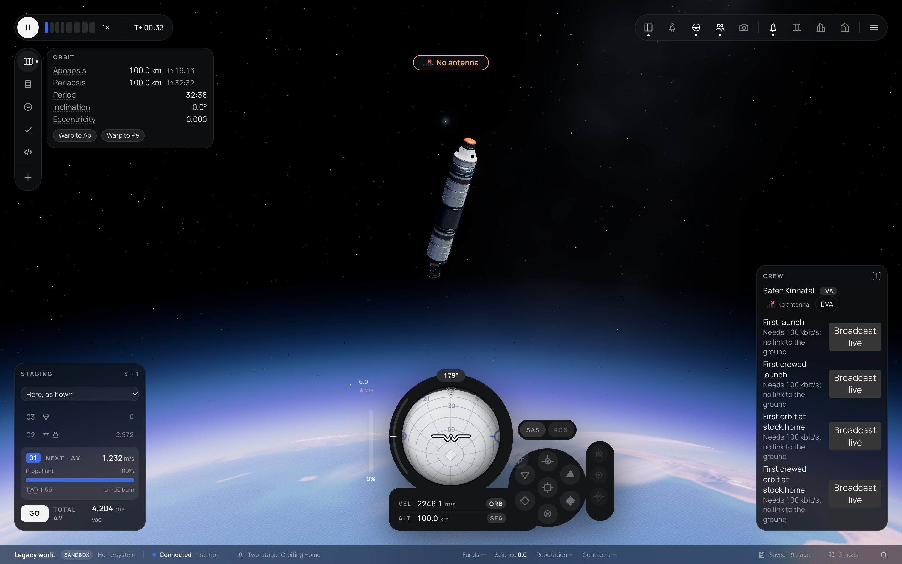
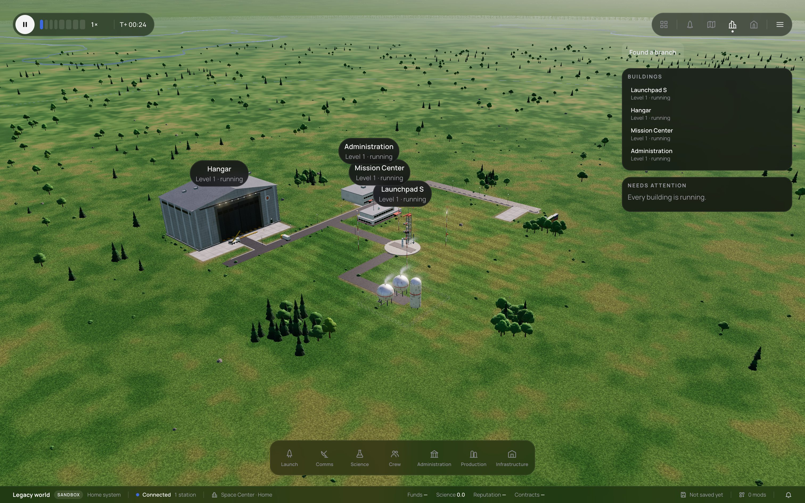
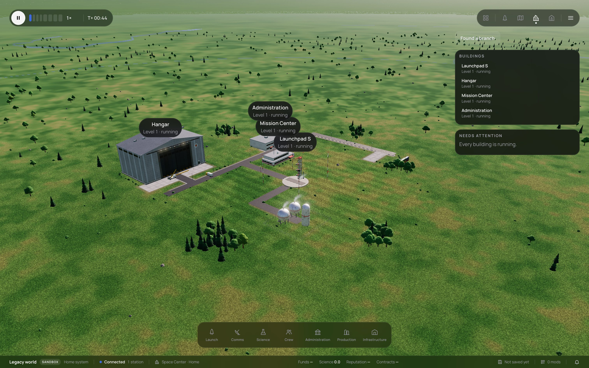

# 252 — Graphics phase 1: a pixel budget for the planet pass, baked cloud shadows on high, lighter MSAA and shadows at Retina, spaced PMREM recaptures

**Plan:** [plans/252-graphics-retina-quick-wins.md](../plans/252-graphics-retina-quick-wins.md) · **Session:** Worker A, 2026-10-20 · **ADRs:** [0234](../decisions/0234-planet-pixel-budget-retina-quick-wins.md), 0053, 0061, 0064, 0086 · **Research:** [refs/graphics-performance/](../../refs/graphics-performance/README.md), [07-m5-baseline.md](../../refs/graphics-performance/07-m5-baseline.md)

## What was done

| Where | What |
|---|---|
| `presets.ts` | `planetPixels` (the pixel budget: 1.75 Mpx), `high` on the baked cloud-shadow map, `msaaSamples`, `shadowSizeAt`, `canvasAntialias`, `RETINA_RATIO` |
| `half-res.ts`, `planet.ts` | `budgetScale` (a scale in [0.5, 1] in steps of 0.05, rounded down); `PlanetPass.setPixelBudget`; the planet pass runs at the smaller of the budget's scale and the governor's; the edge pass's `uMarchScale` follows the active scale. The upsample and edge shaders already worked from the ratio of the two sizes, so no shader changed |
| `post.ts`, `environment.ts`, `renderer.ts` | 2 MSAA samples and a shadow map of at most 2048 from pixel ratio 2 (decided on the ratio before the governor's render scale, so a render-scale step does not rebuild the chain); no canvas MSAA from ratio 2 |
| `recapture-gate.ts`, `environment-light.ts` | at most one image-light capture per 1.5 s; the first capture and a preset change are not held back |
| `apps/web/scripts/capture-graphics.ts` | the five-view look check |
| tests | `retina-budget.test.ts`: the budget maths for 1080p, 1440p, Retina and 4K, the planet's scale and the governor's half rung, MSAA, shadows, the canvas, the gate |

## Numbers (M5, 1512 × 945 at ratio 2, sync ms; details in 07-m5-baseline.md)

| `high` | pad | 3 km | 12 km | orbit |
|---|---|---|---|---|
| before | 43.65 | 47.32 | 50.37 | 27.10 |
| after (1.75 Mpx) | **16.53** | **15.10** | **16.75** | **9.88** |

- 2.6× to 3.1× cheaper; at ratio 2 `high` costs 4.2 ms more than at ratio 1 (30 ms before). `medium` at ratio 2 reads 13.6 / 13.1 / 14.5 / 9.3 ms.
- **Governor on, 120 s on the pad (AC):** p50 16.7 ms, p95 25.0 ms, p99 25.2 ms, 12 % of the frames over 16.7 ms, 0.1 % over 33.3 ms; the governor moved three times between `high` at 100 % and 85 %. The target (p95 ≤ 16.7 ms) is met by the sync numbers and **not** by the interval trace: the M5's display runs at 120 Hz and a frame that just misses 16.7 ms takes the third vsync. Remaining levers: a smaller budget (about 1 ms less at 1.43 Mpx) and plan 253's governor rules.
- **The budget's value** was set from these runs: the first value, 2.07 Mpx, read 17.8 / 16.8 / 18.6 ms and left the governor bouncing.

## Before and after (the look check)

Same camera, same build settings (`high`, 1512 × 945 at ratio 2), the 251 code against the 252 code, the whole page:

| View | Before | After | Mean difference | Pixels over 16 / 255 |
|---|---|---|---|---|
| Pad, noon |  |  | 6.3 | 10.5 % |
| Pad, low sun |  |  | 3.2 | 4.1 % |
| 12 km |  |  | 2.2 | 2.2 % |
| Orbit, 100 km |  |  | 0.6 | 0.5 % |
| Space Center |  |  | 14.2 | 31.1 % |

- **Pad, sunset, 12 km, orbit:** the trees, the tower, the shadows and the sky read the same; the differences are smoke, grass sway and the far hills a little softer. **`[manual]` the owner signs the look off.**
- **Space Center: the loss is visible.** The ground from above is the whole picture there, and with the planet pass at 0.55 of the side the far ground texture and the river line lose their crispness; the two frames also differ in the clock (T+ 24 against 44), which moves the clouds. If the owner rejects it, the budget can be lifted for that view (the Space Center is not frame-critical); its cost at ratio 2 is not measured yet.

## What surprised me

- **No non-MSAA ping-pong buffer was needed:** with RenderPass, bloom and output, three's composer never draws into its write buffer, so it is never allocated.
- **The extras are cheap once the pixels are cut:** after the budget, all `high` switches together save 4.6 ms at the pad and no single one more than 1.9 ms.
- **The frame is not only the planet pass:** the cost fell 7 % when the pass's area fell 16 % (2.07 → 1.75 Mpx), so the part that does not scale with it (the vessel, MSAA resolve, bloom, the upsample and edge pass at full resolution) is a quarter of the frame at Retina.

## Decisions made (link ADRs)

- ADR 0234: the pixel budget, the baked cloud shadows on `high`, MSAA 2 and a 2048 shadow map from ratio 2, no canvas MSAA there, recaptures one per 1.5 s.
- Left out: the governor's rules (plans 253 and 201), and the Space Center's exemption (the owner's call after the look check).
