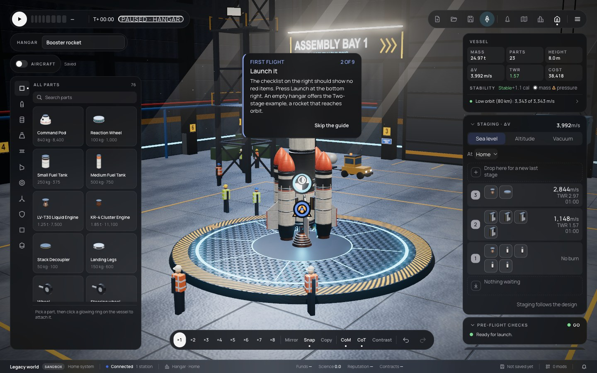
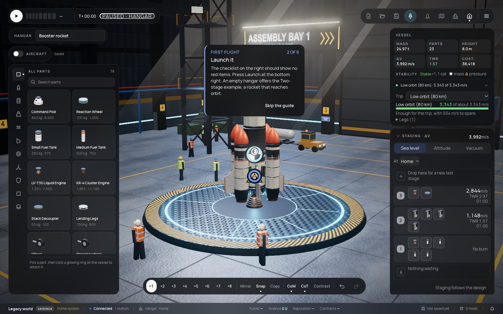

# 255 — Hangar fixes from the owner's test

**Plan:** [plans/255-hangar-owner-fixes.md](../plans/255-hangar-owner-fixes.md) · **Session:** Worker A, 2026-10-20 · **ADRs:** [0240](../decisions/0240-hangar-owner-fixes-panel-and-bars.md) · **Report:** [owner manual test](../reviews/2026-10-20-owner-manual-test.md) items 1–5

## What was done

| Item | Where | What |
|---|---|---|
| 1 | `renderer/vab/hangar.ts` | arms retracted to a 1.2 m stub; the middle is free whatever the vessel; test: nothing of the arms within 10 m of the axis |
| 2 | `mods/stock/src/eva.ts` | `catalog.hidden` on the EVA Suit and the Flag; test in `boot.test.ts` |
| 3 | `web/vab/panel-model.ts`, `panel-folds.svelte.ts`, `FoldButton.svelte`, `StatsStrip`, `StageEditor`, `ChecksList`, `PowerBudget`, `CrewSeats` | trip on one line, folding sections with remembered state, staging rows on one grid (they were squeezed by the flex list); tests in `panel-model.test.ts` |
| 4, 5 | `layout/shell-model.ts`, `MenuBar`, `page-actions`, `vab/+page.svelte` | the Hangar is immersive; New, Open, Save, Launch are icons with tooltips (Launch lit); no black frame |

## Before and after (1440 × 900)

Before: the owner's screenshots, [04](../reviews/assets/2026-10-20-owner-test/04.webp) (bars), [03](../reviews/assets/2026-10-20-owner-test/03.webp) (right panel), [01](../reviews/assets/2026-10-20-owner-test/01.webp) (arms). After, from `apps/web/scripts/capture-hangar.ts`:

## Not done

- Owner approval of the look (`[manual]`).
- The paused chip ("PAUSED · HANGAR") keeps its outlined style: plan 256 makes one badge for every pause state.
- A crew inventory for the EVA Suit and the Flag does not exist; they are hidden, and still load and fly. It is a follow-up if the owner wants one.
- Power and Crew keep their own summaries; the Action groups panel was already folded by its Edit button.
