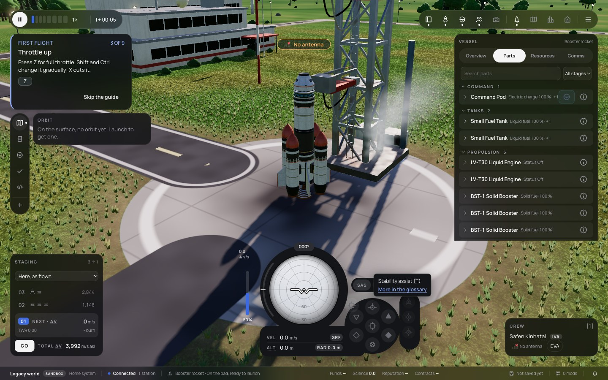
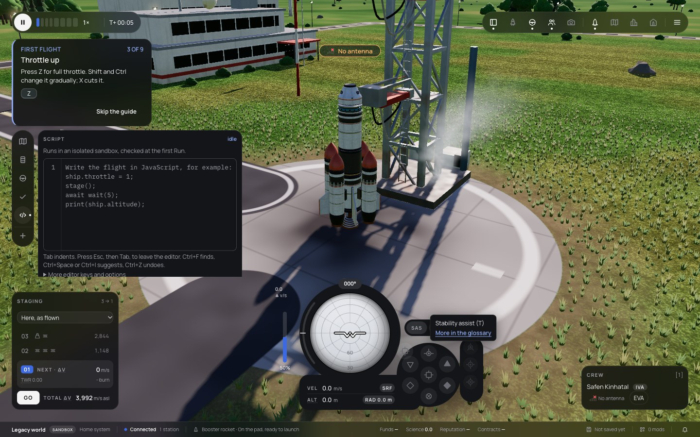
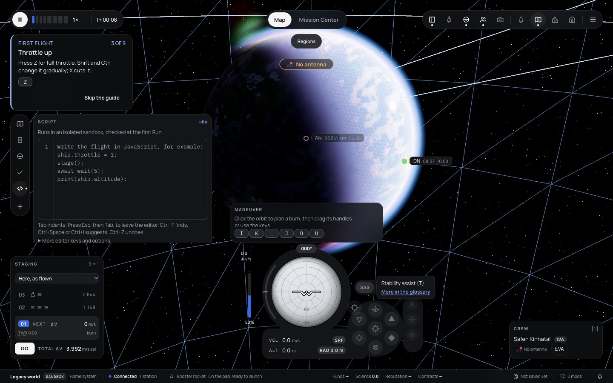

# 256 — Flight UI fixes from the owner's test

**Plan:** [plans/256-flight-ui-owner-fixes.md](../plans/256-flight-ui-owner-fixes.md) · **Session:** Worker A, 2026-10-20 · **ADRs:** [0241](../decisions/0241-flight-ui-owner-fixes.md) · **Report:** [owner manual test](../reviews/2026-10-20-owner-manual-test.md) items 4, 6, 7, 8, 17, 19

## What was done

| Item | Where | What |
|---|---|---|
| 8 | `vessel-panel/VesselPanel.svelte`, `ControlRows.svelte`, `part-summary.ts`, `open-rows.svelte.ts` | parts as one-line accordions with a summary and icon actions; foldable categories; open rows remembered per vessel; compact rows and side-by-side triggers; tests in `part-summary.test.ts` |
| 6 | `dock/Dock.svelte` | the rail has the height of its tabs |
| 7 | `layout/layout-model.ts` (`viewInsets`), `flight/+page.svelte` | a hidden box (the navball module's `display: none` deck measures as an empty box at the origin) leaves no clearance; measured again when the navball toggles; tests in `layout-model.test.ts` |
| 4, 17 | `layout/TimeBar.svelte` | one chip for every pause state, the button variant reset to look the same; tests in `TimeBar.test.ts` |
| 19 | `flight/+page.svelte` | the map's tabs on the bars' row from 1280 px |

## Before and after (1440 × 900)

Before: the owner's screenshots, [09](../reviews/assets/2026-10-20-owner-test/09.png) (vessel panel), [07](../reviews/assets/2026-10-20-owner-test/07.webp) (dock rail), [16](../reviews/assets/2026-10-20-owner-test/16.webp) (map tabs), [14](../reviews/assets/2026-10-20-owner-test/14.png) (chip). After, from `apps/web/scripts/capture-flight-ui.ts`:

## Not done

- Owner approval of the look (`[manual]`).
- The camera anchor was checked by the clearance maths only (the unit test), not by toggling the navball in the browser.
- The chip's look was not captured: it shows only while paused (the tests check the markup, not the pixels).
- The Mission Center page keeps its own `Map | Mission Center` switch inside the page's safe-area frame, so it is not on the bars' row there; making that page immersive (as the Hangar now is) would need its overlay moved below the bars, a plan of its own.
- Open rows are not saved between sessions.
