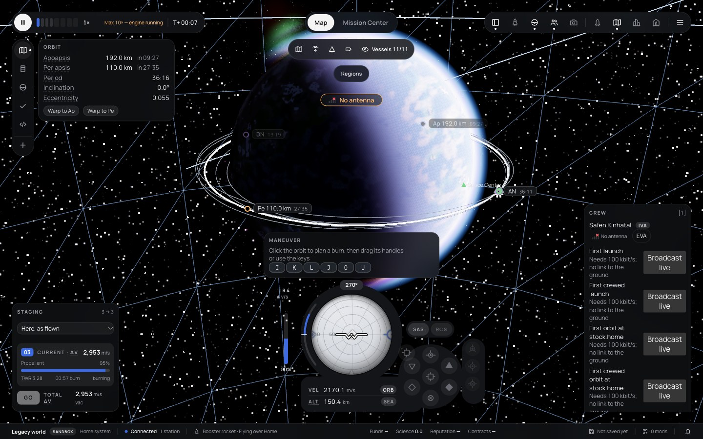
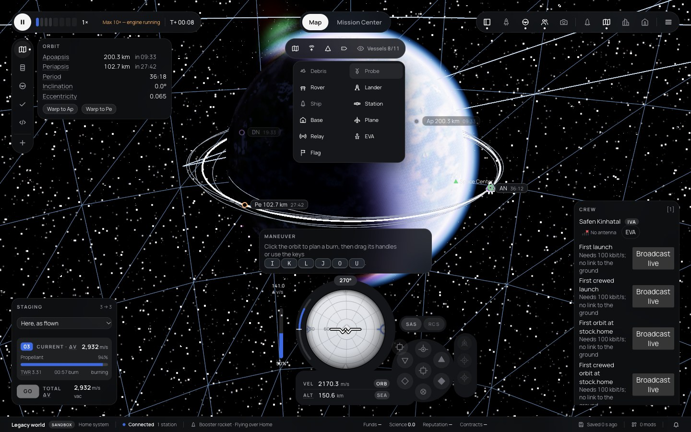

# 258 — Map view like KSP: orbit styles, icons by type, link colours, filters

**Plan:** [plans/258-map-view-ksp-style.md](../plans/258-map-view-ksp-style.md) · **Session:** Worker A, 2026-10-21 · **ADRs:** [0242](../decisions/0242-map-styles-icons-filters.md) · **Report:** [owner manual test](../reviews/2026-10-20-owner-manual-test.md) item 18

## What was done

| Where | What |
|---|---|
| `renderer/map-style.ts`, `scene.ts`, `map.ts` | orbit roles (active white, target amber, other grey, debris dim), the icon glyphs, the sprite marker tinted by role, `setMapLayers({ orbits, hidden, target })`; tests in `map-style.test.ts` |
| `web/lib/map/map-filters.ts`, `.svelte.ts`, `MapFilterBar.svelte` | the filter model, its saved store and the chip row; tests in `map-filters.test.ts` |
| `web/lib/comms/network-model.ts`, `NetworkLayer.svelte` | link states full, weak (under 6 dB) and partial with CommNet's colours; tests in `network-model.test.ts` |
| `web/lib/flight-loop.ts`, `flight/+page.svelte`, `MapMarkers.svelte` | the filters reach the renderer each snapshot, the links and stations layers and the labels follow them |

## Before and after (1440 × 900)

Before: the owner's [screenshot 15](../reviews/assets/2026-10-20-owner-test/15.webp). After, from `apps/web/scripts/capture-map.ts` (the booster example in a 150 km orbit after staging):

## Not done

- Owner approval of the look (`[manual]`).
- The screenshots show no comms link: the example world has a ground station but the vessel has no antenna. The link colours are tested as data, not seen.
- In the screenshots the separated stages' orbits are almost the same as the active one, so the grey of the others is hard to tell from the white; a stage-and-station scene would show it better.
- The Mission Center page keeps its own three layer toggles; it shows the new icons and styles (the scene is shared) but not these filters.
- Icons are a size that suits one scale; there is no hover label on a map icon yet (the Mission Center's labels name vessels).
