# 261 — WebGPU renderer (Phase 0 spike, Phase 6 sky spike, Phase 1, Phase 2a, Phase 2b, Phase 2c)

**Plan:** [plans/261-webgpu-renderer-migration.md](../plans/261-webgpu-renderer-migration.md) · **Session:** Worker D (MacBook Pro M2 13"), 2026-10-20 · **Branch:** `gfx/261-webgpu` · **ADRs:** [0242](../decisions/0242-webgpu-renderer-backend.md)

## What was done

| Where | What |
|---|---|
| `packages/renderer/src/webgpu-spike/sky-spike.ts` | The atmosphere march (Rayleigh, Mie, ozone, sun-depth LUT, pcg3d noise octaves) twice: the existing GLSL on `WebGLRenderer`, and a TSL port on `WebGPURenderer` (WebGPU, or `forceWebGL` for the fallback). A benchmark that waits for the GPU on each frame |
| `apps/web/src/routes/dev/webgpu-spike` | A dev page: backend, noise octaves, pixel ratio, view (pad, 12 km, orbit), one measurement or the whole matrix, JSON out |
| `refs/graphics-performance/data/m2-spike-261-chromium.json` | The M2 Chromium matrix |

## Results (M2, Chromium, ms per frame, synchronous)

| Octaves | Ratio | View | WebGL | WebGPU | Fallback |
|---|---|---|---|---|---|
| 0 | 1 | pad | 1.16 | 1.10 | 1.14 |
| 0 | 2 | pad | 4.45 | 4.27 | 4.35 |
| 0 | 2 | orbit | 2.54 | 2.42 | 2.42 |
| 8 | 2 | pad | 8.90 | 8.78 | 8.82 |
| 8 | 2 | 12 km | 8.84 | 8.78 | 8.84 |
| 8 | 2 | orbit | 6.82 | 6.79 | 6.73 |

A plain port costs the same on every backend (within ±5 %). The three screenshots are identical.

## What surprised me

- **WGSL is stricter about shifts.** `vec3<u32> >> u32` does not compile; it has to be `shiftRight(uvec3(16))`. The failed pipeline drew nothing, and the first numbers (0.14 ms) looked like a miracle. The runner now counts console errors and saves a screenshot per backend.
- **`uv()` runs top-down on `WebGPURenderer`**, on both of its backends, so the first image was upside down. The TSL flips y.
- **Output colour space.** `WebGPURenderer` converts to sRGB at output by default; the GLSL writes straight to the canvas, so the spike sets `LinearSRGBColorSpace` to compare like with like.
- `waitForGPU` is gone in r186; the benchmark waits on `device.queue.onSubmittedWorkDone()` (WebGPU) or a 1-pixel `readPixels` (fallback).

## Safari 26 (M2, run by the owner)

| Octaves | Ratio | View | WebGL | WebGPU | Fallback |
|---|---|---|---|---|---|
| 0 | 2 | pad | 4.8 | 4.9 | 4.7 |
| 8 | 2 | pad | 9.7 | 9.9 | 9.5 |
| 8 | 2 | 12 km | 9.6 | 10.0 | 9.6 |
| 8 | 2 | orbit | 7.4 | 7.7 | 7.3 |

WebGPU is 0–4 % behind in Safari, which is about one step of its 0.1 ms timer. The fallback is as fast as WebGL.

## Gate

Passed. The owner skipped the M5 ("skip dulu m5 nya"). GPU timestamp queries come with Phase 1 step 7; the spike times the CPU wait.

## Phase 6 spike: the LUT sky (M2, Chromium)

The owner wanted to see something early, so the LUT sky (step 20) came before Phases 1–5, on the spike page (`webgpu-lut`, `webgpu-lut-fallback`).

| Where | What |
|---|---|
| `webgpu-spike/lut-sky.ts` | Hillaire's sky in TSL on our air (Rayleigh, the march's Mie split, ozone). Transmittance 256 × 64 with Bruneton's mapping and multiple scattering 32 × 32 (64 directions × 20 steps, ground bounce), baked once. The sky view 192 × 108 (finest at the horizon), 32 samples a texel with both tables, rebuilt every frame. The screen reads one texel; ground pixels read two transmittance texels for the view ray. Above the air the same table holds, its rays starting where they enter. The sunlight fades across the sun's disc at the terminator |
| `sky-spike.ts` | The two LUT backends and the bake time; the fallback's GPU wait now reads the canvas, not a table left bound |
| the page | Show, a bake column, a sunset view |

| ms per frame | WebGL march | WebGPU march | **WebGPU LUT** | LUT fallback |
|---|---|---|---|---|
| ratio 2, pad | 4.58 | 4.32 | **0.78** | 0.85 |
| ratio 2, sunset | 4.57 | 4.37 | **0.79** | 0.82 |
| ratio 2, 12 km | 4.54 | 4.48 | **0.77** | 0.78 |
| ratio 2, orbit | 2.57 | 2.44 | **0.64** | 0.68 |
| ratio 2, pad, 8 octaves | 9.11 | 8.88 | **5.08** | 5.10 |

The tables bake in 7–16 ms, once per atmosphere.

| | The march (today) | The LUT sky |
|---|---|---|
| pad |  |  |
| sunset |  |  |
| orbit |  |  |

### What surprised me

- **Physical is darker.** The march multiplies all in-scatter by 2.2 to stand in for multiple scattering; real multiple scattering adds less overhead and more at the horizon and in twilight. The spike gives the LUT sky an exposure of 1.6 to compare like with like. The port has to calibrate the exposure with the ground, which also gets brighter by it.
- **TSL's typings lag its runtime.** Named `Loop` variables (needed for nested loops, which otherwise all get `i`) and plain numbers as nodes type-fail, so `lut-sky.ts` takes TSL untyped.
- **Table reads use `.level(0)`** (WGSL's `textureSampleLevel`) so sampling inside branches and loops raises no uniformity errors.
- The noise octaves now dominate: 8 octaves cost 4.3 ms of the 5.08. Phase 7's noise textures are the next big gain.

### Still open in Phase 6

- The aerial-perspective volume (the fourth table) for terrain and clouds (step 22).
- The pmndrs/sky evaluation (step 21).
- A rebuild only when the sun or the altitude band changes (today the sky view rebuilds every frame; it costs well under the 0.78 ms).

## Phase 1: the foundation

| Where | What |
|---|---|
| `backend.ts` | `?renderer=webgpu` and `webgpu-fallback`; anything else is WebGL |
| `renderer-facade.ts` | The half of the facade that only talks to the `SceneModel` (camera, map, site, picking, the model's debug calls), shared by both renderers; getters stay getters (`withShared`) |
| `renderer.ts` | Uses the shared half; `createRenderer` hands a WebGPU request to `renderer-webgpu.ts`; `benchmarkAsync`, and `info()` gains renderer, GPU time and the lists |
| `renderer-webgpu.ts` | `WebGPURenderer` (log depth, PCF shadows, ACES, timestamps). The TSL `RenderPipeline`: scene pass with the preset's MSAA, `BloomNode` at the preset's bloom scale with the WebGL chain's strength, radius and threshold, output transform. `compileAsync` warm-up of the scene and of the other presets' parts, then vegetation. A lost device or context rebuilds the renderer up to 3 times. The adapter's name, the texture limit |
| `webgpu-compat.ts` | Hides the GLSL meshes for the frame; lists them and the patched materials |
| Debug → Info | Renderer, GPU and GPU time; "Not drawn yet" on WebGPU |

| M2, Chromium, 1440 × 900, ratio 1 | WebGL (all of it) | WebGPU (what is ported) | Fallback |
|---|---|---|---|
| frame interval p50 (`high`) | 33.2 ms | 16.7 ms (vsync) | 16.7 ms |
| `benchmarkAsync` (`high`) | 24.6 ms | 0.47–0.59 ms | 0.42 ms |
| GPU time from timestamps | – | about 1.2–2.8 ms | – |
| console errors | 0 | 0 | 0 |

The WebGPU frame is cheap because the planet pass is not drawn yet: it is the cost, as `refs/graphics-performance/01` found. These numbers are not a comparison yet; Phase 2 makes them one.

| WebGL (today) | WebGPU after Phase 1 |
|---|---|
| 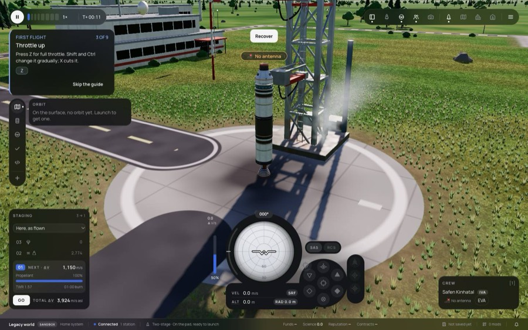 | 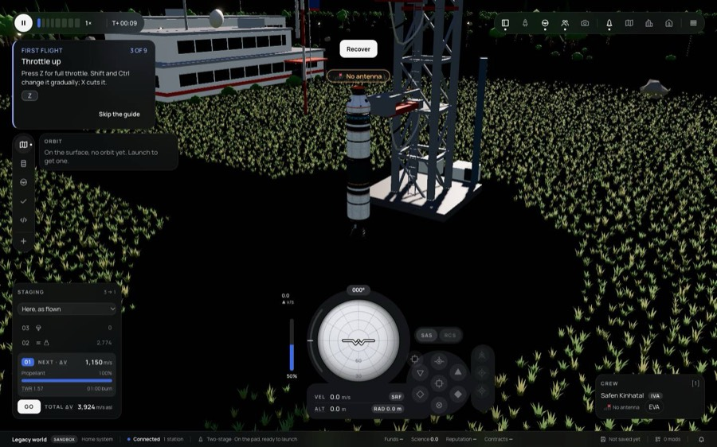 |

### What surprised me

- **A `ShaderMaterial` is not skipped, it is replaced.** The node renderer logs "Material ShaderMaterial is not compatible" and draws a blank material, so hiding has to happen around each draw and each `compileAsync` (which collects the objects before its first `await`).
- **The timestamp pool sums up to when it is read**, not to when the read was asked for. Dividing by the frames counted at the request gave 25–50 ms for a 2 ms frame. The frames are now counted from one finished read to the next.
- **`info.render.drawCalls` reads 0 between frames**: a `compileAsync` resets it. The counts are now taken right after the facade's own draw.
- **The grass draws as plain standard material.** Its wind and colour patch is an `onBeforeCompile`, which the node renderer ignores; it is on the "drawn without its patch" list for Phase 4.

### Verification

```
cd packages/renderer && bun test                      708 pass, 0 fail
bun run check:affected                                ✓ prettier ✓ docs ✓ typecheck; web vitest 1323 passed, 2 failed (sim-host-script-worker.test.ts, the known environment failure on this machine)
bun run typecheck                                     0 errors
bun run build                                         done
headed Chromium, /flight?renderer=webgpu|webgpu-fallback, presets low, medium, high: 0 console errors; Debug → Info "webgpu · WebGPU: apple metal-3 · GPU 2.19 ms a frame"
```

## Phase 2, slice 2a: the planet and the sky in the game

The planet pass is about 2 000 lines of GLSL: a terrain ray march with root finding, patches, clouds, waves, shafts and aurora. It comes over in slices, each one shown in the game. 2a is everything a ray needs to meet the sea-level sphere or the sky.

| Where | What |
|---|---|
| `tsl/noise.ts` | pcg3d value noise, `noiseT`, `noiseA` (the anchored lattice), `fbmF`, the octave rotation, `warpedLatLon`: the same lattice and hashes as the GLSL |
| `tsl/lut-sky.ts` | The spike's tables as a module: in-scatter along any camera ray to the sea-level sphere or out of the air, its transmittance (to the ground by Bruneton's ratio), the sunlight at a point |
| `tsl/planet-pass.ts` | The pass: the camera ray from `uInvProj` and `uCamRot`. The sphere hit. `surfaceAt` on the sphere: the biome map through the warp, the gradient, the coast and colour octaves, grass, forest, desert, rock, snow, beach, wet sand and sea. `sitePaving`: pad, slabs, scorch, ring and cross, roads with dashes and edge lines, aprons, lawn stripes. Sun, ambient (the GLSL's `k`), sea reflection and glint. Stars, the sun's disc. The veil over land as `terrainVeil`. The NaN guard, log depth |
| `renderer-webgpu.ts` | Builds the TSL pass beside the GLSL mesh, updates it after `prepareFrame` (uniforms, visibility, the sky view), follows the preset's ground octaves |

| M2, Chromium, 1280 × 800, `high` | WebGL | WebGPU, 2a |
|---|---|---|
| pad | 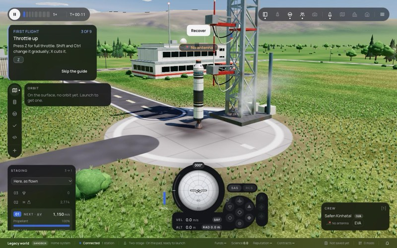 | 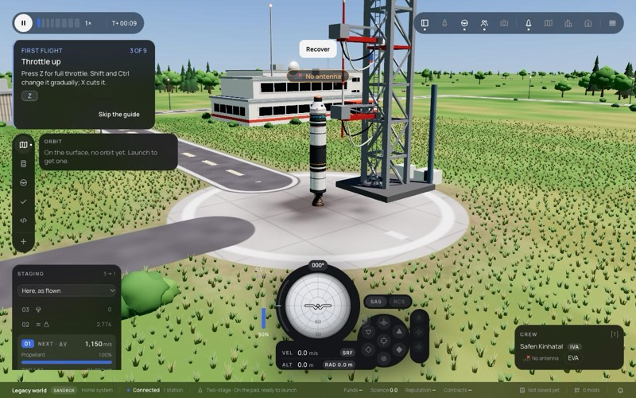 |
| low sun | 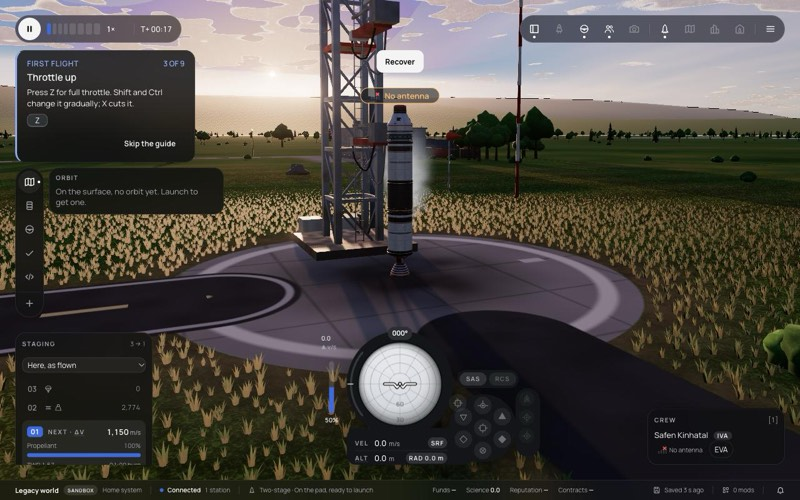 | 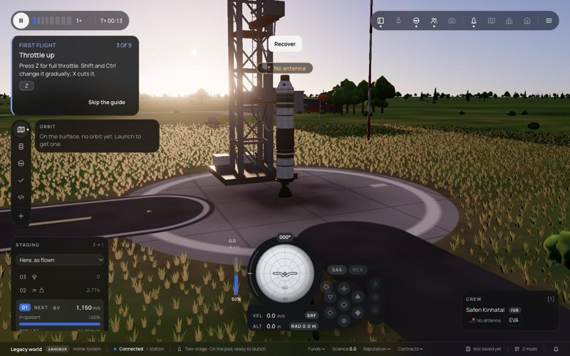 |
| 12 km |  | 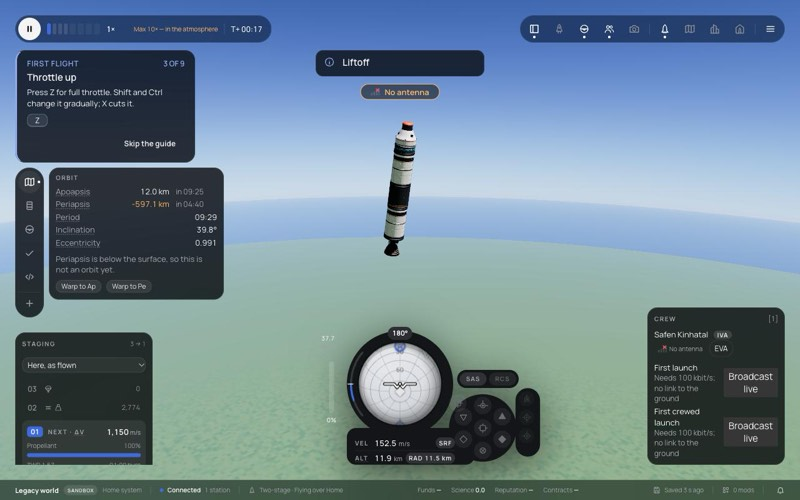 |
| orbit |  | 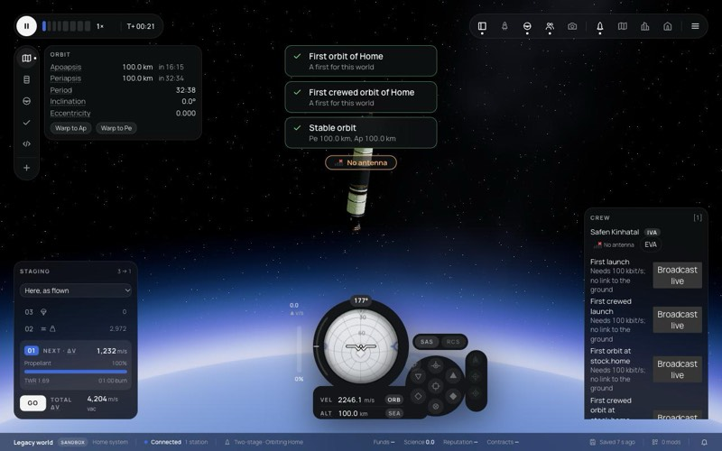 |

`benchmarkAsync(20)`: WebGL 60 / 91 / 59 / 22 ms, WebGPU 1.7 / 1.1 / 1.1 / 0.6 ms (pad, low sun, 12 km, orbit). **Not a comparison yet**: WebGPU draws no terrain march, clouds or water detail, which are most of WebGL's time. The comparison is meaningful once 2b and 2c are in.

### What surprised me

- **A one-line `If` callback is a return.** `If(c, () => x.assign(y))` hands TSL the assign as the callback's value. TSL warns "Return statement used in an inline Fn()" and treats it as a `return`, so callbacks are written with braces.
- **Colour and depth come from one node.** A `property` written in the colour node and read in the depth node depends on the order in which the material sets them up. Returning `vec4(colour, viewZ)` from one `Fn` and reading `.xyz` and `.w` makes TSL emit the pass once.
- **The comparison runs need a profile each.** The WebGL run autosaved the vessel in orbit, and the next page loaded that save.
- **Land needs the terrain veil.** Without it the WebGPU ground at 12 km read paler than WebGL's, whose terrain uses the thinner veil near the camera.

### Not in 2a (next slices)

- 2b: the terrain bake (in TSL, Phase 3's compute later), the march, root finding and silhouette, relief and slope normals, the terrain's and the vessel's shadows on the ground.
- 2c: lakes, rivers, shore and sea waves, ripples; cumulus, cirrus and their shadows; light shafts; aurora; the half-size pass (Phase 2 step 10).

## Phase 2, slice 2b: the terrain and the shadows on the ground

| Where | What |
|---|---|
| `planet.ts` | `terrainJobs`, `markCubeBaked`, `markPatchBaked`: the bakes the CPU plans, for a renderer that bakes them itself (the WebGL path is unchanged) |
| `tsl/terrain.ts` | `heightAt` in TSL (zones, coast warp, hills, ranges and the site's massif, ridged octaves, the lake cap). The far field is a six-face atlas with gutters (ADR 0242 point 9); the patches are 32-bit targets, read filtered where the GPU filters 32-bit floats, else four texels by hand. Samplers: height and slope (the march), height and gradient (shading) |
| `tsl/planet-pass.ts` | The march (steps, crest look-ahead, Illinois, silhouette parabola, the crest-between-samples hit), `macroRelief` and the slope normal from screen derivatives, rock, alpine and snow by height and slope, the grazing fix, `terrainShadow`, `shadowFactor` over three's shadow map. The air in front of terrain is marched with the tables (12 steps) and its veil |
| `tsl/lut-sky.ts` | `segment`: in-scatter and transmittance between two distances along a ray |
| `renderer-webgpu.ts` | `benchmarkAsync` reads the GPU timestamps on WebGPU |

| M2, Chromium, 1280 × 800, `high` | WebGL | WebGPU, 2b |
|---|---|---|
| pad |  | 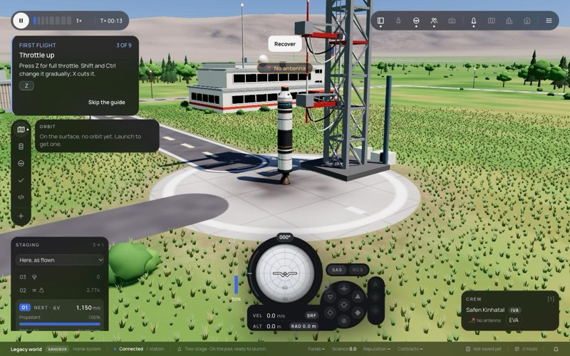 |
| low sun |  | 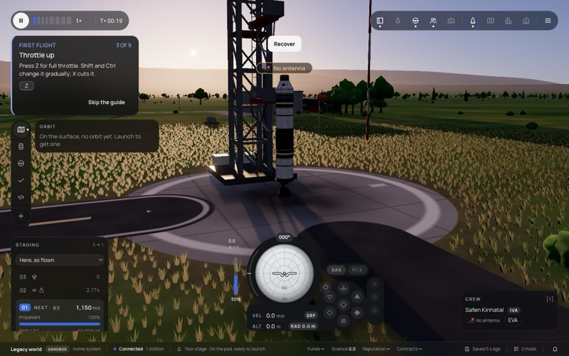 |
| 12 km | 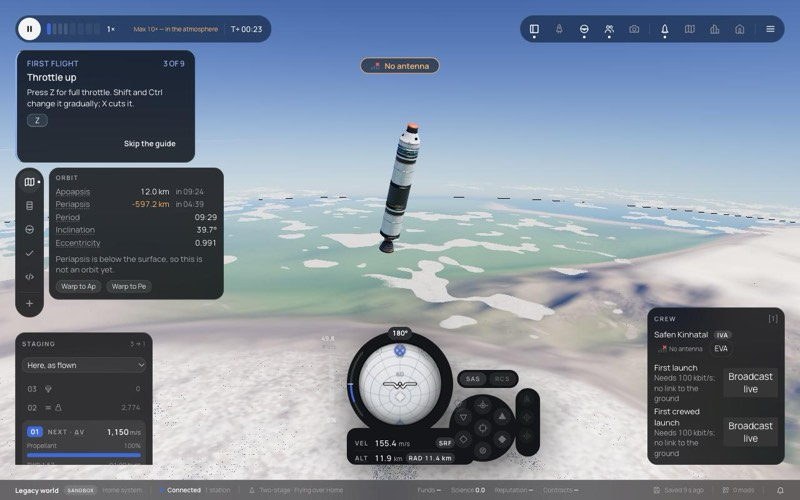 | 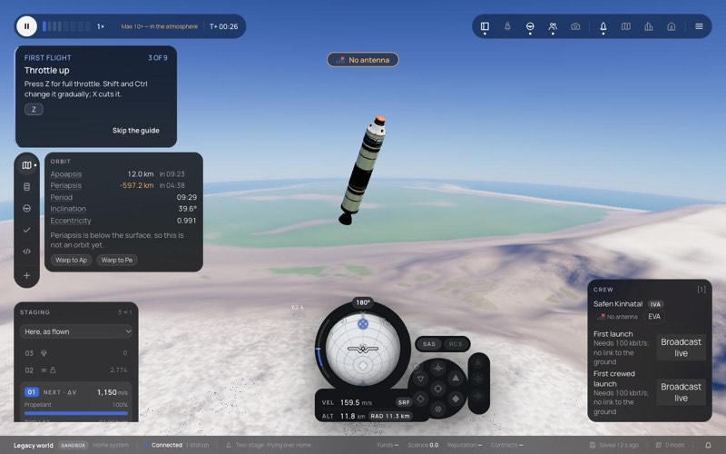 |
| orbit | 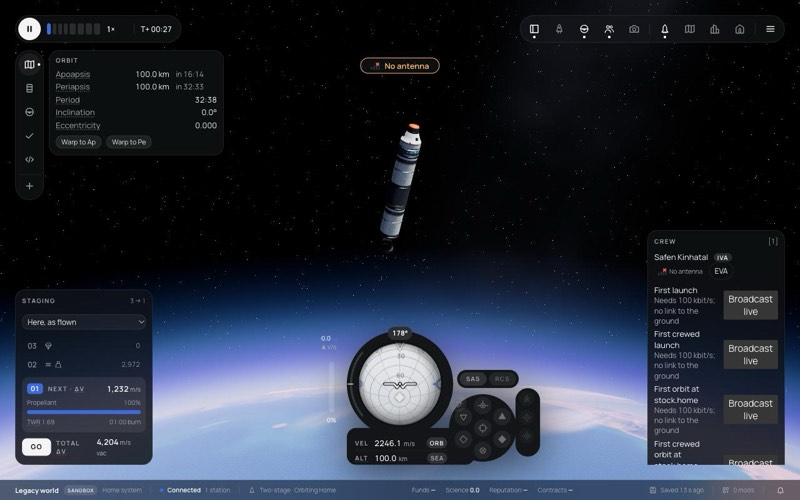 | 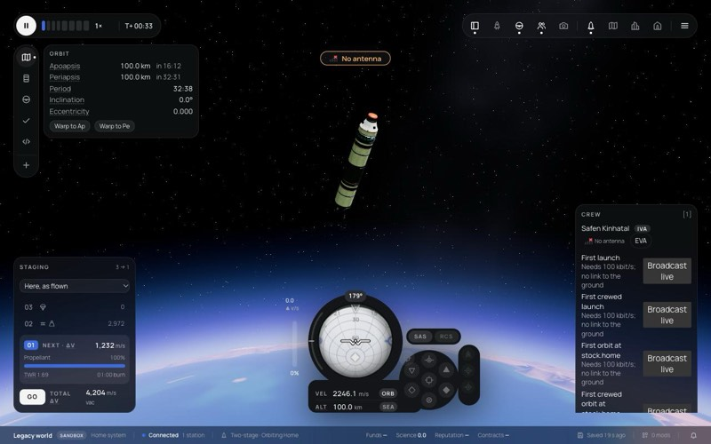 |

Mean brightness per horizontal band, WebGPU against WebGL: within about 10 % in all four views (the sky gain is 1.3, see below).

| Frame interval p50 | pad | low sun | 12 km | orbit |
|---|---|---|---|---|
| WebGL | 50.0 ms | 83.3 ms | 50.1 ms | 16.7 ms |
| WebGPU (2b) | 16.7 ms | 16.7 ms | 16.7 ms | 16.7 ms |

The WebGPU frames are held at the display's 60 Hz. Their GPU time is 1.3 to 4 ms by the live meter, and 2.5 to 16 ms by `benchmarkAsync`'s timestamp sum. The two disagree; Phase 8 settles the measurement. **This is not yet a comparison**: the clouds, water detail, shafts and aurora are in WebGL's time and not yet in WebGPU's.

### What surprised me

- **TSL declares a shared expression where it is first used.** The camera position was first used inside the terrain's air march (an `if` and a loop), so the sky's lookup in the `else` read a variable that was never set, and the sky from orbit glowed blue. The ground's `posRel` had the same problem inside `if (hitT)`. Every value that several branches use is now a `.toVar()` before them. This is the rule for every later TSL port.
- **`colorNode` replaces alpha with the opacity.** The terrain atlas lost its fourth channel (g2), so every slope read as steep and all mountains turned to rock and snow. Data passes write through `fragmentNode`.
- **Uniforms inside `setLayout` functions** get their own names, apart from the material's uniform block, and the shader does not compile (three r186). The terrain samplers are inlined.
- **Fast math folds `x != x` away on Metal,** so the NaN guard did not guard. NaN and infinity are now caught by the exponent bits.
- **Screen derivatives next to a silhouette are undefined** on Metal when the neighbouring pixel took the other branch. The slope normal went NaN in a band along far ridges; it now falls back to the geometric normal.
- **`pow(x, 2.0)` with a negative x is NaN in WGSL.** The ridged noise and the sky view's mapping square by multiplication.
- **The sky gain moved from 1.6 to 1.3** once the sky read the right camera; the spike's 1.6 was calibrated on the sea-level-only pass.

### Not in 2b

- Lakes, rivers, shore and sea waves, ripples (2c).
- Cumulus and cirrus and their shadows, light shafts, aurora (2c).
- The march prepass, the half-size pass and its edge pass (Phase 2 step 10). Without the prepass every pixel marches from the camera.
- The analytic gradient and the bakes on compute (Phase 3).

### Verification

```
cd packages/renderer && bun test                      708 pass, 0 fail
bun run check:affected                                ✓ prettier ✓ docs ✓ typecheck ✓ bun test; web vitest 1323 passed, 2 failed (sim-host-script-worker.test.ts, the known environment failure)
bun run typecheck                                     0 errors
bun run build                                         done
headed Chromium, /flight?renderer=webgpu and webgpu-fallback, high and medium, pad, low sun, 12 km, orbit: 0 console errors
```

## Phase 2, slice 2c: clouds, water, light shafts and aurora

| Where | What |
|---|---|
| `tsl/clouds.ts` | `cloudDensityQ` (the coverage field, puffs and billows), `cirrusDensity`, the slab's profile, multiple-scattering phase, fill, gain, billow shade, powder, sun depth and erosion; `CloudMapTSL`, the equirectangular map baked when the cover changes |
| `tsl/water.ts` | `waveGradient`, `swashOffset`, `surfFoam`, `rippleAt`, `riverField` |
| `tsl/lut-sky.ts` | `march`: the air between two distances with the in-scatter and transmittance at the two cloud distances (the twin of `marchAtmosphere`, on the tables) |
| `tsl/terrain.ts` | `zones` (the lakes' gate) and `cubeHeight` (the shafts' terrain test) are public |
| `tsl/planet-pass.ts` | Lakes with their ragged shore, shore swash and surf, rivers with the flow of their ripples, foam, wave crests and caps, the water normal, floodlights. Cloud shadows from the map. The cumulus march and the cirrus layer composited nearest first. The shafts' second march (cloud map and terrain). The aurora shell, behind and in front of the air |
| `renderer-webgpu.ts` | The sun keeps `castShadow` on while the preset has shadows (see below) |

| M2, Chromium, 1280 × 800, `high` | WebGL | WebGPU, 2c |
|---|---|---|
| a cloud layer from 3 km | 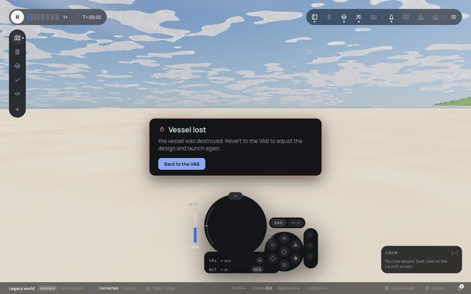 | 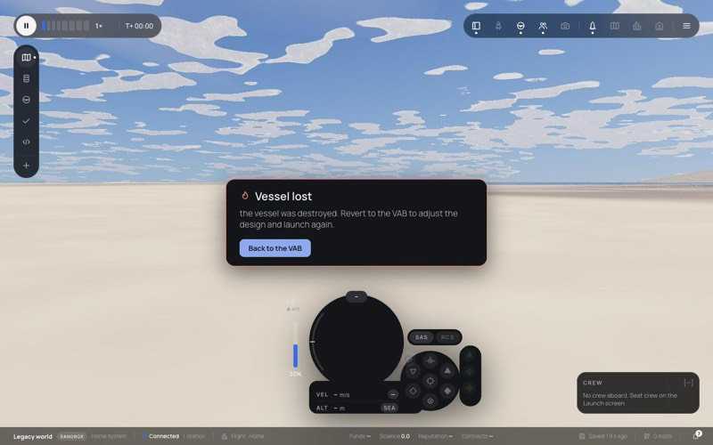 |
| the sea from 120 m (the vessel has just hit it) | 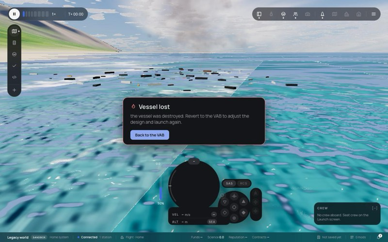 | 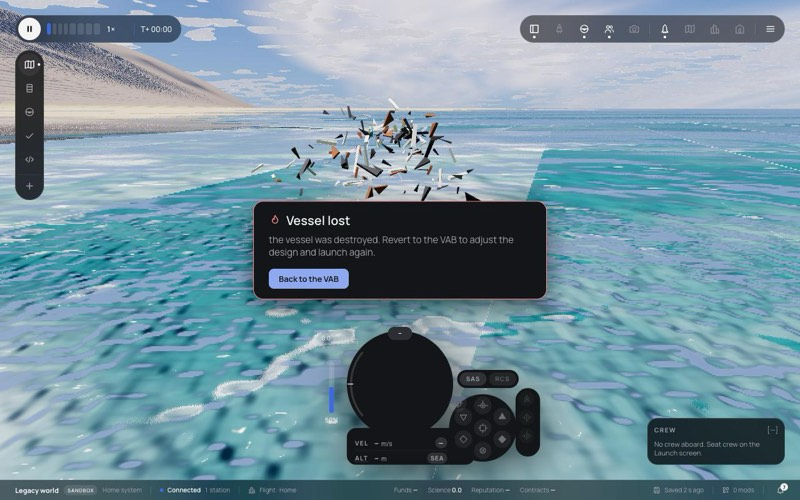 |
| 12 km |  | 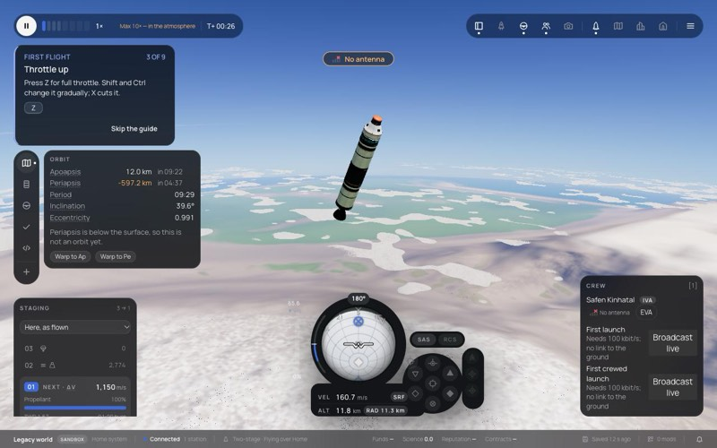 |
| pad, noon |  | 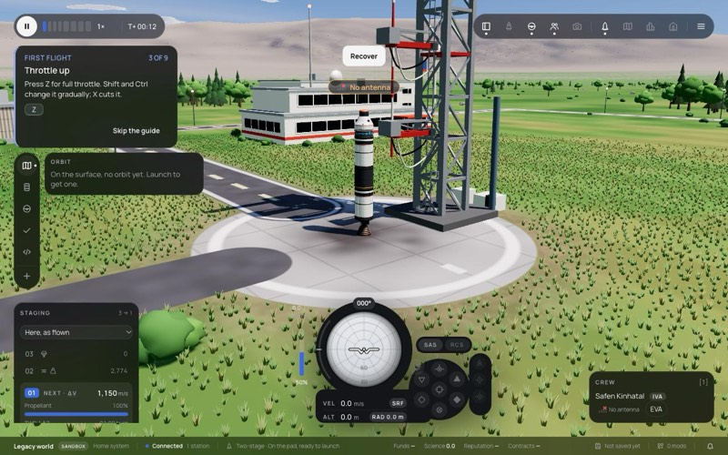 |

Band brightness against WebGL: pad within 5 %, including the band the cloud shadows cross (98 against 101); the low sun and 12 km within about 10 %.

| GPU and frame interval (M2, `high`) | pad | low sun | 12 km | orbit |
|---|---|---|---|---|
| WebGPU, GPU time (live meter) | 4.8 ms | 7.2 ms | 5.0 ms | 0.7 ms |
| WebGPU, frame interval p50 | 16.7 ms | 17.6 ms | 16.7 ms | 16.7 ms |
| WebGL, frame interval p50 | 50.0 ms | 83.3 ms | 50.1 ms | 16.7 ms |

What WebGPU does not draw yet is now only the march prepass and the half-size pass, both performance passes rather than looks; so this is close to a like-for-like comparison of the planet pass. It is not yet a measurement under Phase 8's rules (the M5, Retina, every preset).

### What surprised me

- **Three r186's WebGPU shadow node does not survive `castShadow` going off.** At night the environment turns the sun's shadow off; the node disposes its map and then reads it (`null.depthTexture`), and the frame after binds its own colour target as a texture (hundreds of validation errors). The WebGPU facade keeps the sun casting while the preset has shadows; the planet pass ignores the map when the environment says it is off (`uShadowOn`).
- **The water and the clouds needed no new rules**, only the ones 2b found: shared values as variables, derivatives with a finite fallback, data passes through `fragmentNode`.
- **Finding water took core's own map.** Guessed positions were snow; `isWater` over a spiral from the site found the sea 75 km north.

### Known

- One error at startup, once: three's Lambert pipeline meets the sun's depth texture while the environment grows the shadow map (`shadow.map.setSize`, ADR 0055). It is gone the frame after. The fix belongs with the shadow map's sizing under the node renderer (`shadow.mapSize`), in Phase 4 with the shadow sampling (step 17).
- The aurora is ported but not seen on screen: no view in this session had it lit (`uAurora` 0 in WebGL and WebGPU alike).
- The light shafts are on, but no view checked them against WebGL.

### Verification

```
cd packages/renderer && bun test                      708 pass, 0 fail
bun run check:affected                                ✓ prettier ✓ docs ✓ typecheck ✓ bun test; web vitest 1323 passed, 2 failed (sim-host-script-worker.test.ts, the known environment failure)
bun run typecheck                                     0 errors
bun run build                                         done
headed Chromium, /flight?renderer=webgpu, high: pad, low sun, 12 km, orbit, 3 km at 69° N, the sea; console: the one startup error above
```
