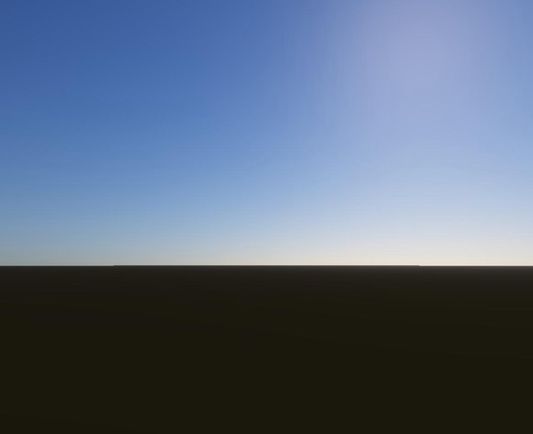
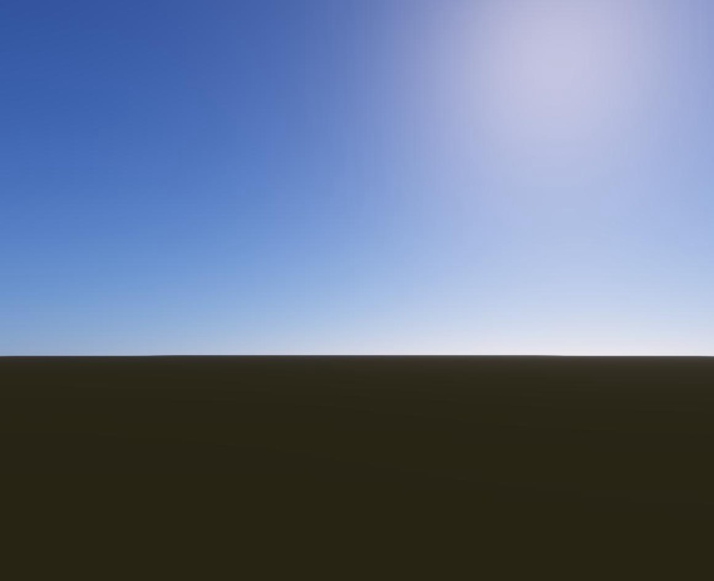
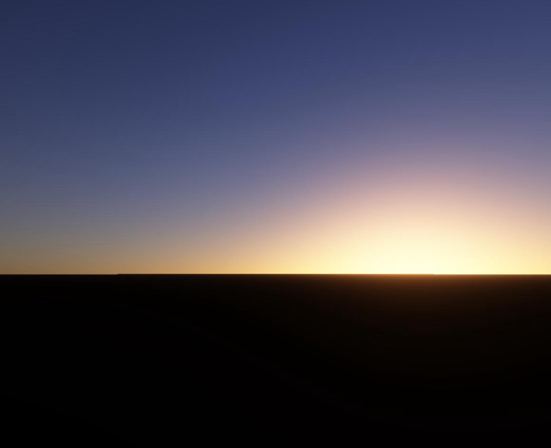
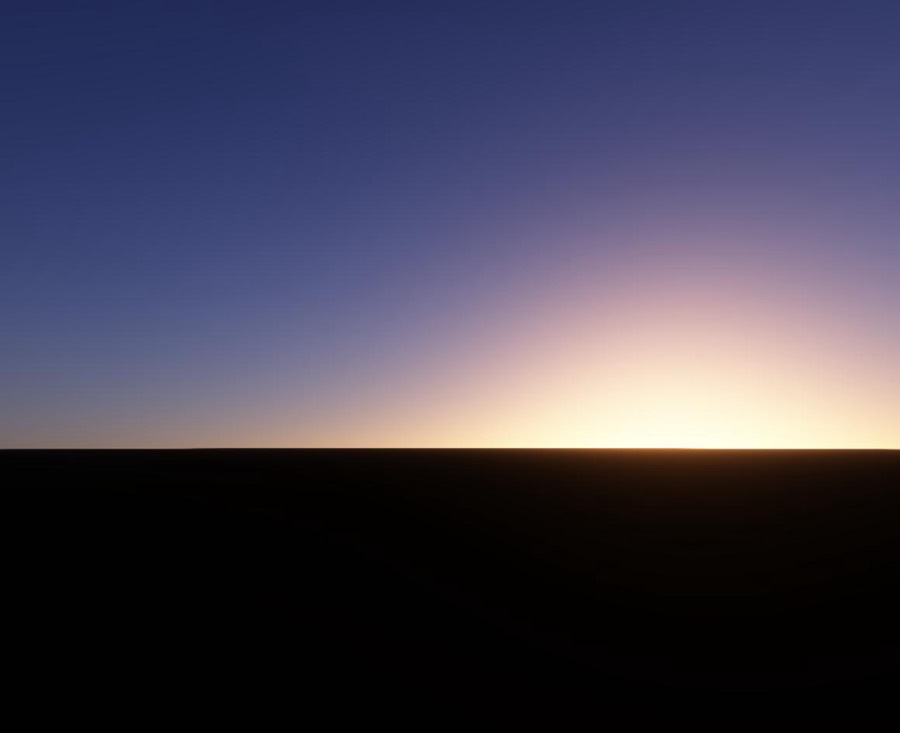
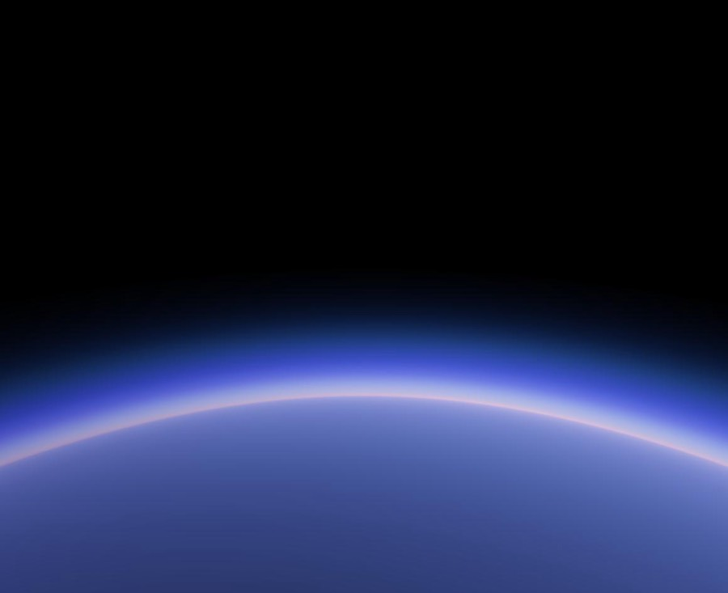
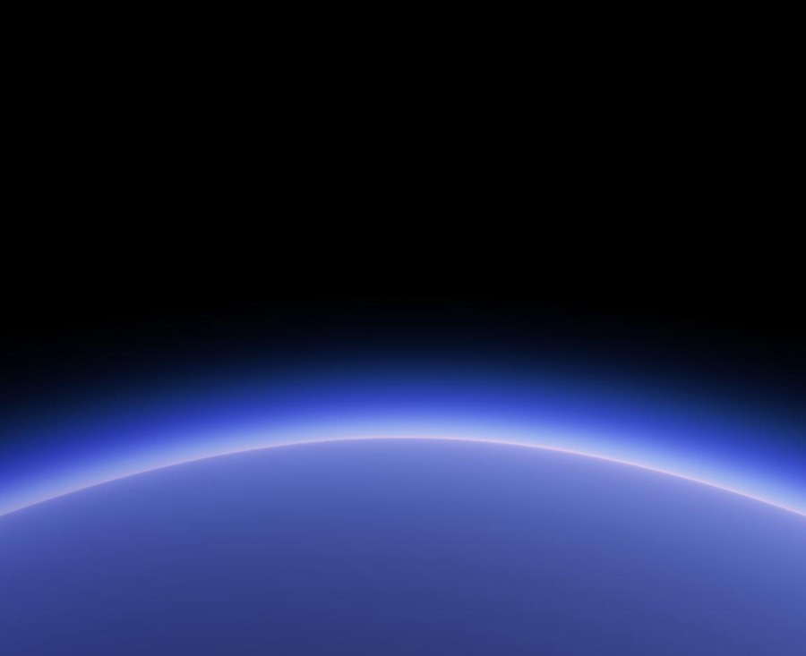

# 261 — WebGPU renderer (Phase 0 spike, Phase 6 sky spike)

**Plan:** [plans/261-webgpu-renderer-migration.md](../plans/261-webgpu-renderer-migration.md) · **Session:** Worker D (MacBook Pro M2 13"), 2026-10-20 · **Branch:** `gfx/261-webgpu` · **ADRs:** [0242](../decisions/0242-webgpu-renderer-backend.md)

## What was done

| Where | What |
|---|---|
| `packages/renderer/src/webgpu-spike/sky-spike.ts` | The atmosphere march (Rayleigh, Mie, ozone, sun-depth LUT, pcg3d noise octaves) twice: the existing GLSL on `WebGLRenderer`, and a TSL port on `WebGPURenderer` (WebGPU, or `forceWebGL` for the fallback). A benchmark that waits for the GPU on each frame |
| `apps/web/src/routes/dev/webgpu-spike` | A dev page: backend, noise octaves, pixel ratio, view (pad, 12 km, orbit), one measurement or the whole matrix, JSON out |
| `refs/graphics-performance/data/m2-spike-261-chromium.json` | The M2 Chromium matrix |

## Results (M2, Chromium, ms per frame, synchronous)

| Octaves | Ratio | View | WebGL | WebGPU | Fallback |
|---|---|---|---|---|---|
| 0 | 1 | pad | 1.16 | 1.10 | 1.14 |
| 0 | 2 | pad | 4.45 | 4.27 | 4.35 |
| 0 | 2 | orbit | 2.54 | 2.42 | 2.42 |
| 8 | 2 | pad | 8.90 | 8.78 | 8.82 |
| 8 | 2 | 12 km | 8.84 | 8.78 | 8.84 |
| 8 | 2 | orbit | 6.82 | 6.79 | 6.73 |

A plain port costs the same on every backend (within ±5 %). The three screenshots are identical.

## What surprised me

- **WGSL is stricter about shifts.** `vec3<u32> >> u32` does not compile; it has to be `shiftRight(uvec3(16))`. The failed pipeline drew nothing, and the first numbers (0.14 ms) looked like a miracle. The runner now counts console errors and saves a screenshot per backend.
- **`uv()` runs top-down on `WebGPURenderer`**, on both of its backends, so the first image was upside down. The TSL flips y.
- **Output colour space.** `WebGPURenderer` converts to sRGB at output by default; the GLSL writes straight to the canvas, so the spike sets `LinearSRGBColorSpace` to compare like with like.
- `waitForGPU` is gone in r186; the benchmark waits on `device.queue.onSubmittedWorkDone()` (WebGPU) or a 1-pixel `readPixels` (fallback).

## Safari 26 (M2, run by the owner)

| Octaves | Ratio | View | WebGL | WebGPU | Fallback |
|---|---|---|---|---|---|
| 0 | 2 | pad | 4.8 | 4.9 | 4.7 |
| 8 | 2 | pad | 9.7 | 9.9 | 9.5 |
| 8 | 2 | 12 km | 9.6 | 10.0 | 9.6 |
| 8 | 2 | orbit | 7.4 | 7.7 | 7.3 |

WebGPU is 0–4 % behind in Safari, which is about one step of its 0.1 ms timer. The fallback is as fast as WebGL.

## Gate

Passed. The owner skipped the M5 ("skip dulu m5 nya"). GPU timestamp queries come with Phase 1 step 7; the spike times the CPU wait.

## Phase 6 spike: the LUT sky (M2, Chromium)

The owner wanted to see something early, so the LUT sky (step 20) came before Phases 1–5, on the spike page (`webgpu-lut`, `webgpu-lut-fallback`).

| Where | What |
|---|---|
| `webgpu-spike/lut-sky.ts` | Hillaire's sky in TSL on our air (Rayleigh, the march's Mie split, ozone). Transmittance 256 × 64 with Bruneton's mapping and multiple scattering 32 × 32 (64 directions × 20 steps, ground bounce), baked once. The sky view 192 × 108 (finest at the horizon), 32 samples a texel with both tables, rebuilt every frame. The screen reads one texel; ground pixels read two transmittance texels for the view ray. Above the air the same table holds, its rays starting where they enter. The sunlight fades across the sun's disc at the terminator |
| `sky-spike.ts` | The two LUT backends and the bake time; the fallback's GPU wait now reads the canvas, not a table left bound |
| the page | Show, a bake column, a sunset view |

| ms per frame | WebGL march | WebGPU march | **WebGPU LUT** | LUT fallback |
|---|---|---|---|---|
| ratio 2, pad | 4.58 | 4.32 | **0.78** | 0.85 |
| ratio 2, sunset | 4.57 | 4.37 | **0.79** | 0.82 |
| ratio 2, 12 km | 4.54 | 4.48 | **0.77** | 0.78 |
| ratio 2, orbit | 2.57 | 2.44 | **0.64** | 0.68 |
| ratio 2, pad, 8 octaves | 9.11 | 8.88 | **5.08** | 5.10 |

The tables bake in 7–16 ms, once per atmosphere.

| | The march (today) | The LUT sky |
|---|---|---|
| pad |  |  |
| sunset |  |  |
| orbit |  |  |

### What surprised me

- **Physical is darker.** The march multiplies all in-scatter by 2.2 to stand in for multiple scattering; real multiple scattering adds less overhead and more at the horizon and in twilight. The spike gives the LUT sky an exposure of 1.6 to compare like with like. The port has to calibrate the exposure with the ground, which also gets brighter by it.
- **TSL's typings lag its runtime.** Named `Loop` variables (needed for nested loops, which otherwise all get `i`) and plain numbers as nodes type-fail, so `lut-sky.ts` takes TSL untyped.
- **Table reads use `.level(0)`** (WGSL's `textureSampleLevel`) so sampling inside branches and loops raises no uniformity errors.
- The noise octaves now dominate: 8 octaves cost 4.3 ms of the 5.08. Phase 7's noise textures are the next big gain.

### Still open in Phase 6

- The aerial-perspective volume (the fourth table) for terrain and clouds (step 22).
- The pmndrs/sky evaluation (step 21).
- A rebuild only when the sun or the altitude band changes (today the sky view rebuilds every frame; it costs well under the 0.78 ms).
