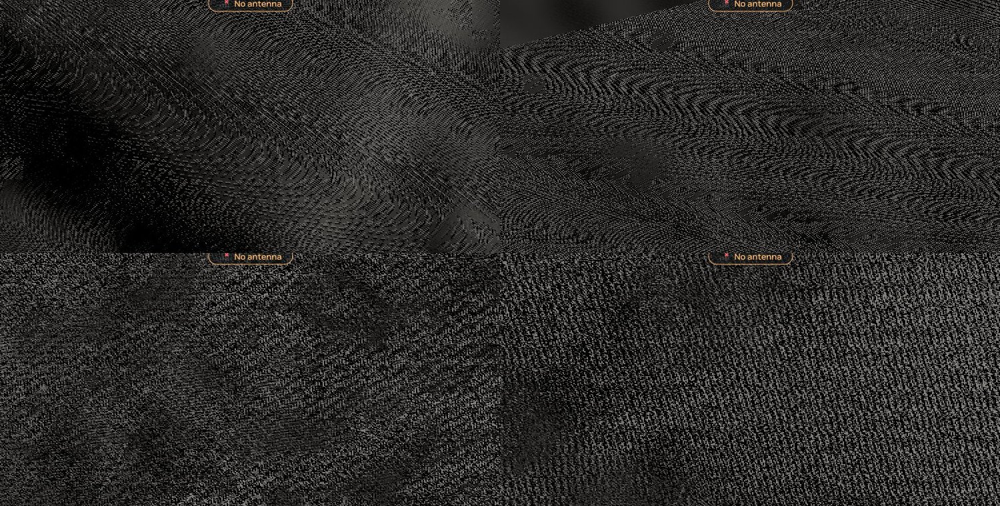

# 263 — Black slivers through the Moon's ground

**Plan:** [plans/263-black-slivers-in-moon-ground.md](../plans/263-black-slivers-in-moon-ground.md) · **Session:** Worker A, 2026-10-21 · **Report:** [owner manual test](../reviews/2026-10-20-owner-manual-test.md) item 24 ([21.webp](../reviews/assets/2026-10-20-owner-test/21.webp))

## Root cause

**Not plan 252.** Cinder is drawn by the moon pass (three displaced meshes, ADR 0054), not by the planet pass whose scale 252 changed (`budgetScale`, the upsample, the edge pass), so none of those candidates apply. The slivers are the **sun-shadow march** of the moon's shader (`moonSunVisibility`, ADR 0068): from each ground point it takes at most 24 samples along the ray to the sun, spaced quadratically (about 55 m apart at 100 m from the point, 150 m at 800 m). At a low sun the ray is long and a ridge or crater rim a few tens of metres wide is **thinner than the spacing**: from one point the samples land in it, from the next they step over it. The shadow band behind the rim, which should be one broad dark area, draws as stripes, and a rim that is caught from few points draws as thin black slivers on ground that is otherwise lit, with no ambient light to soften them on an airless body.

The CPU twin showed it: a 24 m rim, 15 m high, a 4° sun, points every 2 m through its 214 m shadow. The even spacing reported 47 of 98 points lit, in runs of up to 21 (`###......###......`), and no false shadow beyond the band (1391 points all lit). That test is in `terrain-shadow.test.ts`.

## Fix

Each pixel gives its samples a phase in [0, 1) (interleaved gradient noise of `gl_FragCoord`): sample `i` sits at `(i − phase) / steps` of the ray instead of `i / steps`. A rim thinner than the spacing is then caught by a share of the pixels in its band, not by a coherent set of them, so the stripes and slivers become fine scatter whose average is the right coverage. The CPU twin takes the same `phase` (default 0, so the vessel's shadows are unchanged). In the test the longest run of misses falls from 21 to under half of that, and the ground beyond the shadow stays lit.

This trades coherent stripes for noise; it is not an exact shadow. A true fix would sample more densely or from a max-height pyramid of the patch, at a cost this plan did not take.

## Before and after

The owner's exact view (a low camera looking at the horizon) could not be reproduced: the debug API places a vessel but the camera could not be tilted to the horizon, so the shots are straight down at a low sun, where the same aliasing shows as moiré. Cinder, 150 m up, same four places before and after (crops of two of them below; the full frames are `assets/263-before-4.jpg`, `263-before-5.jpg` and the `263-after-` pair):

Left of each pair: before; right: after. Frame time on Cinder at the same place, `renderer.debug.benchmark(1)`, three runs, a dev build at 1512 × 945 @2 with the machine on AC and the load under 3: before 64, 65, 62 ms; after 51, 64, 58 ms. No regression (the change is a hash and a subtraction per shadowed fragment); the numbers are noisy and a dev build, not the 251 tool's rows.

## Not done

- The owner's exact view is unchecked (`[manual]`); if slivers remain there, the other candidates (patch seams, depth precision) are untouched.
- The pad was not measured: it is the home planet's pass, which this shader does not draw except the hills body.
