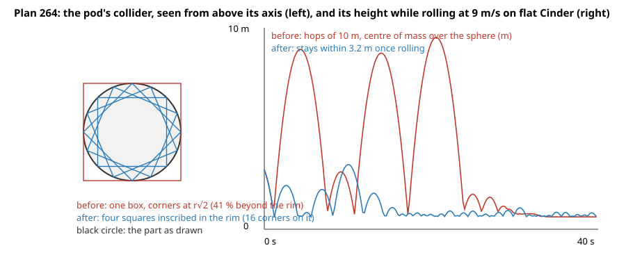

# 264 — A pod that rolls above the Moon's ground

**Plan:** [plans/264-pod-floats-above-moon-ground.md](../plans/264-pod-floats-above-moon-ground.md) · **Session:** Worker B (M5), 2026-10-21 · **ADR:** [0245](../decisions/0245-cylinder-colliders-are-inscribed-squares.md)

## Root cause (measured)

The first suspect of the plan, the ground, was cleared by measurement; the cause is the pod's own collider.

| Suspect | Measurement | Verdict |
|---|---|---|
| physics ground against drawn ground | the sim's tile height and the renderer's terrain both call `@orbital/core`'s field (`terrainUnder`, `environment.ts:303`); a vessel put on Cinder and on Home reads the field's height within 0.5 m (a test) | the same function: not the cause |
| terrain or stones | the same drop on a sphere **without terrain** hopped the same; with `STONE_MAX` at 0 the terrain run was unchanged to the digit | not the cause |
| render lag | the snapshot's own positions hop (the trace is the sim's) | not the cause |
| low-g honesty | a pod dropped straight down at 5 m/s with every restitution at 0 left the ground at +3 m/s, 4.3 m high | not honest: energy is thrown in by a corner |
| the collider | `halfExtentsOf` gave a cylinder the box `(r, h/2, r)`; its corners lie at `r sqrt 2`, 41 % beyond the rim (0.26 m for the pod, 0.5 m for a 1.25 m shield) | **the cause**: a lying pod is a rolling disc to the eye and a rolling square to the solver |

Flat Cinder, pod dropped from 3 m at 9 m/s sideways, centre of mass over the ground, 40 s: before, hops up to 9.6 m (the trace in the chart, sampled every 0.2 s); after, no hop above 3.2 m (2.1 m in the test's run, which differs by a probe vessel placed first) and most of the time within a metre of resting. The rolling is chaotic, so these are two runs, not a statistic. In the owner's screenshot the disc is a heat shield: a bigger disc, so bigger corners.

## What was done

| Where | What |
|---|---|
| `packages/sim/src/parts.ts` | `colliderBoxes`: a cylinder is `CYLINDER_SQUARES` (4) squares inscribed in its circle, turned by equal steps; a box stays one box |
| `packages/sim/src/frames.ts` | `collectColliders` places each box with the part's turn |
| tests | new `collider-shapes.test.ts`: the union never exceeds the rim and fills 85 %, a rolling pod stays under 3 m, the sim's ground height equals the field's on Cinder and Home; counts follow `CYLINDER_SQUARES` (`ground`, `grouping`); `sun-parity.json` re-frozen; the stones tests no longer assert a tilt for a toppling rocket and compare a resumed lander on a stone by height |
| docs | ADR 0245, `architecture/simulation.md` |

## What surprised me

- The ground was innocent in every measured way; the number that gave the cause away was a bounce with a restitution of 1.6 although every body has restitution 0.
- Six squares were better by the numbers (89 % fill) and failed the resume check after a pad liftoff (1.3e-2 m against 5e-3 m allowed); four stop the hops and keep it.

## Open questions / follow-ups

- **No game screenshots** (before or after): no browser run was made; the chart is measured, from the sim. `[manual]` the owner looks.
- On the same flat run the pod still speeds up while it rolls, about 0.1 m/s per second. Not examined here; it may be the tile or a rolling polygon.
- On terrain a rolling pod still hops up to about 7 m over crater slopes at 6 m/s; a part of that may be honest. Not separated here.

## Verification output

pending
