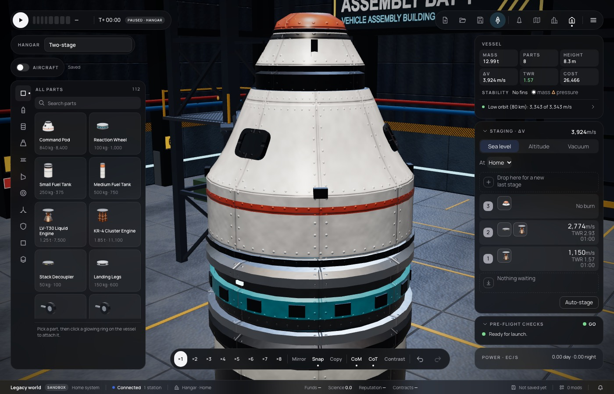

# 278 — Parachutes that continue the pod, a docking chute ring, an octagonal probe core

**Plan:** [plans/278-pods-probes-and-parachutes.md](../plans/278-pods-probes-and-parachutes.md) · **Session:** part visuals session (Claude), 2026-10-21, after plan 277

## What was done

The owner's complaint was that the parachute was a big box that did not blend into the pod's slanted top, and that a pod could not have a docking port on top as well (ADR 0260).

| Where | What |
|---|---|
| `generators/parachute.ts` | **Stack chute:** a short frustum whose wall continues the pod's slope (`params.taper`, default 0.6). It is white with a dark seam and an accent cap, has four clips and a band. The old model was an upright dark drum. **Drogue** (`params.drogue`): the same with a pointed cap. **Radial pack** (`params.radial`): a slim rounded white pack with an accent cap, two straps and a mounting plate. **Docking chute ring** (`params.ring`): 0.625 m joints at both faces, a shoulder over the pod's collar tapering back to the tunnel, and three accent canopy caps |
| Same file, `canopyDynamic` | Takes `anchors`: one canopy per point. The ring's three canopies are each `canopy / √3` across and lean apart. The lines are turned with a quaternion toward each rim point |
| `generators/probe.ts` (new) | Probe core: an octagonal prism with gold foil on four faces and white panels on the other four. Two of the panels carry louvres, one a green status lamp and a display strip. A folded whip lies on a foil face. Round joint collars with bolt heads keep the seams (ADR 0212) |
| `mods/stock/src/parts/recovery.ts` | `stock.parachute-ring` ("OrbitX PR-D16 "Mahkota"", 140 kg, top and bottom 0.625 m nodes, drag of one main) in the Recovery tech node. The chutes are renamed: PR-16 "Kuncup", PR-16R "Kuncup", PR-25 "Kuncup Kecil" (ADR 0255). The drogue gets `drogue: true` |
| `mods/stock/src/parts/comms.ts` | The probe core is drawn by `probe`, titled OrbitX NA-8 "Oktaf" |
| Tests | `packages/sim/test/parachute-descent.test.ts`: a docking port on the ring on a pod, dropped at 5 km and 250 m/s, lands under 8 m/s with the port attached and the ring's chute full. `packages/renderer/test/parts-kit.test.ts`: the stack chute's wall slope is within 10 % of the pod cone's, measured by slicing both models' triangles. Stock boot, visuals (the `probe` kind) and part-id snapshot (additions only) |



## What surprised me

- **The pod cone is steeper near its collar than on average.** From the drum to the collar it is about 0.54, but its bulge makes it 0.62 just under the collar, where the chute continues it. Slicing the generated triangles gives the true number, so the default taper is 0.6. Vertex sampling did not work: a revolved profile only has vertices at its profile heights.
- **The pod's dark docking collar still shows** as a thin band between the cone and the chute. Removing it under a chute needs the renderer to know a part's neighbours, so it is left for later (plan Scope Out).

## Decisions made

None new (ADR 0260).

## Open questions / follow-ups

- New pods: plan 300, with built-in chutes on the 3-seat capsule.
- The pod and the other command parts get OrbitX titles in plan 300.

## Verification output

```
bun test mods/stock + renderer parts, part-seams, parts-kit, parachute: 188 pass, 0 fail
bun test packages/sim/test/parachute-descent.test.ts: 2 pass, 0 fail
bun run typecheck: no errors; prettier (without .claude/launch.json) and web lint: clean
bun run test: 2107 pass, 0 fail (622 s)
apps/web CI=true bun run test: Tests 2 failed | 1372 passed; the two known
  sim-host-script-worker.test.ts failures (STATUS.md, Known issues)
```
