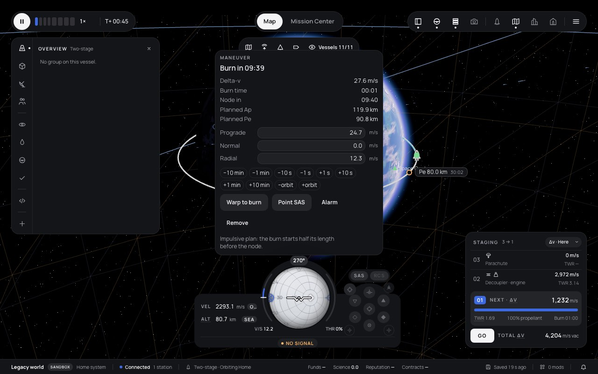
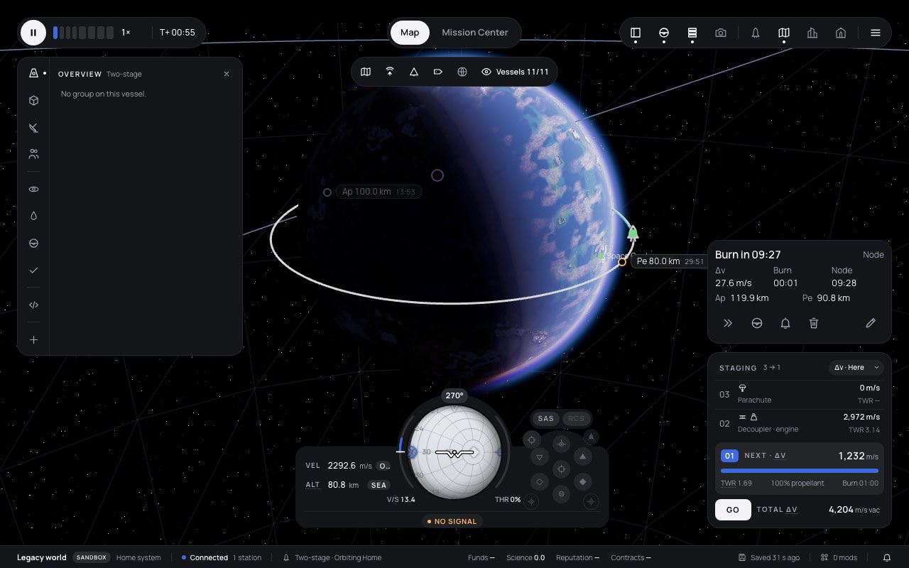
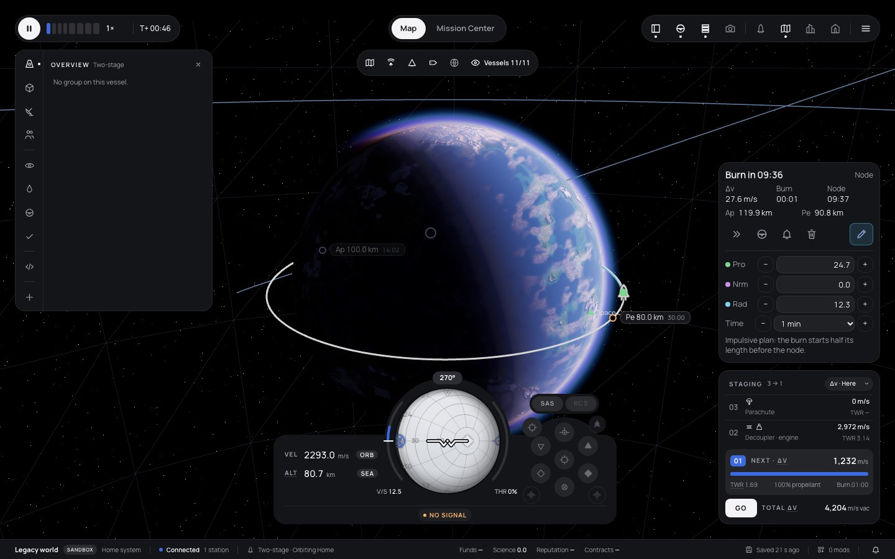
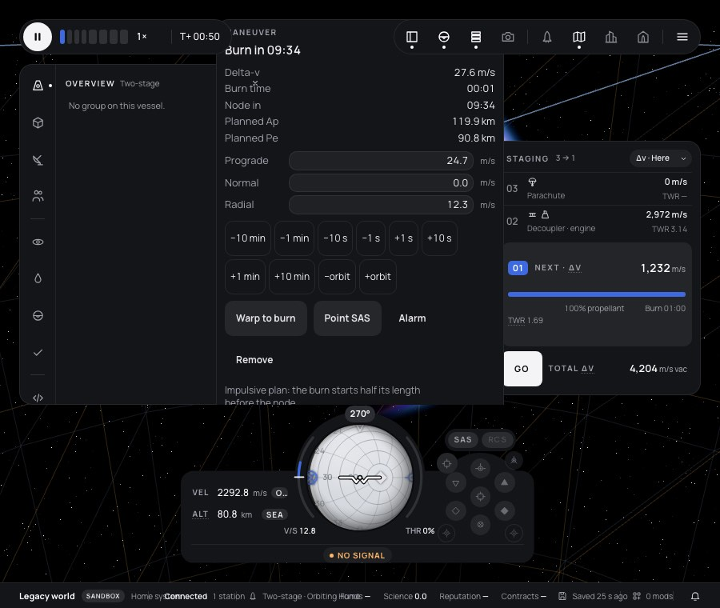
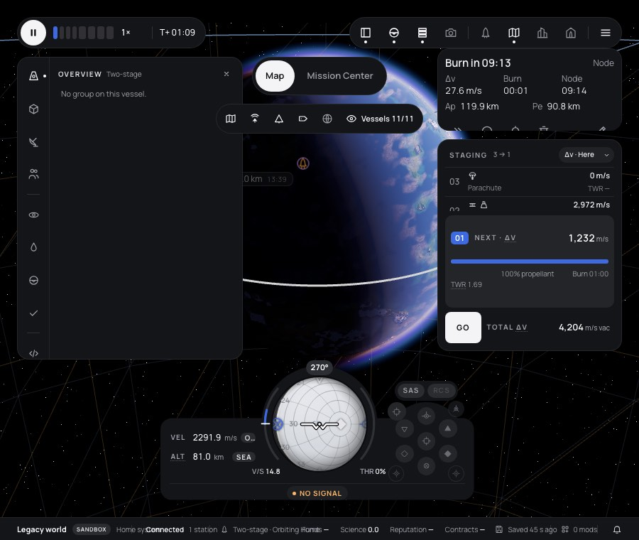
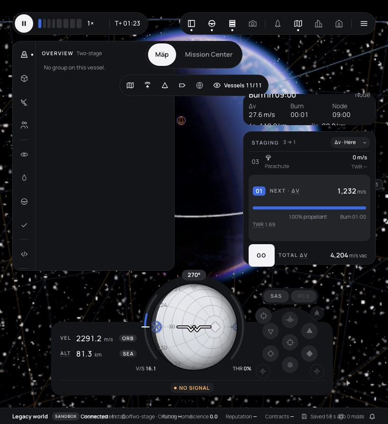

# 292 — Map toolbar in one row, compact maneuver card

**Plan:** [plans/292-map-toolbar-one-row-and-compact-maneuver-card.md](../plans/292-map-toolbar-one-row-and-compact-maneuver-card.md) · **ADR:** [0267](../decisions/0267-map-toolbar-one-row-and-maneuver-card-on-staging.md) · **Session:** map HUD compact session, 2026-10-21, in its own worktree off `origin/main` ad5777d8

## What was done

| Where | What |
|---|---|
| `lib/map/MapFilterBar.svelte` | an optional `regions` prop: a `globe` chip ("Science regions", `data-testid="map-regions"`) between the layer chips and Vessels |
| `lib/hud/RegionsLayer.svelte` | only the label under the cursor; its pill is gone |
| `lib/hud/ManeuverPanel.svelte` | rewritten as a card. Folded: status, `Node i/n` with previous/next, Δv · Burn · Node, Ap · Pe on one line, icon actions (warp `faster`, point SAS `navball`, alarm `bell`, remove `trash`) and the pencil. Open: Pro/Nrm/Rad fields with − / + steppers (1 m/s, Shift 10, arrow keys in the field), a Time stepper (− / step select / +, the step one of 1 s, 10 s, 1 min, 10 min, 1 orbit) and the note. The fold and the step are module state (`maneuverCard`), kept for the session |
| `lib/ui/icons.ts` | `bell` |
| `lib/layout/regions.ts` | `cornerTop(top, column, tools, gap)`: where the right column must stop so it stays under the map toolbar |
| flight `+page.svelte` | the switch and filters in one `.maptools` box; the card moved from above the navball into `.br`, on staging; `.br` renders when staging is shown or a card is due; `--br-cap` cuts the column's max-height under the toolbar |
| tests | `maneuver-card.test.ts` (5), `regions.test.ts` (chip), `layout/regions.test.ts` (`cornerTop`, 3); e2e `navigation.e2e.ts` opens the editor and reads `maneuver-index` |

## How the placement was found

1. First try: the card at the top right, first in the inspectors' column (`.ins`). Good at 1280 and 1440. At 900 × 760 staging stands above the navball module (narrow mode), so the column between the bars and staging was about 80 px tall. The card was cut to its last rows.
2. Second try: the card on staging, in `.br`. At 900 × 760 the card and staging were 15 to 20 px too tall for the room. Drawer mode's 44 px floor for every `.panel button` was the cause, plus the Ap/Pe row. The card's buttons now keep their size with a mouse: `:global(.ui.drawer) .mnv-card.mnv-card :global(button)`. The doubled class beats the page's equal-specificity rule. Ap and Pe share one line on a 6-column grid. After that, 900 × 760 fits without scrolling.
3. At 760 × 830, below the supported 900 × 500 (the small-screen notice shows), the column is capped under the toolbar (y ≈ 185). Staging then lost its GO row behind the navball module. Two fixes were tried:
   - `min-height: min-content` on staging made it keep its whole queue. Worse.
   - What stays: the card shrinks three times as fast (`flex: 0 3 auto`, minimum one status line) and scrolls inside. Staging keeps its GO row.

## Screenshots

Production build (`vite preview`), Chromium via Playwright, two-stage vessel in a 100 × 80 km orbit with a node 600 s ahead (prograde 24.7, radial 12.3), dock open on Overview:

| | |
|---|---|
| before, 1280 |  |
| after, 1280 |  |
| after, 1440, editor open |  |
| before, 900 |  |
| after, 900 |  |
| after, 760 (below the supported size) |  |

Also checked, not committed: 1440 flight view, where the card stands on staging and the planned orbit is absent outside the map; `--ui-scale: 1.25` at 1440; `data-contrast="more"` at 1440. In all three the card is clear of the navball module, staging, the dock and the toolbar. The UI-scale shot set only the CSS variable, so `layoutFor` still saw 100 %.

## Verification

See the plan's Log for the command output. One more note on `navigation.e2e.ts`: its last step stops a warp with a 5-minute alarm. It then asserts that the clock reads at most `t1 + 301` s. Twice it read 0.41 s and 0.54 s past that. The clock runs at 1× between the stop and the read, and the machine was shared with other agents' builds. The step uses no card control. A baseline run of the same spec on `origin/main` was started but not finished: the shared heavy-job lock was held by another session for over 30 minutes, so the run was cancelled.

## Open

- On a short window in drawer mode, with the editor open, the card scrolls inside. Its status line stays, but the action row can be scrolled out of view.
- Touch: the steppers and the time select are 44 px under `pointer: coarse`, by CSS. They were not tried on a touch device.
