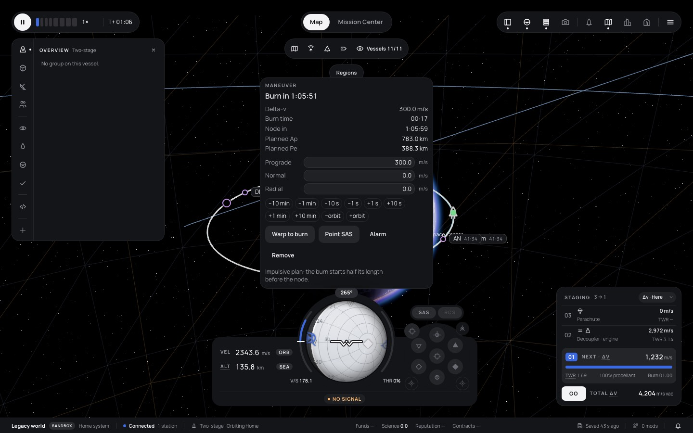
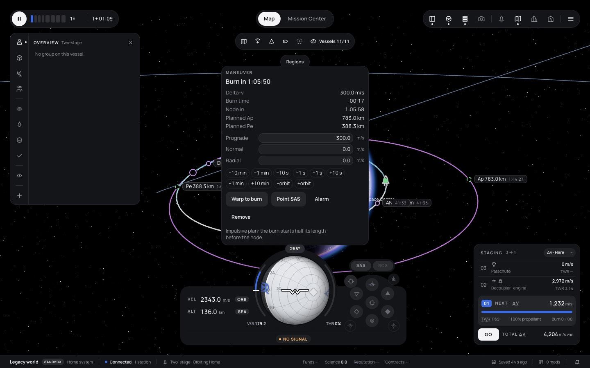

# 293 — Flight map: the escape-burn crash, text selection, spheres of influence, steady lines

**Plan:** [plans/293-flight-map-crash-selection-soi-and-steady-lines.md](../plans/293-flight-map-crash-selection-soi-and-steady-lines.md) · **ADR:** [0266](../decisions/0266-map-paths-drawn-in-body-frames-and-soi-on-demand.md) · **Session:** map crash + jitter session, 2026-10-21, worktree `fix/293-map-fixes` off `origin/main` ad5777d8

## 1. The crash: `propagateUniversal` did not converge

The owner's crash was dt = 50740.92485174809 s and α = −6.236880549521935e-7 1/m on the home body (μ = 3.5316e12): a hyperbola with a = −1.6 Mm.

A script swept states on that hyperbola. It reproduces from the periapsis at radii of 300 km and below (the owner's state was a node's post-burn state). A fuzz of 20 000 random elliptic and hyperbolic cases with |dt| up to 1e7 s failed 85 times before the fix.

The cause is the first guess. For anything not clearly elliptic it was the near-circular scale √μ·dt/r0, which is about 1.4e5 here against a root of about 5e3. F(χ) grows like e^{√(−α)χ}, so Newton from above walks down by about 1/√(−α) = 1 266 per step. Newton never left the bracket, so the bisection fallback never fired. The walk took more than the 100 iterations.

The fix (`packages/kepler/src/propagate.ts`):

- Vallado's hyperbolic guess, sign(dt)·√(−a)·ln(−2μα·dt / (r0·v0 + sign(dt)·√(−μa)·(1 − r0α))), with the old scale as the fallback.
- The bracket grows from twice the guess, so a good guess lies inside it.
- `rtsafe`'s rule: bisect when Newton leaves the bracket or does not halve the previous step. This bounds the iterations whatever the guess.
- A cap of 400, and convergence also when the bracket closes.

After the fix the same fuzz gives 0 failures, a worst relative error of 6.5e-11, and 52 ms for 20 000 solves.

The tests have the owner's numbers in both directions at four periapsis radii, plus 2 000 random long hyperbolic and near-parabolic steps. Both tests fail on the old solver:

```
(fail) the escape burn of the map crash converges and agrees with element propagation
(fail) long hyperbolic and near-parabolic steps always converge (2 000 random cases)
 7 pass  2 fail          ← old propagate.ts
 9 pass  0 fail          ← new
```

Graceful failure, so no `KeplerError` from the map reaches the page:

- `predictPatchedConics` ends the segment when the crossing search throws.
- `mapPathOf` stops the stretch at the last good sample.
- The maneuver controller keeps its last prediction.
- `stretchApsides` and `planeNodes` skip the point.

## 2. Text selection on drags

A synthetic drag in the browser pane selected nothing, with or without the fix, so the owner's highlight could not be reproduced by CDP input. The fix is defensive, in `flight/+page.svelte`:

- `user-select: none` on the canvas and the map layers (`.stage > .layer`).
- While a press that began on the canvas or a map layer is held, `selectstart` is cancelled.
- Any old selection is cleared when such a press starts.

Checked in the pane: the computed `user-select` is `none` on the canvas and the four layers. A `selectstart` during a canvas press is `defaultPrevented`, and after the release it is not.

Handle drags: the arm used to find each handle's screen direction was 5 % of the node's distance from the **sun** (hundreds of megametres), because node positions are in the system frame. It is now 5 % of the node's distance from its own body. The hint box's place on screen is plan 292's.

## 3. Spheres of influence

`MapFilters.soi` (off by default; a value saved before this plan reads as off) is a new switch in the filter bar ("Spheres of influence", a dashed-sphere icon). `setMapLayers({ spheres })` gates the body spheres and the encounter ghosts.

- Renderer test (`moon.test.ts`): the sphere is hidden by default and shown after `setMapLayers({ orbits: true, spheres: true })`.
- Filter tests: the default, the old value, and the round trip.
- Browser (Playwright on the dev server): the switch shows `aria-pressed="false"` on a fresh profile. After it was switched on and the page reloaded, it was still on (localStorage `"soi":true`).

## 4. The jitter

Root cause, from the code and confirmed in the browser: every stretch was drawn at `bodyOffset`, its body's centre at the stretch's start time in the system frame. Since plan 122 the home planet orbits the sun at 9.3 km/s, which caused three problems:

- A planned stretch after a node 1 h ahead hung 37 Mm along the planet's orbit, off the screen.
- The vessel's own stretch lagged the planet by 750 ms of sim time and then snapped back. At 1000× warp that is 7 000 km.
- Each prediction resampled at `t0 + k·span/160` from the current time, so the chords slid along the curve.

Before and after, the same scene (Home orbit 400 × 120 km, a node 1 h 6 min ahead, 300 m/s prograde). On the deployed build the planned (purple) orbit is nowhere near the planet, and the sphere net covers the screen. On this branch the planned orbit sits on the planet with its Ap 783 km and Pe 388 km labels:




Fix: `MapPath.frame` (ADR 0266) and `sampleTimes` (a fixed grid of power-of-two seconds). The renderer's `MapPathSegment.frame`, the node markers and handles, and the encounter and apsis labels all place by the bodies as the snapshot has them now.

Tests:

- A planned stretch around a sun-orbiting planet is drawn at the planet now. Its old offset was more than 10 Mm away.
- A moon encounter hangs where the moon will be, relative to the planet.
- Two predictions 10.25 s apart share more than 50 points to 1 mm.
- A framed path in the renderer is placed at the body.

Measured in Playwright: the node marker against the vessel's own Ap, Pe, AN and DN markers did not move between frames at 1× and 10×. Headless software WebGPU renders too few frames to measure higher rates; the old build gives the same reading there.

The trajectory goldens (`trajectory-golden.test.ts.snap`) were regenerated. They gain `frame` and `times`, and the points are on the new grid.

A side effect: with chords that differ between passes, picking a node's time on a looping orbit treats passes within 3 px as the same place (`SAME_PLACE_PX`, was 1 px). The controller test "a click on the orbit asks the sim for a node at the time of that point" caught this.

## Coordination

Plan 292's session (map toolbar, maneuver card) had uncommitted edits in the same area. I added one row inside `LAYER_ROWS`, appended the `soi` icon at the end of `ICONS`, and added one CSS block after `canvas {}` in the flight page, all outside its hunks. It was told by message.

## Verification

Commands, in the worktree under the heavy-job lock with `nice`:

- `bun run typecheck`: 0 errors (svelte-check: 2073 files, 0 errors, 0 warnings). On a fresh worktree it first needs `build:sandbox`, which the dev server runs.
- `bun run test`: 2089 pass, 0 fail, 310 files.
- `CI=true bunx vitest run` in `apps/web`, after the merge of origin/main: 1362 pass, 2 fail. Both failures are in `sim-host-script-worker.test.ts`: the real QuickJS thread times out. They fail the same way in the owner's untouched checkout at ad5777d8, so they come from before this plan. Before the merge, two other failures were the goldens, which were then regenerated.
- `bun run lint`: exit 0. The first run flagged Prettier style in `map-path.ts` and its test, which are now formatted.
- `bun run docs:check`: OK once the plan was set to done.
- After the merge, `bun run test` had two `career-bot` 3 600-day runs past the 90 s timeout on a loaded machine (300 s and 1 690 s of wall time). Run alone they pass (plan Log).
