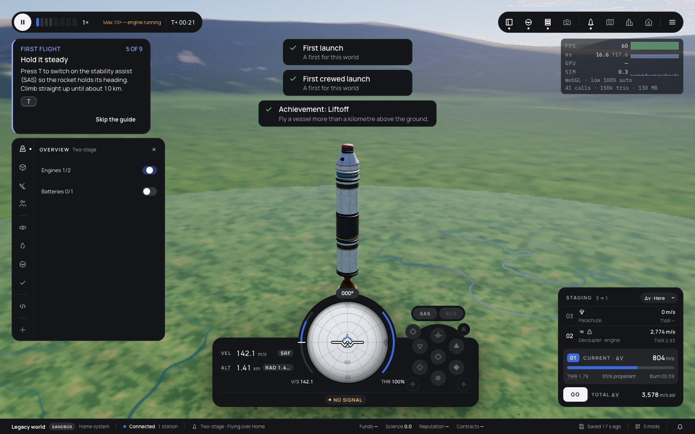
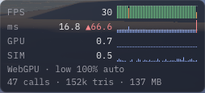
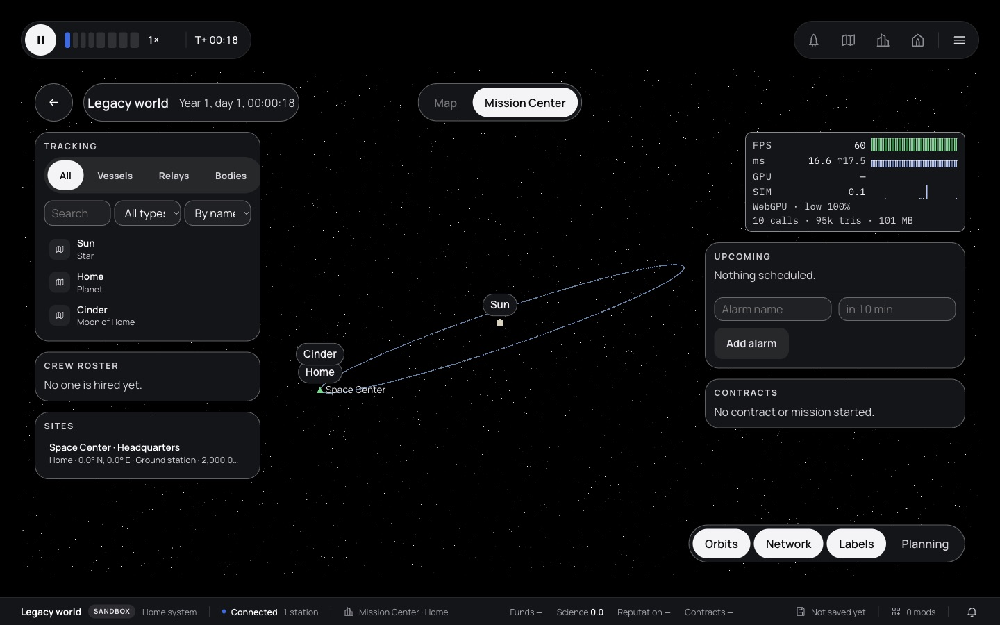

# 294 — A compact performance overlay

**Plan:** [plans/294-performance-overlay.md](../plans/294-performance-overlay.md) · **Session:** perf overlay session, 2026-10-21, in its own worktree off `origin/main` ad5777d8

## What was done

| Where | What |
|---|---|
| `apps/web/src/lib/perf/perf-stats.ts` | `Ring` (fixed-capacity history), `FrameWindow` (one `Float32Array` write per drawn frame, drained into FPS, p50 and max), `isSpike`, `PerfSource` (a view's frames plus a sample on demand), the formats |
| `apps/web/src/lib/perf/PerfOverlay.svelte` | The overlay: rendered once by Svelte, then a 100 ms timer writes the digits with `textContent` and draws four canvases (FPS, frame max with the 16.7 ms line, GPU, sim), 50 samples (5 s) each. `aria-hidden`, nothing focusable, `pointer-events: none`, no backdrop blur (it would cost GPU time on the frame it measures), sizes in rem, token colours, a solid surface in high contrast |
| `packages/renderer/src/renderer.ts`, `renderer-webgpu.ts` | `debug.counters()`: the backend and the last frame's draw calls and triangles, without `info()`'s GPU name |
| `flight-loop.ts`, `space-center-loop.ts`, `mission-center-loop.ts` | A `PerfSource` fed by each drawn frame, `perfSample()` |
| `settings.ts`, `SettingsDialog.svelte` | `interface.perfOverlay` (optional in format 4, absent = off) and its switch in Settings → Interface |
| Flight page | The overlay heads the top-right `.ins` column (ADR 0253 point 3), so the part inspectors stand below it, never under it |
| Space Center page | Top right under the bars |
| `MissionCenterOverlay.svelte` | `perf` prop: the overlay heads the right column, above Upcoming |

## Surprise: `renderer.debug.info()` stalls WebGL

The first version read `debug.info()` every sample. On WebGL a tick then took 3 to 11 ms (smoothed) and the flight ran at 30 to 43 fps instead of 60. A split of the tick showed the sample alone at 55 to 66 ms once a second (I had already cut it to one read a second), the text and the canvases at 0.1 ms or less. `info()` calls `gpuName()`, which on WebGL asks for `UNMASKED_RENDERER_WEBGL` every call: a synchronous query that waits for the GPU. The overlay now reads `debug.counters()` (plain numbers the renderer keeps) and `renderer.preset`, never `info()`.

Debug → Info still calls `info()` when it refreshes; that is a dialog, not a per-frame read, so it stays as it is. Worth knowing for anyone who polls it.

## Verification

Headless-off Chromium (Playwright 1.64.1, `--enable-unsafe-webgpu`) against the dev server at 1440x900, the two-stage example launched at full throttle; the renderer chosen with `orbital.graphics.renderer`. The overlay keeps its own tick cost, smoothed, in `data-tick-ms`; 30 readings 0.5 s apart:

| | tick, ms (min – max) | the overlay read |
|---|---|---|
| WebGL | 0.106 – 0.176 | `FPS 60 · ms 16.6 ↑17.6 · GPU — · SIM 0.3 · WebGL · low 100% auto · 41 calls · 150k tris · 130 MB` |
| WebGPU | 0.117 – 0.177 | `FPS 61 · ms 16.6 ↑17.4 · GPU 0.7 · SIM 0.9 · WebGPU · low 100% auto · 47 calls · 152k tris · 148 MB` |
| Space Center (WebGPU) | 0.180 | `FPS 60 · … · GPU 0.8 · … · WebGPU · low 100% · 36 calls · 476k tris · 98 MB` |
| Mission Center (WebGPU) | 0.148 | `FPS 60 · … · GPU — · … · 10 calls · 95k tris · 100 MB` |

The whole tick (sample, text, four canvases) is under 0.2 ms and runs once per 100 ms, so at 60 fps it is about 0.02 ms a frame; the per-frame part is one typed-array write. `performance.now()` is quantised to 0.1 ms on this page (no cross-origin isolation), so single ticks read 0.0 or 0.1; the smoothed value averages that out.

Space Center and Mission Center draw with no governor, so they show no `auto`/`fixed`. Mission Center's GPU reads `—` on WebGPU: its renderer reports no `gpuFrameMs` there (the flight and the Space Center do).

- Settings → Interface → Performance overlay turned on in the browser pane; `orbital.settings` then held `interface.perfOverlay: true` and the overlay showed in the flight after the reload.
- In the flight: `aria-hidden="true"`, 0 focusable elements inside.
- Space Center and Mission Center were checked with high contrast on and the UI at 125 %: font 13.75 px (11 px × 1.25), background the solid `--surface-solid` (rgb 20 21 24).
- The WebGPU overlay crop caught a spike: `▲66.6` in `--danger` and a red bar.

Also: [flight on WebGPU](assets/294-flight-webgpu.jpg), [Space Center](assets/294-space-center.jpg), [overlay on WebGL](assets/294-overlay-webgl.png).

Checks (no e2e, on the owner's word through the coordinating session): see the plan's Log.

## Open

- Debug → Info's `info()` stalls WebGL for tens of ms on each refresh (above). Not changed here.
- WebGL's draw counters are three.js's `info.render` after the last `render` call of the frame; where a post chain renders in several calls they are the last call's, not the frame's.
