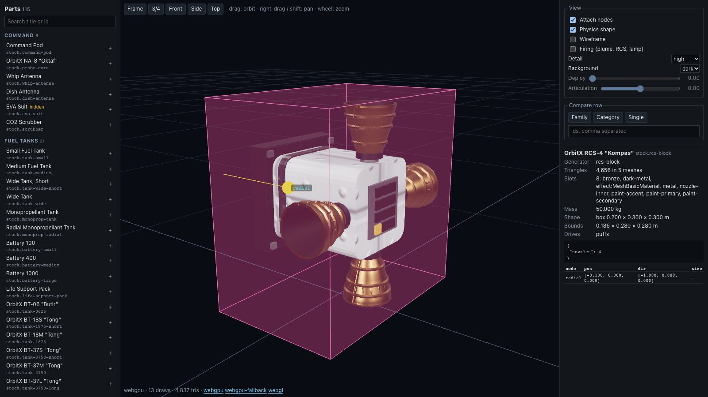
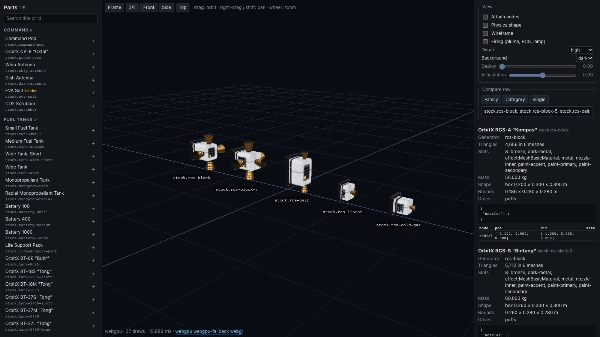
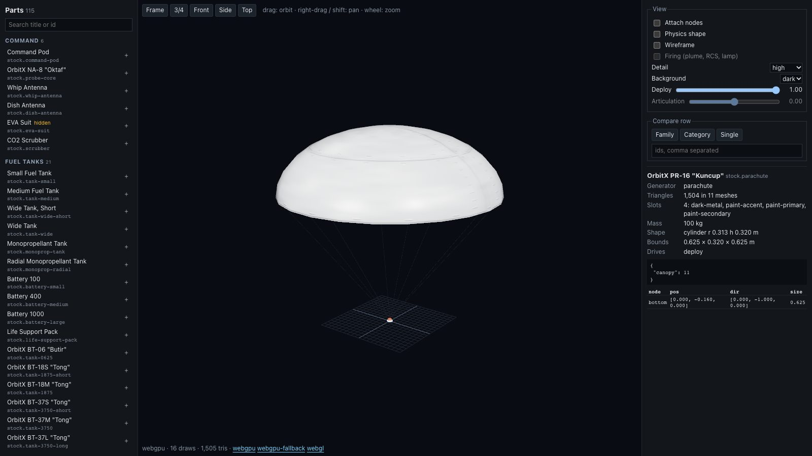
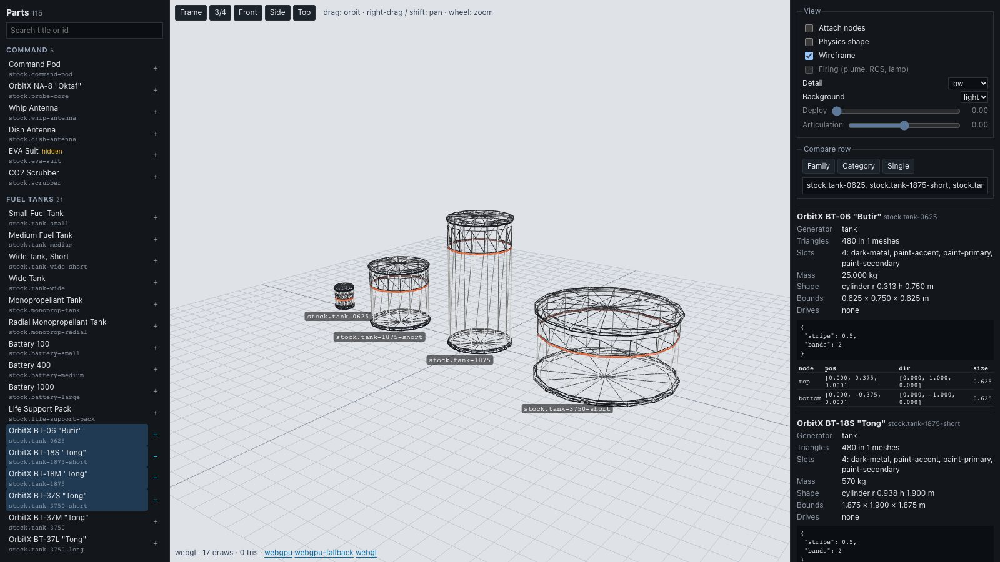

# 301 — A part model viewer page for debugging

**Plan:** [plans/301-part-model-viewer.md](../plans/301-part-model-viewer.md) · **Session:** part viewer session, 2026-10-21, in its own worktree off `main` c56dd985

## What was done

| Where | What |
|---|---|
| `packages/renderer/src/part-viewer/viewer.ts` | `createPartViewer` / `PartViewer`: its own renderer (`WebGLRenderer`, or three's `WebGPURenderer` with `forceWebGL` for `webgpu-fallback`), a `RoomEnvironment` PMREM, a side key light and a hemisphere fill, a half-metre `GridHelper` floor, one `PartModelFactory` at the chosen preset's detail; parts stand on the floor in a row; overlays for attach nodes (sphere, direction line, a ring of the node's diameter; cyan for stack nodes, yellow for nodes without a size) and the physics shape (faint fill plus edges); wireframe; an orbit camera (drag, right-drag or Shift to pan, wheel); `frame`, `resetView`, `view('front'/'side'/'top')`; `stats()` and `labels()` |
| `packages/renderer/src/part-viewer/layout.ts` | Pure: `rowLayout`, `rowGap`, `frameDistance`, `nodeMarkerRadius`, `driveModules` (module snapshots for the deploy flag, the articulation field, and plume/puffs/lamp when firing) |
| `packages/renderer/package.json` | Export `@orbital/renderer/part-viewer` (imported by the page on mount only) |
| `apps/web/src/lib/dev/part-viewer.ts` | Pure: `parseViewerQuery`, `viewerQueryString`, `shownParts`, `familyOf`, `familyMembers`, `groupByCategory` |
| `apps/web/src/routes/dev/parts/+page.svelte` | The page: the part list (every part of stock and the enabled mods, hidden debris pieces marked, grouped by catalogue category, searchable by title and id, `+` adds to the row), the canvas with labels, toggles, sliders, compare buttons, the stats panel; the address follows the view |

## How to use it

Open `/dev/parts` (dev server or the build; nothing links to it). Click a part to view it alone; `+` on other parts makes a row. "Family" compares every part whose id starts with the same word (`stock.tank-*`, `stock.rcs-*`), "Category" every part of the catalogue category, "Single" goes back to one part; the text field takes an id list. The address is always a link to what is on screen:

- `/dev/parts?part=stock.rcs-block&nodes=1&shape=1`
- `/dev/parts?compare=stock.rcs-block,stock.rcs-block-5,stock.rcs-pair,stock.rcs-linear,stock.rcs-cold-gas`
- `/dev/parts?part=stock.parachute&deploy=1`
- keys: `part`, `compare` (comma list), `detail` (`low`/`medium`/`high`), `nodes`, `shape`, `wire`, `fire` (`1`), `deploy` (0..1), `art` (-1..1), `bg` (`light`), and `renderer` (`webgl`, `webgpu`, `webgpu-fallback`; links at the bottom of the canvas switch it).

The articulation slider maps -1..1 to a gimbal tilt of ±0.25 rad about the part's Z, a hinge angle of ±0.6 rad, an extend length of up to 20 m, or the visible piece shown (> 0) or hidden (< 0); at 0 nothing is written, which is the Hangar's rest pose.

## Decisions

- **The viewer owns a renderer instead of reusing `VabView`.** `VabView` is WebGL only and brings the whole hangar; the flight `Renderer` needs a world. The viewer is ~700 lines on the same factory, so what it shows is what the game builds.
- **WebGPU draws the GLSL effects through their twins** (`hideUnported` + `Twins`, as the flight renderer does), so the plume shows under WebGPU too.
- **Deploy jumps to the slider** (`setState` then `tick(60)`), so dragging the slider scrubs the animation instead of easing behind it.
- **Detail rebuilds the factory**: the texture size belongs to the `MaterialLibrary`.
- **Framing includes what deployed** (meshes with a material slot, not the transparent effects), so a parachute at `deploy=1` frames its canopy. The page applies the options before `setParts` for that reason.
- No ADR: a development page that changes no contract.

## Surprises

- `PMREMGenerator.fromSceneAsync` is deprecated in three r186 for the node renderer; after `await renderer.init()` the plain `fromScene` works.
- SvelteKit 3.1 warns on `history.replaceState` (`history_api_conflict`) and on `replaceState` from `$app/navigation` (deprecated); `goto(url, { replace: true, shallow: true })` is the quiet way.
- `tips.test.ts` (plan 228) forbids native `title=` attributes anywhere under `src/`, dev pages included: the page uses `aria-label`.
- The RCS jets (plan 211) are 0.5 m long on a 0.3 m block; with `fire=1` they dominate a compare row. That is the shipped look, now easy to judge.
- Wireframe under WebGL counts 0 triangles in the footer (three counts lines as lines); the stats panel's triangle count is the model's own.

## Verification

Screenshots (Playwright 1.64 Chromium, `--enable-unsafe-webgpu`, dev server on port 5175, 1600x900):

| | |
|---|---|
|  | `part=stock.rcs-block&nodes=1&shape=1`, WebGPU: the radial node with its direction, the 0.2 × 0.3 × 0.3 m box shape around the model, the stats (rcs-block, 4,656 triangles in 5 meshes, 8 slots) |
|  | the five RCS parts in a row with labels, WebGPU, 37 draws |
|  | `part=stock.parachute&deploy=1`, WebGPU: the canopy out, framed |
|  | four tank sizes, `wire=1&detail=low&bg=light&renderer=webgl` |

The footer read `webgpu · 13 draws · 4,837 tris` for the single RCS block and `webgpu-fallback (WebGL2) · 13 draws` for a parachute with `renderer=webgpu-fallback`; `renderer=webgl` drew the same parachute (`webgl · 16 draws · 952 tris`).

Commands (trimmed):

```
$ bun test packages/renderer/test/part-viewer.test.ts
 5 pass  0 fail
$ bun test packages/renderer
 737 pass  0 fail
$ cd apps/web && CI=true bun run test
 FAIL src/lib/sim-host-script-worker.test.ts > … runs a script end to end in another thread
 FAIL src/lib/sim-host-script-worker.test.ts > … a QuickJS builtin that ignores the interrupt budget …
 Tests  2 failed | 1378 passed (1380)      # the two known failures on main
$ bun run lint            # All matched files use Prettier code style!
$ bun run typecheck       # svelte-check: 0 ERRORS 0 WARNINGS
$ bun run docs:check      # ok
```

## Open questions

- None blocking. A follow-up could add picking (click a node to highlight its row) or a turntable animation for videos; not planned.
