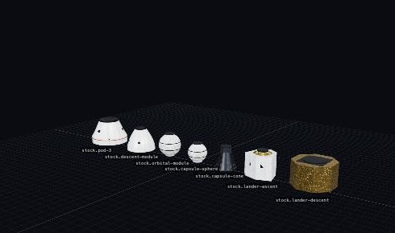
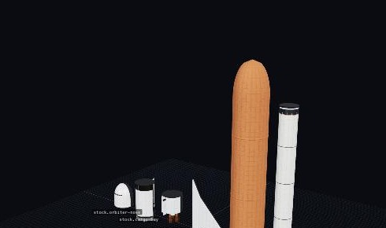
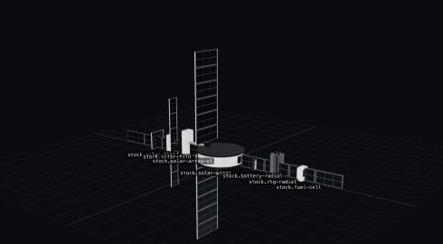

# 303 — The mission parts batch and six mission blueprints

**Plan:** [plans/303-mission-parts-and-blueprints.md](../plans/303-mission-parts-and-blueprints.md) · **Session:** part visuals session (Claude), 2026-10-21

## What was done

The owner's order: prepare first, then all the parts, then blueprints of famous missions, short tests only.

1. **Preparation** was plan 302 (open/close, bay doors, fuel cell, single leg, staged panels). Plan 301 is a worker's `/dev/parts` viewer.
2. **Generators:**
   - `dyn.ts` builds the moving pieces from the kit and poses them by the deploy progress.
   - Moving pieces: folding and tracking solar arrays, stack wings, a whip that swings up and telescopes, a dish that opens like an umbrella, bay doors and petals hinged at their edges, instrument doors, a telescope door, a single leg.
   - Static parts: flat panel, batteries (stack cells and radial pack), RTG, fuel cell, relay dish, seven instrument looks, three containers, couplers, truss, hub, lattice interstage, headlight, sphere and cone capsules, crew cans and station modules, cupola, radiator, satellite bus, boom, lander stages, orbiter nose and aft, delta wing, external tank, escape tower.
   - The engine cluster can put one bell on the axis (a quincunx of 5, an octaweb of 9). The capsule draws three built-in canopies when `chutes` is set.
3. **Parts** (`mods/stock/src/parts/missions.ts`): 59 parts, each in a tech node, with OrbitX titles. The old stack solar, antenna, RTG, science, life-support and data parts are `catalog.hidden`: old designs still resolve (ADR 0259).
   - Payload seats: an `inner` node on the cargo bay and the payload petals.
   - A `bottom` node under the lander's descent stage.
   - A `radial` node on the external tank.
4. **Blueprints** (`apps/web/src/lib/editor/missions.ts`), built with the editor's own operations:
   - Kronos V + Selene (Apollo 11).
   - Ulang-Alik (Space Shuttle). Its main engines draw on the external tank through a fuel line, and its stages are explicit: engines and boosters, boosters off, tank off.
   - Stasiun Cakrawala (station core).
   - Pengorbit (lunar orbiter).
   - Teleskop Cakrawala (space telescope).
   - Satelit Peneliti (research satellite).
5. **A Hangar bug found on the way.** The Hangar's delta-v model gave a resource with `flowMode: 'none'` (solid fuel) no store at all. So every stage with solid boosters burned nothing in the Hangar's figures: the booster rocket's first stage read 0 m/s. The sim's `sources()` gives the part itself; the Hangar now does too.





## What surprised me

- **Test budgets shaped the models.**
  - The low preset must stay under 0.6 of high. Fixed-count extrusions (windows, cells, struts) therefore drop or thin out on low.
  - The engine plates lower each bell's sides past four bells.
  - A flat window frame on a narrow cylinder pokes out at its corners, so it is set 3 cm into the wall.
- **Off-axis joints.** The seam test measures a joint's rim from the part's axis. A coupler's bottoms and the hub's side ports are listed as exceptions, with the reason.
- **The hub's side ports cannot be used from the editor yet.** A stack part's nodes point along ±Y, and the editor does not turn a part onto a sideways node. The station blueprint uses the hub's top. Plan 279 (free placement) is the place to allow it.
- **Two new experiments raised Home's science caps and broke the tech pacing test.** They are high orbit only.
- **Prettier ran between my scripted edits, so some text replacements silently missed.** I now check the edit, not the script's exit code.

## Open questions / follow-ups

- The Hangar UI for these blueprints: the Library is plan 285. A quick list in the welcome card comes after plan 279's branch is merged, because both touch the Hangar page.
- The remainders listed in plan 303's table, in their plans.
- Robotics waits on ADR 0265.

## Verification output

```
bun test mods/stock: 160 pass, 0 fail
bun test packages/renderer (parts, part-seams, parts-kit, shrouds, vab, parachute, cluster): 65 pass, 0 fail
apps/web CI=true vitest src/lib: Tests 2 failed | 1383 passed (the two known sim-host-script-worker tests)
  missions.test.ts: 7 pass
```
