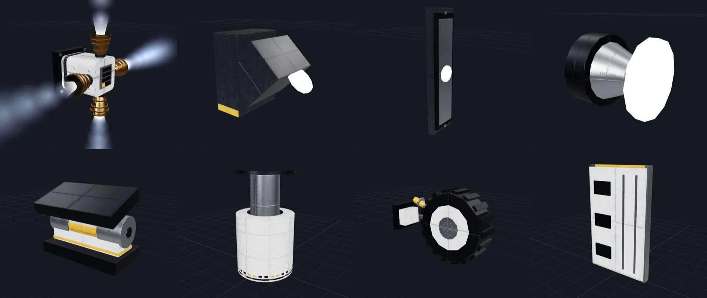

# 311 — Lights, the RCS jet, RCS propellant

**Plan:** [plans/311-lights-panel-angled-nav.md](../plans/311-lights-panel-angled-nav.md) · **Session:** part visuals session (Claude), 2026-10-21

## What was done

- **Lights**, answering the owner's "KSP has flat lights, angled lights and others; do we?":
  - "Strip": a flat panel flush on the hull, a wide soft beam;
  - "Slant": its housing turns the beam 45° along the hull, with no tilt needed;
  - three navigation lights, "Port" (red), "Starboard" (green) and "Beacon" (white), blinking from the start;
  - the spotlight and floodlight renamed "Torch" and "Glow" (ADR 0255, 0268).

  The lamp model already took any position and direction (ADR 0239): the angled lamp is `dir: [√½, √½, 0]`.
- **RCS propellant** (owner's screenshot: Horizon Station's RCS read "no propellant"):
  - Horizon Station had no monopropellant at all;
  - the Kronos service module and the satellite bus (Moonwatch, telescope, Aurora) had none either;
  - the new crewed pods started with an empty store.

  Now: radial monoprop tanks on the station's habitat and the Kronos service module, 60 units in the satellite bus, and the plan 303 pods filled at build. The old command pod stays empty, as plan 211 chose for its frozen tests. A test fails if a blueprint with RCS carries less than 30 units.
- **The RCS jet** (owner: "it should look like a high-pressure gas jet"): a short bright core at the nozzle, and ten soft camera-facing puffs streaming out, each larger and fainter than the last, with a flicker.



Top row: the RCS jet; the angled lamp; the strip; a navigation light. Bottom row: the hinge, the piston extended, the rover wheel, the rover deck.

## What surprised me

- **A cone looks like a light beam.** Seen from the side, an additive cone has hard straight edges. Gas reads as soft round puffs.
- **WebGPU ignored the opacity of additive materials.** The same cone at opacity 0.6, 0.3 and 0.12 looked the same there, and faded in WebGL. Brightness now goes in the colour (`Color.multiplyScalar`), which both renderers honour. The fade along the core is a 1×64 texture, not vertex colours.
- **The core's length followed the jet's `length`.** On a part with a long jet it became a bar of light. The core is now capped at 7 cm.

## Verification output

```
bun test mods/stock: 162 pass
bun test packages/renderer: 743 pass
apps/web vitest missions, mission-flights, blueprints: 18 pass
```
