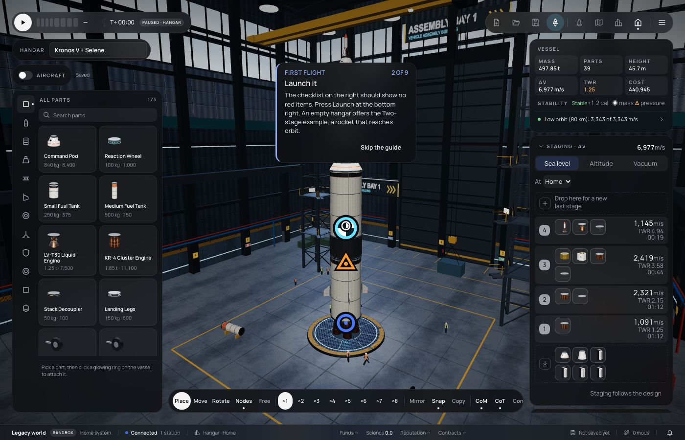

# 314 — A bigger Hangar

**Plan:** [plans/314-bigger-hangar.md](../plans/314-bigger-hangar.md) · **Session:** part visuals session (Claude), 2026-10-21

## What was done

- The room is 1.5 times bigger: 90 × 90 m, with the roof at 69 m (it was 60 × 60 × 46 m). Kronos V is 45.7 m tall.
- The shell is built as before and scaled as one group (`HANGAR_SCALE`), so every truss, window, lamp, sign and crane rail keeps its place on the walls. The platform, the walking crew and the tug keep their real size.
- Camera limits grew with the room. When a craft is too tall to frame from inside the walls at 38°, the view widens up to 75°, as a camera in a real building would.



## What surprised me

- A bigger room alone did not frame Kronos V. At 38° a 46 m stack needs about 96 m of distance, and the walls stop the camera at about 42 m. The wider view is what made it fit.
- The work lights live in the view's scene, not the hangar group, so they are scaled by hand: position, reach and intensity (the square of the scale).

## Verification output

```
apps/web vitest hangar-fit.test.ts: 12 pass
bun test packages/renderer: 743 pass
```
