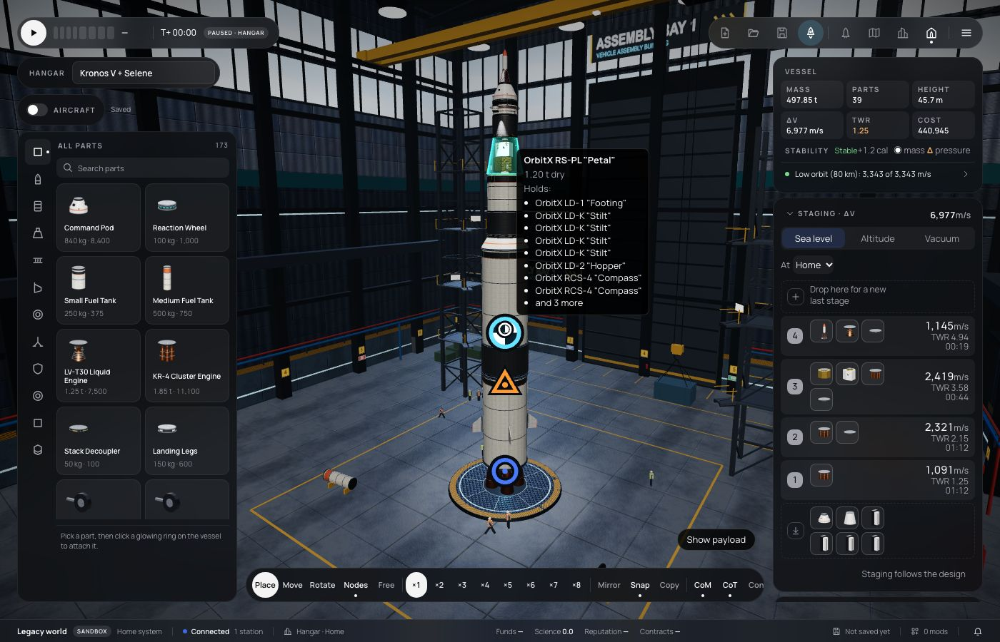
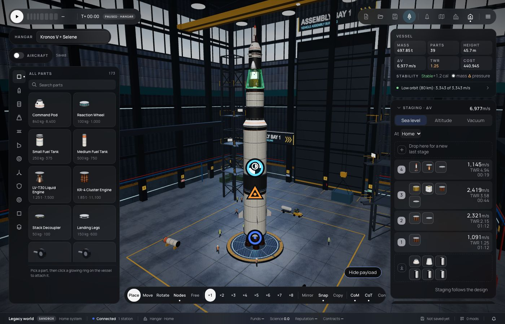
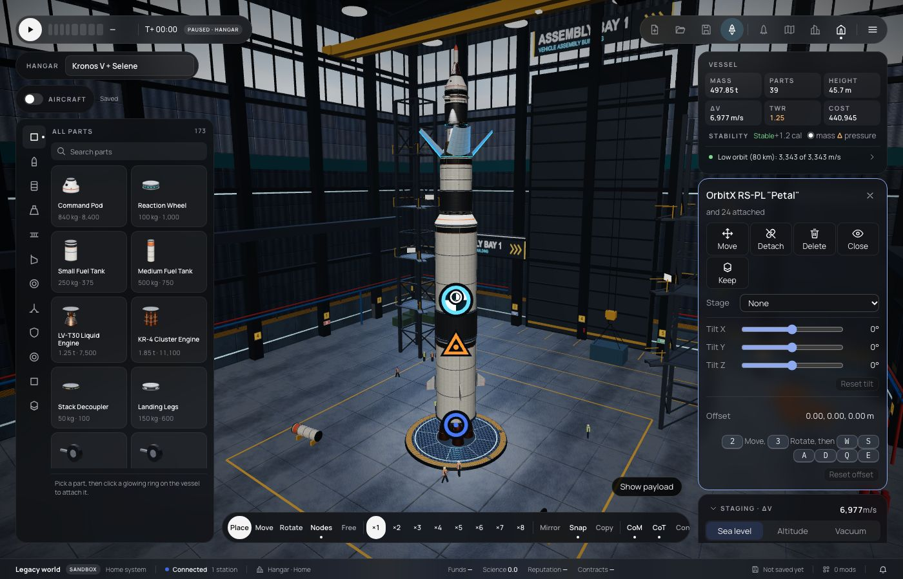

# 315 — Seeing inside in the Hangar

**Plan:** [plans/315-hangar-see-inside.md](../plans/315-hangar-see-inside.md) · **Session:** part visuals session (Claude), 2026-10-21

## What was done

- A part under the pointer gets a tip: its name, its dry mass and, for a fairing, bay or petal set, the parts it holds.
- The shell under the pointer, or the one holding the part under it, is drawn as an x-ray, so the ghost stays while the pointer moves inside.
- **Show payload** (bottom right of the view, shown when the design has a shell) does the same for every shell.
- **Open / Close** on the selection card plays the part's own open pose: bay doors, petals, a fairing's shell hidden, a telescope's door, legs, panels. It is the editor's state only, never saved.
- The pointer reaches through a see-through shell only to the parts it holds. Anything else behind it, such as the decoupler above Kronos V's petals, picks the shell itself.





## What surprised me

- **The first pick went through the petals to the decoupler above them.** A bounding-box test failed too: the decoupler's edge is inside the petals' box. The renderer now gets the list of what each shell holds, from the same profile test the tip uses.
- **The owner's flight error came from the same family.** In flight a part's panel is built from the module's snapshot, not its state. The lamp's snapshot colour is a hex for the renderer, while its control expected a name. A new test builds every stock part's panel from its snapshot. It also caught the rotor's missing `reverse` (plan 306).

## Verification output

```
apps/web vitest inside.test.ts and the editor and vab suites: 268 pass
bun test packages/renderer: 743 pass
bun test mods/stock: 164 pass (with describe-live.test.ts)
```
