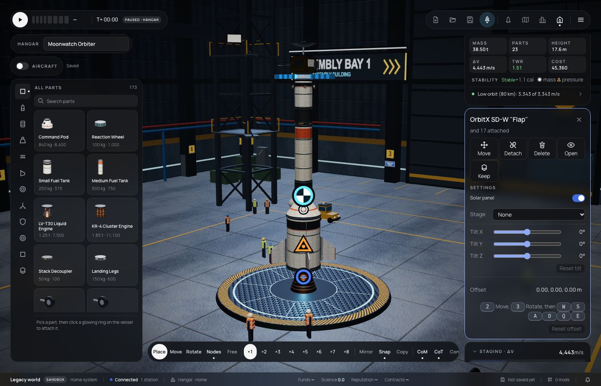

# 316 — Part list and start state in the Hangar

**Plan:** [plans/316-hangar-part-list-and-start-state.md](../plans/316-hangar-part-list-and-start-state.md) · **Session:** part visuals session (Claude), 2026-10-21

## What was done

- **Parts** in the right panel: the vessel's parts as a tree, each under the one it hangs on. A click selects; hovering lights the part in the view and ghosts the fairing or bay around it. Tags show what a shell holds ("holds 11") and which parts are shown open.
- **Start state:** the selected part's Settings now have a switch for solar panels, landing legs, bay doors and petals, instrument and telescope doors, and fuel cells. It is saved in the design's per-part settings, and the flight starts that way (the modules' `state` reads these config fields).
- **The Hangar draws parts as they will launch.** Every module's snapshot is computed from its config and the design's settings, the same data the renderer reads in flight, so no part needed a Hangar-only drawing path.



## What surprised me

- Every deployable already had its start field in its config (`deployed`, `open`, `running`) and its `state` already read it. Only the control's `build` link was missing, and the Hangar drew every part stowed (`modules: {}`).

## Verification output

```
apps/web vitest start-state.test.ts, part-list.test.ts, panel-model.test.ts: pass
bun test mods/stock: 164 pass
```
