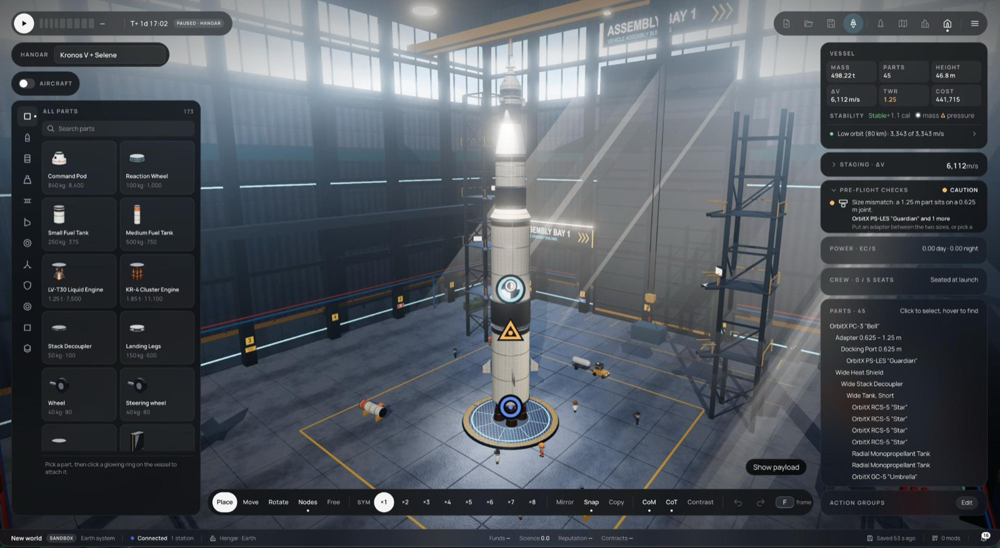
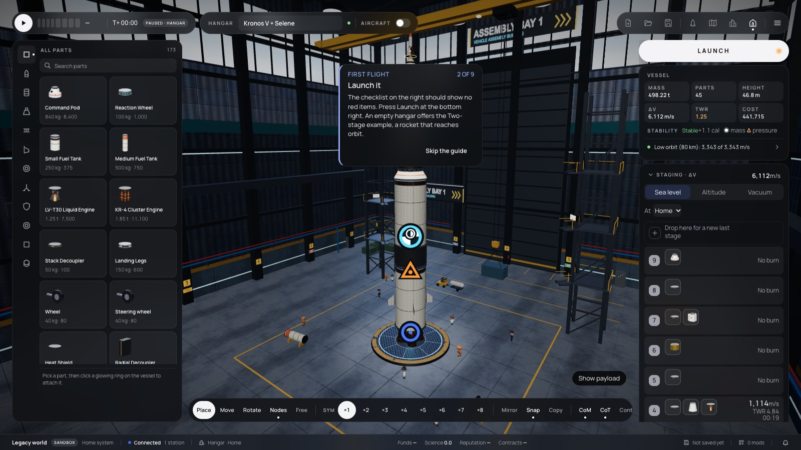
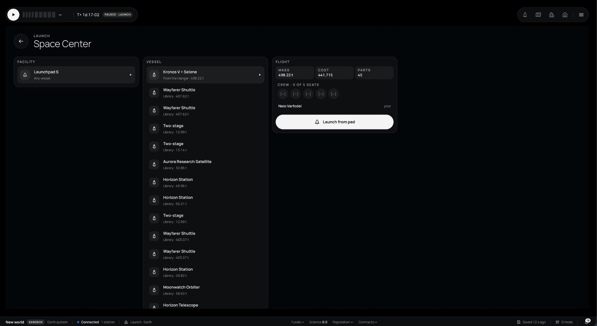
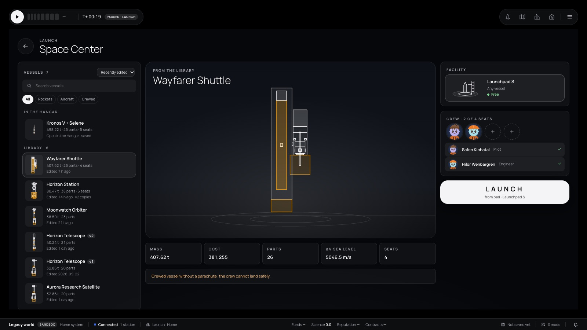
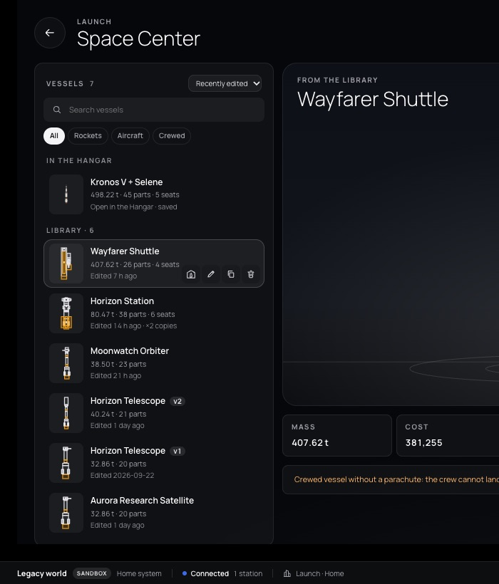

# 346 — The Hangar header beside the time bar, a white LAUNCH, the Launch page and a vessel library

**Plan:** [plans/346-hangar-header-launch-page-vessel-library.md](../plans/346-hangar-header-launch-page-vessel-library.md) · **ADR:** [0295](../decisions/0295-hangar-header-launch-button-launch-page-and-vessel-library.md) · **Session:** ui-v3 session (Claude), 2026-10-22

## What was done

| Where | What |
|---|---|
| `lib/layout/page-actions.svelte.ts`, `WorldShell.svelte` | `pageShell.beside`: a page's own row right of the time bar. The time bar and the slot share one fixed row at left 24, top 24. |
| `lib/vab/VesselName.svelte`, the Hangar page | One 44 px row in the slot: HANGAR · the name field · a save dot · AIRCRAFT and its switch. The capsule above the parts list is gone. |
| `lib/vab/LaunchButton.svelte` | A white, full-width LAUNCH at the top of the right column, above Vessel. It shows an amber dot when the checks warn, and it is disabled with the reason as its tooltip when launch is blocked. Shift-click still flies at once. Launch has left the menu bar; the test id `menu-launch` stays. |
| `lib/launch/vessel-library.ts` | `mergeLibrary` keeps one of identical copies (same name and design; the newest), counts the rest, and folds a record that equals the Hangar's design into it. Different designs under one name are numbered v1, v2 … oldest first. `shownLibrary` searches, filters (All, Rockets, Aircraft, Crewed) and sorts (recent, name, mass, cost), with a name's variants kept together. |
| `lib/launch/design-profile.ts`, `VesselPicture.svelte` | A flat side outline of a design from its resolved layout and part shapes (the capsule brighter, engines amber), for records without a saved thumbnail. Pure SVG, no WebGL on the Launch page. |
| `lib/launch/launch-model.ts` | `seatIn`: a crew member dropped on a seat goes into that part; a full part lets its last occupant go. |
| The Launch page | The library column on the left: search, filter, sort, thumbnails, "In the Hangar" apart from "Library", and per row Open in the Hangar, Rename, Duplicate and Delete (a confirm dialog that offers to delete the copies too). In the middle, a hero of the chosen vessel over a pad backdrop with mass, cost, parts, Δv and seats, and the checks under it. On the right, facility cards with pad or runway art and a Free or Occupied status, with Recover and Terminate as in plan 318; the crew as portrait seats, filled by a click or by dragging a crew row onto a seat; and the big LAUNCH. |
| `lib/onboarding/tutorial.ts` | The first-flight step points at the white LAUNCH at the top right. |

## Notes

- **Copies need the same name.** At first a copy was "the same design, any name", but that made a renamed record vanish into its original. A copy is now the same name (ignoring case) and the same design; a renamed or duplicated record stays.
- Records that do not validate are left out of the Launch page; the Hangar's Open dialog still lists them with their errors.
- The occupied status reads the running sim (`bootWorld`, then `onSnapshot`), so the card changes as soon as Recover or Terminate goes through.

## Screens

Before (the owner's shots, 2026-10-22) and after, at 1600 × 900. The library was seeded with six mission blueprints: three copies of Kronos, two of Horizon Station, and an Aurora design saved under the name Horizon Telescope as a variant.

| Before | After |
|---|---|
|  |  |
|  |  |

## Checks

- `bun run typecheck`: 0 errors (svelte-check 2178 files).
- Web vitest (`CI=true`): 1514 passed, 2 failed. Both failures are in `sim-host-script-worker.test.ts`, and they fail on the base too. New tests: `design-profile.test.ts` (4), `vessel-library.test.ts` (8), `launch-model.test.ts` (`seatIn`, 3).
- Prettier: clean. `bun run docs:check`: passes.
- e2e: not run, at the owner's request. The test ids and texts the e2e specs use are kept: `menu-launch` (the name starts with "Launch"), `launch-facility-*` as radios, `launch-design`, `launch-crew-*`, "Crew · n of m seats", and "Launch from pad" in `launch-go`.
- By hand, in the dev server: rename, duplicate, delete with copies, search, filter, sort, and Open in the Hangar all work.
