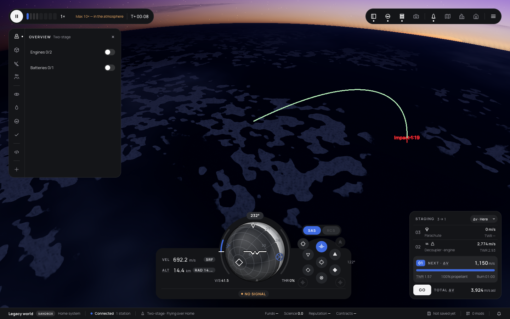

# 347 — Mod overlays and the Trajectories mod

**Plan:** [plans/347-mod-overlays-and-trajectories.md](../plans/347-mod-overlays-and-trajectories.md) · **Session:** mod world API session (Claude) · **Date:** 2026-10-22 · **ADR:** 0296

## What was done

- Core: `overlays.ts` (shapes, `OverlayDefinition`, schemas, `clampOverlay` budgets, `dashSegments`, `cleanMeta`), the air moved from sim to core (`atmosphere.ts`: `ambientAt`, `temperatureAt`, `machDragFactor`, air constants; sim re-exports), World Query `atmosphere`, `groundHeight`, `overlay`, `WorldBody.angularVelocity`, `WorldVessel.mass`/`.dragArea`, `VesselSnapshot.aero`, `Snapshot.overlays`, `ModContext.overlays`, registry `overlays`. API 0.1.107.
- Sim: `ctx.overlays.set/clear` for the plugin's own overlays, never saved; `aero-facts.ts` (mass; C_d·A measured in `applyDrag` along the airflow with the Mach rise divided out, a 4 s running average kept on the vessel state; an axial estimate otherwise); the query in the sim answers `groundHeight` from the terrain.
- Renderer: `overlay-layer.ts`: `LineSegments2` + `LineMaterial` (its TSL twin draws it on WebGPU; the twin now copies `toneMapped`), glyph and label sprites sized to pixels each frame, body-fixed shapes under the body's holder, `on-top` without the depth test; `Renderer.setOverlays`.
- Web: `mod-overlays.ts` merges published and page-side shapes for overlays that are on, keeps the flown vessel's; Settings → Interface lists each overlay with a switch (`settings.overlays`).
- `mods/trajectories`, built in: predictor, system, store, two keybindings for the panel's buttons, panel.

## What surprised me

- A tumbling probe's measured drag area swings from 0.36 to 1.27 m² in a few seconds, and the first prediction took the side-on value: 6 % short. With SAS holding retrograde (or with the average) the prediction holds from the first seconds: a 30 km drop at half orbital speed predicted 92 s over 78.3 km, flew 91 s and landed 971 m from the cross-hair.
- Keeping the average outside the vessel state broke resume determinism (`aero` differed after a resume); it is on `VesselState.dragArea` now and saved.
- The green line looked white on the night side even with `toneMapped = false`: the scene's post pass raises a dark frame's exposure. A more saturated green (`#22c55e`) reads better.
- The Browser pane was hidden for most of the session, which stops the page's frame loop; the screenshot came from a separate Chromium window driven by Playwright.

## Verification output

The frame is from a Chromium window driven by Playwright (the game's default renderer), taken before the label was moved above its point. See the plan's Log for the test output.

## Open questions

- Thrust in the prediction (the current throttle along the attitude), and lift.
- Dashes in screen pixels would need a dashed `LineMaterial` twin on WebGPU; dashes are in metres for now.
