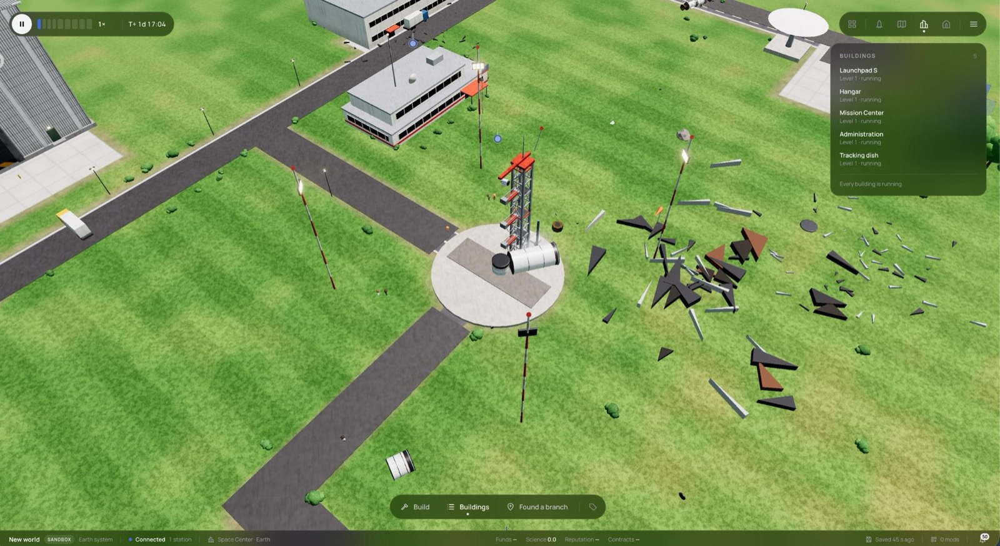
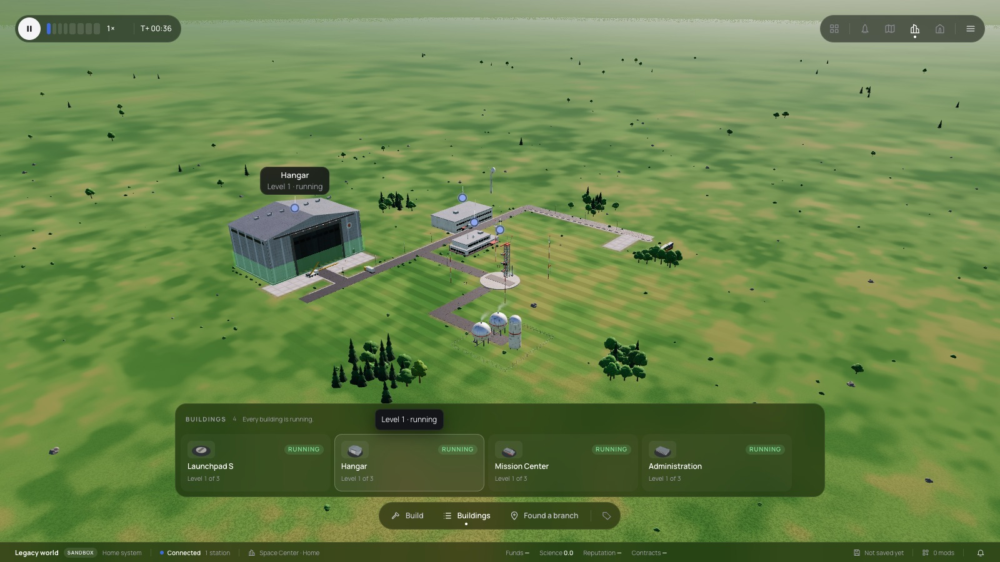
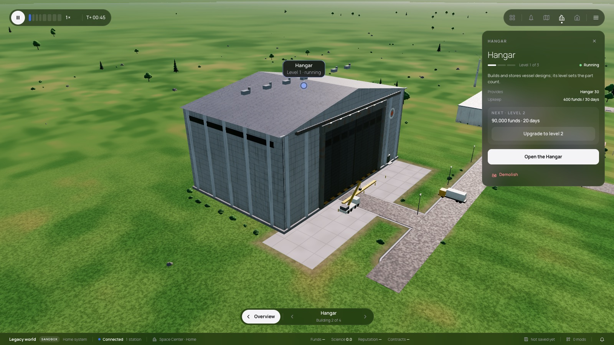

# 349 — The Space Center's Buildings strip

**Plan:** [plans/349-space-center-buildings-strip.md](../plans/349-space-center-buildings-strip.md) · **ADR:** [0298](../decisions/0298-space-center-buildings-strip.md) · **Session:** ui-v3 session (Claude), 2026-10-22

## What was done

| Where | What |
|---|---|
| `lib/space-center/model.ts` | `BuildingRow` has `progress`, `generator` and `size`. `progressOf` works out how far construction or an upgrade has come from the days left and the level's build days. |
| `lib/space-center/SpaceCenterOverlay.svelte` | The corner panel is now a strip above the Overview bar, in the build bar's look. It has a header (count, attention line, Flows and Market toggles, site picker) and one card per building: thumbnail, status chip, name, level, and a progress bar. Hovering a card boxes its building. A click goes to Focus, and the strip is open again back in Overview. `onmark(id, danger)` draws the box red for demolish and white for a hovered card. |
| the Space Center page | `picture(row)` reuses the build menu's thumbnail queue. `markBuilding` takes the colour. |
| `e2e/base-layout.e2e.ts` | Expects the strip 8 px above the bar, centred, and as wide as the build bar. |

## Screens

| Before (the owner's shot) | After |
|---|---|
|  |  |

A click on a card frames the building and opens its panel:

## Checks

- svelte-check: 0 errors. Space Center vitest: 35 passed, with the new `progressOf` and strip tests.
- e2e was not run, at the owner's request. The `sc-*` test ids are kept, and the `branch-sites` spec's `toContainText('running')` still matches, because the chip text is lower case and only drawn in capitals.
