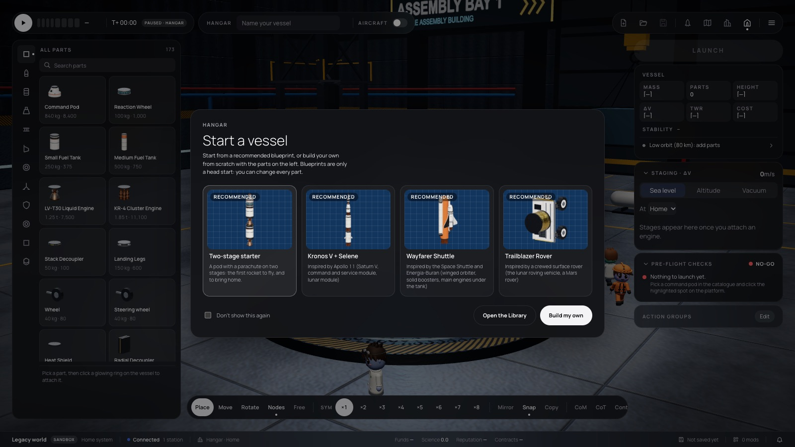
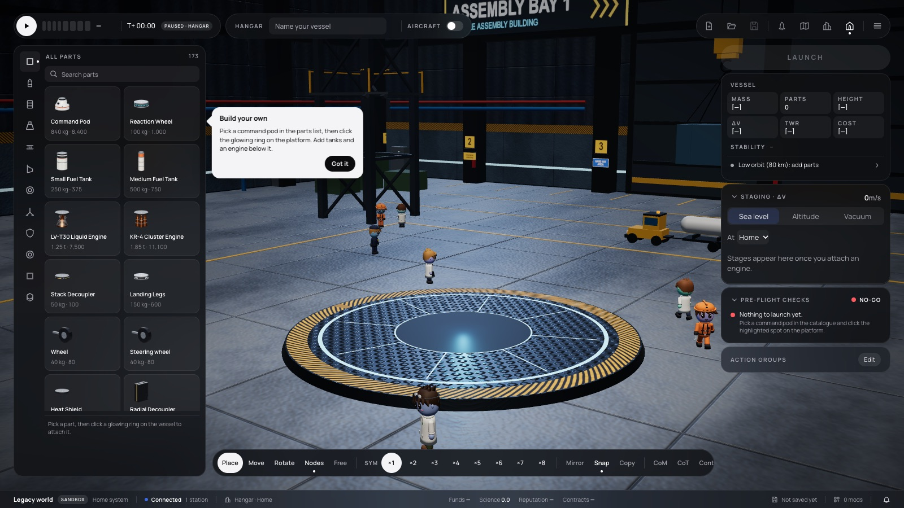

# 350 — Start a vessel

**Plan:** [plans/350-hangar-start-modal.md](../plans/350-hangar-start-modal.md) · **ADR:** [0299](../decisions/0299-hangar-start-modal.md) · **Session:** ui-v3 session (Claude), 2026-10-22

## What was done

| Where | What |
|---|---|
| `lib/vab/StartVessel.svelte` | A modal `<dialog>` with the title "Start a vessel", a subtitle, four Recommended blueprint cards (the Library's thumbnails), Open the Library, Open a saved vessel, Build my own and Don't show this again. Escape and a click on the backdrop count as Build my own. |
| the Hangar page | `offerStart()` runs on mount and after New. It opens the modal, or goes straight to the coach mark when the flag is set, but not in a lesson or with a design loaded. The coach mark sits right of the parts list and nudges. The first part, or a loaded design, closes both. In a lesson the inline welcome card stays. |
| `playwright.config.ts`, `e2e/hangar-start.e2e.ts` | The suite starts with `orbital.vab.hideStart` set. The new spec starts from a clean profile and covers Build my own, Escape, New, a blueprint, and Don't show this again. |

## Screens

## Checks

- svelte-check: 0 errors.
- e2e was not run, at the owner's request. `hangar-start.e2e.ts` is written for when it is.
- The lessons session was told in the shared notes: in a lesson the inline card and `vab-open-library` are unchanged.
