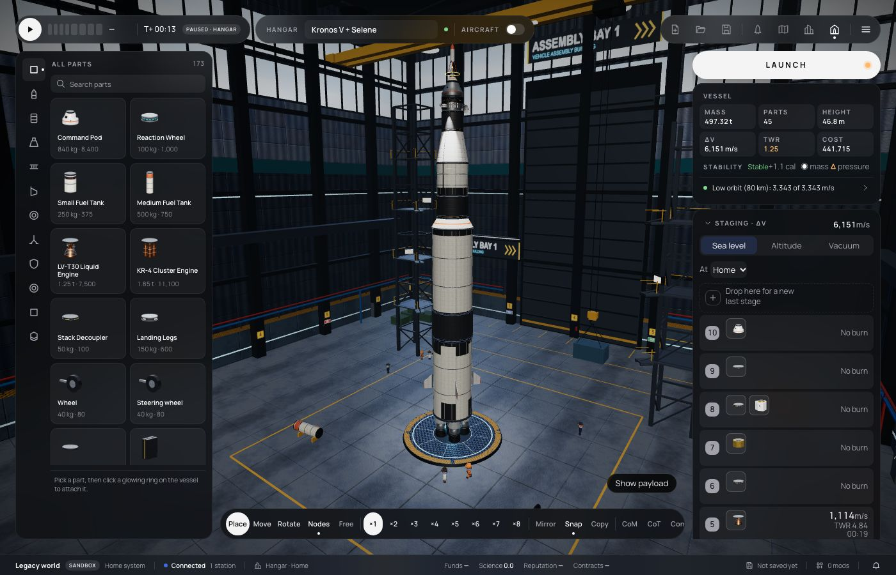
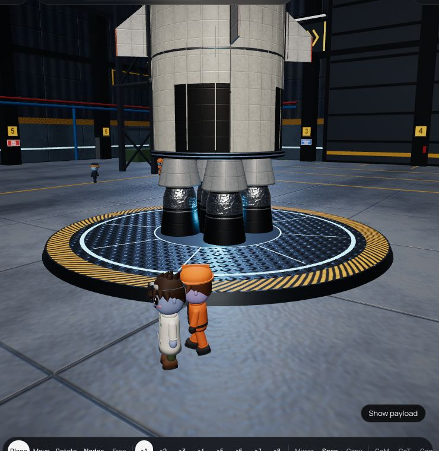
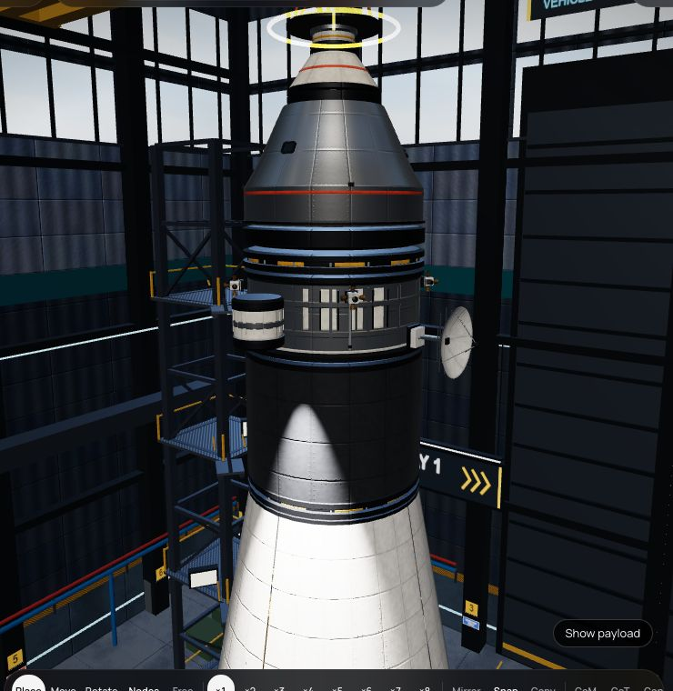
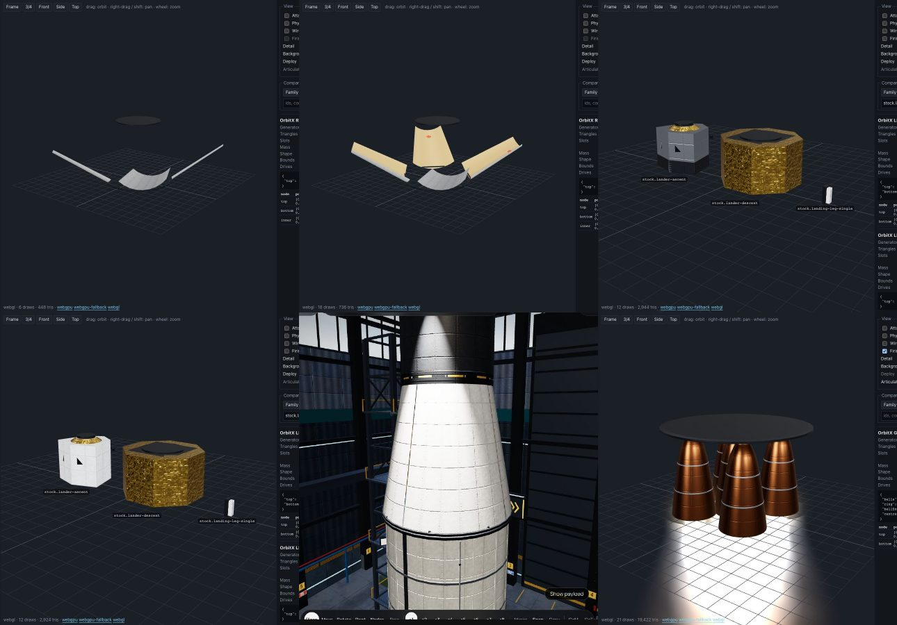

# 355 — Apollo visual pass

**Plan:** [plans/355-apollo-visual-pass.md](../plans/355-apollo-visual-pass.md) · **Session:** part visuals session (Claude), 2026-10-22

## What was done

The owner sent stills from a KSP Apollo build (`refs/apollo-ksp-reference/`, not in the repo) and asked for Kronos V + Selene to look much closer. Markings stay fictional: no flags or country names.

- **Paint** (`stock.paint`):
  - a Hangar build setting ("Paint") on stack tanks, pods and engine plates;
  - the renderer reads it as the visual parameter `paint` through `visual.paramsFrom`, from the design in the Hangar and from the snapshot in flight. `default` keeps the part's own livery.
- **New liveries in the kit:**
  - `roll`: the first stage's black panels round the foot, the roll pattern under the top, stringers;
  - `top-band` and `aft-band`: the second and third stages;
  - `service`: a bare-metal service module with white radiator panels;
  - `foil-engines`: dark bells under silver insulation blankets (a new `blanket` material), with conical engine fairings over the outer four.
- **Kronos V** paints its stages: roll pattern and foil engines on the first stage, black top on the second, black aft band on the third, a silver command module on a striped service module.
- **The SLA petals:**
  - two-sided, with a tan inner skin (`tan` material);
  - a hinge along each foot and a red ring near each tip, as on Apollo's panels;
  - they open 46° instead of 69°;
  - thrown-off panels (plan 345) look the same.
- **The LM ascent stage** is bare aluminium with black panels round its lower faces. The descent stage was already gold foil.

Before (left) and after (right) in the Hangar:




The first stage's foot (foil-wrapped engines, fairings, roll pattern) and the command and service modules:




The petals open and the LM, before and after:



## What surprised me

- **The open petals looked like thin strips** because they were one-sided: from inside, their surfaces were culled. The tan inner skin fixed both the look and the visibility.
- **The winding test** allowed a top-down surface only for nozzle walls. The SLA's inner skin is the same case, so the rule now names the `tan` slot too.
- **Moving files wholesale is dangerous in a shared folder.** My rename of `346-*.jpg` caught another session's plan 346 screenshots. They were restored from git, and only my files carry 355.

## Open questions / follow-ups

- The launch tower with swing arms (ref 27) is a site prop owned by the site sessions: not touched.
- The real SM is taller than `tank-wide-short`. A dedicated service-module part would read closer.

## Verification output

```
bun test mods/stock and packages/renderer: pass (the 8 SceneModel failures come from origin's overlay group, plan 347)
apps/web vitest src/lib/editor and src/lib/vab: 289 pass
```
