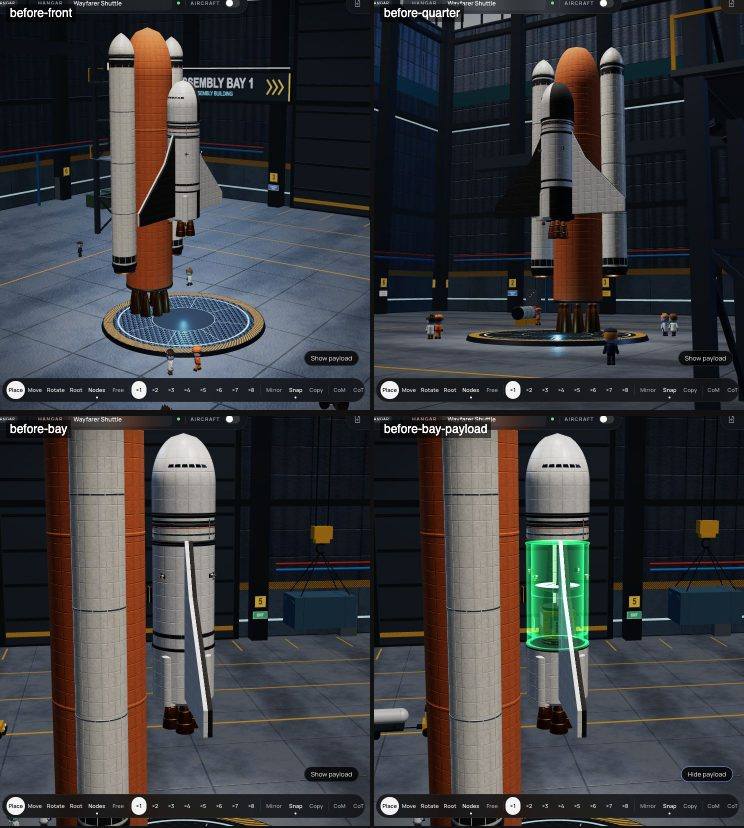
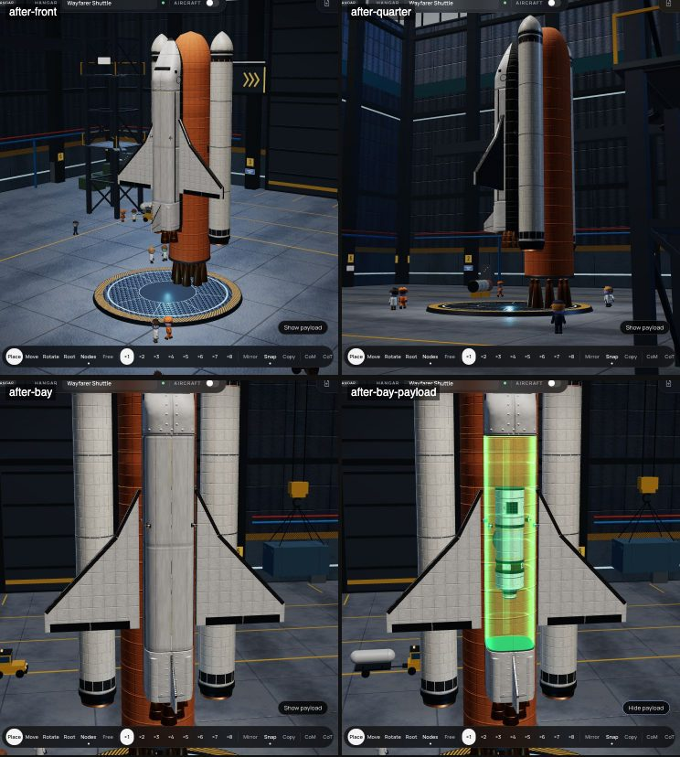
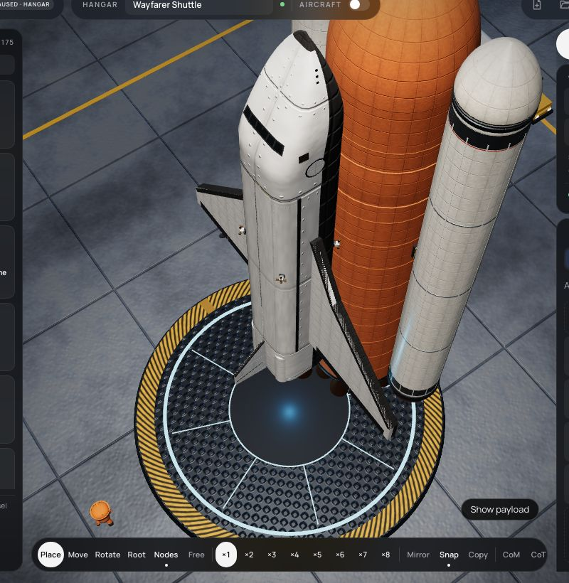
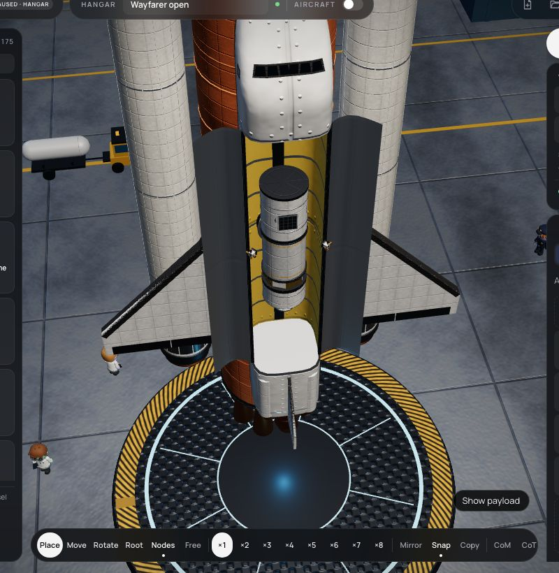

# 356 — Shuttle rebuild

**Plan:** [plans/356-shuttle-rebuild.md](../plans/356-shuttle-rebuild.md) · **ADR:** [0300](../decisions/0300-pre-docked-ports.md) · **Session:** part visuals session (Claude), 2026-10-22

## What was done

The owner sent KSP shuttle stills (`refs/shuttle-ksp-reference/`, not in the repo; ref-42 on the pad, ref-43 in orbit with the bay open) and our own Hangar (ref-41). They asked for:

- an orbiter that reads as a shuttle;
- a real cargo bay with doors;
- a payload docked inside it the KSP way, set free with Undock.

Markings stay fictional.

### The orbiter (renderer)

- **A lofted hull** (`generators/loft.ts`). The section is a superellipse, a rounded square. Its corners reach the 2.5 m node circle, so the joints keep their rims at the node radius (ADR 0212) while the body reads boxy. Black tiles cover the belly up to a chine line on each side.
- **`orbiter-nose`**, now 4.2 m:
  - a cabin, a windscreen slope and a drooped, tapering nose with a dark cap;
  - six windscreen panes and two side windows in black frames;
  - forward RCS ports and the side hatch.
- **`orbiter-bay`**, new:
  - 9 m long, open on top between two sills;
  - a yellow lining (a new `liner` material), metal frames and fore and aft bulkheads;
  - a keel beam on the floor;
  - two clamshell doors that open out along the whole length, with silver radiators inside.
- **`orbiter-aft`:**
  - the lofted aft body with a tiled base and a body flap;
  - the three main engines and the two OMS pods;
  - a swept tail fin with a black leading edge and a rudder line. The part's shape widened to 2.3 m for the fin.
- **`delta-wing`:**
  - black leading edges on the strake and the main edge, and split elevons;
  - a per-part **"Heat tiles on top (the far wing)"** setting (`stock.wing` `tiled`/`tilesUp`, read through `paramsFrom`). The symmetric copy is turned half round, so without it the far wing showed its tiles on top.
- **`external-tank`:** fine foam ribs down the hydrogen tank, a wide intertank band, ribs on the oxygen tank, and a nose spike. The SRBs already had segment rings and nose cones.

### Pre-docked ports (ADR 0300)

- **Docking faces.** An attach node may be `face: 'docking'`; the stock ports' `top` nodes are. In the Hangar, a docking face meets a docking face face to face: the part is turned over, or onto its side, and that is the only match offered there.
- **A new side port**, `stock.docking-port-side` ("Sidecar"): a 1.25 m stack segment with its docking face on its side. A module can lie along the bay, docked to a port on the keel.
- **The sim:**
  - starts a built pair **docked** (`dockBuiltPairs` at spawn);
  - on a split between two ports, releases both and sets `portLeft`. The two then ignore each other until they have been 5 m apart. Without this, the magnet pulled a drifting payload back the moment the 5 s cooldown ended.
- **Undock on stage.** `stock.docking-port` has a build setting, "Undock on stage".
- **A hollow bay.** A module may declare its part `hollow`. `stock.bay` with `walls` then collides as a square tube, with no top while the doors are open. Before this, a module undocked inside the bay was pushed out of the bay's solid box at about 10 m/s.

### Wayfarer Shuttle

The new Wayfarer stack:

- **Orbiter:** nose, bay and aft. The OMS propellant (LFOX 540) is in the aft.
- **Placement:** wings either side (±X); the tank on the belly (−Z), with the doors facing away from it.
- **Payload:** a station module docked in the bay:
  - a keel port;
  - the side port, face to face with it;
  - a two-seat cabin with solar panels;
  - a probe core, an airlock and a small port at the far end.
- **Stages:** boosters and mains, then booster separation, then the tank goes and the orbiter's engines light, then the module undocks.

The orbiter got lighter so the stack stays controllable at lift-off: nose 9 t → 7.5 t, bay 2.5 t. With LFOX 720 the stack tipped over in the first 30 s.

## Screenshots

Before, in the Hangar: front, three-quarter, the bay, and the bay with Show payload:

After, from the same angles. The module lies along the bay, docked on the keel:

After, from above and three-quarter (ref-42's angle):

The bay built open (ref-43's view), with the docked module and the doors swung out:

## Verification

- `packages/sim/test/pre-docked.test.ts` (3 tests):
  - a face-to-face pair starts docked;
  - Undock frees the payload, which drifts straight out with the gap growing (1.45 → 3.33 m over 30 s) and is not caught again;
  - "Undock on stage" undocks on its stage;
  - moved 9 m away and pushed back, the two dock again (one vessel after 30.8 s).
- `apps/web/src/lib/editor/docked-ports.test.ts` (3): a port on a port's face is offered only turned over; the pair resolves face to face; a plain part on a port face is offered as before.
- `apps/web/src/lib/editor/mission-flights.test.ts`, new test "Wayfarer flies to orbit…". On the guidance ascent autopilot it reaches `done: Node executed, periapsis 79.3 km`. It then opens the bay, undocks the module, and the module drifts off at 0.089 m/s.
  - The test stages on a flameout itself: guidance's `autoStage` checks `ignited && flameout`, but the engine clears `ignited` when it flames out, so the autopilot stages only once every engine is out. This is a guidance follow-up, not fixed here.
  - The tank goes at main engine cut-off, as on the Shuttle.
- Part tests: seams (the keel and side faces listed as not flat joints, the lofts as revolve-free), every model fits its cylinder, winding, budgets: renderer 758 pass.
- Sim 677 pass, stock and editor suites pass (see the session report for the final runs).
