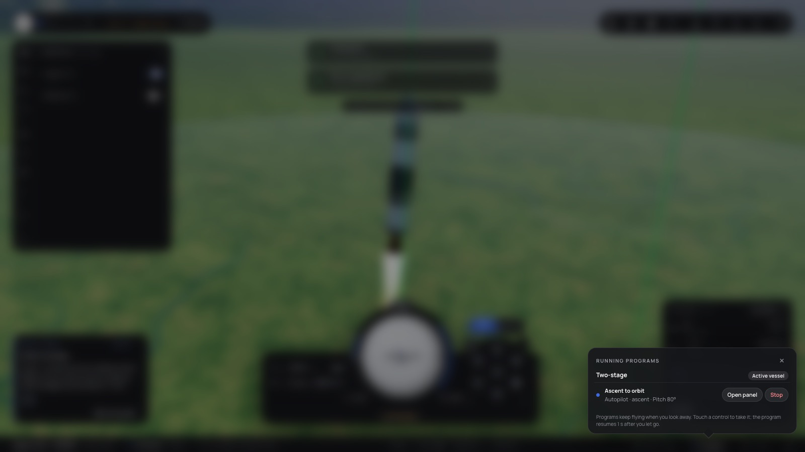
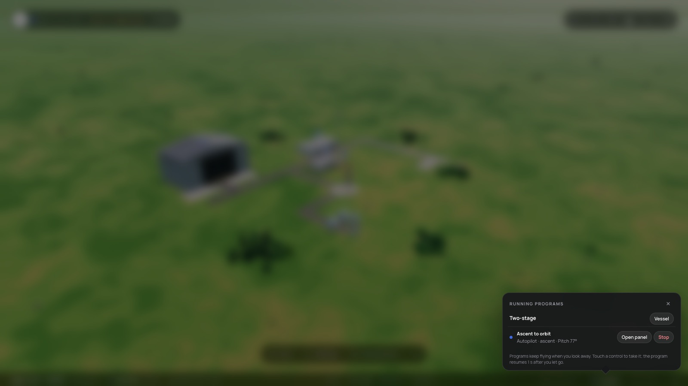
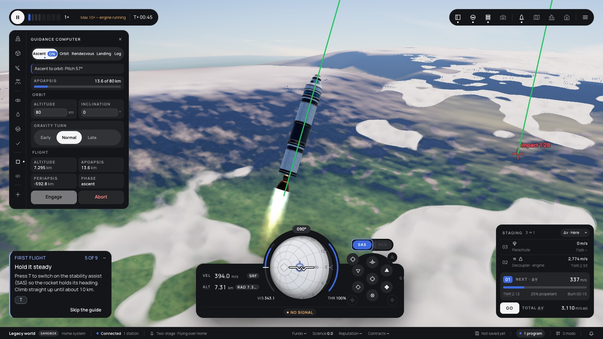

# 359 — The programs popover

**Plan:** [plans/359-programs-popover.md](../plans/359-programs-popover.md) · **ADR:** [0302](../decisions/0302-programs-popover.md) · **Session:** ui-v3 session (Claude), 2026-10-22

## What was done

| Where | What |
|---|---|
| `lib/programs-model.ts` | Rows carry the autopilot id. New: `panelOf` (Script, or the mod's first Flight panel), `programGroups` (by vessel, the flown one first), `stopCommand` (`autopilot-disengage`, or `program-stop` for a script), `flightHref`, and `ProgramActions`. |
| `lib/layout/ProgramsPopover.svelte` | The modal dialog: anchored with an arrow, a glass backdrop with a fallback, Escape caught before the page's keys, groups and rows with Vessel, Open panel and Stop. |
| `StatusBar.svelte`, `WorldShell.svelte`, `(world)/+layout.svelte` | The chip opens the popover. The layout supplies the actions: in Flight through `pageShell.flight`; elsewhere it sets the focus and goes to `/flight?panel=`. |
| the Flight page | Registers `pageShell.flight` (active vessel, `switchVessel`, `openPanel`) and opens `?panel=` once it is loaded. |

## Screens

In Flight, with the ascent autopilot engaged:

From the Space Center, where Vessel is offered:

Open panel from the Space Center: Flight, with the Guidance Computer open on the engaged Ascent tab:

## Checks

- `programs-model.test.ts` (7) and `ProgramsPopover.test.ts` (2) pass, and svelte-check is clean.
- By hand (headless Chromium against the dev server): open, Escape closes it in Flight, and Open panel from the Space Center lands in Flight with the panel open.
- e2e was not run, at the owner's request. The old test id `programs-list` is now the dialog's.
