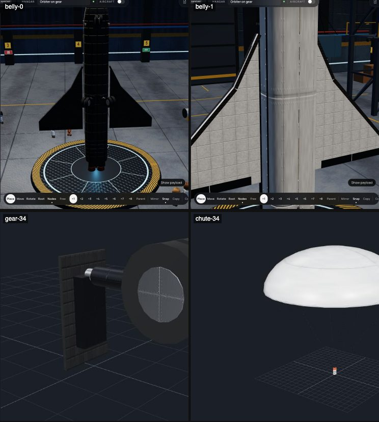

# 361 — Shuttle landing and re-entry

**Plan:** [plans/361-shuttle-landing-and-reentry.md](../plans/361-shuttle-landing-and-reentry.md) · **ADR:** [0303](../decisions/0303-sas-holds-roll-and-reentry-mode.md) · **Session:** part visuals session (Claude), 2026-10-22

## What was wrong

The owner reported three things: the orbiter has no landing gear or brake chute, its re-entry is unstable, and on SAS prograde it flew banked and yawed to the left (`refs/owner-shots/shuttle-prograde-tilt-2026-10-22.jpg`).

- **The control frame was right.** The orbiter's root (`orbiter-nose`) has +Y along the fuselage and +Z out of the roof.
- **SAS pointing modes did not hold roll.** They only damped the roll rate, so a disturbance left the orbiter banked, and a banked glider turns.
- **The orbiter is stable only nose first.** Its wings sit far aft. In a headless re-entry from 75 km, 2 250 m/s:
  - hands-off from 40°, it swung between +63° and −21° and settled near 5°;
  - SAS Hold drifted from 40° to 138° (backwards) by 13 km, because it keeps an inertial attitude while the path curves round the planet;
  - SAS Prograde came in nose first, at 4°.

  Nothing held a belly-first attitude.
- **Heat was not the problem.** Peaks stayed near 1 200 K, against limits of 2 000 K.

## What was done

- **SAS (ADR 0303):**
  - in the air, every pointing mode keeps its roll from local up;
  - prograde and retrograde level the wings;
  - a new mode, **Re-entry**, holds 40° above the airflow, belly first, wings level from orbit down (HUD button, Alt+R).
- **Retractable gear:** `stock.wheel` with `retractable`, `deployed` and `deploySpeed`.
  - Stowed, the wheel has no collider. G lowers and raises it; it will not lower above 150 m/s.
  - `stock.orbiter-gear` (twin wheels) and `stock.orbiter-gear-nose` (steers) sit behind black tile doors, with a strut that swings out.
- **Brake chute:** `stock.drag-chute`, a 90 m² canopy that opens near the ground below 100 m/s and can be cut away.
- **Wayfarer** carries the nose gear, two main gear and the chute, all stowed for launch.

## Screenshots

The belly in the Hangar with the gear lowered, a gear leg, and the chute's canopy:

## Verification

`apps/web/src/lib/editor/mission-flights.test.ts`:

- **SAS prograde from a 20° bank** at 20 km: within 0.30° of level and 0.01° of sideslip after 15 s, for a minute.
- **SAS Re-entry from 75 km** down to 29.9 km:
  - within 5.0° of 40° angle of attack, bank within 0.0°;
  - no part lost; peak 939 K on the wings.
- **Roll-out from 91 m/s** on three lowered gear legs, brakes on: 445 m in 10 s; with the chute fully open, 304 m in 7 s. A level-1 runway is 1 200 m.
- **Wayfarer still reaches orbit** (79.2 km) and lets its module go.

Not done: one headless flight from orbit to the runway, which needs approach guidance. The re-entry and the roll-out are tested apart.
