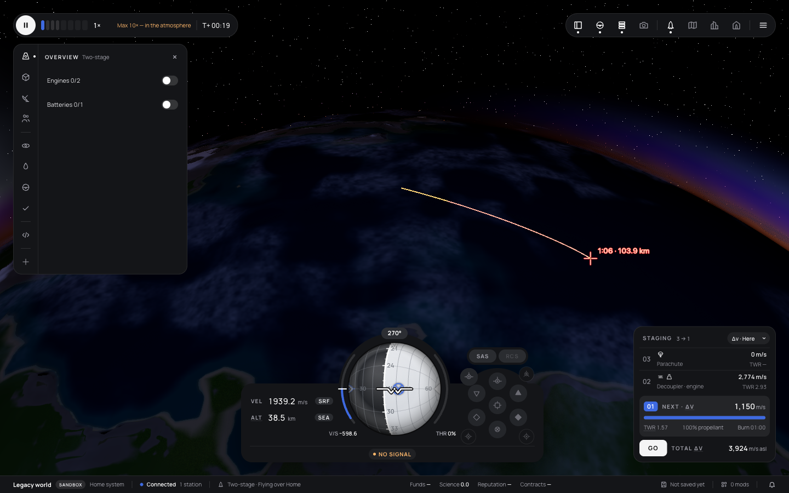

# 366 — Trajectories rework

**Plan:** [plans/366-trajectories-rework.md](../plans/366-trajectories-rework.md) · **Session:** mod world API session (Claude) · **Date:** 2026-10-22 · **ADR:** 0307

## What was done

- `visibility` (pure): nothing on the ground, the pad or splashed, on a stable orbit or escaping, or without an impact; Flight fades in from 1 to 2 km above the ground; the map shows it whenever the path reaches the ground. `descendingOnly` hides it on the way up.
- `arcPieces`: up to ten pieces coloured by √ρ·v³ (green, yellow, orange, red), nothing within 30 m of the vessel, faint over the first 600 m, 2 px at 80 %. Shapes carry `views`, one set when both views look the same.
- Settings store `trajectories.settings` (`show` off/map/both, `descendingOnly`) replaces c36ba3df's `trajectories.show`; the panel's select and switch send `mod-key` with `data`.
- Core: a `pick` panel node (`MapPick`), `mod-key` `data` passed on in `mod:key`, `KeybindingDefinition.hidden`; API 0.1.108. Web: `pick-tool.svelte.ts` (arm, open the map, the next map click on a body, Escape or a miss cancels); the node is drawn as a button with its hint.
- Labels are offset above and right of their point each frame in world space: WebGPU's sprites ignore `Sprite.center`, so the plan-347 label still sat on its cross-hair there.
- The three tether events of plan 313 were missing from `SIM_EVENTS` (the catalogue test failed on main); added.

## What surprised me

- The commit the owner was pointed at (8ddb6183) is the shuttle's gear and SAS re-entry mode; the earlier Trajectories change was c36ba3df.
- A shallow re-entry (58 km, 2.3 km/s, −6°) comes down 1 144 km away: off any Flight camera. The screenshot uses a steeper one.

## Verification output

On the pad the snapshot has no Trajectories overlay (`pad {"sit":"prelaunch"}`): [assets/366-trajectories-pad.png](assets/366-trajectories-pad.png). Test output in the plan's Log.

## Open questions

- Thrust in the prediction, so an ascent's path means something before the engines stop.
