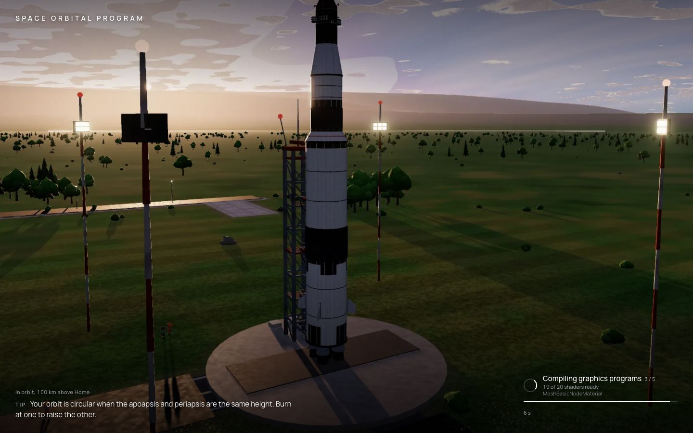
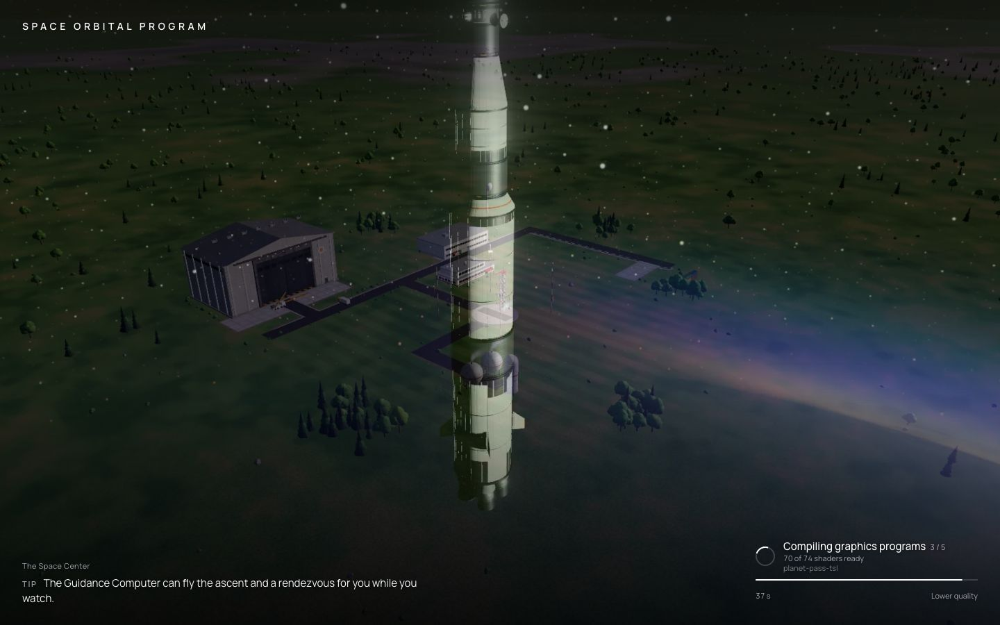
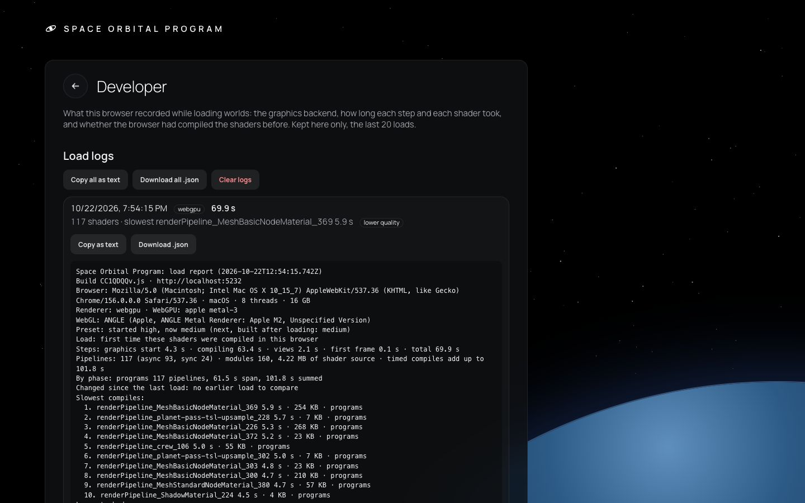

# 370 — Shader compile at world load

**Plan:** [plans/370-shader-compile-at-world-load.md](../plans/370-shader-compile-at-world-load.md) · **Session:** shader compile session (Claude, youthful-pike worktree) · **Date:** 2026-10-22 · **ADR:** 0308

## What was done

- `packages/renderer/src/compile-report.ts`: wraps the WebGPU device's module and pipeline calls, or WebGL's `shaderSource`/`linkProgram` (with `KHR_parallel_shader_compile` polling). It records size, source hash, mode and async time. `Renderer.compiles` exposes it.
- `apps/web/src/lib/load-report.ts` and `world-renderer.svelte.ts` add:
  - the step times, and first or cached load (shader-set hash in `localStorage` `orbital.loadReport`);
  - the modules changed since the last load;
  - the browser, adapter and ANGLE string.
- The loading screen shows "N of M shader pipelines ready" and a Copy load report button. Debug → Info has the same report. The report is also in `window.__orbitalLoadReport()` and logged when the world is ready.
- The WebGPU warm-up asks for pipelines async (three's `getForRender` with a collecting array) until none is pending, then draws its frames on the sync path. The governor's next preset is warmed after the loading screen.
- The planet shaders shrank: noise and the cube-atlas lookup are laid-out functions. The pass is built once per preset, not three times: the shadow map goes through a swappable node.
  - Separate placeholders for the scaled-space and terrain-patch texture nodes.
  - `NodeBuffer_<id>` names renumbered per module.
- The owner's additions:
  - `WorldLoading.svelte`: the game's own shots (`scripts/capture-loading-slides.ts`, 6 WebP, 540 KB) crossfading with a slow pan, a caption and a tip at the bottom left, and the progress in the bottom-right corner (CSS ring, step, shaders ready, the one compiling, bar, elapsed time). After 15 s it offers "Taking long? Continue with lower quality".
  - Load logs in `localStorage` (`load-log.ts`, the last 20).
  - `/developer` on the main menu, with the part and crew viewers moved there from Mods.
  - No copy button on the loading screen.
  - Follow-up (2026-10-23): four more shots, so the slideshow has 10 (856 KB). Each is set up through the debug hooks: `staging` (Kronos V's first stage falling away at 45 km), `sla-petals` (the petals opening round Selene in orbit), `shuttle-bay` (Wayfarer alone in orbit, bay doors open, the module inside) and `lunar-landing` (Selene on its legs on Cinder). `scripts/capture-loading-slides.ts` loads either Hangar start blueprint (a fresh browser context per blueprint, since the start cards show only in an empty Hangar), stages, opens bays and switches to the lander with `]`. Shots marked `moment` pause at once, and `SWEEP=n` shoots n camera yaws for choosing a view.
  - The owner's follow-up the same day: a vignette over the shots; the bar moved to the bottom of the corner, with the elapsed time on the step's line; and a changing line above it ("Fuelling the tanks…", "Rolling out to the pad…"). The line is a CSS animation, so it keeps changing while a compile holds the thread.
- While loading, three's node builds get a 50 ms budget per task, deferring objects not yet built: the longest task fell from 1.4 s to 0.54 s on the M2.
- `apps/web/scripts/measure-shader-compile.ts` measures it. The numbers and the owner's instructions are in [research/shader-compile-windows.md](../research/shader-compile-windows.md).

## What surprised me

- A capture script that waits a fixed time before pausing loses a staging: the spent stage was out of frame 2.5 s later. Pausing straight after the stage command keeps it a few metres below.

- The page's thread time at load is mostly three's own node build (`NodeBuilder.build`): about 3.2 s of WGSL generation on the M2, not our code. The build budget spreads it out but does not shrink it.

- The planet fragment shader was 932 KB of WGSL in one `main`, with 791 inlined copies of the pcg3d hash. The world built 11.2 MB of WGSL at load. That is the likely reason D3D takes a minute.
- No loop in it uses an implicit-derivative sample, so FXC's forced unrolling was not the cause.
- ADR 0304's warmed preset was thrown away on the way back: a different shadow-map size, or `low`'s missing shadow, dropped every planet variant. The warm-up then compiled `low` a second time.
- A variant built before the scaled-space bake read the normal atlas from the albedo one: both nodes started on one placeholder, and three merged the bindings.

## Verification output

Apple M2 (this session's machine; the WebGL string says M2), Chrome 156, WebGPU, pad, `measure-shader-compile.ts`:

```
before  auto: load 22.2 s (2nd 19.0 s) · 11.2 MB WGSL · 115 pipelines (113 sync)
after   auto: load  7.0 s (2nd  7.0 s) ·  3.6 MB WGSL · 120 pipelines (87 async) · changed between loads 0 of 164
before  high: load 30.7 s · 11.1 MB · 148 pipelines
after   high: load  9.1 s ·  4.5 MB · 120 pipelines
```

Screenshots at the pad and in a 100 km orbit match the old build (planet, clouds, shadows, site).

Main-thread long tasks during the load (PerformanceObserver, the same scene, `high`):

```
unthrottled:      before the build budget max 1369 ms (two over 1 s) · after max 541 ms, none over 1 s
4x CPU throttle:  before max 5660 ms · after max 2156 ms
8x CPU throttle:  "Continue with lower quality" appeared at 15 s, one click (3 s under 8x), preset saved low,
                  the log says lowered, ready at low
```







## Open questions

- The Windows numbers: they need the owner's report from the RTX 3060 machine (research doc, "how the owner sends it").
- Whether a `low` boot preset on a first load on Windows is still needed after this. Decide from that report.
