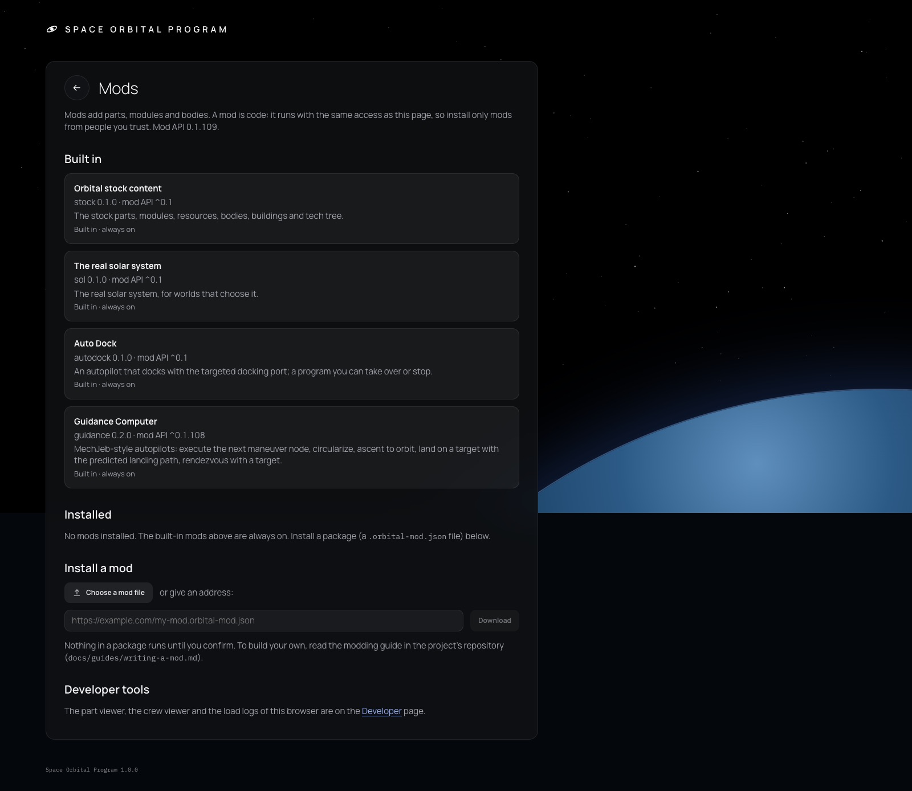
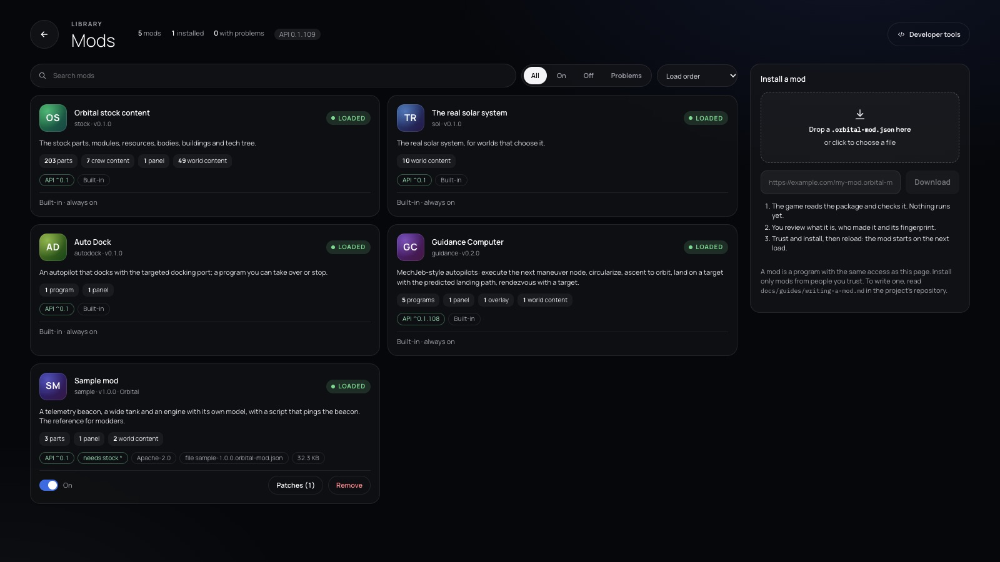
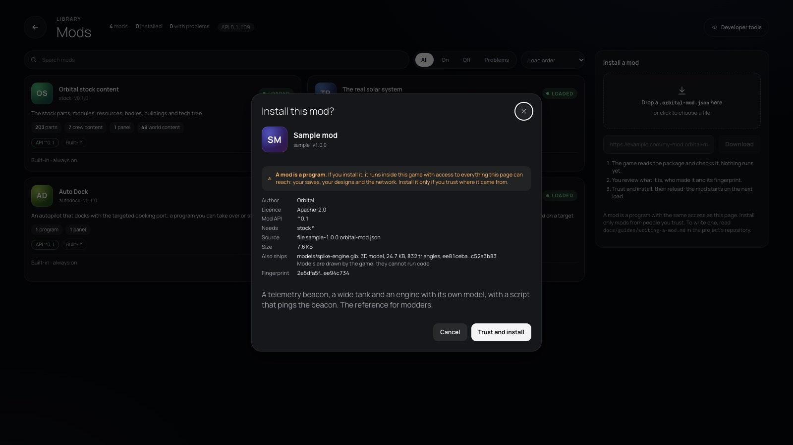
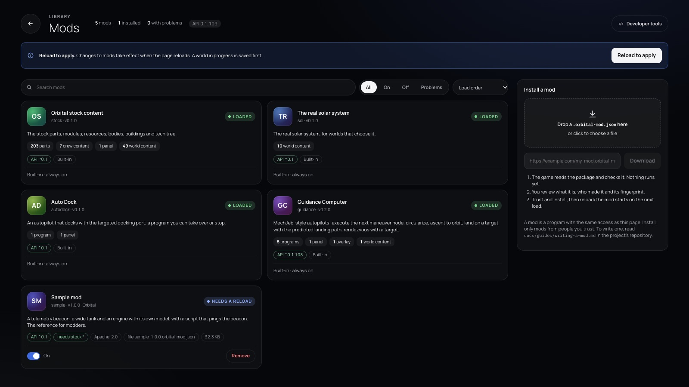

# 376 — The Mods page as a mod manager

**Plan:** [plans/376-mods-page-mod-manager.md](../plans/376-mods-page-mod-manager.md) · **ADR:** [0312](../decisions/0312-mods-page-mod-manager.md) · **Session:** ui-v3 session (Claude), 2026-10-23

## What was done

| Where | What |
|---|---|
| `lib/mods/mod-cards.ts` | `countsByPlugin(registries)` reads the registries' owners. `modCards` builds each card: chip, counts with links to the Developer viewers, the API and dependency checks, patches, size, and whether Update and Remove apply. `shownCards` searches, filters and sorts. `modHue` and `monogram` make the tile. |
| `routes/mods/+page.svelte` | A full-width library page. The header has a summary and the Developer tools link, then the reload banner. The cards sit in a grid with search, filter chips and sort. A side panel holds the drop zone, the address field and the safety steps. There is a review dialog for installs and a confirm for Remove. Reload uses `saveAndReload`. |

## Screens

| Before | After |
|---|---|
|  |  |

The review dialog, then a just-installed mod that needs a reload:

## Notes

- **Follow-up, the same day.** The page now reads plan 375's loader log (`lib/mods/boot-log.ts`) for the counts (`countsFromLog`) and the warnings in the chip. Programs came from the registries at first, because autopilots were not a registry kind in the log. Since f9ee9323 the log counts them too, so every count now comes from the log. Without a stored log, the page falls back to `countsByPlugin(registries)`. The `/developer?tab=&mod=` links now land in the filtered viewers (5809a079).

- The developer-tools session (plan 375) was told about the `/developer?tab=<kind>&mod=<id>` links. Until its viewers read those parameters, the links open the Developer page.
- Stock blueprints are not counted yet: they are not registered through the stock plugin. Plan 375 is moving them there.

## Checks

- `mod-cards.test.ts` (8) and the other mods tests pass, and svelte-check is clean.
- Installing the sample mod by hand works: the review dialog, then "Needs a reload", Reload, and "Loaded" with its counts.
- e2e was not run, at the owner's request.
