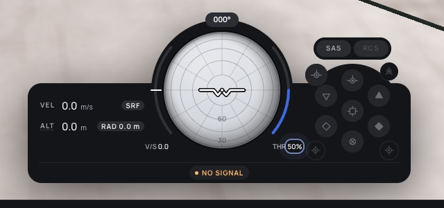
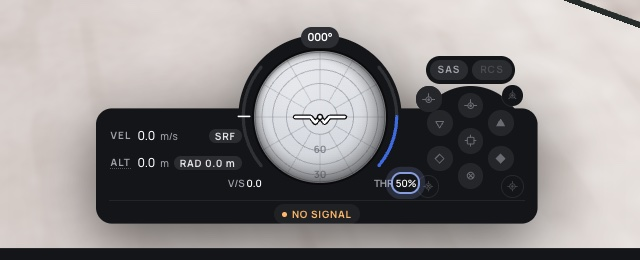
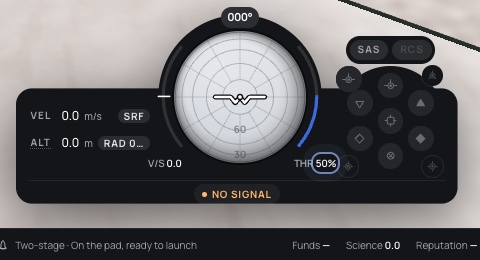
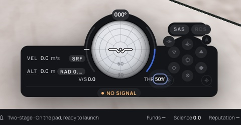

# 383 — Compact navball

**Plan:** [plans/383-compact-navball.md](../plans/383-compact-navball.md) · **ADR:** [0319](../decisions/0319-compact-navball.md) · **Session:** ui-v3 session (Claude), 2026-10-23

## What was done

| Where | What |
|---|---|
| the Flight page | `ballSize` follows `settings.ui.navball`: compact 144/128, normal 180/144. |
| `InstrumentDeck.svelte` | The readouts wing is 164 design units wide (was 150), with a narrower label and gap, so the chips fit at the smaller size. |
| `SasButtons.svelte` | Each mode button gets an `::after` hit area of at least 24 px. |
| `settings.ts`, `SettingsDialog.svelte` | The `interface.navball` field and the "Compact navball" switch, on by default. |

## Screens

| | Before | After |
|---|---|---|
| 1920 × 1080 |  |  |
| 1280 × 800 |  |  |

## Checks

- svelte-check is clean, and the settings, HUD and Flight route tests pass. `regions.test.ts` fails because of the stock-planets work merged from main, not this change.
- e2e was not run.
