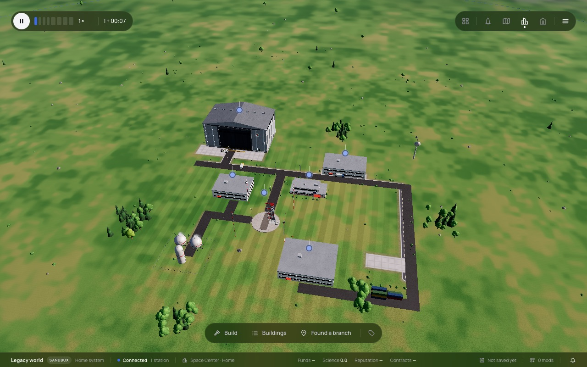
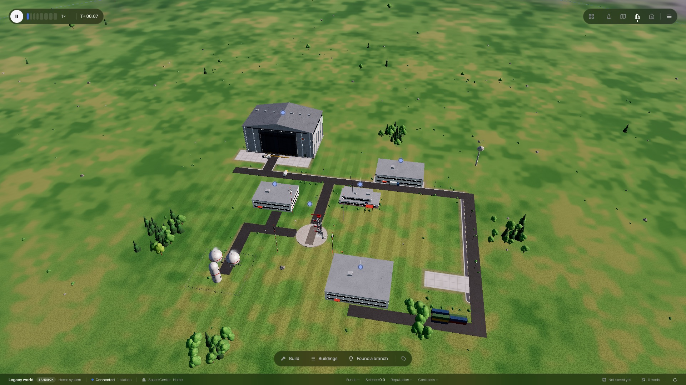
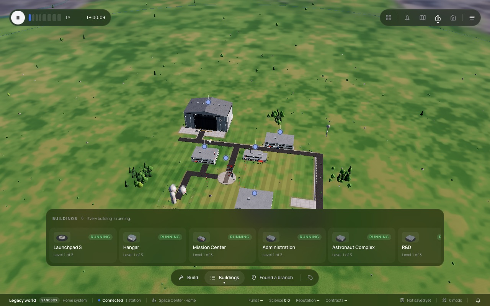
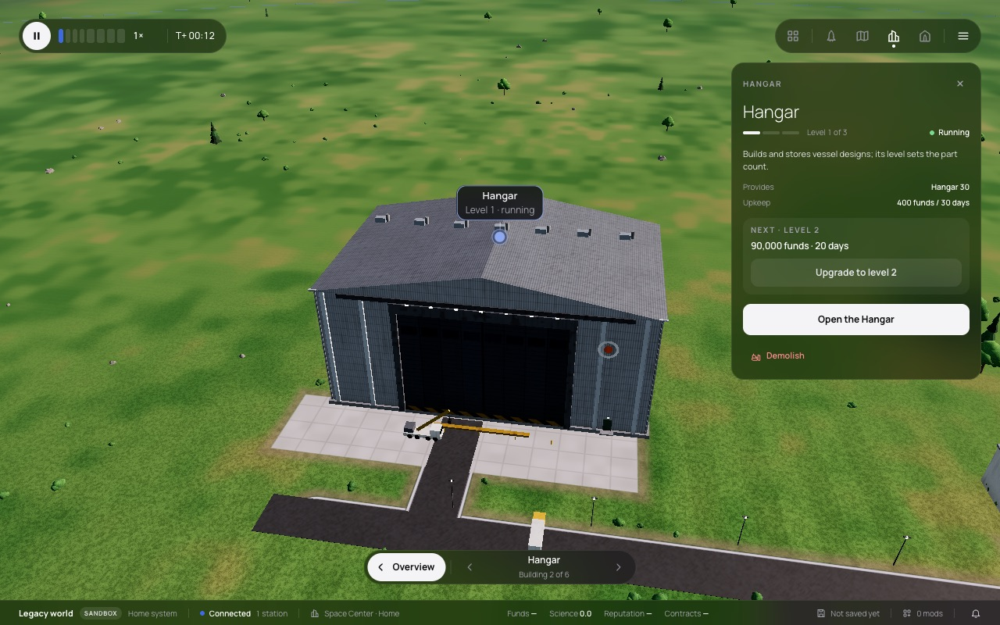
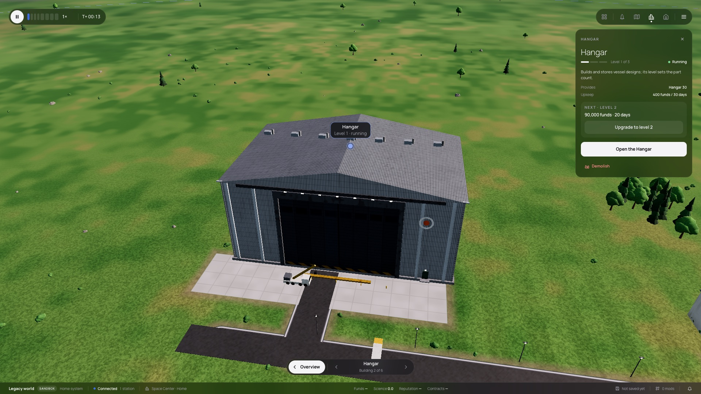
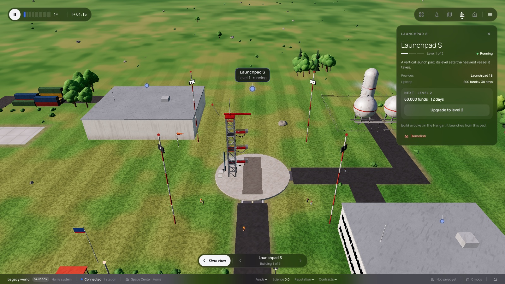
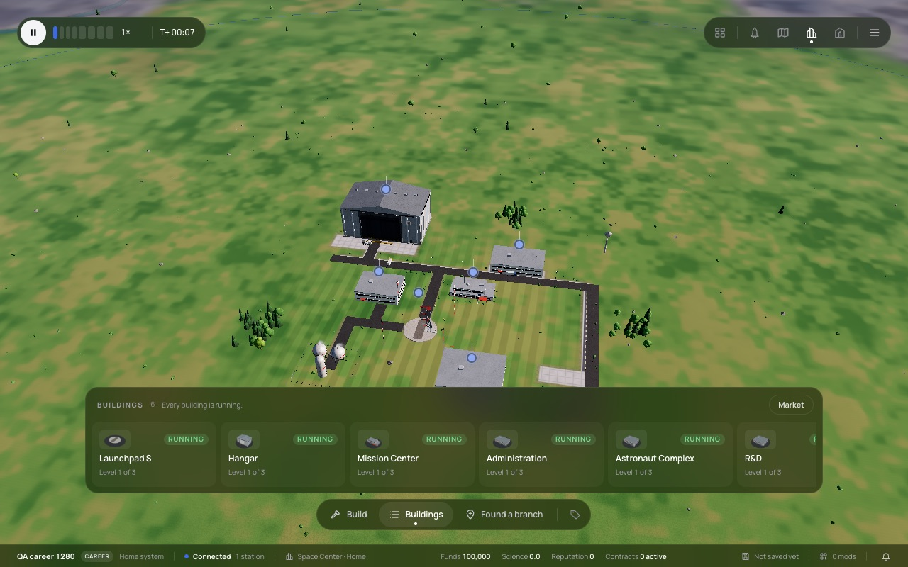
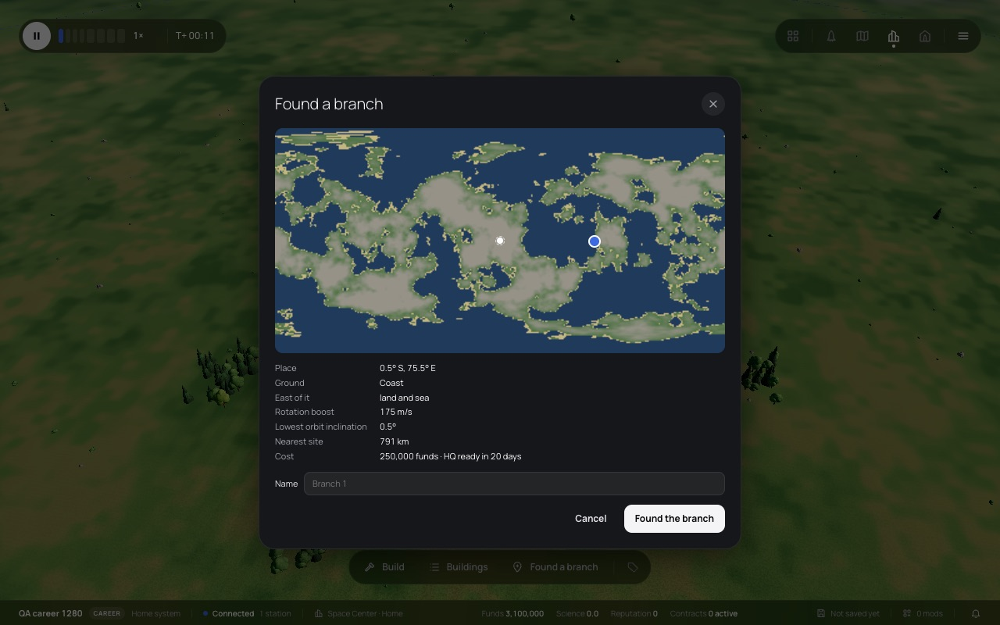
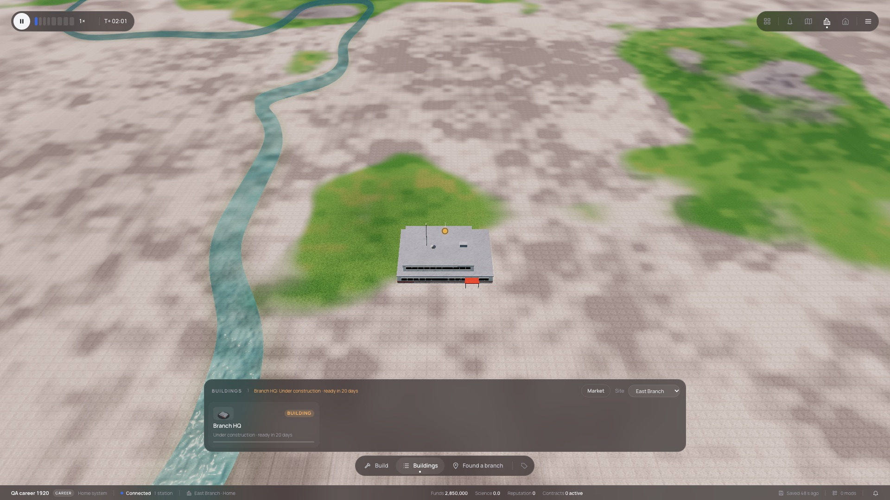
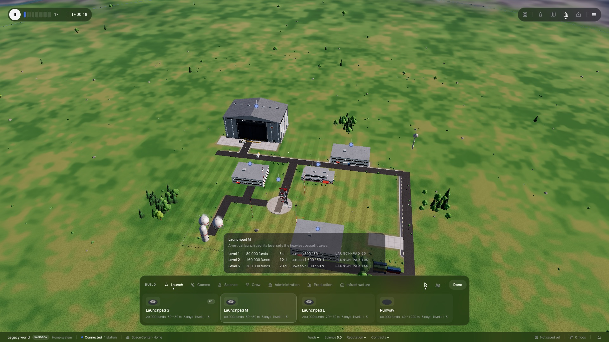

# 387 — Space Center camera and a visual QA pass

**Plan:** [plans/387-space-center-camera-and-visual-qa.md](../plans/387-space-center-camera-and-visual-qa.md) · **ADR:** [0326](../decisions/0326-space-center-camera.md) · **Session:** ui-v3 session (Claude), 2026-10-23

## What was done

| Where | What |
|---|---|
| `lib/space-center/site-camera.ts` | `siteBoxes`: the buildings (footprint, height, entrance facing) and roads as boxes. `frameBoxes`: the distance at which every corner fits the free view. `fitAll`: the site front at 40°, with at least 180 m of ground. `bestView`: the entrance side at 32° and 55 % of the view, walking round blockers. Also `blocks` and `shortestTurn`. |
| `packages/renderer` `Scene.setSiteCamera` | The compass view becomes the rig in the camera frame and eases along the shortest arc. A drag cancels it. |
| the Space Center page | `frame(id)` measures the insets and calls `fitAll` or `bestView`. It runs on opening, on a site switch, back from a building, and when the strip toggles. |
| `SpaceCenterOverlay.svelte` | `onstrip`. The card's status text moved from a tooltip to screen-reader text, because the tooltip stayed over the scene after the camera flew off. |

## Screens

The overview on opening (Sandbox, 1280 and 1920), then with the Buildings strip, which moves the site up above it:

A building from its best angle: the Hangar from its door, and the launch pad from its road:

A new Career world, the branch picker, and the branch's overview with only its HQ (at least 180 m of ground):

Build mode:

## Visual QA findings

**Fixed here:**
- The camera opened near the site centre and kept its azimuth when a building was selected (this plan).
- A strip card's tooltip stayed on screen after the camera flew to the building.
- A branch's overview filled the screen with its one building.

**Listed for their owners:**
- **Loading in headless Chromium with SwiftShader** never leaves "Starting the graphics", even after "Continue with lower quality". With the Mac's GPU (Metal) it loads. This could hit players on software rendering (plan 370's loading screen).
- **A renderer console error** repeats on every Space Center load: `THREE.TSL: TypeError: Cannot read properties of undefined (reading 'value')` at `twins.ts:26`.
- **Branch terrain** shows a visible square grid in the snow and sand texture. It looks like tiling or a low-resolution pattern.
- **A branch HQ under construction** is drawn as a finished building. Only the strip says "Under construction"; there is no scaffold or ghost.
- **Build mode:** the bar and the card's detail panel cover the lower third of the site. A re-frame on opening Build, like the strip's, would help.
- **Not checked:** night lighting by warping to night (the loading screen's night frame showed lit floodlights), and z-fighting up close.

Pins sat on their buildings in every shot, the thumbnails were present in the strip and the build cards, and no building floated or sank.

## Checks

- `site-camera.test.ts` (10) and the Space Center tests (47) pass. svelte-check is clean, the renderer typechecks, and the renderer camera and scene tests pass.
- e2e was not run.
