# 388 — Space Center visual QA leftovers

**Plan:** [plans/388-space-center-qa-leftovers.md](../plans/388-space-center-qa-leftovers.md) · **ADR:** [0329](../decisions/0329-space-center-qa-leftovers.md) · **Session:** space-center QA fixes (Claude), 2026-10-23

## What was done

| Finding (journal 387) | Cause | Fix |
|---|---|---|
| `THREE.TSL: TypeError ... reading 'value'` on every Space Center load and in Flight | The plasma wake reuses the plume's shaders but had no `uPeriod`. The plume twin read it inside a `Fn`, which runs only when three builds the node graph, so the build failed. three then drew a blank material. | The wake has `uPeriod`. Twins link every uniform when they are made, and a missing one is named. `twins.test.ts` makes every twin against its scene material and checks every uniform a shader declares is given. |
| Stuck on "Starting the graphics" with SwiftShader, also after "Continue with lower quality" | `navigator.gpu.requestAdapter()` never answered, so no renderer was made. `lowerQuality()` returned at once without a renderer. | Deadlines and a fallback chain (ADR 0329 point 1). Lower quality works before the renderer exists. |
| A square grid in a branch's snow and sand | The planet pass measured "away from the launch site" from the HQ. At a branch that turned on the 256 m field cells (`floor(pl/256)`), hill relief and rivers. Separately, the 4 m detail tiles were read at mip levels where a tile is a few texels. | `uSiteToOther`: the nearer of the HQ and the branch in view. The detail fades by its mip level. |
| A branch HQ under construction drawn finished (the HQ site too) | The renderer never saw a building's state. | A building site: faint final shape, scaffold, rising core (`constructionOf`, `constructionParts`). |
| The Build bar over the lower third | Tall two-line cards, and the levels panel in the middle above the bar. | Compact cards, a fold chevron, the panel at the right end, re-framed on open and fold. |
| (new) The site spun on screen during time warp | The site view used the flight "Free" frame, whose heading is inertial. | The camera frame is the site's axes turned with the body. |

## Screens

**Branch terrain**, a Career world (seed 12345) with a branch north-east of the HQ. Before (the fixes reverted for the shot), then after:

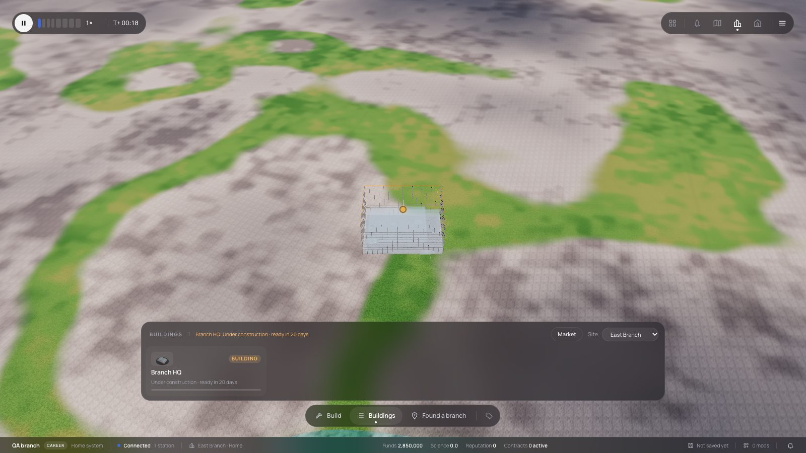
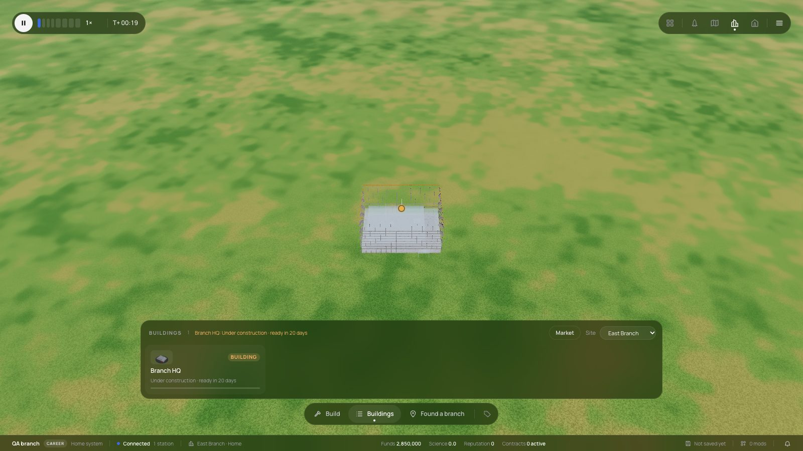

**Close to the ground**, before and after. The after shot also shows the HQ under construction: the scaffold, the faint final shape and the slab.

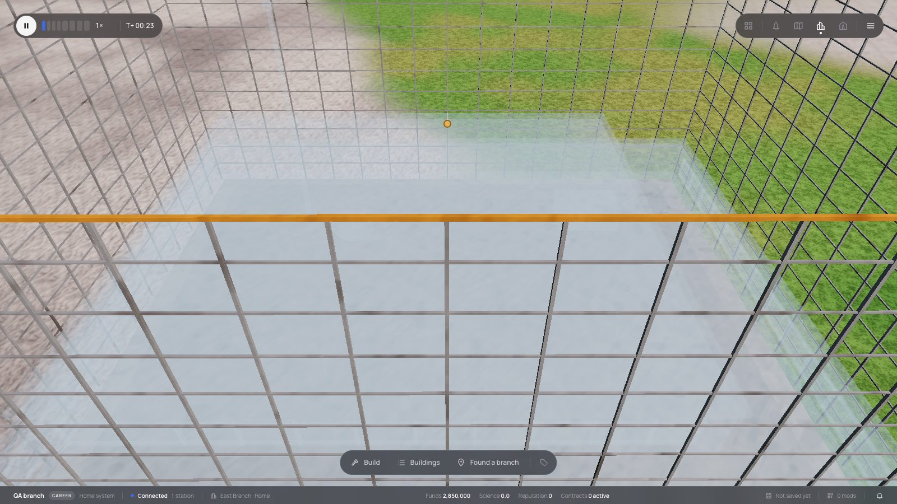
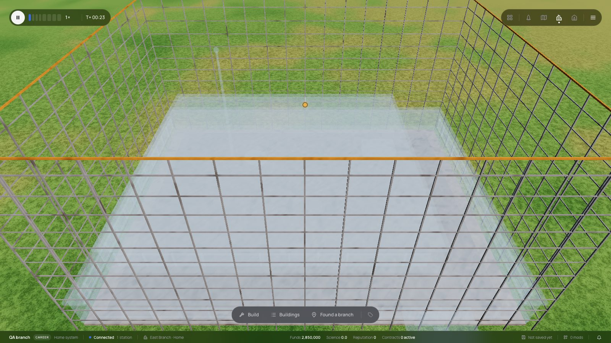

**Build mode at the HQ**, before, then after with the bar open and folded. The branch's build mode re-frames the site above the bar:

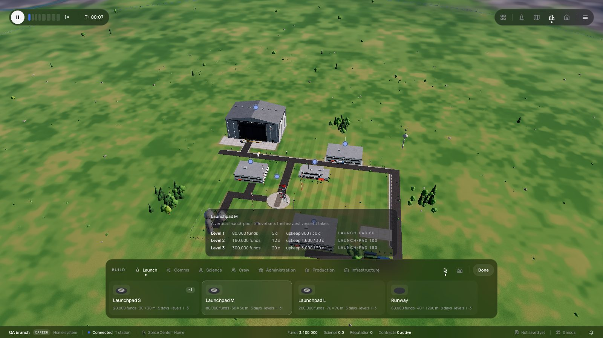
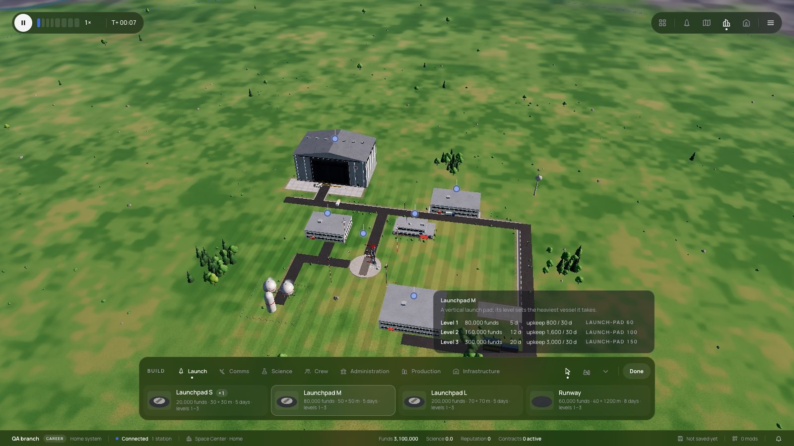
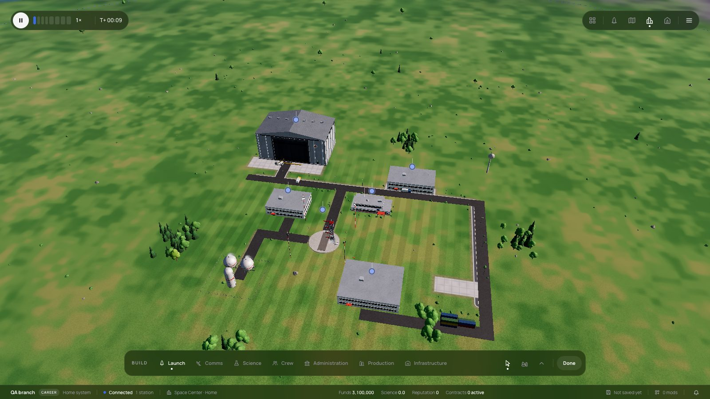
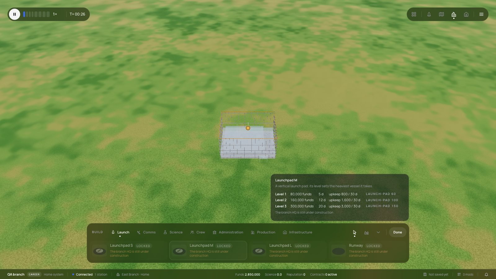

**Software rendering (SwiftShader, headless Chromium).** The Settings choice WebGPU hung. "Continue with lower quality" reloaded on WebGL and reached the Space Center at 71 s. With `?renderer=webgpu` on the address, no fallback is allowed, and the screen says the graphics are unavailable:

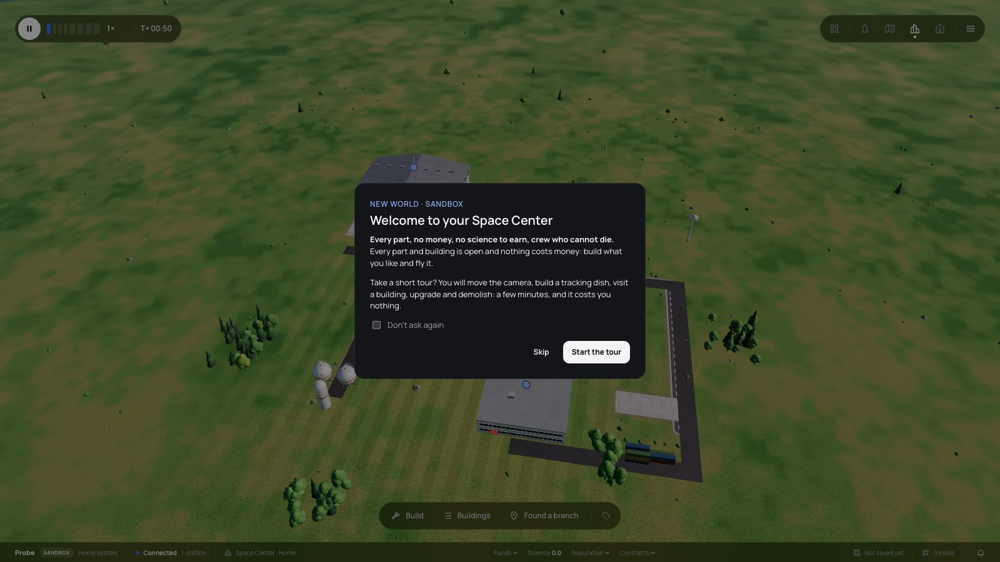
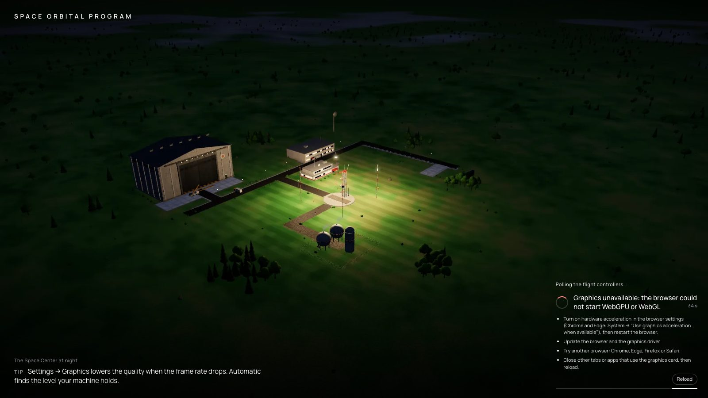

**Night across a 1000× warp.** Before, the site turned between frames:

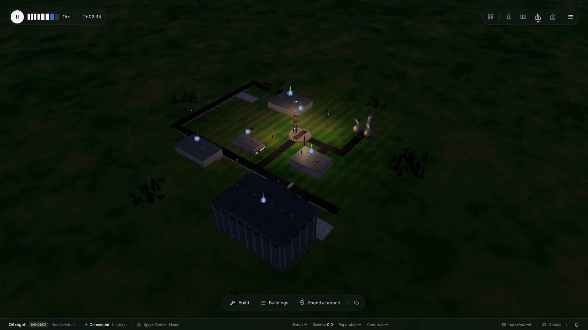
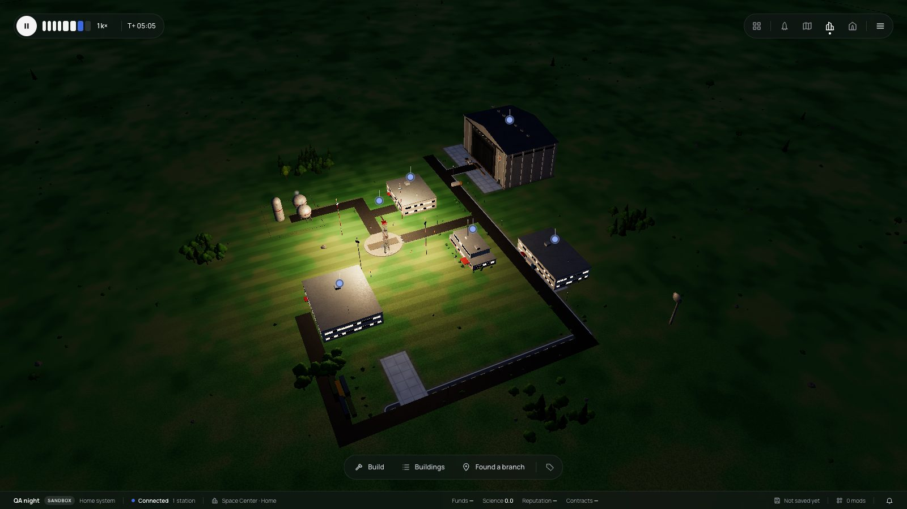

After, it holds still through dusk, night and the next day:

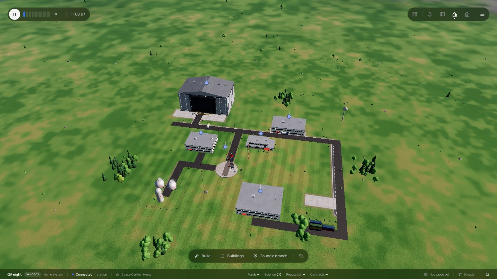
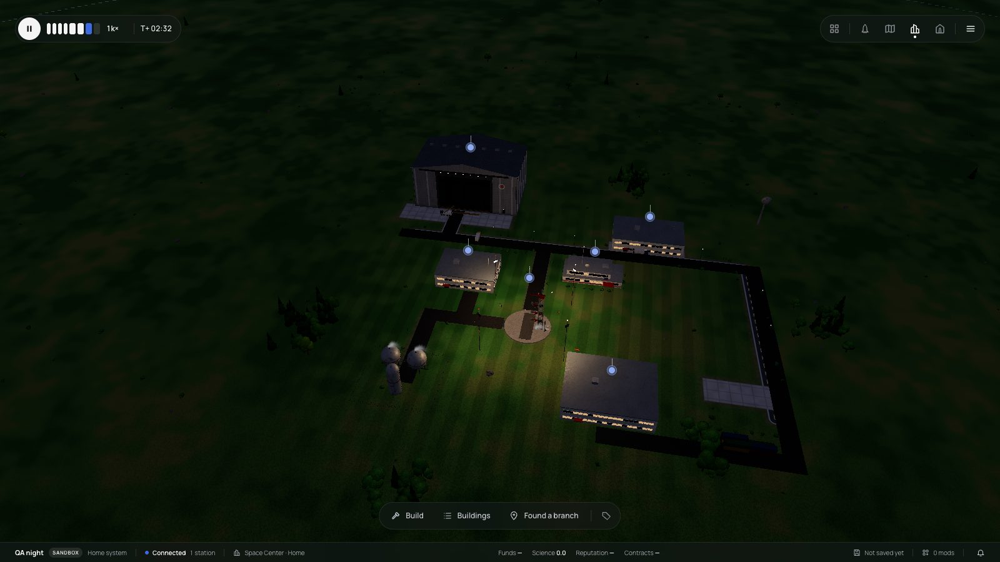

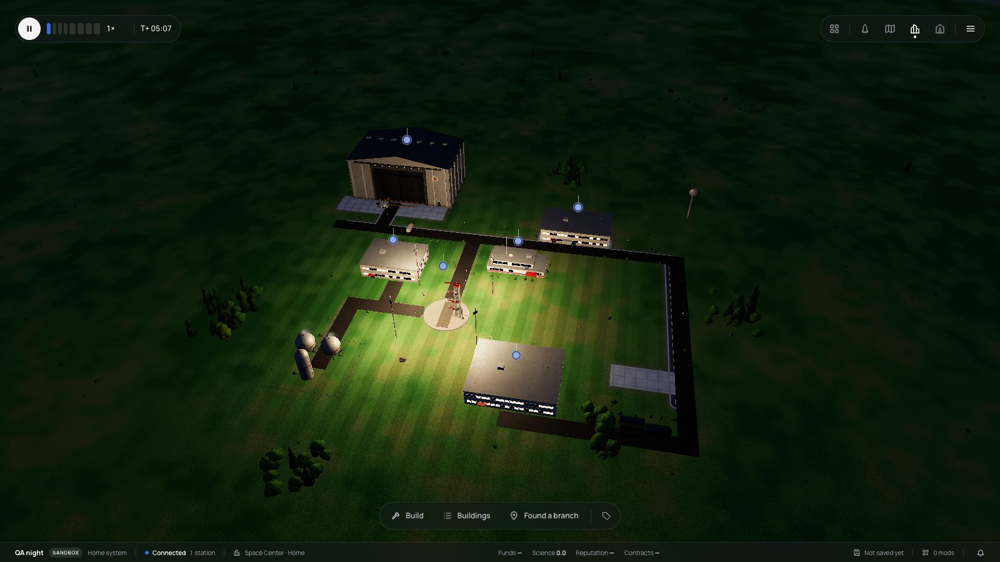

**Up close** (the Hangar's door and roof edge): no z-fighting.

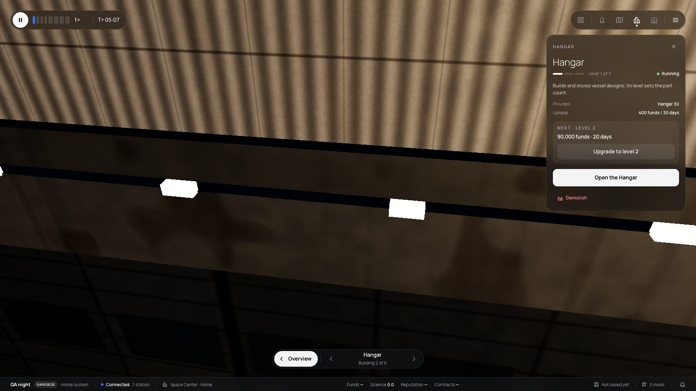

## Checks

- `bun test` in `packages/renderer`: 840 pass. This includes `twins.test.ts` (17), `branch-ground.test.ts` (3), the construction tests and the warp test in `site-list.test.ts`. The new tests fail on the code before the fixes.
- The web tests: `graphics-start.test.ts` and `site-views.test.ts` pass.
  - `sim-host-script-worker.test.ts` fails 2 of 5 on this machine. It fails the same on the code before this plan.
- svelte-check is clean, and the renderer typechecks.
- The probes are `scripts/probe-space-center.ts`, `scripts/capture-388.ts` and `scripts/capture-388-night.ts`.
- e2e was not run (skipped by instruction).

## Surprises

- The in-app browser pane did not catch console errors after a navigation. A Playwright probe did.
- `requestAdapter()` answered `null` at once on a bare page under SwiftShader, but never answered on the game's page.
- The Space Center camera spin under warp was not in journal 387's list. It showed up while checking the night.
