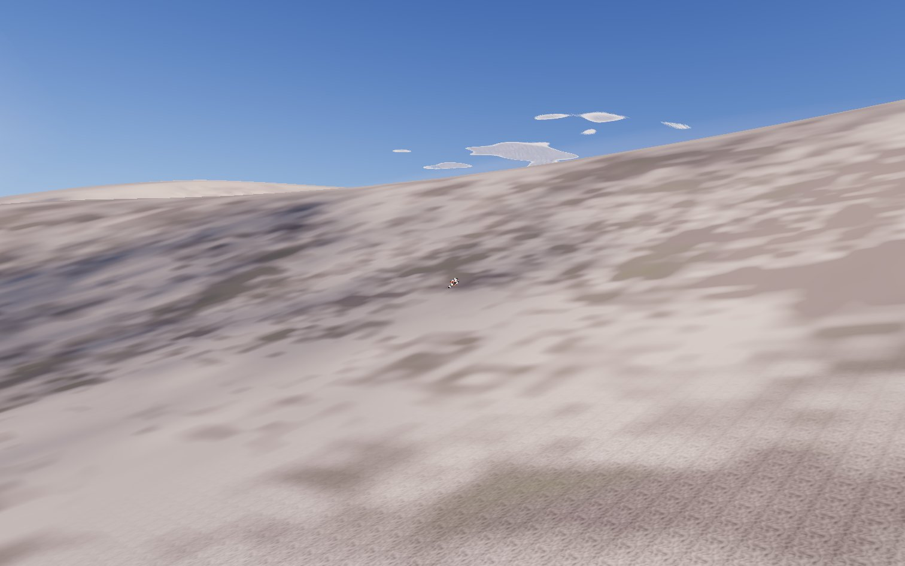
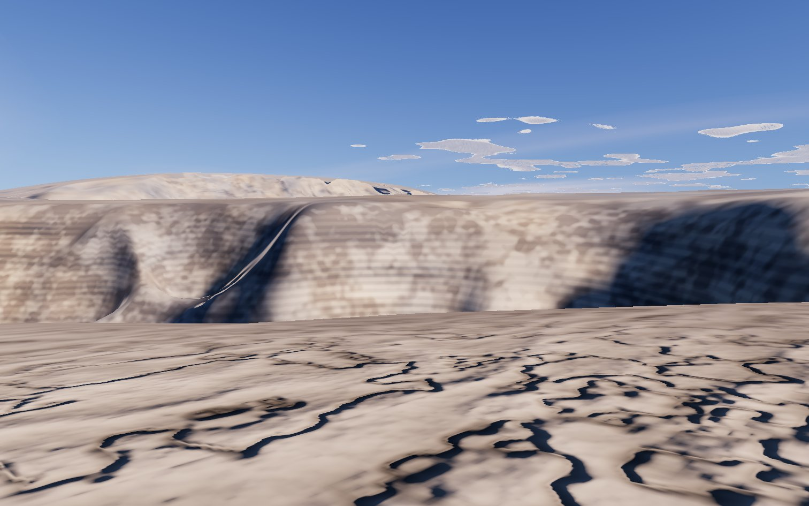
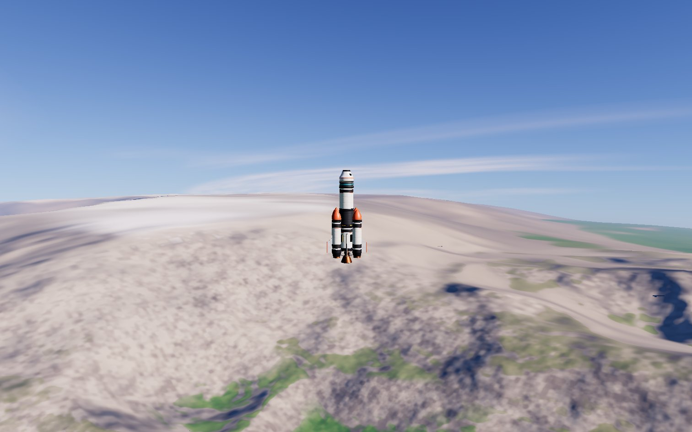
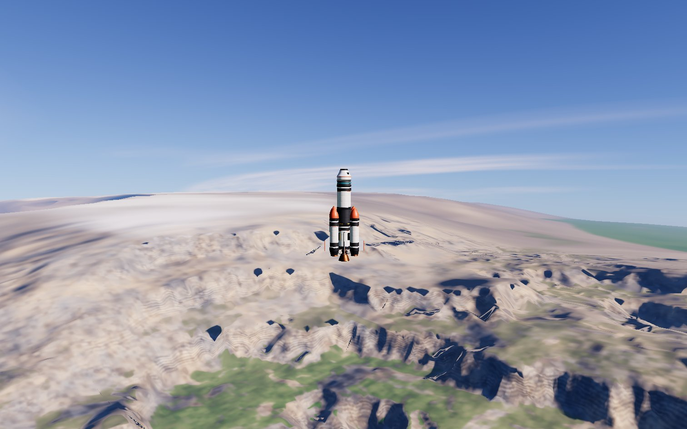
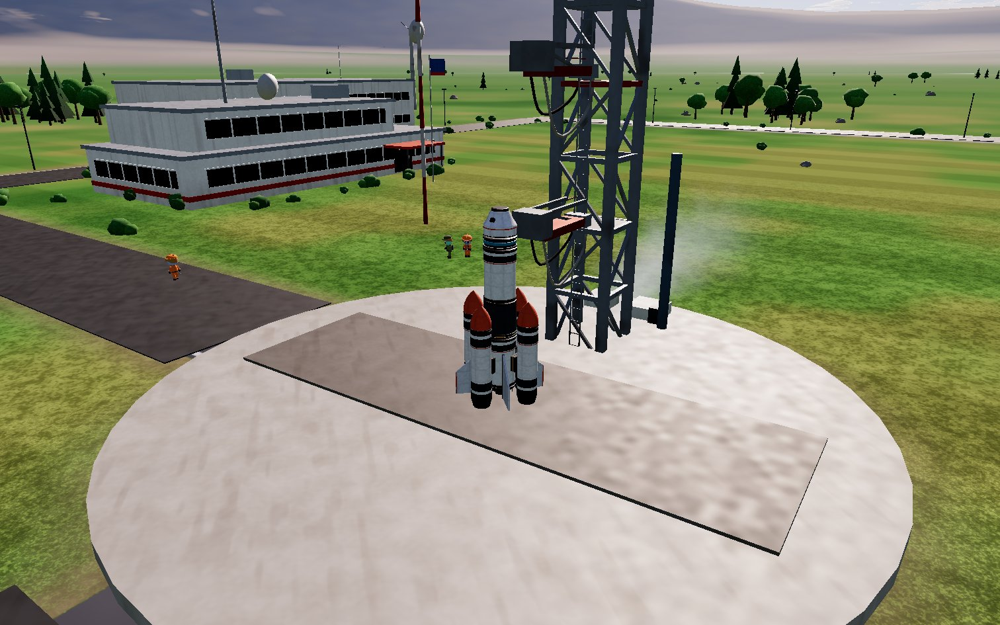
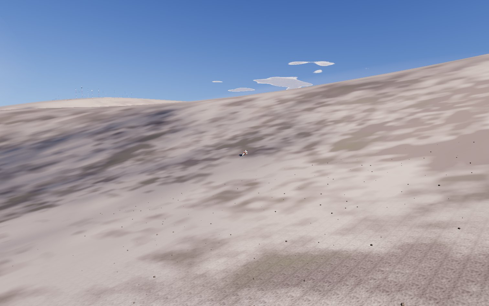
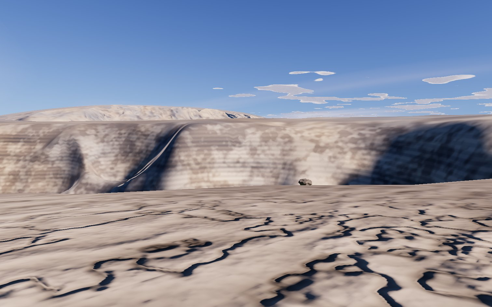
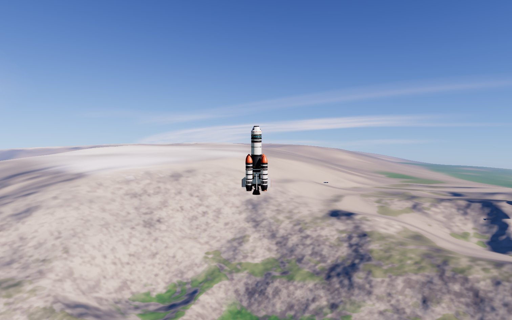
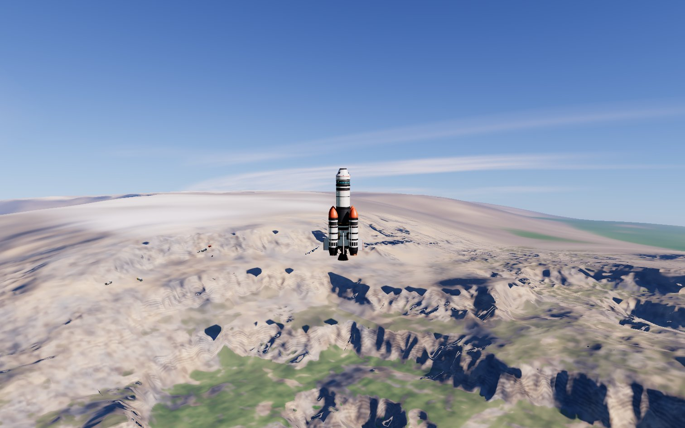
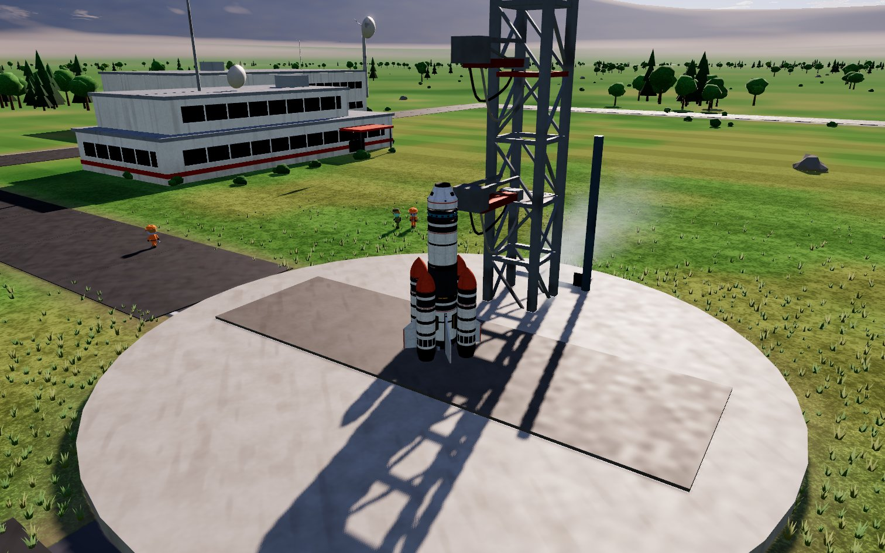

# 417 — Ground relief, cliffs and rock

**Plan:** [plans/417-ground-relief-cliffs-and-rock.md](../plans/417-ground-relief-cliffs-and-rock.md) · **Session:** Worker B, 2026-11-08 · **ADR:** [0375](../decisions/0375-keep-three-raw-webgpu-for-hot-passes.md) (addendum, points 7 to 10)

## What was found

The owner's M5 test said the land and the cliffs of Earth lack detail. The height function had nothing finer than about 2 km (hills 30 km × 4 octaves, ridge 16 km × 4 octaves), a slope of at most 1, and rock that was a flat two-tone mix. A mean second difference of the highlands over 20 m was **0.030 m**: the ground was a smooth sheet at the scale of a vessel.

## What was done

| Where | What |
|---|---|
| `core/terrain.ts`, `terrain-gradient.ts` | The ridge runs 8 octaves (16 km to 125 m, it was 4). The octaves from the fifth on fade in with the mountain mask (`range`, 0.12 to 0.3) and are not evaluated below it, so the lowlands and the plains cost and look as before. Cliffs: where a 7 km noise mask meets real mountains the mountain profile is pulled 85 % of the way toward a 5-step staircase (`terrace`, smooth steps, treads 0.32 to 0.68, risers 4.2 times the plain slope). `ridgeMean` and the departure form keep the level of the field when an octave is left out. `TERRAIN_MAX_SLOPE` 1 to 5. |
| `shaders/terrain.glsl.ts`, `tsl/terrain.ts` | The same function in GLSL and TSL (value and forward-mode gradient), every constant from `TERRAIN_SHAPE`. The bakes are **band-limited by texel size**: an octave finer than about four texels of the bake (`TERRAIN_TEXEL_M`, `texelM`) fades out into its mean. |
| `tsl/planet-pass.ts`, `shaders/planet.glsl.ts`, `detail-textures.ts` (`ROCK_SHADING`) | Rock: strata along the height (9, 46 and 230 m layers, bent by a noise, varied in strength), a 45 to 400 m warm and cool tint, strongest on cliffs (`tanS`). Detail normals from the rock channel of the one detail texture, read as a height: its finite difference over one texel of the level read, two more triplanar reads, only where rock is more than 2 % of the pixel and the footprint is under 8 m. |
| `presets.ts`, the passes | Low `terrainShadowSteps` 0 to 3, skipped where the zone weight is under 0.03 (inside a site's flat zone, so the pad pays nothing). |
| `tsl/terrain-mesh.ts` | The quadtree's slope bound follows `TERRAIN_MAX_SLOPE` (it was a literal 1.2). |
| Scripts | `packages/core/bench/terrain-cost.ts`, `apps/web/scripts/capture-417.ts`, `measure-417.ts` (A/B of two builds served side by side), `parity417.ts` (GPU patch against the CPU function). |

### Why two things differ from a first reading of the plan

1. **Band limit by texel.** The first version simply added octaves. At High the mid patch has 32 m texels and the cube about 1 km texels; a 62 m or 1 km octave sampled there is aliased noise that does not match what the fine patch draws (the first screenshot showed rows of dimples and, at one place, a camera under the baked ground). Dropping an octave must not lower the field, because a ridged octave has a mean of 0.784 (not 0.5): each octave contributes its mean plus its departure, and an octave the bake cannot carry contributes only the mean.
2. **A TSL closure bug found on the way.** The body of a TSL `If` runs when the stack is built, after the JS loop that made it; a closure over `let q, amp, freq` saw their final values. The fine octaves copy them per iteration now (`const [qi, ampi, freqi] = [q, amp, freq]`).

### The sim and the fixtures

- `terrain-legacy.json` (golden heights of the Legacy terrain): re-recorded, because the heights changed on purpose (finer octaves, cliffs); the lake levels and maps are unchanged and pinned as before. `nonZero` and the first 200 and every fifth height changed, and the SHA-256 of the 10 000 heights.
- `terrain.test.ts` and `terrain-patch.test.ts` pinned how well a fixed grid reproduces the height ("a 4 m grid within 0.05 m, a 32 m grid within 1 m"): the new detail needs 0.15 m and 10 m (cliff risers are 4 rise over run; the 32 m figure is the CPU function's, the GPU's mid patch drops the octaves it cannot carry).
- `hills-ground.test.ts` pins the SHA-256 of the bake programs: re-pinned on purpose.
- `terrain-model.test.ts`: `localMarchSlope(1)` is no longer the bound; the test asks for the bound's own gradient.
- New tests: relief at 20 m, cliffs exist and stay inside the bound, lowlands stay gentle (no 20 m slope above 0.1 under 150 m), the terrace is the identity at mask 0 and monotone; the shader twins carry the same tables (`ground-relief.test.ts`). The slope test was made to fail once (`cliffStrength` 1) and does.
- **The sim's ground-contact and landing tests pass unchanged** (`bun test packages/core packages/sim packages/renderer`: 2 261 pass before the two fixture pins above, all of them after). Launch sites are as flat as before: the zone weights are untouched and `exactly zero within the flat radius of the launch site` and the mask test pass.

## Numbers

### Height function cost (`packages/core/bench/terrain-cost.ts`)

Bun, M5, microseconds a sample, the minimum of nine rounds (the median moved with the other workers' load; runs alternate old and new). The old function is the tree at 198e2655.

| set | old | new | ratio |
|---|---|---|---|
| land (home land, outside the flat zone: every term runs) | 0.46 | 0.54 to 0.56 | 1.17 to 1.21 |
| massif (12 to 44 km from the pad) | 0.45 | 0.53 to 0.55 | 1.19 to 1.22 |
| sim (300 m grid on the massif, what the sim reads) | 0.43 | 0.55 to 0.57 | 1.28 to 1.31 |
| globe (uniform on the sphere, mostly sea) | 0.34 | 0.37 to 0.38 | 1.08 to 1.11 |

The limit is 1.5. (The first version, with 6 hill octaves, was 1.34 to 1.51 on the sim set; the hills went back to 4, which the plan did not need.)

### What the ground is now (CPU function, 60 000 samples on the massif, 20 m baseline)

| | old | new |
|---|---|---|
| mean second difference over 20 m, above 1.5 km | 0.030 m | 0.323 m |
| share of the massif with slope over 1.5 | 0.00 % | 0.30 % |
| steepest slope over 5 m (any land, 120 000 samples) | 1.02 | 4.22 |
| p99 slope in lowlands and plains (under 150 m) | 0.006 | 0.006 |

### GPU against CPU (`parity417.ts`, WebGL, a highland of the massif, 1 000 texels)

Mean and worst difference between the baked patch and `terrainHeight`, metres (the highland's highest point is 2.9 to 3.1 km):

| preset | patch | texel | mean | worst | note |
|---|---|---|---|---|---|
| High | fine | 4 m | 0.021 | 0.32 | all octaves present |
| High | mid | 32 m | 0.020 | 0.29 | octaves of 125 m and more are present (four texels) |
| Low | fine | 8 m | 0.020 | 0.31 | |
| Low | mid | 64 m | 0.99 | 39 | by design: the octaves under 256 m and the cliff risers fade into their mean |

The old tree gave 0.007 / 0.04 (fine, High) and 0.015 / 0.27 (mid, High): the GLSL twin of the new function is as exact as the old one where the texel can carry the detail.

### Frame time at the pad (`measure-417.ts`, headed Chromium, M5, DSF 2, builds side by side, rounds interleaved)

`apps/web/scripts/measure-417.ts`, 4 rounds of 15 s after 6 s of warm-up, the pad on the Booster rocket (`/flight`, the default view), WebGPU, `governor off`, `/tmp/orbital-measuring` held; the 1-minute load was 3.2 to 5 (two other workers). The two dev servers are the tree at 198e2655 (before) and this branch (after); rounds alternate who goes first.

| preset | mean frame before | after | delta | p50 before / after | GPU ms (median of the reads) before / after |
|---|---|---|---|---|---|
| Low | 8.33 | 8.33 | 0.00 | 8.30 / 8.30 | 0.37 / 0.39 |
| High | 16.43 | 16.55 | +0.12 | 16.70 / 16.70 | 5.28 / 5.25 |

Both are inside the +0.3 ms limit. How to read them: the pad on Low sits at the display's 120 Hz cap (8.33 ms) in every round of both builds, and High at the 60 Hz step (16.7 ms), so the mean frame can only show a cost once it passes the cap; the GPU read says the same (+0.02 and -0.03 ms), and the p95 is 9.3 before and after (Low), 17.2 before and 17.6 after (High). The first, noisier run (three rounds, load 3.4 to 6.5, mean frames of 8.3 to 12 ms on Low from the other workers' hitches) gave no other answer: the p50 was 8.30 and 16.70 in both builds. The new work at the pad is nil by construction: the flat zone has no relief, the ridge's fine octaves fade out below the mountain mask, the rock block runs only where rock is more than 2 % of the pixel, and Low's shadow march is skipped inside the zone.

What the new shading costs where it runs (on rock, on cliffs) was not measured by a scene of the gate: `perf:gate` has no mountain scene.

## Screens

Before and after, Low and High, at the same highland of the massif (36 km east of the pad, 1.8 km high: where the new terrain has the most cliffs), from the vessel standing on it (300 m view: the camera orbit is limited to a few tens of metres, so "300 m" is the standing view), 3 km above it and 30 km above it (clouds off), and the pad.

| | before | after |
|---|---|---|
| Low, standing |  |  |
| Low, 3 km |  |  |
| Low, 30 km |  |  |
| Low, pad |  |  |
| High, standing |  |  |
| High, 3 km |  |  |
| High, 30 km |  |  |
| High, pad |  |  |

## Checks

- `bun scripts/probe-dusk.ts` (High, WebGPU, against this branch): `pipelines before dusk 92, after 92: 0 built`. At Low the same probe reports 68 then 70 (2 built), and **so does the tree at 198e2655**: a pre-existing Low result, not this plan's.
- `bun scripts/probe-textures.ts high --gate` and `low --gate`: `gate ok: no pipeline over 15 sampled textures, none failed`. The detail texture is still one binding; the rock normals are two more reads of it, not a texture.
- `bun run lint`, `bun run typecheck`, `bun run docs:check` green; `bun test packages/core packages/sim packages/renderer`: 2267 pass, 1 fail on the first full run (the plan 039 prepass test: with the slope bound at 5 the cone widened 3 times and the prepass saved nothing). Fixed with `MARCH_CONE_SLOPE = 3` (`terrain-model.ts`, used by the TSL prepass): the cone is tens of metres wide, where the slope's p99.9 is 1.4 to 1.8 (max 2.9 to 5.1 over 5 to 160 m). 2 gave a cone start past a brute-force hit, 3 and 3.5 pass both tests. **Reservation:** a riser steeper than 3 inside one cone can be passed by the prepass; not seen on screen, not measured. `bun test packages/renderer`: 1086 pass, 0 fail after the fix.

## Not done

- **WebGPU parity read-back.** `readPatch` is `null` on the WebGPU renderer, so the GPU against CPU comparison is on WebGL (the GLSL twin). The TSL twin was checked by eye (it showed a real bug, the closure one above, before it was fixed) and by the screens; a WebGPU read-back is plan 418's kind of tool.
- **`perf:gate`** (needs a production build on a quiet machine; the machine was shared with two workers the whole time).
- The 30 km view still shows the mountains as shapes, not as cliffs: a pixel there is thousands of metres, the cliffs are hundreds. What reads from 30 km is the terraced massifs and their shadows.
- [manual] M2 and Windows.
