# Visual part & blueprint: riset dan usulan

> Lanjutan: daftar pelacakan part dan sistem (nama, bentuk, interaksi, status) ada di [parts-tracker.md](parts-tracker.md).
> Riset, 2026-10-21. Bahan diskusi dengan owner sebelum ada plan atau kode. Belum ada keputusan di sini; pertanyaan terbuka ada di §10.
> Referensi KSP/KSP2 dipakai **hanya untuk bentuk dan jenis detail**. Tidak ada art, tekstur, atau model KSP yang disalin (hak cipta).

## 0. Ringkasan

1. **Akar masalah terbesar bukan kualitas generator, tetapi generator yang salah.** 23 dari 74 part stock digambar dengan generator `tank`. Daftarnya: probe core, dua antena, tiga panel surya, RTG, tiga baterai, tujuh alat sains, dua part life support, data drive, dua tangki monoprop, dan flotation collar. Karena itu semuanya tampak seperti "cakram/tabung bergaris" (§2).
2. **Part fungsional hanya bisa dipasang di stack.** Panel surya, antena, dan alat sains memakai `stackNodes`, jadi bentuknya terpaksa silinder 1,25 m. Di KSP, part seperti ini hampir semuanya ditempel radial di dinding. Masalah ini menyentuh mod `stock` (aturan attach), bukan hanya renderer.
3. **Satu generator melayani banyak part dengan sedikit parameter.** Contohnya, tiga mesin cair kita hanya berbeda ukuran bell. Di KSP, setiap mesin punya siluet sendiri.
4. **Ikon katalog membuat semuanya lebih buruk.** Muka sambungan biru mendominasi ikon. Part kecil (RCS, parasut, drogue) tampak seperti titik, dengan dugaan kuat bahwa bounding box ikon ikut menghitung mesh yang tersembunyi (plume, kanopi).
5. **Blueprint:** kita punya 5 contoh generik, dipilih lewat tombol teks tanpa gambar atau statistik. Usulannya: satu "Pustaka" dengan kartu gaya *blueprint* (render di atas grid biru, label bagian, statistik, filter), ditambah 10–16 roket nyata yang lengkap (RCS, antena, kru, parasut, life support, listrik).
6. **Rekomendasi jalur:** semua keluarga part tetap **prosedural**. glTF tetap untuk mod (ADR 0076). Pekerjaan dimulai dengan sebuah "detail kit" bersama (rim, band, ring, panel line, stub pipe, bell berongga), lalu generator baru per keluarga. Biaya per fase ada di §9.

## 1. Sumber yang dibaca

| Sumber | Hasil |
|---|---|
| Gambar owner: kartu RV-105 RCS Thruster Block, versi lama dan revamp | dianalisis di §3 |
| Gambar owner: roket stilasi yang dibongkar (putih/hitam) | dianalisis di §6 (detail kit) |
| [imgur: KSP tierlist (album)](https://imgur.com/a/ksp-tierlist-t89NXPI) dan [imgur XSHrpzp](https://imgur.com/XSHrpzp) | tier list semua part KSP. Ikon kecil, tetapi cukup untuk siluet: hampir tiap part punya bentuk khas walau ukurannya mirip |
| tiermaker.com (2 link) | **tidak terbaca:** halaman meminta verifikasi Cloudflare (CAPTCHA), dan CAPTCHA tidak saya kerjakan. Isinya sama dengan dua gambar imgur di atas, yang berasal dari template tiermaker yang sama |
| [Pengumuman Steam 1630779027896402729](https://steamcommunity.com/games/220200/announcements/detail/1630779027896402729) | ternyata newsletter **"KSP Loading… Breaking Ground under the spotlight!"** (24 Mei 2019), bukan pengumuman revamp part. Isinya: deployed science (control station, RTG, panel surya PD, antena ground, goo monitor, weather analyzer, ionographer, seismometer), rover arm, robotika (hinge, piston, rotor, servo, KAL-1000). Berguna untuk daftar part sains dan robotika, bukan untuk gaya revamp. Kartu RV-105 dari owner berasal dari seri revamp KSP 1.7–1.8 |
| [kerbalstates.com/tag/blueprints](https://kerbalstates.com/tag/blueprints/) | 10 kiriman, semuanya craft fiksi (Crew Vehicle Mk3, Neidon II/III, V.I.N.C.E.N.T Lander, Sarnus Station, …). **Gaya penyajiannya yang penting:** satu render craft di atas grid biru, nama besar, blok statistik (Mass, Delta-V, TWR, Crew, Range), dan label bergaris penunjuk ke setiap bagian (Forward RCS, Docking Port, Parachute, Crew Hatch, RCS Thrusters (4), Fuel Tank, Engine). Gaya ini sama dengan kartu RV-105 |
| `refs/reverse-engineering-ksp-ksp2/09-parts-catalogue.md` | katalog part KSP1/DLC/KSP2 yang sudah ada di repo. Dipakai untuk kolom "KSP" di §4 |
| Kode: `packages/renderer/src/parts/generators/*`, `mods/stock/src/parts/*`, `apps/web/src/routes/(world)/vab/+page.svelte`, `apps/web/src/lib/editor/examples.ts`, `apps/web/src/lib/vab/LibraryDialog.svelte` | §2, §4, §7, §8 |

Gambar "kita sekarang" dirender dari game (dev server, `VabView.renderIcon`, 256 px, diperkecil). Semua ada di `img/icons/`. Lembar lengkapnya:

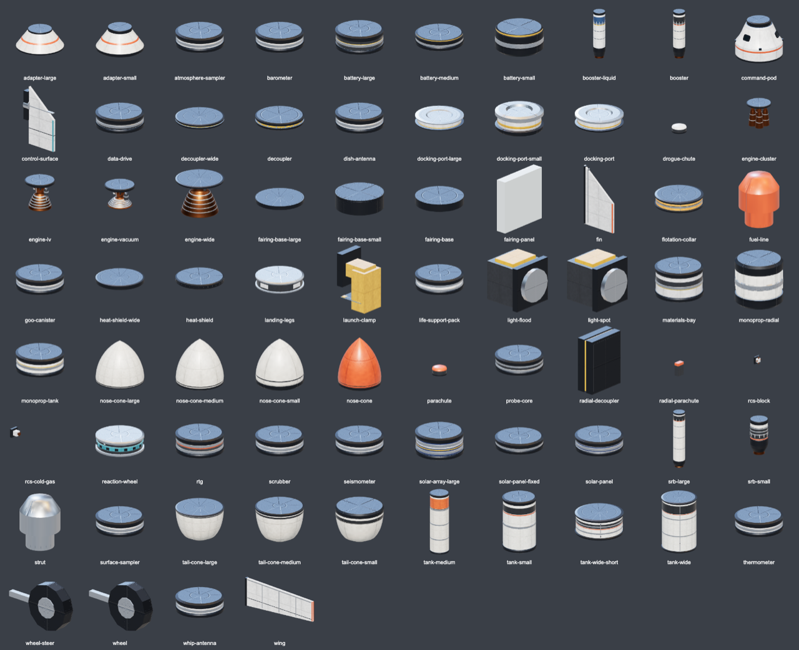

## 2. Diagnosis

### 2.1 Part yang memakai generator `tank` padahal bukan tangki

| Part | Seharusnya tampak seperti |
|---|---|
| `probe-core` | badan probe: oktagon atau bola kecil, panel foil, lampu status |
| `whip-antenna`, `dish-antenna` | batang teleskopik / piringan parabola dengan feed horn |
| `solar-panel`, `solar-panel-fixed`, `solar-array-large` | panel lipat atau sayap berlapis sel biru gelap dengan rangka |
| `rtg` | silinder bersirip radiator (sirip memanjang di sekeliling) |
| `battery-small/medium/large` | kotak atau cakram tipis dengan sel-sel, terminal, tanda kutub |
| `thermometer`, `barometer`, `seismometer`, `surface-sampler`, `atmosphere-sampler`, `goo-canister`, `materials-bay` | alat kecil berbeda-beda, biasanya radial: probe batang, kotak sensor, tabung kaca, bay dengan pintu |
| `life-support-pack`, `scrubber` | kontainer bertingkat dengan katup / kotak filter berkisi |
| `data-drive` | kotak elektronik bersirip pendingin |
| `monoprop-tank`, `monoprop-radial` | tangki bola atau kapsul (monoprop KSP berbentuk toroid atau bola), bukan barel |
| `flotation-collar` | cincin karet pelampung yang menggembung |

Inilah sumber utama keluhan "semuanya cakram, cincin, tabung". Generator `tank` sendiri sudah cukup baik: collar, stripe, band, stringer, dan feed line semuanya ada.

### 2.2 Aturan attach memaksa bentuk

Semua part pada tabel di atas memakai `stackNodes`, sehingga harus berbentuk silinder dengan muka atas dan bawah. Di KSP, panel surya, antena, alat sains, lampu, dan sebagian baterai ditempel radial. Karena itu siluet KSP bebas: bisa sayap, piringan, atau batang. Untuk memperbaiki bentuk, sebagian part ini harus pindah ke attach `radial` (seperti `rcs-block`, `lights`, `radial-parachute` yang sudah ada). Hal ini mengubah **mod stock dan desain tersimpan**: perlu ADR, migrasi desain, dan pengecekan blueprint yang memakai part tersebut.

### 2.3 Variasi dalam satu keluarga terlalu sedikit

- `engine-lv`, `engine-vacuum`, `engine-wide`: generator `engine` yang sama, hanya `bellExit`/`throat` yang berbeda. Di ikon, ketiganya tampak sebagai "bell tembaga bergaris di bawah piringan".
- `booster`, `booster-liquid`, `srb-small`, `srb-large`: tabung putih dengan nozzle hitam.
- `decoupler`, `decoupler-wide`, `heat-shield*`, `fairing-base*`, dan semua part di §2.1: cakram dengan muka biru.

### 2.4 Ikon katalog

- **Muka sambungan dominan.** Ikon diambil dari atas, sehingga muka atas berwarna biru dengan cincin node menjadi bagian terbesar dari gambar. Di KSP, ikon diambil dari samping agak ke atas dan muka sambungan tidak diberi warna khusus.
- **Part kecil tampak seperti titik** (`rcs-block`, `rcs-cold-gas`, `parachute`, `drogue-chute`, `radial-parachute`). `frameIcon` memotret menurut `Box3.setFromObject(holder)`, dan fungsi itu ikut menghitung mesh yang tidak terlihat. **Dugaan kuat, belum diverifikasi:** plume RCS dan kanopi parasut yang tersembunyi memperbesar kotak tersebut. Perbaikannya kecil.
- `strut` dan `fuel-line` tampil sebagai gumpalan silinder, karena ikon menampilkan ujung konektor tanpa batangnya.

### 2.5 Material dan warna

Material yang tersedia: `paint-primary/secondary/accent`, `metal`, `dark-metal`, `foil`, `glass`, `ablator`, `nozzle`, `nozzle-inner`, `rubber`, `lamp`, ditambah noise prosedural (`textures.ts`: hull, foil, tile, weathering). Yang belum ada:

- **livery** (pola cat: band hitam, checker roll pattern, sisi setengah hitam), seperti pada gambar 8 dan roket nyata;
- **decal tanpa teks** (panel keypad, panah, garis bahaya, logo bendera dari mod);
- **panel line yang diukir** (normal map garis panel dan rivet);
- warna bell selain tembaga bergaris (KSP revamp: perunggu gelap atau logam gelap dengan ring halus, dalamnya jelaga).

## 3. Poin 1: RCS block (RV-105) dibanding milik kita

Generator kita (`packages/renderer/src/parts/generators/rcs-block.ts`, 42 baris, plan 211) terdiri dari:

- satu kotak `dark-metal` sebagai pelat dasar;
- satu kotak `paint-primary` berukuran 0,6 × 0,55 × 0,55 sebagai badan;
- empat `cylinder` `nozzle` berupa kerucut sederhana tanpa lubang (8 atau 14 segmen).

Kerucut menempel langsung ke badan, tanpa stub, dengan panjang 0,22 × sisi terkecil.

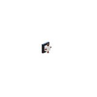 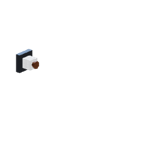

| Ciri RV-105 (versi revamp) | Kita sekarang | Yang perlu dibuat |
|---|---|---|
| Rumah kecil membulat: kotak dengan sudut tumpul dan muka atas melengkung seperti pelana | kotak tajam | kotak *chamfer/rounded* (extrude `roundedRect` sudah ada di `capsule.ts`) dengan atap melengkung |
| Panel line, sekrup di sudut, panel keypad 3×4 dengan angka "1/2", "2/2" | polos | panel tertanam di setiap sisi (sisipan kotak tipis, warna sedikit lebih gelap), decal keypad **gambar sendiri** tanpa teks KSP |
| Pelat dasar gelap yang lebih lebar dari rumah | ada, tetapi sebagai kotak tipis | pelat dengan bevel dan empat baut |
| Empat bell bersilang (atas, bawah, kiri, kanan), ditambah satu stub pendek per bell | kerucut menempel langsung | **pipa stub** (silinder pendek, `metal`), lalu leher, lalu bell |
| Bell bertingkat (cincin-cincin horizontal), perunggu, mengembang di ujung | kerucut polos `nozzle` | profil `revolve` dengan 4–6 ring timbul, material perunggu (slot baru atau varian `nozzle`) |
| **Berongga**: tampak dalam bell yang gelap | tertutup | dinding bell + `nozzle-inner` (pola yang sudah ada di `engine.ts`) |
| Ukuran terbaca jelas di ikon | titik kecil | perbaikan framing ikon (§2.4) |

Biaya: generator baru sekitar 120–180 baris dan detail kit dari §6, kira-kira **setengah plan**. Varian yang sama bisa dipakai untuk `rcs-cold-gas` (1 nozzle) dan untuk blok 5 arah (seperti Soyuz/Apollo quad, §7).

## 4. Per part: KSP, kita sekarang, celah

Kolom "KSP" diringkas dari `09-parts-catalogue.md` dan tier list. Penilaian: ✅ terbaca sebagai benda yang benar, ⚠️ terbaca tetapi polos atau mirip saudaranya, ❌ terbaca sebagai benda lain.

### 4.1 Command & control

| Kita | Ikon | KSP/KSP2 | Nilai | Celah |
|---|---|---|---|---|
| `command-pod` (1 kursi) | 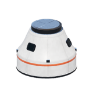 | Mk1 (1), Mk1-3 (3 kursi), Mk2 lander can, Mk1 lander can, cupola, PPD hitchhiker | ✅ | hanya 1 ukuran dan 1 kursi. Tidak ada pod 3 kursi (Apollo/Soyuz), lander can, cupola, atau modul kru |
| `probe-core` | 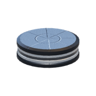 | Stayputnik (bola berantena), OKTO (oktagon), HECS (silinder pendek berpanel), QBE (kubus) | ❌ | §2.1 |
| `reaction-wheel` | 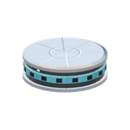 | cakram tipis dengan panel ventilasi | ⚠️ | cukup, tetapi jendela teal-nya mirip lampu |
| `data-drive` | 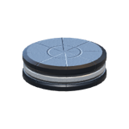 | (KSP: tidak ada; mirip "experiment storage unit": kotak dengan pintu) | ❌ | §2.1 |

### 4.2 Tangki

| Kita | Ikon | KSP/KSP2 | Nilai | Celah |
|---|---|---|---|---|
| `tank-small`, `tank-medium` | 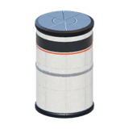 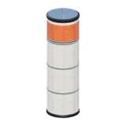 | FL-T100…T800: varian warna putih, oranye, hitam-putih, perak; kubah ujung terlihat; garis las | ⚠️ | bagus, tetapi semua satu livery (putih + stripe oranye). Belum ada pilihan livery, band hitam (gambar 8), atau skirt |
| `tank-wide`, `tank-wide-short` | 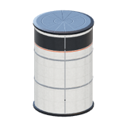 | Rockomax X200: panel besar bergaris, varian oranye (busa) | ⚠️ | sama |
| `monoprop-tank`, `monoprop-radial` | 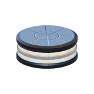 | FL-R toroid, Stratus-V bola atau kapsul radial | ❌ | §2.1 |

### 4.3 Mesin

| Kita | Ikon | KSP/KSP2 | Nilai | Celah |
|---|---|---|---|---|
| `engine-lv` | 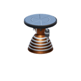 | LV-T30/T45: rangka terbuka, turbopump, pipa | ⚠️ | detail ada (strut, pump, plumbing), tetapi kecil di ikon. Bell tembaga bergaris mirip pegas |
| `engine-vacuum` | 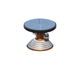 | Terrier (pendek, bell lebar), Poodle (dua warna, bell besar) | ⚠️ | harus jauh lebih pendek di atas dan bell lebih panjang/lebar dengan nozzle extension gelap |
| `engine-wide` | 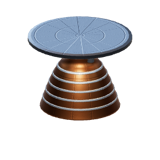 | Skipper / Mainsail: shroud penuh selebar tangki menutupi pompa | ⚠️ | butuh **shroud** (rok kerucut selebar diameter) |
| `engine-cluster` | 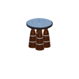 | Twin-Boar (mesin+tangki), Mammoth (4 nozzle), Rhino | ⚠️ | kecil di ikon. Untuk Saturn V/Falcon perlu mount 5 dan 9 mesin |
| `srb-small`, `srb-large`, `booster` | 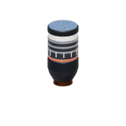 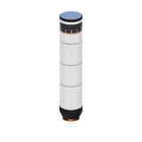 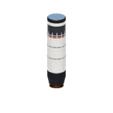 | Flea, Hammer, Thumper, Kickback: segmen dengan sambungan, rok belakang, nozzle tetap, cincin hitam | ⚠️ | polos. Butuh ring segmen, skirt belakang, motor pemisah, dan band hitam |
| `booster-liquid` | 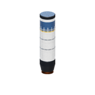 | (replika R-7: booster meruncing) | ⚠️ | untuk Soyuz/R-7 perlu booster **meruncing** dengan puncak kerucut |
| belum ada | | Spark, Nerv (nuklir), Dart (aerospike), Dawn (ion), Vector, Rapier | | di luar riset ini, dicatat sebagai lubang katalog |

### 4.4 RCS

`rcs-block`, `rcs-cold-gas`: ❌ di ikon dan ⚠️ di dunia. Lihat §3.

### 4.5 Struktur dan coupling

| Kita | Ikon | KSP/KSP2 | Nilai | Celah |
|---|---|---|---|---|
| `decoupler`, `decoupler-wide` | 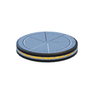 | TD-12/TR-18: cakram tipis dengan pita kuning-hitam dan baut eksplosif | ⚠️ | terlihat sebagai cakram biru. Pita bahaya dan baut belum ada |
| `radial-decoupler` | 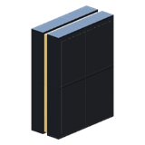 | TT-38K: balok dengan engsel | ✅ | |
| `adapter-small`, `adapter-large` | 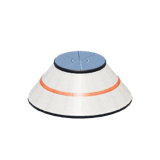 | adapter kerucut berpanel | ✅ | |
| `fairing-base*`, `fairing-panel` | 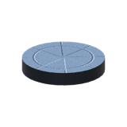 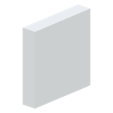 | AE-FF: alas dengan cincin, cangkang terbagi | ⚠️ | ikon panel hanya kotak putih. Ikon alas cuma cakram |
| `strut`, `fuel-line` | 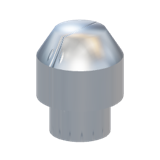 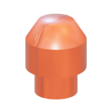 | EAS-4 (batang biru-abu), FTX-2 (pipa dengan klem) | ❌ (ikon) | ikon harus menampilkan batang contoh |
| `launch-clamp` | 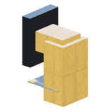 | TT18-A: menara rangka | ✅ | |
| belum ada | | truss / girder, I-beam, panel struktur, interstage rangka (Soyuz), LES tower | | dibutuhkan blueprint (§7) |

### 4.6 Aero

`nose-cone*`, `tail-cone*`, `fin`, `control-surface`, `wing`: ✅/⚠️. Bentuknya benar. Nose cone sedikit gemuk, dan belum ada nose ogive tajam maupun grid fin (Falcon, Soyuz LES).

### 4.7 Recovery dan termal

| Kita | Ikon | KSP/KSP2 | Nilai | Celah |
|---|---|---|---|---|
| `parachute`, `drogue-chute`, `radial-parachute` | 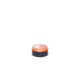 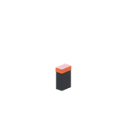 | Mk16: tutup kerucut oranye-putih. Mk2-R radial: kotak memanjang | ⚠️ | ikon seperti titik (§2.4). Model dunianya dengan kanopi sudah ada (plan 101) |
| `heat-shield`, `heat-shield-wide` | 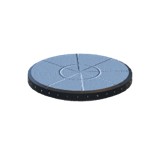 | piring ablatif coklat dengan cincin | ⚠️ | di ikon kalah oleh muka sambungan |
| `flotation-collar` | 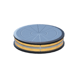 | (KSP: tidak ada) | ❌ | §2.1 |

### 4.8 Daya, komunikasi, sains, life support

Semua ❌ (§2.1). Contoh KSP sebagai acuan bentuk:

- OX-STAT: panel datar kecil.
- SP-L 1x6: sayap lipat dengan engsel.
- Gigantor: sayap besar yang berputar.
- PB-NUK RTG: silinder bersirip.
- Z-100/Z-1k: kotak atau cakram tipis baterai.
- Communotron 16: batang tegak.
- HG-5: piringan lipat kecil.
- DTS-M1: piringan.
- Communotron 88-88: piringan besar.
- 2HOT: kotak dengan termometer tegak.
- PresMat: barometer silinder dengan kaca.
- Mystery Goo: tabung dengan dua pintu dan jendela.
- SC-9001: bay persegi dengan pintu lipat.

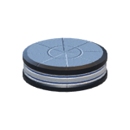  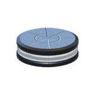 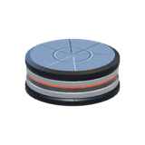 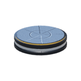   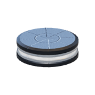

*(urutan: panel surya, dish, whip, RTG, baterai, goo, termometer, life support. Semuanya cakram.)*

### 4.9 Ground, lampu, docking

| Kita | Ikon | KSP/KSP2 | Nilai | Celah |
|---|---|---|---|---|
| `landing-legs` | 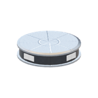 | LT-1/LT-2: kaki tunggal radial dengan peredam, ditempel per kaki | ⚠️ | milik kita berupa cincin 4 kaki. Saat terlipat hanya cakram |
| `wheel`, `wheel-steer` | 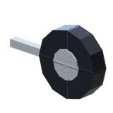 | roda rover dengan suspensi, ban berpola | ⚠️ | roda oktagon hitam tanpa pola ban |
| `light-spot`, `light-flood` | 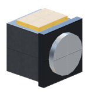 | Illuminator: rumah kecil miring dengan lensa | ⚠️ | kubus besar dengan lensa. Terlalu besar dan kotak |
| `docking-port*` | 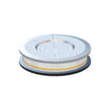 | Clamp-O-Tron: cincin dengan kelopak pemandu (androgynous) | ⚠️ | cakram dengan cincin. Kelopak pemandu dan lampu sasaran belum ada |

## 5. Target tampilan per keluarga

Prinsip yang diambil dari RV-105 dan gambar 8:

1. **Siluet** harus khas pada 64 px.
2. **Tiga tingkat detail:**
   - bentuk besar;
   - fitur sedang: rim, band, stub, pintu;
   - detail kecil: panel line, baut, decal.
3. **Minimal dua material**, tidak pernah monoton: cat dan logam gelap, ditambah aksen.
4. **Rongga terlihat** (bell, pipa, bay).

| Keluarga | Target |
|---|---|
| **Pod** | kerucut dengan jendela berbingkai, hatch dengan engsel, port RCS tertanam (4 quad), tangga, docking collar. Ukuran: 1 kursi (ada), 3 kursi 2,5 m (Apollo CM), bel/lampu depan (Soyuz descent), lander can |
| **Probe core** | badan oktagon atau bola dengan panel foil emas/hitam, antena kecil bawaan, lampu status, panel instrumen |
| **Tangki** | generator sekarang + parameter `livery` (`plain`, `bands`, `checker`, `half-black`, `foam-orange`, `steel`), kubah ujung pada tangki 2,5 m, skirt dan interstage. Gambar 8: band hitam lebar dengan rim timbul di tepinya |
| **Mesin** | generator dipecah menjadi beberapa preset siluet: `open` (rangka + pompa, untuk lifter), `shroud` (rok penuh), `vacuum` (kepala pendek, bell panjang dengan extension gelap), `cluster(n)` dengan pola 4/5/9 (Saturn F-1, Merlin octaweb), `vernier` (RD-107 dengan 2 vernier). Bell perunggu atau gelap dengan ring halus, dalam berjelaga |
| **SRB** | segmen dengan ring sambungan, rok belakang, nozzle tetap gelap, nose cap, band hitam (gambar 8, booster samping) |
| **RCS** | §3: rumah membulat, panel, stub, bell bertingkat berongga. Varian 1, 4, dan 5 nozzle |
| **Antena** | whip teleskopik (3 segmen menyempit dengan bola di ujung), dish lipat (piringan dengan rusuk + feed horn + engsel, animasi deploy), relay besar |
| **Panel surya** | fixed: panel datar dengan sel biru gelap dan garis perak. Lipat: kotak penyimpan, lalu 3–6 panel yang terbuka seperti akordeon (deploy). Array besar: tiang + sayap dengan rangka, berputar ke matahari |
| **Baterai** | radial: kotak tipis dengan sel bergaris dan terminal. Stack: cakram tipis dengan sel di sekeliling, tidak setinggi tangki |
| **Parasut** | tutup kerucut dua warna (oranye/putih), tali pengikat, kanopi (ada). Radial: kotak memanjang dengan tutup |
| **Decoupler** | cakram tipis dengan pita bahaya kuning-hitam, baut eksplosif, alur pemisah |
| **Fairing** | alas dengan cincin dan baut. Cangkang ogive terbagi dengan garis sambung dan band (sebagian sudah ada) |
| **Kaki** | kaki tunggal radial (peredam teleskopik, telapak), selain cincin yang ada |
| **Sains** | setiap alat dengan bentuk sendiri, radial: termometer (batang di atas kotak), barometer (kaca + gauge), seismometer (kotak + kaki), goo (tabung + 2 pintu + jendela), materials bay (kotak dengan pintu lipat besar), sampler (lengan atau corong) |
| **Lampu** | rumah kecil miring dengan lensa dan bingkai, ukuran jauh lebih kecil |
| **Docking port** | cincin dengan 3 kelopak pemandu (androgynous), lampu sasaran, varian probe/drogue untuk Apollo/Soyuz |
| **Life support** | kontainer dengan katup dan pipa. Scrubber: kotak dengan kisi |

## 6. Poin 4: "detail kit" dari gambar roket bongkar

Gambar 8 menunjukkan bahwa kesan "tidak monoton" datang dari beberapa primitif yang berulang di semua part:

- **rim** di tiap tepi part, yaitu bibir yang sedikit lebih lebar;
- **band** hitam di tangki dan booster;
- **ring timbul** di bawah nose dan di atas mesin;
- **kontras dua warna** (putih/hitam) yang konsisten;
- **bell dengan ring.**

Usulannya adalah modul bersama `generators/kit.ts` yang dipakai semua generator:

| Primitif | Isi |
|---|---|
| `rim(y, r, h)` | bibir di tepi part (profil revolve kecil) |
| `band(y0, y1, slot)` | pita cat |
| `raisedRing(y, r)` | ring timbul |
| `panelGrid(...)` | panel line lewat normal map, atau sisipan tipis |
| `bolts(n, r, y)` | baut (instanced) |
| `stubPipe(from, dir, len, r)` | pipa pendek |
| `ribbedBell(profile, rings)` | bell bertingkat, dinding dalam + luar |
| `hazardStripe(y, h)` | pita bahaya kuning-hitam |
| `hatch(w, h)` | hatch dengan engsel |
| `foilPanel` | panel foil |
| `lensLamp` | lampu berlensa |

Ditambah slot material `bronze` dan parameter `livery` di `PartVisual.params` (aditif, tidak mengubah schema).

Kit ini juga menghemat biaya: generator baru menjadi rangkaian pemanggilan kit, bukan geometri dari nol.

## 7. Poin 3: blueprint (rancangan siap pakai)

### 7.1 Sekarang

Lima contoh di `apps/web/src/lib/design.ts:206` dan `apps/web/src/lib/editor/examples.ts`:

| Contoh | Isi | Part |
|---|---|---|
| Two-stage example | pod, wheel, tangki kecil + LV ×2, decoupler, parasut | 8 |
| Booster rocket | + 4 radial decoupler, booster, nose cone, fin | 23 |
| Asparagus rocket | + fuel line + strut | ±31 |
| Glider | pod, tangki, 4 sayap | 6 |
| Moon shot | lander + inti + 4 booster cair | 25 |

Tidak ada yang membawa RCS, antena, panel surya, baterai, life support, lampu, atau alat sains. Tidak ada roket nyata.

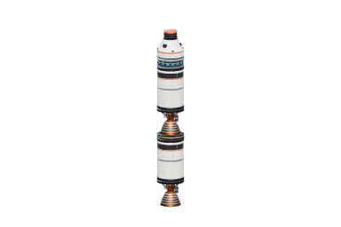  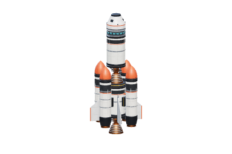 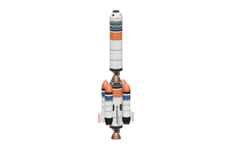 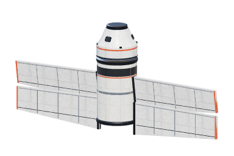

### 7.2 Roket nyata yang diusulkan

Setiap blueprint harus **lengkap**. Daftar periksa wajib untuk setiap blueprint:

- kendali (pod atau probe) dan SAS/reaction wheel;
- RCS dengan monoprop;
- daya (surya, baterai, RTG, atau fuel cell);
- antena;
- untuk wahana berawak: kursi kru, life support, parasut, dan heat shield;
- docking port bila misinya docking;
- fairing bila membawa satelit;
- lampu;
- satu atau dua alat sains.

Kolom "part baru" menyebut part yang **belum ada** di stock.

| # | Blueprint (nama di game: lihat §10) | Struktur | Part baru yang dibutuhkan |
|---|---|---|---|
| 1 | **Saturn V + Apollo** (CSM + LM) | S-IC (5 mesin, 3,75–5 m) → S-II (5 mesin vakum) → S-IVB (1 mesin, interstage) → adapter SLA berisi LM → service module (mesin SPS, 4 quad RCS, dish, radiator) → CM 3 kursi (parasut ×3, heat shield, docking probe) → menara LES | tangki dan mesin 3,75 m dan 5 m, mount 5 mesin, pod 3 kursi 2,5 m, menara LES (motor escape, dibuang), adapter SLA (panel terbuka), quad RCS, lander LM (tahap turun oktagon berfoil + kaki, tahap naik dengan kabin bersudut), fuel cell (opsional) |
| 2 | **Saturn IB + Apollo CSM** | S-IB (8 tangki + 8 mesin) → S-IVB → CSM | sama seperti no. 1 tanpa LM, ditambah cluster 8 |
| 3 | **Soyuz (R-7) + wahana Soyuz** | 4 booster meruncing ("salib Korolev") → Blok A inti berpinggang → Blok I dengan interstage rangka → fairing + menara escape bergrid fin → wahana: modul orbit (bulat, docking probe, antena), modul turun (bentuk lampu depan, 3 kursi, parasut, heat shield), modul servis (2 sayap surya, RCS, antena) | booster meruncing, mesin 4 ruang dengan vernier, interstage rangka, grid fin, menara escape, pod "headlight" 3 kursi, modul orbit bulat, docking probe-drogue |
| 4 | **Vostok** (R-7 + kapsul bola) | 4 booster + inti + tahap atas + bola kru 1 kursi dengan modul instrumen | kapsul bola, kursi pelontar (opsional) |
| 5 | **Sputnik** | R-7 + satelit bola 4 antena | probe bola, whip antena panjang ×4 |
| 6 | **Proton-M + Briz-M + satelit** | inti 4,1 m dikelilingi 6 tangki luar → tahap 2/3 → Briz-M (toroid) → satelit dengan sayap surya dan dish | tangki toroid, satelit generik (bus + sayap + dish) |
| 7 | **Falcon 9 + Dragon** (kru/kargo) | booster 9 mesin (octaweb) dengan grid fin dan 4 kaki → interstage → tahap 2 dengan mesin vakum panjang → Dragon (kapsul 4 kursi, trunk dengan panel surya, Draco tertanam) | mount 9 mesin, grid fin, kaki besar lipat, kapsul gaya Dragon, trunk surya |
| 8 | **Falcon Heavy** | 3 inti Falcon + satelit | dari no. 7 |
| 9 | **Atlas V + Centaur + probe planet** | inti dengan 2–4 SRB, Centaur (tahap atas balon), fairing → probe dengan RTG dan dish besar (gaya New Horizons) | SRB tipis panjang, dish besar, probe bus |
| 10 | **Long March 2F + Shenzhou** | 4 booster dengan nose cap → inti → tahap 2 → fairing + menara escape → Shenzhou (3 modul, 4 sayap surya) | sebagian besar dari no. 3 |
| 11 | **Ariane 5 + satelit** | inti kriogenik + 2 SRB besar → tahap atas → 2 satelit (ganda) | SRB besar 3 m, adapter ganda (SYLDA) |
| 12 | **Mercury-Redstone** | roket tunggal + kapsul kerucut 1 kursi + menara LES | kapsul kerucut kecil, menara LES kecil |
| 13 | **Gemini-Titan II** | 2 tahap hipergolik + kapsul 2 kursi + modul adaptor | kapsul 2 kursi |
| 14 | **Space Shuttle** (tahap lanjut) | orbiter bersayap + tangki eksternal oranye + 2 SRB | orbiter (badan + sayap delta + 3 mesin), tangki busa oranye. Besar, dikerjakan paling akhir |
| 15 | **Stasiun (Salyut/Mir/ISS-mini)** | modul hab, truss, panel surya besar, docking | modul hab, truss, radiator |
| 16 | 5 contoh lama → kategori "Belajar" | tetap ada, dilengkapi parasut, antena, dan baterai | — |

Prioritas yang saya sarankan: **1, 3, 7, 12** dahulu. Keempatnya mewakili AS, Rusia, era modern, dan roket yang mudah. Yang lain menyusul setelah part dasarnya ada.

**Masalah skala:** kelas terbesar kita sekarang 2,5 m. Saturn V, Proton, dan Shuttle membutuhkan kelas 3,75 m dan 5 m, beserta mesin dan decoupler yang sepadan.

## 8. Redesain picker blueprint

### 8.1 Sekarang

Kartu "Build a vessel" di tengah hangar berisi lima tombol teks (`+page.svelte:264-282`). Tidak ada gambar, statistik, filter, atau pencarian. Pustaka kapal (`LibraryDialog.svelte`) berupa daftar baris dengan thumbnail 96×64, nama, dan "N parts · M stages", juga tanpa filter.

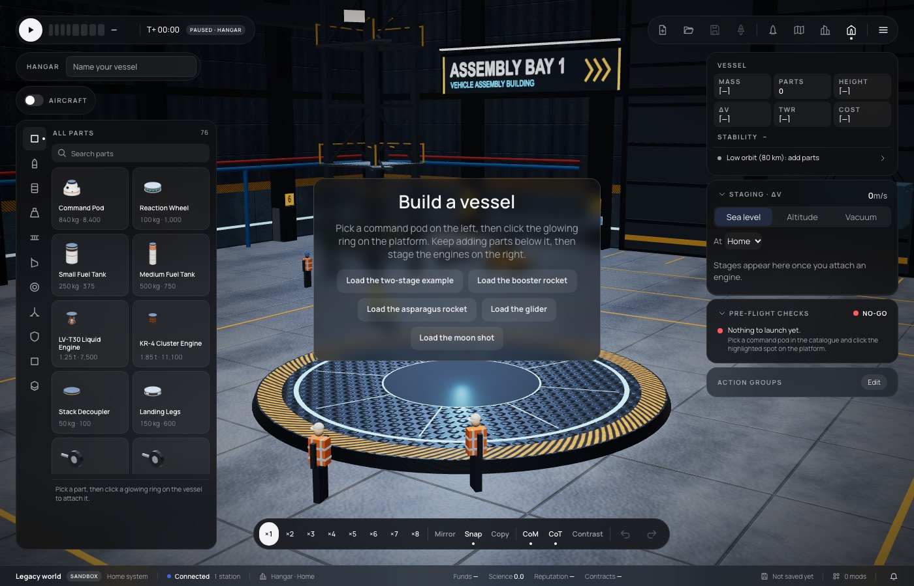

### 8.2 Usulan: satu "Pustaka" untuk blueprint, rancangan saya, dan sub-assembly

```
┌ Pustaka ────────────────────────────────────────────────────────────────┐
│ [Blueprint] [Rancangan saya] [Sub-assembly]          🔍 cari…           │
│ Asal: (Semua)(Nyata)(Belajar)(Mod)  Tujuan: (Orbit)(Bulan)(Planet)(Stasiun)│
│ Awak: (Berawak)(Probe)   Ukuran: S M L XL   Urut: [Nama ▾]              │
├─────────────────────────────────────────────────────────────────────────┤
│ ┌───────────────┐ ┌───────────────┐ ┌───────────────┐ ┌───────────────┐ │
│ │░grid biru░░░░░│ │░░░░░░░░░░░░░░░│ │               │ │               │ │
│ │░░  [render]  ░│ │   [render]    │ │   [render]    │ │   [render]    │ │
│ │░░  roket ░░░░░│ │               │ │               │ │               │ │
│ │ Bulan · 3 awak│ │ Orbit · 3 awak│ │               │ │               │ │
│ │ Saturnus V    │ │ Soyuz         │ │ …             │ │ …             │ │
│ │ 2.9kt Δv 9.4k │ │ 310t Δv 9.6k  │ │               │ │               │ │
│ │ 112 part 🔒 2 │ │ 64 part       │ │               │ │               │ │
│ └───────────────┘ └───────────────┘ └───────────────┘ └───────────────┘ │
└─────────────────────────────────────────────────────────────────────────┘
 klik kartu → panel detail di kanan:
 ┌ Saturnus V ─────────────────────────────────────┐
 │ render besar dengan label penunjuk (gaya        │
 │ kerbalstates / RV-105):  LES ─┐  CM (3 awak) ─┐  │
 │ SM: SPS, RCS ×4, dish ─┐  LM ─┐  S-IVB ─┐ …     │
 │ Massa · Δv per tahap · TWR · awak · biaya ·      │
 │ "mencapai: Bulan dan kembali (sisa 400 m/s)"     │
 │ Kelengkapan: ✓RCS ✓Antena ✓Surya/FC ✓Parasut     │
 │              ✓Life support ✓Heat shield          │
 │ Part yang belum dibuka (karier): 2               │
 │ [Muat ke hangar]  [Muat sebagai sub-assembly]    │
 └──────────────────────────────────────────────────┘
```

Rinciannya:

- **Kartu**: render di atas grid biru (gaya blueprint, sama dengan kartu RV-105 dan kerbalstates), lencana tujuan dan awak, nama, massa, Δv, jumlah part, dan gembok bila ada part yang belum dibuka di mode karier.
- **Render**: thumbnail dibuat sekali dengan `captureThumbnail` (sudah ada, kini 192×128) dan disimpan dalam cache IndexedDB per versi blueprint. Grid biru digambar dengan CSS di belakang PNG transparan, jadi tidak perlu kerja renderer.
- **Label penunjuk** di panel detail: setiap part penting diberi `label` pada data blueprint. Posisinya diproyeksikan dengan `Renderer.project`, yang sudah ada.
- **Statistik**: dihitung dengan modul Δv/TWR dan trip planner (plan 034) yang sudah ada.
- **Data blueprint**: pindah dari fungsi TypeScript di `apps/web` ke **konten mod** (`defineBlueprint` di SDK). Dengan begitu mod bisa menambah blueprint, dan stock membawa blueprint nyata. Hal ini perlu ADR.
- **Hangar kosong**: kartu "Build a vessel" diganti baris kecil berisi 4 kartu unggulan dan tombol "Buka pustaka".

## 9. Rencana bertahap dan biaya

Satuan biaya: **plan**, kira-kira satu sesi agen dengan tes, dokumen, dan screenshot. S = ½ plan, M = 1, L = 2–3. Rekomendasi jalur: **semua keluarga prosedural.** Alasannya:

- generator sudah mendukung tingkat detail (`detail.extras`), palet per part, animasi deploy (kaki, parasut), instancing, dan glow suhu;
- tidak ada file biner atau lisensi aset;
- ADR 0028/0076 tetap membuka jalur glTF untuk mod.

glTF baru masuk akal kalau suatu hari kita punya artis 3D. Bentuk yang paling sulit dibuat prosedural adalah kabin LM bersudut dan orbiter Shuttle. Keduanya tetap bisa dibuat dengan extrude dan potongan kotak.

| Fase | Isi | Biaya | Bergantung pada |
|---|---|---|---|
| **0 Quick win** | perbaikan framing ikon (bounding box tanpa mesh tersembunyi); muka sambungan tidak biru di ikon; sudut ikon lebih ke samping; ikon strut/fuel-line dengan batang | S | — |
| **1 Detail kit + material** | `kit.ts` (§6), slot `bronze`, parameter `livery` untuk tangki/SRB/booster, decal non-teks (keypad, bahaya), pita bahaya pada decoupler | M | 0 |
| **2 RCS + mesin** | RCS baru (§3) dengan varian 1/4/5 nozzle; mesin dipecah menjadi preset `open`/`shroud`/`vacuum`/`vernier`; SRB bersegmen | M–L | 1 |
| **3 Part fungsional** | ADR: attach radial untuk part fungsional dan migrasi desain lama. Generator baru: probe core, antena (whip, dish lipat dengan deploy), panel surya (fixed, lipat dengan deploy, array besar yang berputar), RTG bersirip, baterai, 7 alat sains, life support, scrubber, data drive, monoprop toroid/bola, flotation collar | L (2–3 plan) | 1 |
| **4 Part untuk roket nyata** | kelas 3,75 m dan 5 m (tangki, decoupler, mesin, mount 5/9 mesin); pod 3 kursi 2,5 m; pod "headlight" Soyuz + modul orbit; kapsul kecil (Mercury/Vostok); menara LES; interstage rangka; booster meruncing; grid fin; docking probe/drogue; lander (tahap turun dan naik); satelit bus; fuel cell | L (3 plan) | 2, 3 |
| **5 Pustaka & picker** | ADR `defineBlueprint` di SDK; dialog Pustaka gabungan (blueprint, rancangan saya, sub-assembly), kartu bergrid biru, filter, detail dengan label penunjuk, statistik, kelengkapan | M–L | 0 (bisa paralel dengan 2–4) |
| **6 Blueprint nyata** | gelombang 1: Saturn V/Apollo, Soyuz, Falcon 9/Dragon, Mercury-Redstone. Gelombang 2: Vostok, Sputnik, Proton, Atlas V, Long March 2F, Gemini. Gelombang 3: Ariane 5, Falcon Heavy, stasiun, Shuttle. Setiap blueprint dites terbang headless sampai tujuannya (seperti moon shot di plan 034) | L (1 plan per gelombang) | 4, 5 |

Total kasar: **10–14 plan**. Fase 0, 1, dan 5 bisa dimulai segera, dan fase 5 bisa berjalan paralel dengan 2–4 karena tidak menyentuh file yang sama.

Risiko yang perlu dijaga:

- **anggaran frame:** tambahan segitiga dari detail kit perlu dibatasi lewat `detail.extras` dan instancing;
- **golden snapshot dan tes** yang membekukan massa roket referensi (lihat komentar di `command.ts:33`);
- **migrasi** desain tersimpan bila attach part berubah;
- **bentrok** dengan sesi lain yang sedang menyentuh `apps/web` (map pick list, Space Center).

## 10. Pertanyaan untuk owner

1. **Nama roket nyata:** ~~asli atau tiruan?~~ **Diputuskan owner (2026-10-21): nama tiruan.** Usulan nama ada di [parts-tracker.md §9](parts-tracker.md).
2. **Attach radial untuk part fungsional** (panel surya, antena, sains, baterai): setuju diubah walaupun desain tersimpan lama perlu dimigrasi?
3. **Prosedural semua**, atau ada keluarga yang ingin owner arahkan ke glTF?
4. **Urutan:** mulai dari fase 0 + 1 + RCS (hasil cepat terlihat), atau langsung dari Pustaka (fase 5)?
5. **Gaya warna:** tetap putih dengan aksen oranye seperti sekarang, atau livery per roket (Saturn hitam-putih checker, Soyuz hijau abu, Falcon putih polos)?
6. **Skala:** setuju menambah kelas 3,75 m dan 5 m?
7. **Blueprint di mode karier:** boleh dimuat walaupun partnya belum dibuka (ditandai gembok), atau disembunyikan?
