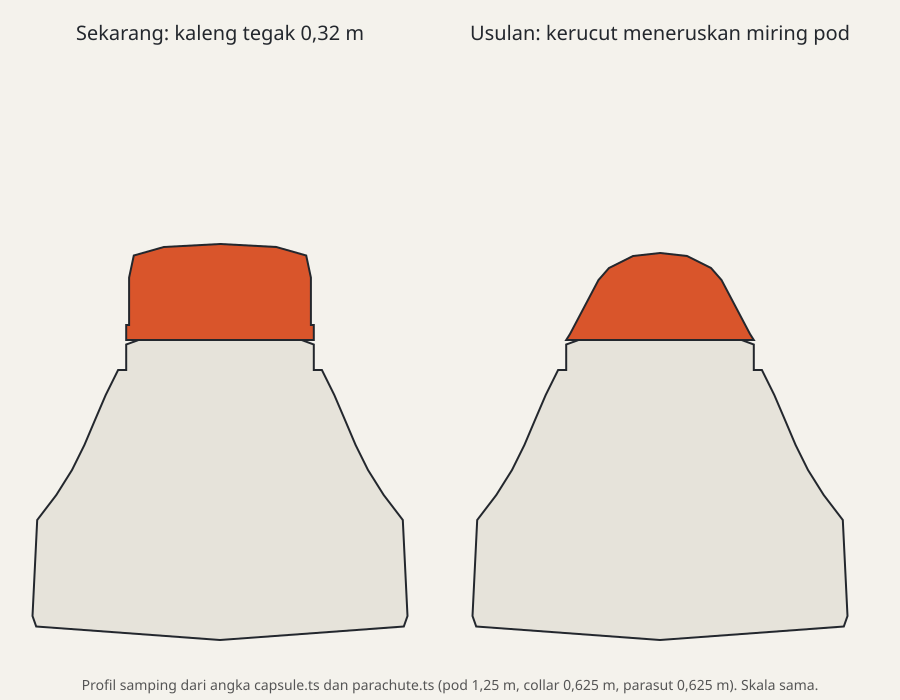

# Pelacak part dan sistem: apa yang kita tiru dari KSP/KSP2

> Riset, 2026-10-21. Lanjutan dari [README.md](README.md), atas permintaan owner: kumpulkan nama-nama part dan sistem KSP/KSP2 yang akan kita tiru, bentuk dan modelnya, dan interaksinya, supaya bisa dilacak satu per satu.
> Belum ada keputusan di sini. Setiap baris yang disetujui nanti menjadi bagian dari plan; sistem baru memerlukan ADR.

## 0. Aturan main

- **Yang ditiru: fungsi, jenis, bentuk umum.** Contohnya: RCS 4 arah berbentuk salib, parasut kerucut di puncak pod, panel surya lipat akordeon. Bentuk seperti ini sama di semua roket nyata, jadi bukan milik KSP.
- **Yang tidak ditiru:**
  - nama part KSP ("RV-105", "Mk16", "Communotron", "Probodobodyne", "STEADLER", "Rockomax");
  - tekstur, decal, dan logo KSP;
  - model 3D KSP.

  Kolom "Referensi KSP" di bawah hanya untuk riset. Nama di game memakai **nama tiruan kita sendiri** (§1).
- **Pembeda dari KSP:** palet warna sendiri (putih, abu, dan aksen oranye dari `visual-direction.md`), pola cat (livery), dan detail kecil yang kita rancang sendiri (keypad, panel, baut).
- **Harus realistis:** bentuk mengikuti fungsi nyata. Bell berongga, pipa ke nozzle, parasut yang menyatu dengan kemiringan pod, panel surya bersel, dan antena berengsel.

## Keputusan (2026-10-21)

Owner memutuskan: semua lapis 1–4 penting, robotika masuk roadmap rilis (terutama untuk rover), nama perusahaan fiksi **OrbitX**, ukuran minimal setara KSP/KSP2. Sisanya diputuskan CTO atas delegasi owner. Keputusannya tercatat di ADR 0255–0264 dan dikerjakan oleh plan 275–291 (semuanya `draft`, **ditahan** sampai owner melepasnya; main sedang dipakai untuk perbaikan renderer dan UI/UX):

| ADR | Keputusan | Plan |
|---|---|---|
| 0255 | Satu merek fiksi **OrbitX**; dari KSP ditiru jenis dan bentuk, bukan nama atau art; blueprint memakai nama tiruan | 291 |
| 0256 | Tujuh kelas ukuran: 0,625 / 1,25 / 1,875 / 2,5 / 3,75 / 5 / **7,5 m** (KSP dan KSP2 berhenti di 5 m) | 275 |
| 0257 | Tetap prosedural, dengan detail kit bersama, livery, satu generator per jenis part, dan ikon yang jujur | 291, 276–281 |
| 0258 | Hangar bebas: gizmo geser x/y/z dan putar, offset (format 4), mode bebas, docking port boleh miring atau di mana saja | 279 |
| 0259 | Part fungsional ditempel di dinding; versi stack lama tetap ada sebagai part legacy tersembunyi (tanpa migrasi) | 280 |
| 0260 | Puncak pod: parasut kerucut yang meneruskan kemiringan pod, **cincin parasut dengan node docking** (lebih baik dari KSP), parasut radial, atau parasut bawaan pod 3 kursi | 278 |
| 0261 | Bay berpintu melindungi isi hanya saat tertutup; muatan dilepas hanya saat pintu terbuka | 281 |
| 0262 | Robotika: kapal dipecah menjadi grup kaku di sendi robotik, disambung joint Rapier bermotor; diawali spike | 282, 283 |
| 0263 | Blueprint adalah konten mod, ditampilkan di satu Pustaka | 285–287 |
| 0264 | Inventaris EVA dan stasiun sains yang ditinggal di planet | 284 |

Catatan: nama perusahaan per bidang di bawah ini **digantikan** oleh merek tunggal OrbitX (ADR 0255). Nama panggilan part tetap dipakai sebagai usulan.

## 1. Penamaan tiruan (usulan awal, digantikan oleh OrbitX)

Kita butuh **perusahaan fiksi** milik kita sendiri, satu per bidang, dengan nama asli buatan kita. Ini seperti STEADLER atau Probodobodyne di KSP, tetapi bukan nama mereka. Polanya: `KODE-ukuran varian` ditambah nama panggilan.

| Bidang | Perusahaan fiksi (usulan, bebas diganti) | Contoh nama part |
|---|---|---|
| Pod dan kabin | **Orbita Habitat Works** | OH-1 "Kerang" (pod 1 kursi), OH-3 "Lonceng" (pod 3 kursi) |
| Probe dan elektronik | **Nadi Avionics** | NA-8 "Oktaf" (probe oktagon) |
| Tangki | **Bejana Tank & Barrel** | BT-12 (1,25 m), BT-25 (2,5 m) |
| Mesin cair | **Garuda Propulsion** | GP-30 "Elang", GP-90 "Rajawali" |
| Roket padat | **Petasan Solid Motors** | PS-1 "Mercon" |
| RCS dan pendorong kecil | **Gerak Halus Thrusters** | GH-4 "Kompas" (4 arah), GH-1 "Tunggal" (1 arah) |
| Parasut dan recovery | **Payung Recovery Co.** | PR-16 "Kuncup" |
| Daya | **Surya Daya Power** | SD-6 "Sayap", SD-R "Tungku" (RTG) |
| Komunikasi | **Gema Comms** | GC-16 "Cambuk" (whip), GC-88 "Piring" (dish) |
| Sains | **Selidik Instruments** | SI-T "Termo", SI-P "Baro" |
| Struktur dan coupling | **Rangka Structural** | RS-TD12 (decoupler) |
| Robotika | **Sendi Robotics** | SR-H1 (engsel), SR-P2 (piston) |

Nama roket di blueprint juga tiruan (§9). Owner sudah setuju dengan prinsip ini.

## 2. Legenda

- **Status:**
  - ✅ ada dan terbaca benar;
  - 🎨 ada, perlu model ulang;
  - 🆕 part baru;
  - ⚙️ butuh sistem baru di sim (lihat §8).
- **Pasang:**
  - `stack`: atas atau bawah;
  - `radial`: menempel di dinding;
  - `node`: muka khusus, misalnya puncak pod.
- **Interaksi:**
  - **S** = bisa di-stage;
  - **AG** = action group;
  - **P** = tombol di panel part saat terbang (buka/tutup, nyala/mati, cut);
  - **A** = animasi model;
  - **E** = setelan di Hangar (varian, limiter, warna);
  - **EVA** = dipasang atau dipakai oleh astronot.
- **Prio:**
  - P1 = perlu untuk roket nyata pertama dan untuk keluhan owner;
  - P2 = memperkaya;
  - P3 = nanti.

## 3. Roket inti

### 3.1 Pod, kabin, probe, kendali

| ID | Part kita | Referensi KSP/KSP2 | Pasang | Bentuk & detail | Interaksi | Status | Prio |
|---|---|---|---|---|---|---|---|
| CMD-01 | Pod 1 kursi (`command-pod`) | Mk1 Command Pod | stack | kerucut tumpul, jendela berbingkai, hatch, tangga, port RCS di bahu, collar 0,625 m | P (lampu, hatch), EVA | 🎨 kecil (detail hatch, tangga) | P1 |
| CMD-02 | Pod 3 kursi 2,5 m | Mk1-3 "Gumball" | stack | kerucut lebar gaya Apollo, 5 jendela, collar docking, port RCS terbenam | P, EVA | 🆕 | P1 |
| CMD-03 | Pod "lampu depan" 3 kursi | KV-3 [MH] | stack | bentuk lonceng/lampu depan gaya Soyuz, perlu heat shield terpisah | P, EVA | 🆕 | P1 |
| CMD-04 | Kapsul bola 1–2 kursi | KV-1/KV-2 [MH] | stack | bola dengan hatch bundar dan jendela kecil (Vostok) | P, EVA | 🆕 | P2 |
| CMD-05 | Kapsul kerucut kecil 1 kursi | (Mercury) | stack | kerucut ramping dengan sirip ribs dan menara LES | P, EVA | 🆕 | P2 |
| CMD-06 | Lander can 1 / 2 kursi | Mk1 / Mk2 Lander Can | stack | silinder pendek berjendela besar, rangka, foil di bawah | P, EVA | 🆕 | P2 |
| CMD-07 | Kabin lander bersudut | Munar Excursion Module [MH] | stack | kabin bersudut gaya LM, jendela segitiga, antena | P, EVA | 🆕 | P1 (Apollo) |
| CMD-08 | Cupola | PPD-12 Cupola | stack | kubah berjendela banyak untuk stasiun | P, EVA | 🆕 | P3 |
| CMD-09 | Kabin penumpang | Mk1 Crew Cabin, Hitchhiker | stack | silinder dengan jendela samping, tanpa kendali | EVA | 🆕 | P2 |
| CMD-10 | Kursi luar | EAS-1 External Command Seat | radial | kursi terbuka (rover) | EVA | 🆕 | P3 |
| PRB-01 | Probe core (`probe-core`) | OKTO / HECS | stack | **oktagon** dengan panel foil, lampu status, antena kecil | P (hibernasi) | 🎨 (sekarang tabung) | P1 |
| PRB-02 | Probe bola mini | Stayputnik | stack | bola kecil dengan 4 batang antena (Sputnik) | — | 🆕 | P2 |
| PRB-03 | Probe kubus | QBE | stack/radial | kubus kecil berpanel | — | 🆕 | P3 |
| PRB-04 | Probe 2,5 m | RC-L01 | stack | cincin lebar bersirip elektronik | — | 🆕 | P2 |
| PRB-05 | Bus satelit | (ESA probes [MH]) | stack | kotak berlapis foil emas dengan muka untuk sayap surya dan dish | — | 🆕 | P1 (satelit di blueprint) |
| CTL-01 | Reaction wheel (`reaction-wheel`) | Small/Advanced Inline Stabilizer | stack | cakram dengan sirip ventilasi dan kotak motor di sekeliling | P (mode, otoritas), E | 🎨 kecil | P2 |
| CTL-02 | Data drive (`data-drive`) | Experiment Storage Unit | radial | kotak dengan pintu dan konektor | P | 🎨 (sekarang tabung) | P2 |

### 3.2 RCS: tiap jenis punya sumbu sendiri

KSP punya beberapa bentuk RCS. Bentuknya mengikuti **berapa arah dorong** dan **di mana dipasang**.

| ID | Part kita | Referensi KSP/KSP2 | Nozzle / sumbu | Bentuk & detail | Interaksi | Status | Prio |
|---|---|---|---|---|---|---|---|
| RCS-01 | Blok 4 arah (`rcs-block`) | RV-105 RCS Thruster Block | 4 nozzle bersilang (atas, bawah, kiri, kanan) | rumah membulat, pelat dasar gelap, keypad dan panel, 4 pipa stub, bell bertingkat berongga (README §3) | P (nyala/mati, per sumbu: pitch/yaw/roll/maju/samping), E (limiter) | 🎨 besar | P1 |
| RCS-02 | Blok 5 arah | (blok 5 arah gaya Apollo/RV-1X, varian "5") *(nama KSP perlu verifikasi)* | 4 bersilang + 1 ke depan | rumah sama dengan RCS-01, tambah 1 nozzle menghadap luar | P, E | 🆕 | P1 (Apollo SM quad) |
| RCS-03 | Port tunggal (`rcs-cold-gas`) | Place-Anywhere 7 Linear RCS Port | 1 nozzle lurus ke luar | lubang bell kecil di pelat bundar, bisa ditanam di dinding | P, E | 🎨 | P1 |
| RCS-04 | Blok sudut 3 arah | RV-1X Variable Thruster Block (varian) *(perlu verifikasi)* | 2–3 nozzle (sudut) | rumah kecil, nozzle 90° | P, E | 🆕 | P2 |
| RCS-05 | Pendorong besar bipropelan | Vernor Engine | 1 nozzle besar, bahan LF+Ox | silinder panjang dengan bell, pipa feed | P, E | 🆕 | P2 |
| RCS-06 | Port tertanam di pod | (built-in di pod KSP2 / Apollo CM) | per pod | lubang nozzle terbenam di cangkang pod (bagian dari CMD-02/03) | ikut pod | 🆕 (di generator pod) | P2 |
| RCS-07 | Mesin monoprop kecil | O-10 "Puff" | 1 bell, sebagai mesin | bell kecil, tangki bola mini | S, P | 🆕 | P3 |
| RCS-08 | Pendorong besar KSP2 | VR-N1ER Veer-Governor [KSP2] | blok 4 arah besar | versi besar RCS-01 untuk 2,5 m | P, E | 🆕 | P3 |

Logika sim RCS sudah ada (`ModuleRcs`, plan 211). Konfigurasinya per nozzle (`nozzles`, `translate`), jadi semua jenis di atas cukup ditambahkan sebagai **data part dan bentuk model**, tanpa sistem baru. Tombol per sumbu di panel (KSP: toggle pitch/yaw/roll/translate) perlu dicek apakah sudah ada; kalau belum, ini perluasan `ModuleRcs`.

### 3.3 Tangki

| ID | Part kita | Referensi KSP/KSP2 | Bentuk & detail | Interaksi | Status | Prio |
|---|---|---|---|---|---|---|
| TNK-01 | Tangki 1,25 m (`tank-small/medium`) | FL-T100…T800 | barel dengan collar, las, stringer, stripe | E (**livery**: putih, hitam-putih, oranye busa, perak) | 🎨 livery | P1 |
| TNK-02 | Tangki 2,5 m (`tank-wide*`) | X200 series | sama + kubah ujung terlihat | E | 🎨 livery | P1 |
| TNK-03 | Tangki 0,625 m | Oscar-B | tangki kecil bulat | E | 🆕 | P2 |
| TNK-04 | Tangki 3,75 m dan 5 m | S3 / S4 [MH] | panel besar bergaris | E | 🆕 | P1 (Kronos V) |
| TNK-05 | Tangki adapter (meruncing) | C7 / FL-A | kerucut berisi bahan bakar | E | 🆕 | P2 |
| TNK-06 | Tangki radial | Dumpling / Baguette | kapsul kecil menempel di dinding | E | 🆕 | P3 |
| TNK-07 | Tangki toroid | Doughnut / FL-R toroid | **cincin** (donat) di antara stack | E | 🆕 | P2 (Briz) |
| TNK-08 | Monoprop (`monoprop-tank`, `monoprop-radial`) | FL-R25 / Stratus-V | bola atau toroid; radial: kapsul | E | 🎨 (sekarang barel) | P1 |
| TNK-09 | Tangki booster meruncing | (R-7 strap-on) | kerucut panjang yang menyempit ke atas, puncak lancip | E | 🆕 | P1 (Soyuz) |
| TNK-10 | Tangki bola | Spherotron [KSP2] | bola dengan cincin pemasang | E | 🆕 | P3 |

### 3.4 Mesin dan booster

| ID | Part kita | Referensi KSP/KSP2 | Bentuk & detail | Interaksi | Status | Prio |
|---|---|---|---|---|---|---|
| ENG-01 | Mesin lifter 1,25 m (`engine-lv`) | LV-T30 / LV-T45 | **rangka terbuka**: pompa, pipa, bell pendek dengan ring | S, P (limiter, gimbal), E | 🎨 | P1 |
| ENG-02 | Mesin vakum (`engine-vacuum`) | Terrier / Poodle | kepala pendek, bell panjang dan lebar, nozzle extension gelap | S, P, E | 🎨 | P1 |
| ENG-03 | Mesin 2,5 m (`engine-wide`) | Skipper / Mainsail | **shroud penuh** menutupi pompa | S, P, E (shroud on/off) | 🎨 | P1 |
| ENG-04 | Cluster 4 (`engine-cluster`) | Twin-Boar / Mammoth | 4 bell di bawah pelat | S, P, E | 🎨 | P2 |
| ENG-05 | Pelat mesin 5 / 8 / 9 | EP-xx engine plate [MH], Mammoth | pelat dengan susunan quincunx (5, gaya F-1), cincin 8, octaweb 9 | S, E | 🆕 | P1 |
| ENG-06 | Mesin dengan vernier | (RD-107 gaya Soyuz) | 4 ruang bakar + 2 vernier kecil berputar | S, E | 🆕 | P1 (Soyuz) |
| ENG-07 | Mesin kecil 0,625 m | Spark / Ant | mini, bell lebar | S, E | 🆕 | P2 |
| ENG-08 | Mesin nuklir termal | LV-N "Nerv" | silinder panjang, radiator, bell panjang | S, E | 🆕 ⚙️ panas | P3 |
| ENG-09 | Mesin ion | Dawn | kotak dengan grid bundar | S, E | 🆕 ⚙️ xenon | P3 |
| ENG-10 | Aerospike | Dart | ram melingkar tanpa bell | S, E | 🆕 | P3 |
| SRB-01 | SRB (`srb-small`, `srb-large`, `booster`) | Flea / Hammer / Thumper / Kickback | **segmen** dengan ring sambungan, rok belakang, nozzle tetap, band hitam | S, E (limiter) | 🎨 | P1 |
| SRB-02 | Booster cair (`booster-liquid`) | — | sama seperti SRB-01 dengan pipa dan katup | S, E | 🎨 | P2 |
| SRB-03 | Motor pemisah kecil | Sepratron | tabung kecil miring, radial | S | 🆕 | P2 |
| SRB-04 | Menara escape (LES) | Launch Escape System | tiang rangka + motor dengan nozzle miring, dibuang setelah terbang | S, AG (abort) | 🆕 | P1 (Apollo, Soyuz) |

## 4. Coupling, struktur, payload

| ID | Part kita | Referensi KSP/KSP2 | Bentuk & detail | Interaksi | Status | Prio |
|---|---|---|---|---|---|---|
| CPL-01 | Decoupler stack (`decoupler*`) | TD-06…TD-50 | cakram tipis dengan **pita bahaya** kuning-hitam, baut eksplosif | S, P, E (gaya dorong, crossfeed) | 🎨 | P1 |
| CPL-02 | Separator (hancur sendiri) | TS-06…TS-50 | sama, tanpa sisa | S | 🆕 | P2 |
| CPL-03 | Decoupler radial (`radial-decoupler`) | TT-38K / TT-70 | balok dengan engsel | S | ✅ | — |
| CPL-04 | Docking port (`docking-port*`) | Clamp-O-Tron Jr./std/Sr. | cincin dengan **3 kelopak pemandu**, lampu sasaran | P (undock, control from here) | 🎨 | P1 |
| CPL-05 | Docking port bertutup | Shielded Clamp-O-Tron | port dengan penutup yang membuka | P, A | 🆕 | P2 |
| CPL-06 | Docking probe/drogue | (Apollo, Soyuz) | probe batang + kerucut penerima | P | 🆕 | P2 |
| CPL-07 | Penjepit (Klaw) | Advanced Grabbing Unit | lengan berjari, membuka dan menutup | P, A ⚙️ | 🆕 | P3 |
| STR-01 | Adapter (`adapter-*`) | adapter series | kerucut berpanel | — | ✅ | — |
| STR-02 | Multi-coupler 2/3/4 | TVR bi/tri/quad coupler | pelat dengan 2/3/4 muka bawah | — | 🆕 | P2 |
| STR-03 | Interstage rangka | (Soyuz Blok I) | **rangka kisi** terbuka antara tahap | S | 🆕 | P1 (Soyuz) |
| STR-04 | Tabung struktur | T-xx structural tube [MH] | tabung berongga membungkus mesin | — | 🆕 | P2 |
| STR-05 | Truss / girder | Modular Girder, trusses [KSP2] | rangka persegi | — | 🆕 | P2 (stasiun) |
| STR-06 | Strut kubik / oktagonal | Cubic Octagonal Strut | blok kecil penyambung | — | 🆕 | P3 |
| STR-07 | Strut dan fuel line (`strut`, `fuel-line`) | EAS-4, FTX-2 | batang dengan klem | — | ✅ model / 🎨 ikon | P1 (ikon) |
| STR-08 | Launch clamp (`launch-clamp`) | TT18-A | menara rangka | S | ✅ | — |
| PAY-01 | Fairing (`fairing-base*`, `fairing-panel`) | AE-FF series | alas dengan cincin dan baut, cangkang ogive terbagi | S, P (buang) | 🎨 | P1 |
| PAY-02 | **Service bay** (rongga berpintu) | SM-18 / SM-25 Service Bay | tabung pendek dengan 4 pintu yang membuka; part di dalamnya terlindung | P, AG, A ⚙️ | 🆕 | P1 |
| PAY-03 | **Cargo bay** | Mk2/Mk3 Cargo Bay, cargo bay bundar [KSP2] | badan panjang dengan pintu atas atau ramp | P, AG, A ⚙️ | 🆕 | P2 |
| PAY-04 | Adapter muatan berpanel (SLA) | (Apollo SLA) | 4 panel yang membuka seperti kelopak, menyimpan lander | S, A ⚙️ | 🆕 | P1 (Apollo) |
| PAY-05 | Adapter muatan ganda | (SYLDA, Ariane) | cangkang dalam untuk 2 satelit | S | 🆕 | P3 |
| PAY-06 | Kontainer inventaris | SEQ-9 / SEQ-24 | kotak dengan tutup, menyimpan item EVA | P, EVA ⚙️ | 🆕 | P2 |

## 5. Aero, recovery, termal

| ID | Part kita | Referensi KSP/KSP2 | Bentuk & detail | Interaksi | Status | Prio |
|---|---|---|---|---|---|---|
| AER-01 | Nose / tail cone (`nose-cone*`, `tail-cone*`) | nose cone series | ogive; varian tajam dan tumpul | E | ✅/🎨 kecil | P2 |
| AER-02 | Fin, control surface, wing | fins, elevons, wings | sudah benar | E, P | ✅ | — |
| AER-03 | Grid fin | GRFN-125/250 [KSP2] | kisi persegi yang melipat | P, A, AG | 🆕 | P2 (gaya Falcon, LES Soyuz) |
| AER-04 | Airbrake | Airbrake | panel yang membuka | P, AG, A | 🆕 | P3 |
| REC-01 | **Parasut puncak pod** (`parachute`) | Mk16 Parachute | **kerucut terpotong yang meneruskan kemiringan pod** (bukan kaleng tegak), tutup dua warna di puncak, alas pas dengan collar 0,625 m. Sekarang tabung tegak 0,32 m di atas collar, sehingga tampak seperti kotak (§5.1) | S, P (deploy, cut, set ketinggian/tekanan), A (kanopi) | 🎨 besar | P1 |
| REC-02 | Parasut puncak besar | Mk16-XL | sama untuk collar 1,25 m (pod 3 kursi) | S, P, A | 🆕 | P1 |
| REC-03 | Drogue (`drogue-chute`) | Mk25 / Mk12-R | kerucut kecil berujung runcing; radial: kotak ramping | S, P, A | 🎨 | P1 |
| REC-04 | Parasut radial (`radial-parachute`) | Mk2-R / Mk16-R [KSP2] | kotak memanjang **melengkung mengikuti dinding** dengan tutup | S, P, A | 🎨 | P1 |
| REC-05 | Parasut tertanam di pod | (Apollo: 3 parasut di bawah tutup pod) | ruang di puncak pod 3 kursi, tutup terlontar | ikut pod | 🆕 | P2 |
| REC-06 | Flotation collar (`flotation-collar`) | — | cincin karet menggembung | P, A | 🎨 | P3 |
| THR-01 | Heat shield (`heat-shield*`) | heat shields 0,625–3,75 m | piring ablatif dengan tepi logam, bisa dilepas | S, P (lepas) | 🎨 kecil | P1 |
| THR-02 | Heat shield tiup | HIAD | mengembang dari 2,5 m ke 10 m | P, A | 🆕 | P3 |
| THR-03 | Radiator | radiator panels | panel datar atau lipat yang membuang panas | P, A ⚙️ panas | 🆕 | P3 |

### 5.1 Kenapa parasut tampak seperti kotak

Diagram di atas digambar dari angka di `capsule.ts` dan `parachute.ts`.

- **Sekarang:** pod menyempit ke collar 0,625 m. Di atasnya, parasut adalah drum **tegak lurus** setinggi 0,32 m dengan tutup bulat. Garis miring pod putus, sehingga parasut tampak seperti kaleng yang ditaruh di atas.
- **Usulan:** parasut menjadi kerucut terpotong yang **meneruskan kemiringan pod**, lebih pendek, dengan tutup dua warna. Pod dan parasut terbaca sebagai satu bentuk, seperti puncak kapsul nyata.

Cara membuatnya: generator parasut menerima parameter `taper`, yaitu kemiringan dinding. Parameter ini bisa diambil dari pod induk, atau cukup satu nilai bawaan yang cocok dengan pod stock. Collar pod juga sebaiknya tidak membuat anak tangga ke dalam ketika ada parasut di atasnya.

Pada parasut radial, kotaknya perlu **melengkung mengikuti dinding** dan lebih tipis.

## 6. Sistem misi: daya, komunikasi, sains, life support

### 6.1 Daya listrik

| ID | Part kita | Referensi KSP/KSP2 | Pasang | Bentuk & detail | Interaksi | Status | Prio |
|---|---|---|---|---|---|---|---|
| PWR-01 | Panel datar tempel (`solar-panel-fixed`) | OX-STAT / OX-STAT-XL | radial | **pelat datar** bersel biru gelap dengan bingkai perak, ditempel ke dinding | (selalu nyala) | 🎨 (sekarang tabung) + ⚙️ radial | P1 |
| PWR-02 | Panel lipat (`solar-panel`) | SP-L 1x6, SP-W 3x2, OX-4 | radial | kotak penyimpan; **membuka seperti akordeon** 3–6 lembar | **S** (opsional), **P** (buka/tutup), **AG**, **A** | 🎨 + ⚙️ radial | P1 |
| PWR-03 | Array besar berputar (`solar-array-large`) | Gigantor XL / SP-XXL Colossus [KSP2] | radial | tiang + sayap besar dengan rangka, **berputar ke matahari** | S, P, AG, A (lipat + putar) | 🎨 + ⚙️ radial | P1 |
| PWR-04 | Sayap surya stack | (Soyuz, Shenzhou, satelit) | stack/radial | sepasang sayap yang membuka dari bus | S, P, A | 🆕 | P1 |
| PWR-05 | Baterai radial / stack (`battery-*`) | Z-100 / Z-400 / Z-1k / Z-4k | radial dan stack | radial: kotak tipis bersel. Stack: cakram tipis dengan sel di sekeliling | P (kunci aliran) | 🎨 | P1 |
| PWR-06 | RTG (`rtg`) | PB-NUK / RTG-500 [KSP2] | radial | silinder dengan **sirip radiator** memanjang | — | 🎨 | P1 |
| PWR-07 | Fuel cell | Fuel Cell / Fuel Cell Array, FC-01 [KSP2] | radial/stack | kotak dengan pipa dan katup, memakai LF+Ox untuk listrik | P (start/stop, auto) ⚙️ konverter | 🆕 | P1 (Apollo) |
| PWR-08 | Reaktor fisi | KR4-P3 [KSP2] | stack | silinder berat dengan radiator besar | P ⚙️ uranium, panas | 🆕 | P3 |
| PWR-09 | Alternator mesin | (ModuleAlternator: mesin menghasilkan listrik) | — | tanpa model | — ⚙️ | 🆕 | P2 |

Logika sim yang **sudah ada** (`ModuleSolarPanel`, plan 190/208): `deployable`, `mode: flat | track`, aksi `retract`, dan toggle `deployed` di panel part. **Belum ada:** animasi buka-tutup pada model, staging panel surya, dan panel rusak karena aliran udara.

### 6.2 Komunikasi

| ID | Part kita | Referensi KSP/KSP2 | Pasang | Bentuk & detail | Interaksi | Status | Prio |
|---|---|---|---|---|---|---|---|
| COM-01 | Antena whip (`whip-antenna`) | Communotron 16 / 16-S | radial | batang teleskopik 3 segmen + pangkal berengsel; varian tetap (16-S) | P, AG, A (memanjang) | 🎨 + ⚙️ radial | P1 |
| COM-02 | Dish lipat (`dish-antenna`) | HG-5 / DTS-M1 | radial | piringan dengan rusuk yang **membuka seperti payung** + feed horn | P, AG, A | 🎨 | P1 |
| COM-03 | Dish besar | Communotron 88-88 / HG-55 | radial | piringan besar di lengan berengsel | P, A | 🆕 | P2 |
| COM-04 | Relay | RA-2 / RA-15 / RA-100 | stack | piringan relay di atas cincin | P, A | 🆕 ⚙️ relay | P2 |
| COM-05 | Antena kecil bawaan | internal antenna | — | batang kecil di probe atau pod | — | 🆕 (di PRB) | P2 |

### 6.3 Sains

| ID | Part kita | Referensi KSP/KSP2 | Bentuk & detail | Interaksi | Status | Prio |
|---|---|---|---|---|---|---|
| SCI-01 | Termometer (`thermometer`) | 2HOT Thermometer | kotak kecil + batang termometer tegak | P (log), radial | 🎨 + radial | P1 |
| SCI-02 | Barometer (`barometer`) | PresMat Barometer | silinder dengan kaca dan gauge | P | 🎨 | P1 |
| SCI-03 | Seismometer (`seismometer`) | Double-C Seismic Accelerometer | kotak dengan kaki kecil | P | 🎨 | P2 |
| SCI-04 | Goo (`goo-canister`) | Mystery Goo Containment Unit | tabung dengan **2 pintu** dan jendela | P, A (pintu) | 🎨 | P1 |
| SCI-05 | Materials bay (`materials-bay`) | SC-9001 Science Jr. | kotak dengan **pintu lipat besar** | P, A | 🎨 | P1 |
| SCI-06 | Atmosphere sampler (`atmosphere-sampler`) | Atmospheric Fluid Spectro-Variometer | silinder dengan corong | P | 🎨 | P2 |
| SCI-07 | Surface sampler (`surface-sampler`) | Sample Grabber [KSP2] | lengan pendek dengan sendok | P, A | 🎨 | P2 |
| SCI-08 | Detektor gravitasi | GRAVMAX Negative Gravioli Detector | antena bercabang | P | 🆕 | P3 |
| SCI-09 | Lab | Mobile Processing Lab | modul besar berjendela | P ⚙️ | 🆕 | P3 |
| SCI-10 | Teleskop / pemindai orbit | M700 / Sentinel | silinder dengan lensa | P ⚙️ | 🆕 | P3 |

### 6.4 Life support

Life support adalah sistem kita sendiri. KSP stock tidak punya.

| ID | Part kita | Bentuk & detail | Status | Prio |
|---|---|---|---|---|
| LS-01 | Paket life support (`life-support-pack`) | kontainer bertingkat dengan katup dan pipa | 🎨 | P1 |
| LS-02 | Scrubber CO₂ (`scrubber`) | kotak dengan kisi filter | 🎨 | P1 |
| LS-03 | Modul hab / greenhouse | modul besar berjendela, untuk stasiun | 🆕 | P3 |

## 7. Permukaan, rover, robotika, lengan

### 7.1 Ground dan rover

| ID | Part kita | Referensi KSP/KSP2 | Bentuk & detail | Interaksi | Status | Prio |
|---|---|---|---|---|---|---|
| GRD-01 | Kaki cincin (`landing-legs`) | — | 4 kaki dalam satu part | S, P, AG, A | ✅ | — |
| GRD-02 | Kaki tunggal radial | LT-05 / LT-1 / LT-2 | peredam teleskopik + telapak, ditempel per kaki | S, P, AG, A | 🆕 | P1 (lander LM) |
| GRD-03 | Roda rover (`wheel`, `wheel-steer`) | RoveMax S2 / M1 / TR-2L / XL3 | ban berpola, velg, **suspensi**, motor | P (motor, rem, setir) | 🎨 | P2 |
| GRD-04 | Kabin rover | TR-3 "Bulldog" [KSP2] | kabin truk berjendela | EVA | 🆕 | P3 |
| GRD-05 | Tangga | ladders (tetap / teleskopik) | tangga (generator `ladder` sudah ada) | P, A | 🆕 part | P2 |
| GRD-06 | Lampu (`light-spot`, `light-flood`) | Illuminator Mk1/Mk2 | rumah kecil miring dengan lensa, jauh lebih kecil | P, AG | 🎨 | P2 |
| GRD-07 | Bor (`stock.drill`, plan 128) | Drill-O-Matic | lengan bor yang turun, mata bor berputar | P, A | 🎨 (cek) | P2 |

### 7.2 Sains yang ditinggal di planet (deployed science)

Di KSP (Breaking Ground), alat-alat ini dibawa dalam inventaris, lalu dipasang astronot di tanah. Setelah itu mereka bekerja sendiri dan mengirim sains sedikit demi sedikit.

| ID | Part kita | Referensi KSP | Bentuk & detail | Interaksi | Status | Prio |
|---|---|---|---|---|---|---|
| DEP-01 | Stasiun kendali | Experiment Control Station | kotak di atas 4 kaki dengan panel kontrol, layar, dan tombol | EVA, P ⚙️ | 🆕 | P2 |
| DEP-02 | RTG lapangan | Mini-NUK-PD | RTG kecil di tripod | EVA ⚙️ | 🆕 | P2 |
| DEP-03 | Panel surya lapangan | OX-Stat-PD | panel heksagon di atas 4 kaki, kabel ke stasiun | EVA ⚙️ | 🆕 | P2 |
| DEP-04 | Antena lapangan | Communotron Ground HG-48 | dish kecil di tripod | EVA ⚙️ | 🆕 | P2 |
| DEP-05 | Monitor goo | Go-ob ED Monitor | tabung goo di kaki | EVA ⚙️ | 🆕 | P3 |
| DEP-06 | Stasiun cuaca | PD-3 Weather Analyzer | tiang dengan anemometer | EVA ⚙️ | 🆕 | P3 |
| DEP-07 | Ionograf | Ionographer PD-22 | kotak dengan antena bercabang | EVA ⚙️ | 🆕 | P3 |
| DEP-08 | Seismometer pasif | Grand Slam Passive Seismometer | tiang tertanam | EVA ⚙️ | 🆕 | P3 |

Kita sudah punya **base kit** dan bor (plan 128, ADR 0125), yaitu fondasi untuk "meninggalkan sesuatu di planet". Deployed science bisa memakai jalur yang sama.

### 7.3 Robotika dan lengan

| ID | Part kita | Referensi KSP [BG] | Bentuk & detail | Interaksi | Status | Prio |
|---|---|---|---|---|---|---|
| ROB-01 | Engsel kotak (2 ukuran) | G-00 / G-11 / G-32W hinge | dudukan miring, motor silinder dengan ventilasi, poros bertutup | P (sudut target, kecepatan, kunci), AG ⚙️ | 🆕 | P3 |
| ROB-02 | Engsel "alligator" | G-01L / G-12L | dua pelat panjang dengan engsel di ujung | P, AG ⚙️ | 🆕 | P3 |
| ROB-03 | Servo putar | M-06 / M-12 / M-25 / F-12 | kotak bersegi dengan piringan putar di atas | P, AG ⚙️ | 🆕 | P3 |
| ROB-04 | Rotor listrik | EM-16 / EM-32 / EM-64 | silinder dengan **kumparan tembaga** terlihat dan piringan berbaut | P (rpm, torsi, arah) ⚙️ | 🆕 | P3 |
| ROB-05 | Piston hidraulik / teleskopik | Hydraulic Cylinder / Telescoping Hydraulic Cylinder | pelat persegi berbaut + silinder dengan 1–3 tingkat yang memanjang | P (panjang target) ⚙️ | 🆕 | P3 |
| ROB-06 | Pengendali urutan | KAL-1000 Controller | kotak kuning dengan layar dan tombol merah | P (editor lintasan waktu) ⚙️ | 🆕 | P3 |
| ROB-07 | Baling-baling, rotor turbo | propeller/helicopter blades, R121/R7000 | bilah dengan sudut | P ⚙️ aero | 🆕 | P3 |
| ARM-01 | Lengan pemindai S/M/L | CRSY Light / SPRT Medium / OP-E Large Scanning Arm | lengan 2 ruas dengan dudukan bundar dan kepala kamera/sensor; besar: pipa oranye di sepanjang lengan | P, A ⚙️ (fitur permukaan) | 🆕 | P3 |

## 8. Sistem di balik part, dan "apakah ini penting?"

Jawaban singkat: **ya, sistem seperti ini yang membuat game roket terasa hidup, tetapi tidak semuanya sama penting.** Saya membaginya menjadi empat lapis menurut nilai bagi pemain dan biaya bagi kita.

| Lapis | Sistem | Sudah ada di sim? | Yang kurang | Nilai bagi pemain | Biaya |
|---|---|---|---|---|---|
| **1. Roket yang terasa nyata** | mesin, tangki, staging, aero, panas re-entry, parasut, RCS, docking | **ya**, semuanya | bentuk (README) dan varian RCS/parasut | sangat tinggi: inilah yang dilihat setiap saat | rendah–sedang (model saja) |
| **2. Kebutuhan misi** | listrik (surya, baterai, RTG), komunikasi, life support, sains | **ya** (logika) | bentuk; **pasang radial**; animasi deploy; fuel cell | tinggi: tanpa ini wahana tidak "lengkap" | sedang |
| **3. Muatan dan permukaan** | fairing (ada), **service bay / cargo bay** (part di dalam terlindung dari aero dan panas), SLA kelopak, lander, rover, inventaris dan **deployed science**, base (ada) | sebagian | aturan "part di dalam ruang tertutup" (occlusion), pintu beranimasi, inventaris EVA | tinggi untuk Apollo/satelit; sedang untuk deployed science | sedang–tinggi |
| **4. Mekanik lanjutan** | robotika (engsel, servo, rotor, piston), lengan pemindai, Klaw, reaktor, radiator dan panas inti, ISRU lengkap | tidak | **sambungan bergerak di fisika** | sedang: dicintai pemain lanjut, tidak dibutuhkan pemain baru | **tinggi** |

### 8.1 Catatan teknis yang menentukan biaya

1. **Robotika bertabrakan dengan arsitektur fisika kita.** Saat ini satu kapal adalah **satu benda kaku** (ADR 0018, plan 011, demi performa). Engsel, rotor, dan piston butuh beberapa benda yang tersambung sendi (joint) di Rapier, ditambah sinkronisasi save, docking, dan staging. Ini proyek besar dan harus diawali ADR sendiri. Animasi yang **tidak mengubah fisika** (panel surya membuka, dish membuka, pintu bay) jauh lebih murah dan sudah didukung (`visual.deploy`, seperti kaki dan parasut).
2. **Service/cargo bay** butuh sistem "terlindung": part di dalam tidak terkena drag dan panas. Fairing kita (plan 219) mungkin sudah punya dasarnya; perlu dicek sebelum plan.
3. **Pemasangan radial untuk part fungsional** mengubah aturan attach di mod stock, jadi desain tersimpan lama perlu dimigrasi (README §2.2).
4. **Panel surya bisa di-stage:** modul surya sudah punya aksi buka dan tutup. Yang perlu ditambah adalah `stageable` dan sambungan ke animasi model.
5. **Deployed science** bisa memakai fondasi base kit (ADR 0125), tetapi butuh **inventaris EVA**, yang belum ada.

### 8.2 Rekomendasi urutan

1. **Lapis 1 dan 2 dahulu.** Model ulang semua part yang ada, ditambah varian RCS, parasut yang menyatu dengan pod, pemasangan radial, dan animasi deploy (panel surya, dish, pintu goo/materials bay). Ini menjawab keluhan owner yang paling terlihat.
2. **Part untuk roket nyata gelombang 1:** pod 3 kursi, LES, pelat 5/9 mesin, interstage rangka, booster meruncing, fuel cell, SLA kelopak, kaki tunggal, dan service bay.
3. **Lapis 3:** inventaris EVA dan deployed science, cargo bay, rover lengkap.
4. **Lapis 4 belakangan, lewat ADR robotika tersendiri.**

## 9. Nama tiruan untuk blueprint roket nyata

Usulan, bebas diganti. Nama tidak memakai merek dagang. Tujuannya cukup jelas mengingatkan pada aslinya tanpa menyalin.

| ID | Terinspirasi oleh | Nama tiruan (usulan) | Alasan nama | Part kunci (ID di atas) |
|---|---|---|---|---|
| BP-01 | Saturn V + Apollo | **Kronos V + Selene** | Kronos = padanan Yunani untuk Saturnus; Selene = dewi Bulan | TNK-04, ENG-05 (5), CMD-02, CMD-07, RCS-02, SRB-04, PAY-04, PWR-07, REC-05, GRD-02, COM-02 |
| BP-02 | Saturn IB + Apollo CSM | **Kronos IB** | keluarga yang sama | sama tanpa lander, ENG-05 (8) |
| BP-03 | Soyuz (R-7) + wahana Soyuz | **Semyorka-S + Persatuan** | "Semyorka" = julukan umum R-7 ("si tujuh"); "Persatuan" = arti kata Soyuz | TNK-09, ENG-06, STR-03, AER-03, SRB-04, CMD-03, PWR-04, CPL-06 |
| BP-04 | Vostok | **Semyorka-V + Timur-1** | Vostok = "timur" | CMD-04, TNK-09, ENG-06 |
| BP-05 | Sputnik | **Pengiring-1** | Sputnik = "teman seperjalanan" | PRB-02, COM-01 |
| BP-06 | Proton + Briz-M | **Neutron-M + Angin** | pasangan partikel; Briz = "angin sepoi" | TNK-07, PRB-05, PWR-04, COM-03 |
| BP-07 | Falcon 9 + Dragon | **Rajawali 9 + Naga** | burung pemangsa dan naga, tanpa merek | ENG-05 (9), AER-03, GRD-02 (besar), CMD-02 (varian) |
| BP-08 | Falcon Heavy | **Rajawali Berat** | | dari BP-07 |
| BP-09 | Atlas V + Centaur + probe | **Herkules V + Kentauros** | Atlas → titan lain; Centaur → Kentauros | SRB-01 tipis, PRB-05, PWR-06, COM-03 |
| BP-10 | Long March 2F + Shenzhou | **Jalan Jauh 2F + Perahu Ilahi** | terjemahan bebas | TNK-09, CMD-03 (varian), PWR-04 |
| BP-11 | Ariane 5 | **Lumière 5** | | SRB-01 besar, PAY-05 |
| BP-12 | Mercury-Redstone | **Hermes-R** | Mercury → Hermes | CMD-05, SRB-04 kecil |
| BP-13 | Gemini-Titan II | **Dioskuri + Raksasa II** | Gemini = si kembar Dioskuri | CMD-04 (2 kursi) |
| BP-14 | Space Shuttle | **Ulang-Alik** | | (sayap orbiter, tangki busa) — terakhir |
| BP-15 | Salyut / Mir / ISS mini | **Stasiun Cakrawala** | | STR-05, LS-03, PWR-03, CPL-04 |
| BP-16 | Rover bulan (LRV) | **Penjelajah Selene** | | GRD-03, GRD-04, CMD-10 |

## 10. Cara melacak

- Setiap baris di atas punya **ID tetap** (misalnya `RCS-02`, `BP-01`). Plan nanti menyebut ID yang dikerjakannya, dan kolom Status di sini diperbarui saat plan selesai.
- Satu plan menangani **satu keluarga** (misalnya "RCS-01…04 + detail kit"), bukan satu part, supaya kit dan tes dipakai bersama.
- Pertanyaan untuk owner ada di README §10. Tambahan dari dokumen ini:
  - (a) Setuju dengan pembagian 4 lapis dan urutannya?
  - (b) Nama perusahaan fiksi: pakai usulan di §1, atau owner punya tema sendiri (misalnya nama Nusantara semua)?
  - (c) Robotika: masuk roadmap rilis, atau ditaruh setelah rilis karena butuh perubahan fisika?
